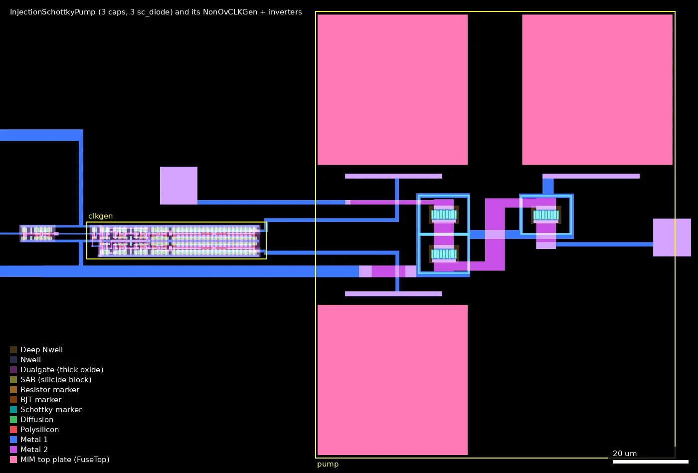
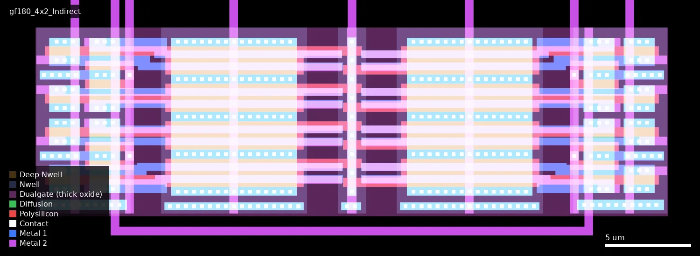
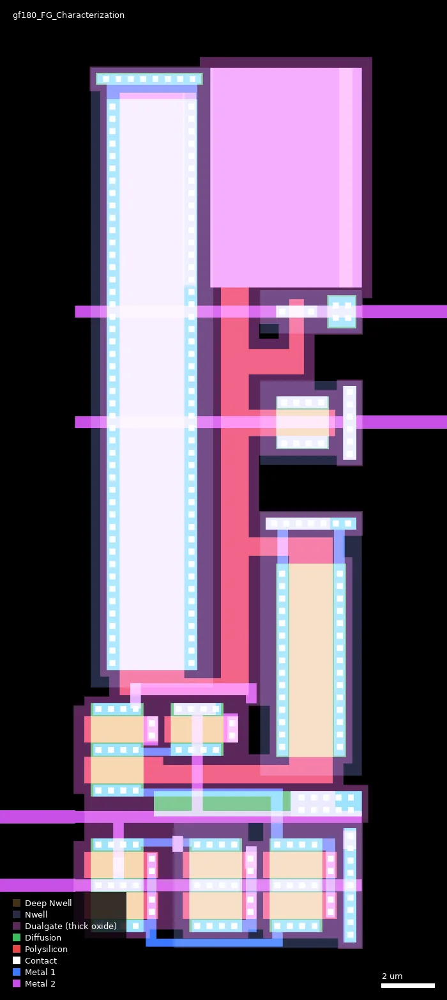
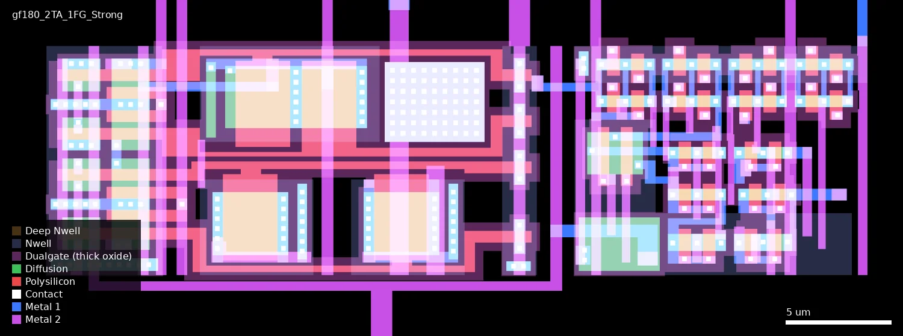
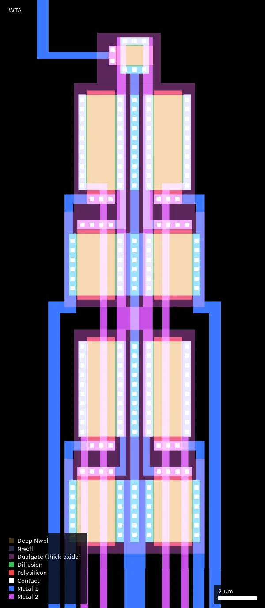
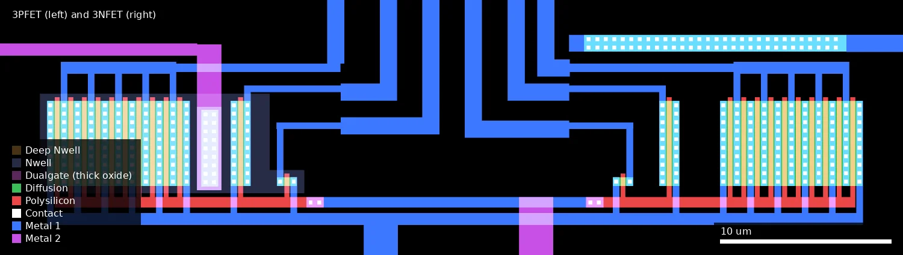

# 0000: ICELab Test Chip (ws-run2)

| | |
|---|---|
| Repository | https://github.com/GTIceLab/ASHES-GF180nm @ 8c360e2 (`main`, last commit 2026-09-10) |
| Slot | 1x0p5 |
| Top cell | chip_top |
| Licence in repo | None at the taped-out commit (audit: no LICENSE file, no SPDX headers). A LICENSE (Apache-2.0 per GitHub) was added later in `e64a178`, 2026-10-08, by Luke Hanks; the repo is now at `0727b33` (2026-10-12) |
| README | Missing (no README anywhere in the tree) |
| Taped-out layout | 0000_chip_top_6_7, 3932 x 2531 um, 1 placement on the G802 reticle |
| Commit used for the comparison | `8c360e2` (cloned HEAD); `designs.csv` taped-out commit `8c360e2ad484` (identical). `TrueFinalGds/chip_top.gds` XORs to zero against the OAS on every non-fill layer |

## What the repo actually contains

An analog test chip from the Georgia Tech ICE Lab carrying floating-gate (FG) circuits,
charge pumps to program them, and plain transistor characterisation cells. The GitHub
description calls the repo an "open-source GF180nm standard cell library" for the lab's ASHES
analog synthesis tool; "standard cells" here means fixed-pitch analog cells, not digital logic.

Flow: xschem schematics, magic layouts (`.mag`, tech `gf180mcuD`), KLayout DRC with the stock
PDK deck (`.lyrdb` files) and KLayout LVS (`.lvsdb`, for two cells). Top-level assembly was
done by hand in a layout editor; `2_Tools/` holds an experiment with the lab's `ashes_fg`
Python place-and-route (qrouter) on three cells only.

Tree:

- `1_Design/GF180_cells/`: one directory per cell (list below), plus loose
  `gf180mcu_fd_sc_mcu7t5v0__inv_1/inv_4/filltie.gds`, `SchottkyDiode.gds`, `hh_model_v5.mag`.
- `1_Design/Tapeouts/WaferSpaceShuttleRun2/`: `TrueFinalGds/chip_top.gds` (94 MB),
  `chip_top_filled.gds`, `chip_top_prefill.gds`, earlier `FinalGds/` and `PrecheckTesting/`
  versions, and `FinalGds/chip_top.lyrdb` (764 rule categories, 0 violations).
- `2_Tools/lib/`: `class_lib_GF180.py` (ASHES cell classes `TunnelingChargePump`,
  `SchottkyDiode`), cell GDS copies, `layer_map/gf180mcuD.json`, `tech_lef/gf180mcuD.lef`.
  `2_Tools/run_syn/`: a three-instance ASHES test (`chip.py`, generated `chip.v`, qrouter DEF).
- `3_Examples/`: onboarding material: an inverter schematic, NMOS and PMOS `nfet_03v3`/
  `pfet_03v3` I-V testbenches, and a copy of the 4x2 FG array layout.

What is on the die (cell hierarchy of `TrueFinalGds/chip_top_prefill.gds`; the taped-out layout has the same cells, see below):

| Cell | Function |
|---|---|
| `gf180_4x2_Indirect` | 4x2 array of indirectly programmed floating-gate pFETs |
| `gf180_FG_Characterization` | Single FG test cell with its capacitors broken out |
| `gf180_2TA_1FG_Strong` | Two transconductance amplifiers with FG-programmed bias/offset (4 floating gates) |
| `WTA` | 4-input winner-take-all current circuit (9 thick-oxide NFETs) |
| `3NFET`, `3PFET` | Three `nfet_03v3` and three `pfet_03v3` of different sizes (layout: 0.5/0.28, 5/0.28 and 10 parallel 5/0.28 fingers each) |
| `HVSchottkyPump`, `TunnelingSchottkyPump`, `InjectionSchottkyPump` | Dickson charge pumps: `sc_diode` Schottky diodes + `cap_mim` (layout: 5 caps / 5 `sc_diode` cells, 4/4, 3/3) |
| `NonOvCLKGen` x3 | Non-overlapping two-phase clock generator from `gf180mcu_fd_sc_mcu7t5v0` cells (`nor2_1`, `inv_4`, `inv_20`, `clkbuf_2`, `clkinv_1`), one per pump |
| loose `inv_1`/`inv_4` | 7-track inverters (purpose not documented) |
| Pad frame | 54 `gf180mcu_fd_io__asig_5p0`, 2 custom `gf180mcu_fd_io__bare`, 8 `dvdd`, 8 `dvss`, wafer.space ID/logo cells, seal ring |

Present but not on the die: `hh_model_v5.mag` (a Hodgkin-Huxley neuron model built around the
4x2 array with MIM caps), `HVPump`, `InjectionChargePump`, `TunnelingChargePump` (earlier
junction-diode versions of the pumps).

Verification present: KLayout DRC databases for every cell and for the top level, all with
zero violations against the unmodified `gf180mcu.drc` from the ciel-installed PDK. LVS
databases for `NonOvCLKGen` and `InjectionSchottkyPump` (results not parsed). No LVS for the
FG cells or top level. No simulation outputs. No silicon data.

## Taped-out layout

Measured from `layout/0000.oas` (reticle cell `0000_chip_top_6_7`, one placement on G802 at 12.036 mm, 18.197 mm) with KLayout; connectivity from a hierarchical `LayoutToNetlist` extraction over Metal1-5, Via1-4 and the MIM top plate (devices are not extracted, so the pump diode chains and every transistor channel are open circuits in that netlist).

| Fact | Value |
|---|---|
| Die (top cell) | 3932 x 2531 um |
| Pads | 56 signal pads: 54 `gf180mcu_fd_io__asig_5p0` (ESD, Poly2 + Dualgate + DIODE_MK present) and 2 `gf180mcu_fd_io__bare` (no Poly2, no Dualgate, no DIODE_MK marker); plus 8 `dvdd`, 8 `dvss`, 4 `cor`, 664 fill cells. Pad plates are 60 x 60 um Metal5 openings. |
| Pad labels | Template names only (`bidir_PAD[0..45]`, `input_PAD[0..3]`, `analog_PAD[0..3]`, `clk_PAD`, `rst_n_PAD`, 8x `VDD`, 8x `VSS`); the table below says what each really drives |
| Standard cells | `gf180mcu_fd_sc_mcu7t5v0`: 40 logic placements (12 `clkbuf_2`, 10 `inv_4`, 6 `inv_20`, 6 `nor2_1`, 3 `clkinv_1`, 3 `inv_1`) + 10 fill/tap; no SRAM |
| Custom analog cells | `gf180_4x2_Indirect`, `gf180_2TA_1FG_Strong`, `gf180_FG_Characterization`, `WTA`, `3NFET`, `3PFET`, 3 pumps (`cap_mim` 40 x 40 um top plate, `sc_diode`), 3 `NonOvCLKGen` |
| Special layers in use | DNWELL 12/0 (12 shapes), Schottky marker 241/0 (12 shapes), MIM top 75/0 (12 plates, 19 200 um2), Dualgate 55/0 on every FG/OTA/WTA gate, V5_XTOR 112/1 on the 16 OTA nFETs only |
| Dummy fill | 2.72 M wafer.space fill placements, seal ring, ID/logo/QR cells |

### Does it match the repository?

Yes. Repository commit compared: `8c360e2` (HEAD of `main` when cloned, 2026-09-10); `wafer.space-bench/data/designs.csv` lists the taped-out commit for 0000 as `8c360e2ad484`, the same commit. The submitted-file candidate is `1_Design/Tapeouts/WaferSpaceShuttleRun2/TrueFinalGds/chip_top.gds` (94 MB, top cell `chip_top`, 3932 x 2531 um).

- Cell list: both have 719 cells; after removing the `$n` suffixes the names are identical except the top cell (`chip_top` renamed `0000_chip_top_6_7`). The top level instances are the same 776 (54 `asig_5p0`, 2 `bare`, 8+8 power, 4 corners, 664 fill, 7 `*_FILL` cells, `sealring`, 3 ws ID cells, marker, logo, the 12 analog cells and the loose standard cells). `chip_top_prefill.gds` has 705 cells (the 7 fill cells and their children are missing); `chip_top_filled.gds` has the same top-level instance list as `chip_top.gds` (cell lists compared, not XORed).
- XOR of the OAS against `chip_top.gds`, flattened, per layer: every non-fill layer has zero XOR (Pad, Contact, Via1-4, Nwell, DNWELL, Dualgate, SAB, MIM, Schottky, markers and all text labels checked: 0 polygons, 0.000 um2), over the whole die. The fill layers differ only in datatype: the GDS keeps them on datatype 4 (22/4, 30/4, 34/4, 36/4, 42/4, 46/4, 81/4) and the OAS on datatype 0; the areas add up exactly (for example COMP: OAS 4 602 486.5 um2 = 2 219 936.5 um2 on 22/0 + 2 382 550.0 um2 on 22/4). I did not re-run the XOR with the fill datatypes merged, so "fill identical" rests on equal area and polygon counts, not on a polygon-level XOR.
- So the manufactured die is the repository's `TrueFinalGds/chip_top.gds`; the earlier "presumed" is now confirmed for the design layers. Neither the layout nor the XOR says anything about which of the other GDS variants (`FinalGds/`, `PrecheckTesting/`) was uploaded first.
- LICENSE: the audited commit has none. The repository now carries a LICENSE (Apache-2.0 per the GitHub licence API) added by Luke Hanks in `e64a178` on 2026-10-08, after the taped-out commit; one further commit exists (`0727b33`, 2026-10-12, "Added Drain Switch Schematic" by another account). The taped-out files are therefore not themselves under the licence commit, but `e64a178` is a descendant of `8c360e2`.

### Where each structure is and which pads it reaches

All positions are in die coordinates (um); box = lower-left corner and size as placed (cells with a rotated placement have their width and height swapped relative to the cell's own frame).

| Structure | Cell, box | Measured devices | Pads reached (extracted connectivity) |
|---|---|---|---|
| 4x2 FG array | `gf180_4x2_Indirect`, (1621.1, 1966.3), 37.05 x 11.06 | 8 floating Poly2 shapes (19.1 um2 each, no poly contact), each crossing a 0.45/0.55 um tunnelling junction, a 7.35/1.65 um control capacitor and two 1.8/0.55 um pFETs (16 FG pFETs, 8 tunnel junctions, 8 control caps). 4 contacted select poly lines cross 8 further 1.8/0.55 pFETs. All in Dualgate, no V5_XTOR | `Vd_P[0..3]` bidir_PAD[38,41,42,45]; `Vd_R[0..3]` bidir_PAD[39,40,43,44]; `Vg[0,1]` bidir_PAD[34,32]; `Vs[0,1]` bidir_PAD[37,30]; `Vsel[0,1]` bidir_PAD[35,31]; `VINJ[0]` and `VINJ[1]` both bidir_PAD[36]; `VTUN` bidir_PAD[33] (bare) |
| OTA + FG | `gf180_2TA_1FG_Strong`, (2984.2, 1931.2), 39.14 x 12.05 | 50 gates: 16 nFET 0.6/0.55 (V5_XTOR + Dualgate), 34 pFET (0.55-3.0 um wide, 0.45-2.6 long; Dualgate, no V5_XTOR). 4 floating polys (21-22 um2, no poly contact), each with 0.45/0.55 tunnel junction, a 3.0 x 2.6 or 2.95 x 2.6 um control cap and two 1.8/0.55 pFETs | `VIN1_PLUS/MINUS` bidir_PAD[7,6]; `VIN2_PLUS/MINUS` bidir_PAD[12,13]; `Vout1/2` bidir_PAD[25,26]; `PROG` bidir_PAD[27]; `RUN` from a loose `inv_4` whose input is PROG pad (RUN = NOT PROG); `VD_P[0,1]` bidir_PAD[38,41]; `VD_R[0,1]` bidir_PAD[39,40]; `Vg[0,1]` bidir_PAD[18,21]; `Vsel[0,1]` bidir_PAD[29,28]; `VTUN` bidir_PAD[33]; `VDD` analog_PAD[0]; `GND` VSS ring. There is no `VINJ` pin on the cell's placement: the net labelled `VINJ` inside the cell reaches no pad and no other cell |
| FG characterisation | `gf180_FG_Characterization`, (3315.8, 634.9), 11.35 x 33.9 (rotated) | 13 gates, all Dualgate: 5 nFET 2/1, 5 pFET 2/1, pFET 0.45/0.55 (tunnelling junction), 7.35/1.65 (control cap), 21.7/2.45 (large cap). One floating poly (150.5 um2, no poly contact) carries the tunnel junction, both caps and two of the 2/1 pFETs; the other 8 2/1 devices have contacted gates | `Vpoly` bidir_PAD[18]; `Vgate` bidir_PAD[21]; `Vd` bidir_PAD[19]; `Vs` bidir_PAD[20]; `Vref` bidir_PAD[22]; `Vlarge` bidir_PAD[23]; `V2` bidir_PAD[24]; `Vout` bidir_PAD[15]; unlabelled pin = bidir_PAD[16] (almost certainly `VINJ`) and bidir_PAD[33] (`VTUN`); `VDD` analog_PAD[0]; `GND` VSS |
| WTA | `WTA`, (2229.1, 721.1), 9.6 x 28.2 (rotated) | 9 nFETs, all Dualgate, no V5_XTOR: 4x 5.0/1.5, 4x 3.25/2.0, 1x 1.5/1.0 | `Vin<0..3>` bidir_PAD[6,7,12,13] (shared with the OTA inputs); `Bias<0..3>` bidir_PAD[9,8,11,10]; `Vbias` bidir_PAD[14]; `Vmid` has no pad; `GND` VSS |
| 3 NFETs | `3NFET`, (1074.4, 658.8), 17.4 x 11.4 | 12 fingers, all thin oxide, no Dualgate: 1x 0.5/0.28, 1x 5/0.28, 10x 5/0.28 in parallel (50/0.28 total) | `Vd_Small/Med/Large` bidir_PAD[5,4,3]; `Vg` bidir_PAD[2]; `Vs` bidir_PAD[1]; `GND` VSS |
| 3 PFETs | `3PFET`, (1043.3, 658.8), 17.7 x 10.6 | same 12 fingers (0.5/0.28, 5/0.28, 10x 5/0.28) in an Nwell, no Dualgate | `Vd_Small` clk_PAD; `Vd_Med` rst_n_PAD; `Vd_Large` bidir_PAD[0]; `Vg` bidir_PAD[2] and `Vs` bidir_PAD[1] (the same two pads as the NFETs); `VDD` (well) analog_PAD[0] |
| Injection pump | `InjectionSchottkyPump`, (780.0, 938.2), 95.8 x 118.5 | 3 `cap_mim` (40 x 40 um top plate), 3 `sc_diode` cells (one stage of 2 in parallel, one of 1) | `Vin` input_PAD[1]; **`Vout` input_PAD[3]**; `GND` VSS; clock from the clock generator below |
| Tunnelling pump | `TunnelingSchottkyPump`, (780.0, 1509.4), 95.8 x 118.5 | 4 `cap_mim`, 4 `sc_diode` (2+2) | `Vin` input_PAD[1]; **`Vout` analog_PAD[1]**; `GND` VSS |
| HV pump | `HVSchottkyPump`, (780.0, 1343.2), 150.0 x 118.5 | 5 `cap_mim`, 5 `sc_diode` (2+2+1) | `Vin` input_PAD[1]; **`Vout` input_PAD[0] (bare pad)**; `GND` VSS |
| Clock generators | `NonOvCLKGen` (y 991.5, Injection), `NonOvCLKGen$1` (y 1396.5, HV), `NonOvCLKGen$3` (y 1562.8, Tunnelling), each at x 719.8, 47.1 x 8.7 | `nor2_1`, `inv_4`, `inv_20`, `clkbuf_2`, `clkinv_1`; each is fed by a loose `inv_1` (3.1 x 4.8 um at x 701.0) followed by a loose `inv_4` (6.5 x 4.8 um at x 704.4) | clock input (`inv_1` input): Injection input_PAD[2], HV analog_PAD[3], Tunnelling analog_PAD[2]; `VDD` analog_PAD[0]; `VSS` ring |
| Bare pads | `gf180mcu_fd_io__bare` x2: left (26.0, 1156.8), 350 x 75.3 (rotated) and top (2250.8, 2155.0), 75.3 x 350 | no Poly2, no Dualgate, no DIODE_MK; still has Nwell/Pplus/Nplus shapes (8/38/8) | input_PAD[0] = HV pump output; bidir_PAD[33] = common `VTUN` of 4x2, OTA and FG-char |

Sharing is heavy, so only subsets can be measured at the same time. Pad sharing found in the extraction: bidir_PAD[1] and [2] drive both the NFET and PFET triplet (source and gate common; drains separate, so only one polarity can be driven at a time with the other's drains floating); bidir_PAD[6,7,12,13] feed both the OTA inputs and the WTA inputs; bidir_PAD[18,21] are `Vg[0,1]` of the OTA and `Vpoly`/`Vgate` of the FG-char cell; bidir_PAD[38-41] are shared by the 4x2 and OTA drains; bidir_PAD[33] is `VTUN` for all three FG cells. `bidir_PAD[17]` reaches nothing. The digital `VDD` ring reaches nothing: every analog cell and the clock generators take their supply from analog_PAD[0] (an `asig_5p0` pad with ESD, not a supply pad), and their ground from the shared VSS ring.

**Pad table.** Pad centres are the label positions on the Metal5 pad plates; "terminals" are the structure pins in the same extracted net. Method: LayoutToNetlist over Metal1-5, Via1-4 (Via4 landing on a MIM top plate treated as plate-to-Metal5), net names from the labels on those layers; every pad net was checked to be separate from every other pad net and from VSS/VDD.

| Pad label | Pad centre (x, y) um | Terminals reached (extracted, metal + vias) |
|---|---|---|
| `VSS` | 2804.5, 2473.0 | 3NFET.GND; HVpump.GND_w; InjPump.GND_w; NonOvCLKGen.GND (x3); TunPump.GND_w; WTA.GND; 2TA.GND; FGchar.GND; inv_1.VSS (x3); inv_4.VSS (x4) |
| `analog_PAD[0]` | 58.0, 1758.5 | 3PFET.VDD; NonOvCLKGen.VDD (x3); 2TA.VDD; FGchar.VDD; inv_1.VDD (x3); inv_4.VDD (x4) |
| `analog_PAD[1]` | 58.0, 1617.5 | TunPump.Vout_e |
| `analog_PAD[2]` | 58.0, 1476.5 | inv_1 input (clock-gen driver) |
| `analog_PAD[3]` | 58.0, 1335.5 | inv_1 input (clock-gen driver) |
| `bidir_PAD[0]` | 740.5, 58.0 | 3PFET.Vd_Large |
| `bidir_PAD[1]` | 869.5, 58.0 | 3NFET.Vs; 3PFET.Vs |
| `bidir_PAD[2]` | 1256.5, 58.0 | 3NFET.Vg; 3PFET.Vg |
| `bidir_PAD[3]` | 1385.5, 58.0 | 3NFET.Vd_Large |
| `bidir_PAD[4]` | 1514.5, 58.0 | 3NFET.Vd_Med |
| `bidir_PAD[5]` | 1643.5, 58.0 | 3NFET.Vd_Small |
| `bidir_PAD[6]` | 1772.5, 58.0 | WTA.Vin<0>; 2TA.VIN1_MINUS |
| `bidir_PAD[7]` | 1901.5, 58.0 | WTA.Vin<1>; 2TA.VIN1_PLUS |
| `bidir_PAD[8]` | 2030.5, 58.0 | WTA.Bias<1> |
| `bidir_PAD[9]` | 2159.5, 58.0 | WTA.Bias<0> |
| `bidir_PAD[10]` | 2288.5, 58.0 | WTA.Bias<3> |
| `bidir_PAD[11]` | 2417.5, 58.0 | WTA.Bias<2> |
| `bidir_PAD[12]` | 2546.5, 58.0 | WTA.Vin<2>; 2TA.VIN2_PLUS |
| `bidir_PAD[13]` | 2675.5, 58.0 | WTA.Vin<3>; 2TA.VIN2_MINUS |
| `bidir_PAD[14]` | 3062.5, 58.0 | WTA.Vbias |
| `bidir_PAD[15]` | 3191.5, 58.0 | FGchar.Vout |
| `bidir_PAD[16]` | 3320.5, 58.0 | FGchar.VINJ (unlabelled) |
| `bidir_PAD[17]` | 3449.5, 58.0 | (none) |
| `bidir_PAD[18]` | 3874.0, 771.5 | 2TA.Vg[0]; FGchar.Vpoly |
| `bidir_PAD[19]` | 3874.0, 912.5 | FGchar.Vd |
| `bidir_PAD[20]` | 3874.0, 1053.5 | FGchar.Vs |
| `bidir_PAD[21]` | 3874.0, 1194.5 | 2TA.Vg[1]; FGchar.Vgate |
| `bidir_PAD[22]` | 3874.0, 1335.5 | FGchar.Vref |
| `bidir_PAD[23]` | 3874.0, 1476.5 | FGchar.Vlarge |
| `bidir_PAD[24]` | 3874.0, 1617.5 | FGchar.V2 |
| `bidir_PAD[25]` | 3874.0, 1758.5 | 2TA.Vout1 |
| `bidir_PAD[26]` | 3449.5, 2473.0 | 2TA.Vout2 |
| `bidir_PAD[27]` | 3320.5, 2473.0 | 2TA.PROG; inv_4 input (drives RUN) |
| `bidir_PAD[28]` | 3191.5, 2473.0 | 2TA.Vsel[1] |
| `bidir_PAD[29]` | 3062.5, 2473.0 | 2TA.Vsel[0] |
| `bidir_PAD[30]` | 2675.5, 2473.0 | 4x2.Vs[1] |
| `bidir_PAD[31]` | 2546.5, 2473.0 | 4x2.Vsel[1] |
| `bidir_PAD[32]` | 2417.5, 2473.0 | 4x2.Vg[1] |
| `bidir_PAD[33]` | 2288.5, 2473.0 | 2TA.VTUN; 4x2.VTUN; FGchar.VTUN (unlabelled) |
| `bidir_PAD[34]` | 2159.5, 2473.0 | 4x2.Vg[0] |
| `bidir_PAD[35]` | 2030.5, 2473.0 | 4x2.Vsel[0] |
| `bidir_PAD[36]` | 1901.5, 2473.0 | 4x2.VINJ[0]; 4x2.VINJ[1] |
| `bidir_PAD[37]` | 1772.5, 2473.0 | 4x2.Vs[0] |
| `bidir_PAD[38]` | 1643.5, 2473.0 | 2TA.VD_P[0]; 4x2.Vd_P[0] |
| `bidir_PAD[39]` | 1514.5, 2473.0 | 2TA.VD_R[0]; 4x2.Vd_R[0] |
| `bidir_PAD[40]` | 1385.5, 2473.0 | 2TA.VD_R[1]; 4x2.Vd_R[1] |
| `bidir_PAD[41]` | 1256.5, 2473.0 | 2TA.VD_P[1]; 4x2.Vd_P[1] |
| `bidir_PAD[42]` | 869.5, 2473.0 | 4x2.Vd_P[2] |
| `bidir_PAD[43]` | 740.5, 2473.0 | 4x2.Vd_R[2] |
| `bidir_PAD[44]` | 611.5, 2473.0 | 4x2.Vd_R[3] |
| `bidir_PAD[45]` | 482.5, 2473.0 | 4x2.Vd_P[3] |
| `clk_PAD` | 482.5, 58.0 | 3PFET.Vd_Small |
| `input_PAD[0]` | 58.0, 1194.5 | HVpump.Vout_e |
| `input_PAD[1]` | 58.0, 1053.5 | HVpump.Vin_w; InjPump.Vin_w; TunPump.Vin_w |
| `input_PAD[2]` | 58.0, 912.5 | inv_1 input (clock-gen driver) |
| `input_PAD[3]` | 58.0, 771.5 | InjPump.Vout_e |
| `rst_n_PAD` | 611.5, 58.0 | 3PFET.Vd_Med |

The pumps' outputs are not wired to `VTUN` or `VINJ` on chip: each goes to its own pad (HV pump output on the bare pad input_PAD[0], tunnelling pump on analog_PAD[1], injection pump on input_PAD[3]), so the on-chip pumps can only feed the floating-gate cells through a board-level or probe-level connection to bidir_PAD[33] (`VTUN`) or bidir_PAD[36] (4x2 `VINJ`). Likewise the pump diode chains were not traced through the devices; the Vin/Vout/clock pad assignment above is the metal-level result.

![The clock generator and the loose `inv_1` and `inv_4` of the injection pump (x 699-769, y 990-1002): the inverters buffer the pad (input_PAD[2]) into `CLK_IN`.](images/clkgen.webp)

## Authors and affiliations

| Person / organisation | Role | Affiliation | Source |
|---|---|---|---|
| Luke Hanks (GitHub `LH220`) | Sole committer (11 commits, 2026-07-06 to 2026-09-10): cells, pumps, routing, final GDS | Georgia Tech ICE Lab (repo is in the lab's org; personal profile states nothing) | `git shortlog`, `gh api repos/GTIceLab/ASHES-GF180nm/contributors` |
| GTIceLab | Owning organisation: "Integrated Computational Electronics Laboratory at Georgia Tech", blog `hasler.ece.gatech.edu` | Georgia Institute of Technology | `gh api orgs/GTIceLab` |
| "Ike" | Directory `1_Design/GF180_cells/Ike/` holds the 3NFET/3PFET cells; presumably a second designer (inferred from the directory name only) | not stated | directory name |

## Value for GF180MCU characterisation and PDK development

### Verdict: High

Purpose-built characterisation silicon for a device the PDK does not offer (a floating-gate
transistor with injection and tunnelling), plus Schottky-diode charge pumps, bare MOSFETs of
three sizes and a custom ESD-less pad, all on analog pads. The limitation is documentation:
there is no pad map, model or test plan in the repo (the pad map is now traced from the layout, see above; the pumps' outputs are on separate pads rather than wired to the FG cells).

### Test structures and measurable circuits

How the floating gate is built (measured on the taped-out layout and cross-read with `4x2_Indirect/gf180_4x2_Indirect.mag`; the geometry below is measured, the functional name of each well (injection, control gate, tunnelling) is still inferred from geometry and pin names):

- The FG cells use only standard layers: Nwell 21/0, COMP 22/0, Poly2 30/0, Pplus 31/0, Nplus 32/0,
  Contact, Metal1-3 and Dualgate 55/0 (thick oxide; confirmed on every gate of the 4x2, OTA, FG-char and WTA cells). No DNWELL, SAB, MIM or V5_XTOR in the 4x2, FG-char or WTA cells (V5_XTOR is only on the 16 OTA nFETs). DNWELL, the Schottky marker and MIM exist only in the pumps. In magic the gate regions are `mvpmos`/`hvpmos`, which extract as `pfet_06v0`.
- Each floating gate is one Poly2 shape of 19.1 um2 with **no poly contact** (checked: 8 floating shapes in the 4x2 cell, 4 in the OTA, 1 in the FG-char cell), crossing
  three separate n-wells:
  1. a transistor well: two thick-oxide pFETs, each W = 1.8 um, L = 0.55 um, sharing the
     floating gate (one for hot-electron injection programming, one in the signal path:
     "indirect" programming), drains on `Vd_P[]` and `Vd_R[]`;
  2. a wide well: a 7.35 um x 1.65 um poly-over-COMP MOS capacitor acting as the control gate
     (`Vg[]`);
  3. a narrow well shared by both columns: a 0.45 um x 0.55 um poly-over-COMP junction for
     Fowler-Nordheim tunnelling (`VTUN`).
- Four contacted select poly lines (`Vsel[0..1]`), crossing eight 1.8/0.55 pFETs, gate the rows (the draft said four select pFETs). Array pins: `Vd_P[0..3]`,
  `Vd_R[0..3]`, `Vg[0..1]`, `Vs[0..1]`, `Vsel[0..1]`, `VINJ[0..1]`, `VTUN`. Cell size 37 x 11 um.
- DRC: zero violations on the stock deck for the cell (`gf180_4x2_Indirect.lyrdb`,
  `_magic.lyrdb`) and for the full chip. No waivers were needed or recorded.

| Structure | Parameter exercised | Access | Repo path | Simulation available |
|---|---|---|---|---|
| `gf180_4x2_Indirect` (8 FG pFETs) | Thick-oxide (Dualgate) gate-oxide tunnelling current versus voltage, hot-electron injection efficiency of `pfet_06v0`-type devices at L = 0.55 um, charge retention, control-gate coupling ratio, cell-to-cell mismatch | 17 analog pins (above); pads traced, see the pad table (bidir_PAD[30-45]) | `1_Design/GF180_cells/4x2_Indirect/` (`.mag`, `.gds`); no schematic | None |
| `gf180_FG_Characterization` | The same FG elements isolated: tunnelling junction (0.45/0.55 um), control-gate capacitor (7.35/1.65 um), a large 21.7 um x 2.45 um capacitor, five 2/1 um `pfet_06v0` and five 2/1 um `nfet_06v0`; the pin `Vpoly` does **not** contact the floating poly: that poly (150.5 um2, carrying the tunnel junction, both caps and two of the 2/1 pFETs) has no poly contact, so the cell measures the capacitors and the contacted 2/1 devices but the FG node itself is only reachable through the capacitors; of the ten 2/1 devices, eight have contacted gates and two share the floating poly | `Vpoly` bidir_PAD[18], `Vgate` [21], `Vlarge` [23], `VTUN` [33], `VINJ` [16, unlabelled], `Vd` [19], `Vs` [20], `Vref` [22], `V2` [24], `Vout` [15], `VDD` analog_PAD[0], `GND` VSS | `1_Design/GF180_cells/FGCharacterization/` (`.sch`, `_magic.gds`) | Schematic only; FG elements are drawn as `pfet_06v0` |
| `3NFET` | `nfet_03v3` Id-Vg / Id-Vd, Vth, leakage at W/L = 0.5/0.28, 5/0.28 and 10 x 5/0.28 um (thin oxide; layout confirms these sizes and no Dualgate) | `Vg` bidir_PAD[2], `Vs` [1], `GND`; drains `Vd_Small/Med/Large` on bidir_PAD[5/4/3]; `Vg` and `Vs` are shared with the PFET cell | `1_Design/GF180_cells/Ike/3NFETs.gds`, `drc.mag` | `3_Examples/FET_Characterization/NMOS_testbench.sch` (deck only, no results) |
| `3PFET` | `pfet_03v3`, same three sizes | `Vg` bidir_PAD[2], `Vs` [1] (shared with the NFETs); drains `Vd_Small/Med/Large` on clk_PAD / rst_n_PAD / bidir_PAD[0]; well `VDD` analog_PAD[0] | `Ike/3PFETs.gds`, `pdrc.mag` | `PMOS_testbench.sch` (deck only) |
| `InjectionSchottkyPump` | PDK `sc_diode` forward drop and reverse leakage (each cell: Schottky marker 6.84 x 2.32 um over five Nplus fingers in a DNWELL; the stage multiplicity of the draft, m = 4, is not what the layout shows: 1 or 2 cells per stage), `cap_mim_2f0fF` 40 um x 40 um, pump output versus clock frequency and load; 3 MIM caps and 3 `sc_diode` cells (layout) | `Vin` input_PAD[1], `Vout` input_PAD[3], `GND`; clock: pad input_PAD[2] -> loose `inv_1` -> `inv_4` -> `NonOvCLKGen` | `1_Design/GF180_cells/InjectionSchottyPump/` (`.sch`, `.spice`, `.gds`, LVS runs) | Netlist only |
| `TunnelingSchottkyPump`, `HVSchottkyPump` | As above with more stages (4 and 5 MIM caps); exercises MIM and Schottky/DNWELL breakdown limits. The outputs are not wired to the FG cells: Tunnelling pump `Vout` is analog_PAD[1], HV pump `Vout` is the bare pad input_PAD[0] (extracted connectivity) | `Vin` input_PAD[1] (common to all three pumps); clock pads HV analog_PAD[3], Tunnelling analog_PAD[2] | `2_Tools/lib/gds/FinalPumps/*.gds`; `.sch` in `HVPump/` and `TunnelingChargePump/` describe the older `diode_pd2nw_06v0` versions | `TunnelingChargePump_TB.sch` (older version, deck only) |
| `NonOvCLKGen` | `gf180mcu_fd_sc_mcu7t5v0` cell delay (non-overlap time), drive of `inv_20` into MIM load | `CLK_IN` from the loose `inv_4` (input pad via `inv_1`: input_PAD[2] / analog_PAD[3] / analog_PAD[2]); `PHI1/2` internal to the pump | `1_Design/GF180_cells/NonOvCLKGen/` (schematic, testbench, DRC, LVS) | `NonOvCLKGen_TB.sch`, extracted `NonOvCLKGen.spice` (no results) |
| `gf180_2TA_1FG_Strong` | Two OTAs (16 nFET 0.6/0.55 with V5_XTOR and 34 pFET with Dualgate in the layout; 4 floating gates) with FG-set bias: transconductance, offset programmability, FG retention in a circuit | `VIN1_PLUS/MINUS` bidir_PAD[7,6], `VIN2_PLUS/MINUS` [12,13], `Vout1/2` [25,26], `PROG` [27], `RUN` (= NOT PROG via a loose `inv_4`), `VD_P[0..1]` [38,41], `VD_R[0..1]` [39,40], `Vg[0..1]` [18,21], `Vsel[0..1]` [29,28], `VTUN` [33], `VDD` analog_PAD[0]; `VINJ` is not routed to any pad | `1_Design/GF180_cells/2TA/` (`.sch`, `.mag`, `.gds`) | Schematic only |
| `WTA` | Thick-oxide NFET matching and subthreshold behaviour (devices 5/1.5 x4, 3.25/2.0 x4, 1.5/1.0 x1 um, confirmed, all Dualgate) | `Vin<0..3>` bidir_PAD[6,7,12,13], `Bias<0..3>` [9,8,11,10], `Vbias` [14], `GND`; `Vmid` is not routed to a pad | `2_Tools/lib/gds/WTA.gds` only | None |
| `gf180mcu_fd_io__bare` pads (x2) | Pad capacitance and leakage without ESD devices; tolerance of the pad stack to programming voltages | input_PAD[0] (HV pump output) and bidir_PAD[33] (`VTUN`) | `1_Design/GF180_cells/BarePad/` | None |

Voltage domains (confirmed by Dualgate overlap): FG, OTA and WTA cells use the thick-oxide devices (all gates inside Dualgate); `3NFET`/`3PFET` use
3.3 V thin oxide (no Dualgate); the clock generators use the 7-track 5 V standard cells. Everything is supplied from analog_PAD[0] and the VSS ring, and several pads are shared between structures (see the pad table), so measurements must be sequenced.

### Candidate PDK additions

- **Floating-gate pFET cell.** A complete, DRC-clean recipe for a single-poly FG memory
  element in stock GF180MCU layers (dimensions above). If silicon confirms injection and
  tunnelling, this is a candidate for a documented PDK device or parameterised cell; it would
  need a SPICE model (none exists here), an LVS recognition rule (the stock decks would see
  three `pfet_06v0` with an unconnected gate), and an antenna/floating-gate check exemption.
- **`gf180mcu_fd_io__bare`**: a 75.3 x 350 um pad cell with the standard DVDD/DVSS/VDD/VSS rail
  crossings and an `ASIG5V` pin but no Poly2, no Dualgate and no DIODE_MK marker (confirmed on the die; it keeps some Nwell/Pplus/Nplus well-tie shapes), in `.mag` and
  GDS with a clean DRC database. A high-voltage/low-capacitance analog pad is missing from
  the stock IO library.
- **Schottky diode in use.** The pumps instantiate the PDK `sc_diode` (DNWELL 12/0 + Schottky
  marker 241/0); the commit "figured out schottky diodes" (2026-07-09) indicates it took
  effort. Measured forward/reverse data would validate a device that is rarely exercised.
- **ASHES technology files**: `2_Tools/lib/layer_map/gf180mcuD.json`, `tech_lef/gf180mcuD.lef`
  and `class_lib_GF180.py` show what the lab's analog synthesis flow needs from the PDK.
- No DRC/LVS deck changes, waivers or PDK bug reports are recorded in the repo.

### What would be needed to use it

- A pad map: now traced from the layout (pad table above). Top-level labels are still only template names; the authors have not documented the map, so it is worth confirming with them.
- A programming procedure and voltage limits for injection and tunnelling (not in the repo),
  (the two bare pads are input_PAD[0] and bidir_PAD[33]).
- Equipment: semiconductor parameter analyser / SMUs with sub-pA resolution for FG charge and
  retention, a high-voltage source for `VTUN`, a clock source for the pumps. Bare-die probing
  or a package with direct analog pin access; the `asig_5p0` ESD diodes will clamp
  anything above the pad supply, so high-voltage nodes need the bare pads.
- A SPICE model or at least hand-calculated expectations for the FG cell.

## Notes and caveats

- The platform description lists three charge pumps, the 4x2 array, two transconductance
  amplifiers, an FG characterisation cell and NFET/PFET cells. The die also contains a `WTA`
  cell that is not mentioned.
- The pump schematics and `.mag` files in `HVPump/`, `InjectionChargePump/` and
  `TunnelingChargePump/` use `diode_pd2nw_06v0`; the pumps on the die are the `*SchottkyPump`
  versions, of which only the injection pump has a schematic and netlist.
- `4x2_Indirect` and `WTA` have no schematic at all. LVS was run only on the clock generator
  and injection pump.
- The submitted layout is an OASIS file; the repo holds nine GDS variants, so the hash could
  not be matched, but `TrueFinalGds/chip_top.gds` XORs to zero against the taped-out layout on every non-fill layer (fill is identical in area; it is on datatype 4 in the GDS).
- Several files carry Windows `:Zone.Identifier` side files and absolute paths under
  `/home/luha/`.
- The last commit message says "added general ASIC team onboarding information" but adds only
  the three example directories, no text.
- The FG well roles (injection/read, control gate, tunnelling) are inferred from geometry and
  pin names, consistent with the lab's published indirect-programming FG cells, but are not
  stated in the repo. Silicon measurement (or the authors) would settle it.
- Extracted connectivity covers metal, vias and the MIM top plates only; the transistor and diode channels were not traced, so net names are metal-level facts. A first extraction that treated every Via4 as Metal4-Metal5 falsely shorted the MIM plates (pump outputs to ground); this was corrected before the pad table was written.
