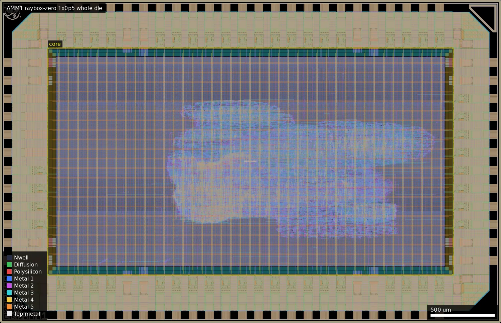
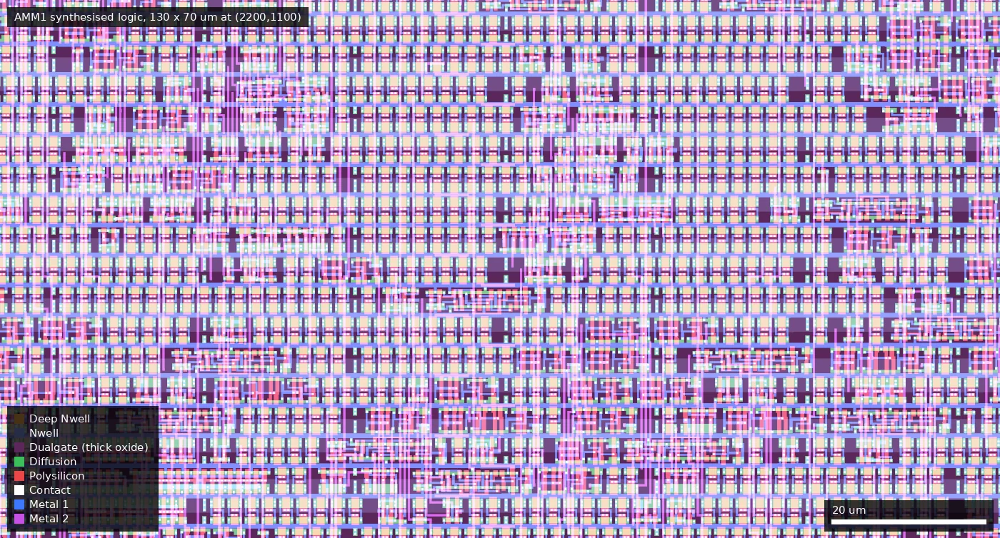
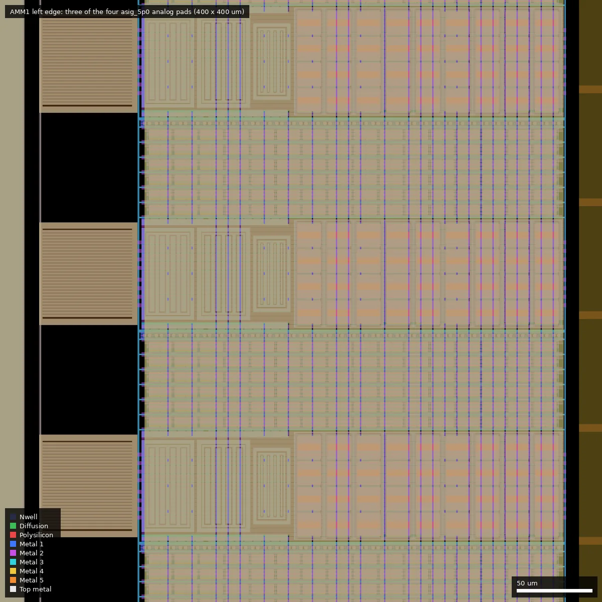

# AMM1: raybox-zero wafer.space run 2 half height (ws-run2)

| | |
|---|---|
| Repository | https://github.com/algofoogle/gf180ws2-raybox-zero @ f5bbcef (main, last commit 2026-07-15) |
| Slot | 1x0p5 |
| Top cell | chip_top |
| Licence in repo | Apache-2.0 (LICENSE) |
| README | OK (978 words, substantive) |
| Taped-out layout | AMM1_chip_top_2_6, 3932 x 2531 um, 2 placements on the G802 reticle |

## What the repo actually contains

Anton Maurovic's raybox-zero ray-casting "3D" renderer (a 32x32 map, 4 doors, 8 textures plus door texture, Q11.11 fixed point, demo mode, debug overlay) hardened on the wafer.space project template with LibreLane 3. The RTL is the submodule `src/raybox-zero` (HEAD 8d827a0, initialised and present) plus `src/chip_core.sv`, `src/rbz_options.v` (feature switches: map overlay, debug overlay, leak-fixed, SPI POV regs, map rect, doors, wait-states config) and the template `chip_top.sv`.
- Cells: `gf180mcu_fd_sc_mcu7t5v0` (5 V), `gf180mcu_fd_io` pads, no SRAM macros (texture memory is flops / optional external QSPI ROM; the PNL has no `sram` instances) and no analog blocks. Flow: `SYNTH_STRATEGY: "DELAY 2"`, `CLOCK_PERIOD: 40` (25 MHz), hold margins 0.40/0.35 with hold buffers allowed up to 70 % (the submitted PNL has about 11,400 `dlyb_1` cells).
- IO: bidir[7:0] inputs (SPI and QSPI controls), bidir[23:16] RGB222 + hsync/vsync in Tiny VGA PMOD order (`registered_vga_output` selectable by `i_reg`), bidir[15:8] QSPI texture ROM pins (Leo Moser PMOD), bidir[27:24] hblank/vblank/hmax/vmax debug, bidir[37:28] vpos, bidir[38+] unused inputs. Pads set to CMOS input, fast slew, no pulls.
- Verification: cocotb testbench `cocotb/chip_top_tb.py` with a W25Q128JV flash model and texture ROM hex files in `cocotb/texture_rom/`; RTL sim and gate-level sim flows. No DRC/LVS/STA reports are in the repo.
- Layouts: `wafer.space/` holds bz2 GDS and powered netlists for commit 4ab47b1 (1x0p5 build) and a 0p5x1 variant (added in the last commit). The platform layout is the 1x0p5 one.
- Docs: `doc/render.png`, `doc/3dscreens.png` only.

## Taped-out layout

| | |
|---|---|
| Reticle cell | `AMM1_chip_top_2_6`, 3932 x 2531 um, 2 placements on G802 (at 4.052, 15.606 mm and 8.044, 15.606 mm, both r0) |
| Pads / IO cells | 51 digital pads: 46 `gf180mcu_fd_io__bi_24t` (bidirectional), 5 `in_c`, 1 `in_s` (Schmitt; clk and rst_n plus input[3:0]); 8 `dvdd`, 8 `dvss`; 4 `asig_5p0` analog pads (`analog_PAD[0..3]`, left edge); 4 corner cells; fill 1 / 5 / 10 / nc = 226 / 22 / 414 / 20 |
| Standard cells | `gf180mcu_fd_sc_mcu7t5v0` only: 154,598 placements = 31,608 logic + 122,990 fill/tap/antenna |
| Largest cell types | `dlyb_1` 11,385 (36 % of logic cells, hold buffers), `nand2_1` 1,624, `nor2_1` 1,610, `dffq_1` 1,378, `oai21_1` 1,343, `aoi21_1` 1,305, `dlyc_1` 707, `dffnq_1` 378 |
| Flip-flops | about 1,760 (`dffq_1` + `dffnq_1`) |
| SRAM macros | none |
| Oxide | the whole core is under Dualgate 55/0 and V5_XTOR 112/1 (5 V library cells); no 3.3 V-only thin-oxide logic |
| MIM / high-res poly / DNWELL / BJT | none in the core. Layers present in the file: RES_MK, DIODE_MK, MOS_CAP_MK, ESD_MK, ISOSUB only from the IO cells and wafer.space fill; no MIM, DNWELL or BJT marker layers |
| Custom / hand-drawn | none. Only non-library content is the wafer.space logo, QR code, shuttle ID, project ID and marker cells |

*Whole die (3932 x 2531 um). The yellow box is the core area (376,376 to 3556,2155 um); the standard-cell logic occupies only a blob roughly x 1300..3400, y 670..1745 um in its middle, the rest is power grid (vertical Metal4/5 stripes) and empty rows.*

### Does it match the repository?
Yes. I extracted `wafer.space/chip_top_4ab47b1.gds.bz2` (the 1x0p5 build, committed in `f5bbcef`) and compared its top-level cell tree with the reticle cell: identical IO cell counts and sizes (46 bi_24t, 5 in_c, 1 in_s, 4 asig_5p0, 8+8 power, same fill counts, same ID/logo cells), the same 1x0p5 die size, and 154,598 mcu7t5v0 placements in both, which equals the 122,990 + 31,608 counted on the reticle. The PNL of that commit has 11,385 `dlyb_1`, equal to the layout. So the manufactured design is that commit. The repo's `src/raybox-zero` submodule HEAD was not compared cell by cell, because the netlist is flat (no module names survive), so the block-level contents (renderer, map, textures) are taken from the repo and not seen in the layout. There is no SRAM macro and no analog block, as the repo says. The `0p5x1` GDS in the repo is a different orientation and was not used.

### What the layout adds
- The design is flat synthesised logic: no macro, memory or hierarchy to point at. The 32x32 map, textures and doors are therefore in flops and gates, consistent with about 1,760 flip-flops.
- The four analog pads (`analog_PAD[3:0]`, left edge at y 1336, 1477, 1618, 1759 um) are present but the core only declares the port; nothing in the repo drives them. They are bare `asig_5p0` pads, usable as direct probe points to an ESD-protected analog pad (not designed by the project, no connection to the logic).
- The placed core is sparse (the logic blob covers roughly a third of the core box by eye).

*Detail view of standard-cell rows at (2200,1100)-(2330,1170) um: 7-track 5 V cells in rows, all inside Dualgate (thick oxide, the purple tint).*

*Left edge (0,1400)-(400,1800) um: three of the four `asig_5p0` pad cells (pad opening at left) with the IO ring's ESD structures.*

## Authors and affiliations

| Person | Role | Affiliation | Source |
|---|---|---|---|
| Anton Maurovic (algofoogle) | project author and raybox-zero author (13+1 commits) | not stated (GitHub profile: Adelaide, Australia; no company) | `git shortlog`, README, gh api |
| Leo Moser | template author (AUTHORS.md) | not stated | AUTHORS.md |

## Value for GF180MCU characterisation and PDK development

### Verdict: Low
Ordinary synthesised digital logic on stock cells with a VGA digital output. It is a yield/functional data point and a real-time visible demo; there are no dedicated test structures; the layout confirms no SRAM, MIM, resistor, DNWELL or custom cell.

### Test structures and measurable circuits
No purpose-built structures. Measurable behaviour: the whole design runs from a 25 MHz pad clock, produces a 25 MHz-class VGA pixel stream (RGB222 + syncs on bidir pads 16..23, which is a pixel-clock-rate digital output, not a timing-critical PHY). Maximum working clock versus supply, and failure of the long reciprocal paths (see timing hack) would be a coarse indicator of real delay versus STA margins. No simulation data intended for comparison with silicon is in the repo beyond RTL/GL test benches.

### Candidate PDK additions
Nothing found. Documented flow issues (not PDK defects per se): (1) a `set_false_path -through` on the 22 `rcp_fsm.operand*` nets in `librelane/chip_top.sdc` because the reciprocal chained-multiplier paths are really multicycle but the author could not express that through Yosys/ABC restructuring, which leaves surrounding logic unchecked; (2) the first hardening gave gate-level iverilog X on synchronous resets because the mapped logic used `D = ~(~q | q)` patterns (non-async-reset DFFs), worked around by `SYNTH_STRATEGY "DELAY 2"`.

### What would be needed to use it
Packaged part, 25 MHz clock source, SPI host and a VGA monitor or capture board; nothing for characterisation.

## Notes and caveats
- The timing false path means STA does not cover the reciprocal path; a silicon speed test of the chip would measure the real limit but is not a controlled measurement.
- Two layouts exist in the repo (1x0p5 and 0p5x1); the 0p5x1 one is not what was submitted.
- Hold-buffer count (11,385 `dlyb_1`) was confirmed in the layout, and matches the repo's PNL.
- Not settled: whether the false-path reciprocal logic works at 25 MHz on silicon; only a measurement answers that.
