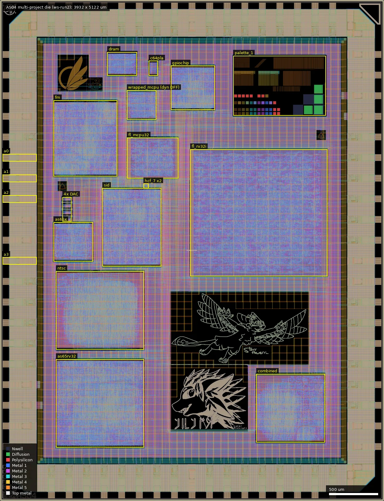
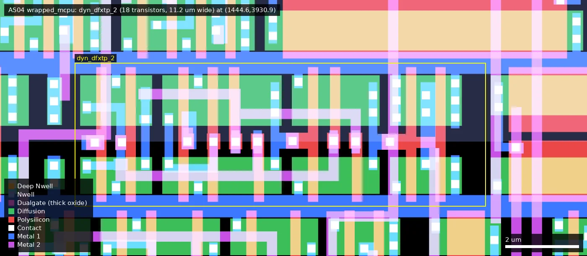
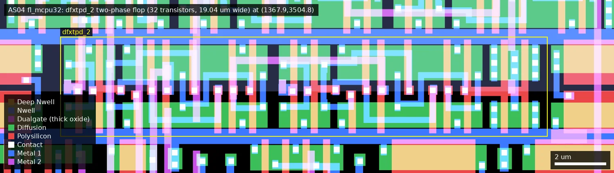
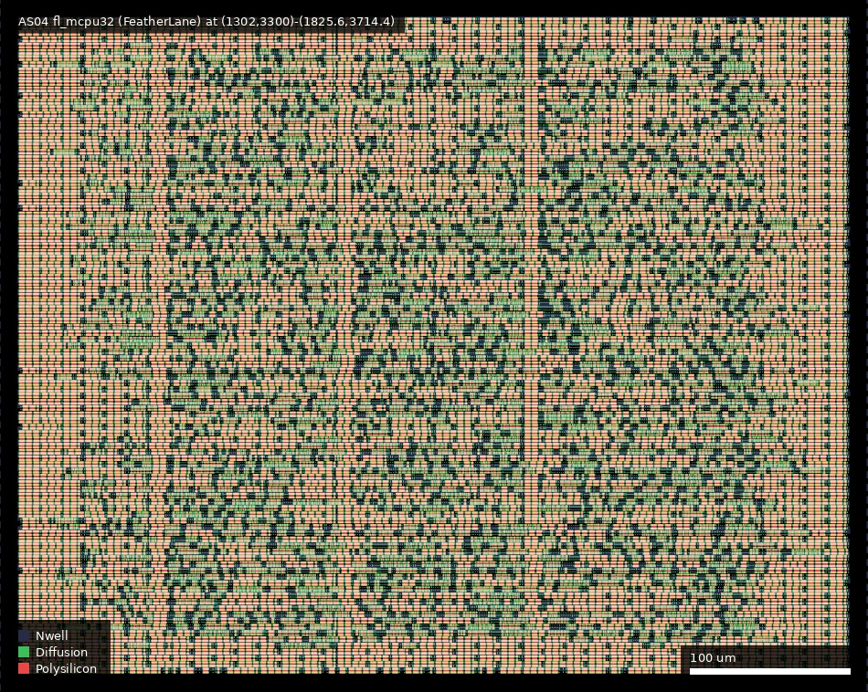
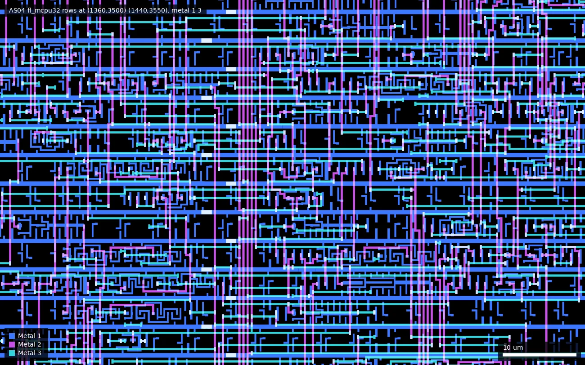
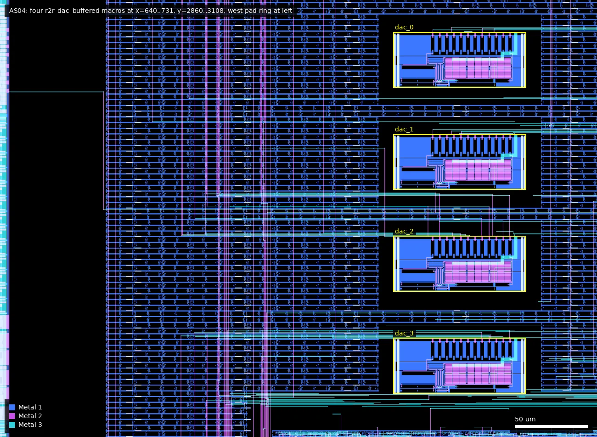
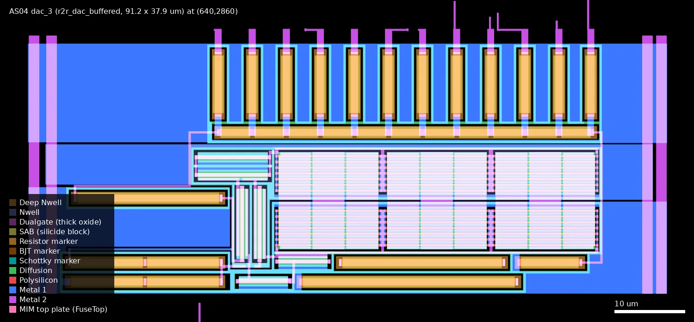
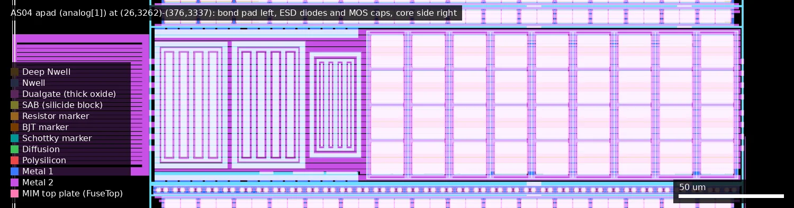
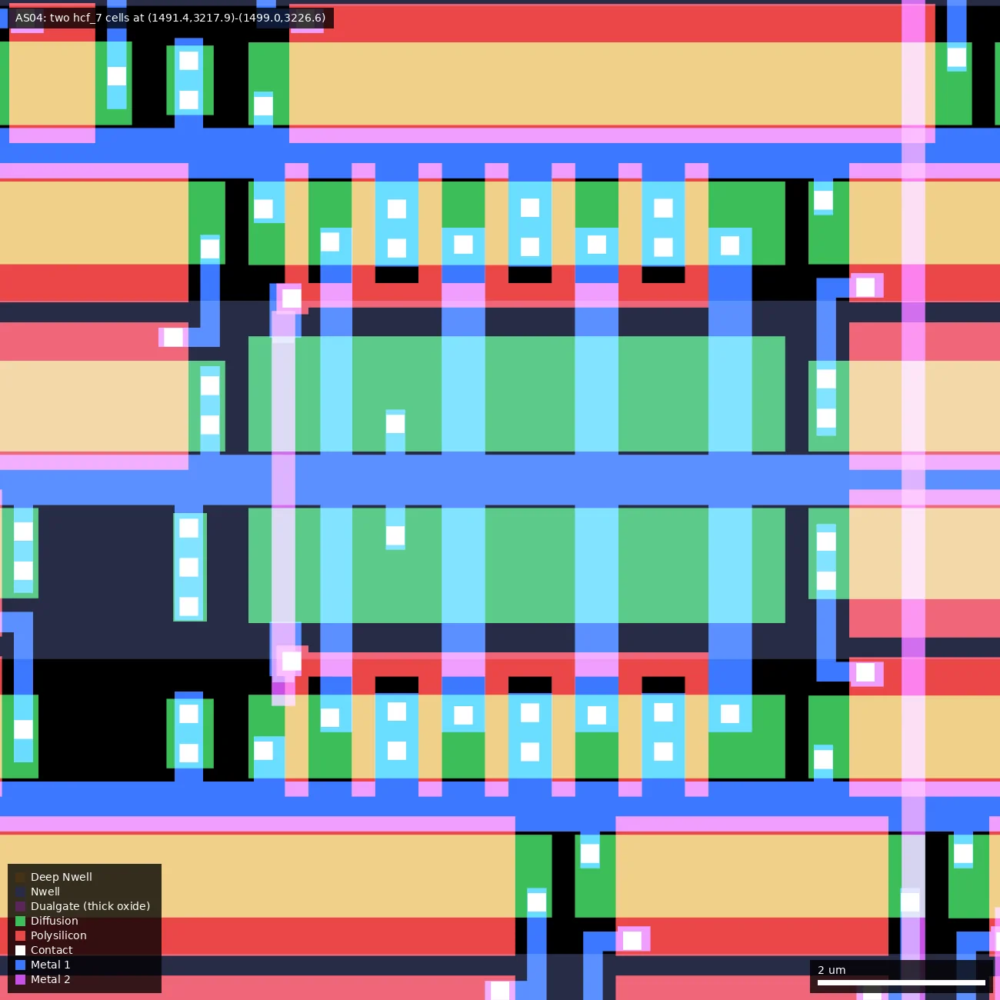
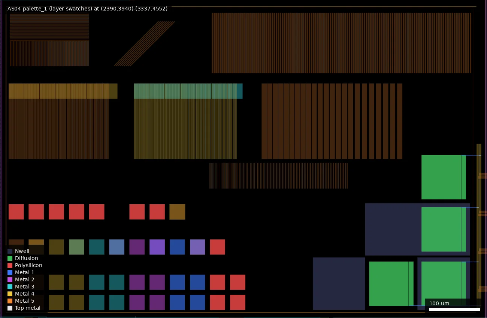

# AS04: AS04 Multi-Project die using 3.3V SCL (ws-run2)

| | |
|---|---|
| Repository | https://github.com/AvalonSemiconductors/ws-submission-2026 @ a8d7552 (main, last commit 2026-08-16; "Final version" 6705fd8 2026-07-15) |
| Slot | 1x1 |
| Top cell | chip_top |
| Licence in repo | Apache-2.0 (LICENSE) |
| README | THIN (49 words; docs in docs/source/, site avalonsemiconductors.github.io/WS2026) |
| Taped-out layout | AS04_chip_top_10_0, 3932 x 5122 um, 1 placement on the G802 reticle |

## What the repo actually contains

Successor to AS03 on the Avalon 3.3 V library. Makefile: SCL=`gf180mcu_as_sc_mcu7t3v3`, PAD=`gf180mcu_ocd_io` (level-shifting pads; VDD 3.3 V +/-10 %, DVDD separate), SRAM option `gf180mcu_ocd_ip_sram`, PDK via ciel, PDK_COMMIT d658698 (wafer-space gf180mcu fork, `--include-libraries all`). 5-bit `design_sel` mux, 46 bidir pads and 4 analog pads in 1x1. The library is not vendored (only a spice copy, `macros/Analog/r2r_dac/gf180mcu_as_sc_mcu7t3v3.spice`, 74 subckts: and/ao/aoi/buff/clkbuff/dfsrtp/dfxtn/dfxtp/dlybuff/fill/hcf_7/inv/invz/maj3/mux2/nand/nor/xor/tap...).

Sub-designs (address from `docs/source/multiplexer.rst`):

- 00000/00001 6502 core (6510/6502 pinout), macro AS65x.
- 00010/00011 RV32IMA (6510/6502 pinout), macro 65RV32.
- 00100 C64 PLA replica (C64PLA); 00101 SID replica (SID); 00110 SID 2 FM synth (FMSynth).
- 00111 Retro GPIO chip (3 DACs); 01000 Retro DRAM controller.
- 01001 "Halt and Catch Fire (do not select)": two `gf180mcu_as_sc_mcu7t3v3__hcf_7` cells instantiated in `chip_top.sv`, enabled when this address is selected and `bidir[0]` and `bidir[1]` are both high.
- 01010 MCPU32 Dynamic DFF Tester: 32-bit 4-instruction CPU (MCPU extended to 32 bits) using only dynamic DFFs, macro MCPU32, cell `wrapped_mcpu` (`excluded.cells` removes static dfxtp/dfsrtp/dlxf; the layout shows the flop used is `dyn_dfxtp_2`).
- 01011 NTSC test generator 2 (composite luma+chroma via DAC), macro NTSCTest.
- 01100 Hellorld + Diceroll + blinker, nanoprocessor, simple 8-bit CPU, secret-message stub, all in macro Combined.
- 11101 FeatherLane MCPU32 and 11110 FeatherLane RV32I: two layouts made by the external FeatherLane flow (codeberg.org/TholinVali/FeatherLane), checked in as `FeatherLaneStuff/fl_*.gds/lef/lib/mag/v` with blackbox Verilog and a SIM model. Cell names are prefixed `fl_gf180mcu_as_sc_mcu7t3v3__` (`dfxtpd_2`, mux2, clkbuff, diode, tap, filltype_*), so FeatherLane writes its own copy of this library. Both designs take a two-phase clock (PHI1 on `bidir[0]`, PHI2 on `bidir[1]`), and `dfxtpd_2` is the flop with PHI1 and PHI2 pins.
- 11111 all pads high-Z.
- Art: `art/` (palette_1, td, avali, expie, whisper, tholin; own gds/lef/lib).

Analog: `macros/Analog/r2r_dac`: 12-bit buffered R-2R DAC, 4 instances (dac_0..3) onto analog_PAD[0..3]. Extracted spice uses `nfet_03v3` (23), `pfet_03v3` (25), `ppolyf_u_1k` (31, r_width 1u): 3.3 V devices, a retune of the AS03 DAC. xschem `opamp_chonky`, `r2r_dac_bench.sch` (tran 1n 3u). The mag view has `nfet_03v3`/`pfet_03v3`/`ppolyf_u_1k` generated cells. Analog pad: `macros/Analog/pad/apad` (gds/lef/lib/mag/verilog, ports WEH and ASIG5V). In `chip_top.sv` the DAC output connects to `WEH` and `ASIG5V` is left open; in the LEF `WEH` is the core-side Metal2 pin and `ASIG5V` is the bond pad itself.

Verification: cocotb benches with committed `results.xml` (MCPU32 passes the ISA check; built on the author's machine) for 65RV32, C64PLA, Combined, DRAM, FLMCPU32, GPIO, MCPU32, NTSC, SID. Not present: final layout, DRC/LVS/STA reports, silicon data.

## Taped-out layout

| | |
|---|---|
| Die | 3932 x 5122 um, 5 metal layers (Metal5 is the top metal), one placement on G802 |
| Pads | 74: 46 `gf180mcu_ocd_io__bi_24t`, 4 `apad` (analog), 6 `gf180mcu_ocd_io__in_c` (5 design_sel + clock), 6 `dvdd`, 8 `dvss`, 2 `vdd`, 2 `vss` |
| Standard cells | 87,322 logic cells, all `gf180mcu_as_sc_mcu7t3v3`: 75,966 placed by LibreLane and 11,356 with the `fl_` prefix inside the two FeatherLane layouts |
| Flip-flops | 8,521: 4,901 `dfxtp_2`, 2,087 `dfxtn_2`, 1,337 `dfxtpd_2` (FeatherLane only), 196 `dyn_dfxtp_2` (MCPU32 tester only) |
| SRAM | none |
| Custom blocks | 4 x `r2r_dac_buffered` (91.2 x 37.9 um), 4 x `apad`, 2 FeatherLane layouts, 2 x `hcf_7`, art macros including the layer-swatch block `palette_1` |
| Transistors | all core logic and the DACs are thin-oxide 3.3 V devices (no Dualgate anywhere in the 12 logic blocks or the DAC); Dualgate appears only in the IO ring, in `apad` and as one shape in `palette_1` |

### Does it match the repository?

Yes. There is no chip-level layout in the repository, so the comparison is against the flow configuration and the hard-macro GDS files that are checked in:

- Every macro, DAC and art block is at the coordinates in `librelane/macros/macros_3v3.yaml`; pad counts match the 1x1 block of `src/slot_defines.svh`.
- `r2r_dac_buffered`, `apad`, `fl_mcpu32` and `fl_rv32i` were XORed layer by layer against the repo GDS: zero difference on every layer. `palette_1` differs only in that its NDMY marker (111/5) is absent from the taped-out cell.
- There is no Multiplexer macro on this die (AS03 had one): the multiplexer is flat in `chip_top`, 1,020 logic cells placed between the macros, including 49 `buff_16` input repeaters and the two `hcf_7` cells.
- The MCPU32 tester uses `dyn_dfxtp_2`, not `dfxtpd_2` as the earlier version of this summary guessed. `dfxtpd_2` is a different cell, used only by FeatherLane.

Whole die (0,0)-(3932,5122): the two FeatherLane layouts, the dynamic-DFF tester `wrapped_mcpu`, the other logic macros, the four DACs with their pads a0 to a3 on the west edge, the `hcf_7` pair and the `palette_1` swatch block; unmarked dark blocks are artwork.

### The gf180mcu_as_sc_mcu7t3v3 library as it is on silicon

The library is not in the repository, so these facts come from the layout.

- 75 distinct cell types are placed, 62 of them logic or sequential: and2_2/4, ao211_2/4, ao21_2/4, ao21b_2, ao22_2/4, ao31_2/4, aoi211_2/4, aoi21_2/4, aoi21b_2/4, aoi22_2/4, aoi31_2/4, buff_2/4/8/12/16, clkbuff_4/8/12, dlybuff_2, inv_2/4/6, maj3_2/4, mux2_2/4, mux4_2, nand2_2, nand2b_2/4, nand3_2, nand4_2, nor2_2/4, nor2b_2/4, nor3_2, oai211_2, oai21_2/4, or2_2/4, xnor2_2/4, xor2_2/4, dfxtp_2, dfxtn_2, dfxtpd_2, dyn_dfxtp_2, hcf_7. The rest are fill_1/2, fillcap_4/8/16, filltype_1/2/4/8 (FeatherLane), tap_2, diode_2, tieh_4, tiel_4.
- Cells named in the repo's spice copy or `excluded.cells` that are not on the die: dfsrtp_2, dfxtp_4, dlxfp_2, dlxfn_2, invz_2, nand2_4, ao21b_4, dlybuff_4, fill_4, fill_8. Cells on the die that the spice copy lacks: dfxtpd_2, dyn_dfxtp_2, mux4_2, oai21_2/4, filltype_*.
- Most used: buff_2 (11,540), mux2_2 (10,377), and2_2 (6,981), dfxtp_2 (4,901), ao22_2 (4,472), xnor2_2 (4,381). Several _4 drive strengths have fewer than ten instances (ao22_4, aoi22_4, maj3_4, xnor2_4, nand2b_4 and others); xor2_4 (33) appears only in FeatherLane.
- Cell height 3.92 um. In the cells sampled (inv_2, mux2_2, maj3_2, mux4_2, the flops) every gate is L = 0.28 um with NMOS W = 1.0 um and PMOS W = 1.38 um; dlybuff_2 also has 0.36 um NMOS and 0.59 um PMOS.
- Flops: `dfxtp_2` and `dfxtn_2` are 15.12 um wide with 26 transistors; `dyn_dfxtp_2` is 11.2 um wide with 18 transistors and a single CLK pin; `dfxtpd_2` is 19.04 um wide with 32 transistors and pins PHI1, PHI2, D, Q. Transistor count suggests `dfxtpd_2` is a static two-phase flop (six transistors more than `dfxtp_2`), but that is geometry, not a netlist.
- Two revisions of the library are on the die. The `fl_` copies of inv_2, mux2_2, and2_2 and clkbuff_8 have the same diffusion, poly, wells and implants as the LibreLane copies but differ in a few contacts and Metal1 shapes (0.07 to 1.2 um2 per cell); tap_2 and diode_2 are identical.

`dyn_dfxtp_2` in `wrapped_mcpu` at (1444.6,3930.9): nine NMOS and nine PMOS, 11.2 um wide.

`fl_gf180mcu_as_sc_mcu7t3v3__dfxtpd_2` in `fl_mcpu32` at (1367.9,3504.8): 16 NMOS and 16 PMOS, 19.04 um wide.

### Sub-designs located

| Sub-design | Cell | Box (um) | Logic cells | Flops |
|---|---|---|---|---|
| FeatherLane RV32I | `fl_rv32i` | (1950,2300)-(3352.8,3596.4) | 9,656 (+29,601 diode cells) | 1,161 `dfxtpd_2` |
| FeatherLane MCPU32 | `fl_mcpu32` | (1302,3300)-(1825.6,3714.4) | 1,700 (+4,847 diode cells) | 176 `dfxtpd_2` |
| MCPU32 dynamic-DFF tester | `wrapped_mcpu` | (1300,3900)-(1600,4200) | 2,144 | 196 `dyn_dfxtp_2`, 2 `dfxtn_2` |
| RV32IMA | `as65rv32` | (575,550)-(1475,1450) | 17,150 | 1,916 `dfxtn_2`, 2 `dfxtp_2` |
| 6502 core | `as65x` | (550,2450)-(950,2850) | 3,777 | 169 `dfxtn_2`, 1 `dfxtp_2` |
| SID | `sid` | (1050,2400)-(1650,3200) | 14,244 | 1,505 `dfxtp_2` |
| FM synth | `fm` | (550,3320)-(1200,4095) | 15,112 | 1,451 `dfxtp_2` |
| GPIO chip | `gpiochip` | (1750,4000)-(2200,4450) | 5,209 | 696 `dfxtp_2` |
| Hellorld, nanoprocessor, 8-bit CPU | `combined` | (2625,600)-(3325,1300) | 8,266 | 937 `dfxtp_2` |
| NTSC generator | `ntsc` | (575,1550)-(1475,2350) | 7,296 | 103 `dfxtp_2` |
| DRAM controller | `dram_controller` | (1100,4350)-(1400,4590) | 1,592 | 206 `dfxtp_2` |
| C64 PLA | `c64pla` | (1525,4350)-(1615,4500) | 156, of which 95 `dlybuff_2` | none |
| Multiplexer and HCF | flat in `chip_top` | between the macros | 1,020 | none |

The MCPU32 tester and FeatherLane MCPU32 implement the same CPU with different flows and flops: 2,144 cells in 300 x 300 um (LibreLane, dynamic flops, single clock) against 1,700 cells plus 4,847 antenna diodes in 523.6 x 414.4 um (FeatherLane, two-phase flops). Both FeatherLane layouts route on Metal1 to Metal4 only.

`fl_mcpu32` at (1302,3300)-(1825.6,3714.4), wells, diffusion and poly: FeatherLane's own row placement, with vertical breaks in the rows under the power straps.

Metal 1 to 3 inside `fl_mcpu32` at (1360,3500)-(1440,3550), showing FeatherLane's routing.

### DACs and analog pads

DAC cell measured from the layout (four identical instances): 48 transistors, all thin oxide: 21 NMOS and 21 PMOS gate fingers of W = 14.29 um, L = 0.3 um, 2 NMOS of W = 7 um, L = 0.6 um, 4 PMOS of W = 10 um, L = 0.6 um. 31 poly resistor bodies 1.0 um wide with SAB and no Dualgate (`ppolyf_u_1k`): 13 of 8 um (twelve 2R legs and the termination), 11 of 4 um (R), and 4 x 10 um, 1 x 20, 1 x 22.5, 1 x 30 um in the op-amp. At a nominal 1 kohm/sq that makes R = 4 kohm and 2R = 8 kohm, twice the AS03 values.

DAC-to-pad connections come from connectivity extracted over the top-level metal and via shapes. Each `OUT` reaches exactly one `apad`:

| DAC | Position (lower left) | Data input (`chip_top.sv`) | Pad | `apad` cell centre (bond pad at x about 26 to 90) | Route length |
|---|---|---|---|---|---|
| dac_0 | (640,3070) | sample_raw_1 | analog[0] | west (201,3510) | about 0.75 mm |
| dac_1 | (640,3000) | sample_raw_2 | analog[1] | west (201,3300) | about 0.6 mm |
| dac_2 | (640,2930) | sample_raw_fm | analog[2] | west (201,3088) | about 0.5 mm |
| dac_3 | (640,2860) | sample_ntsc | analog[3] | west (201,2456) | about 0.8 mm |

As on AS03 the outputs are ordinary router nets of minimum width (0.28 um), but far shorter: roughly 0.2 to 0.3 kohm in series at the tech-LEF 0.104 ohm/sq (estimate from geometry).

`apad` is not an `ocd_io` cell. Compared layer by layer it is the stock 5 V analog pad `gf180mcu_fd_io__asig_5p0` (the same cell as AS03's `asig_5p0_fixed`) with two changes: Metal2 to Metal4 plates and via stacks added under the bond pad at (9,2)-(66.7,62) in the cell, and the pins renamed, so that `WEH` is the core-side Metal2 pin the stock cell calls ASIG5V and `ASIG5V` is the Metal5 bond pad. Its ESD diodes and MOS capacitors are the stock cell's, inside Dualgate. It differs from `gf180mcu_ocd_io__asig_5p0` on this run's other dies in implants, contacts, Dualgate extent and the DIODE, Latchup and MOS-cap marker layers, so it is the `fd_io` analog pad placed in an `ocd_io` ring, not the ring library's own analog pad.

The four `r2r_dac_buffered` macros at x = 640 to 731, y = 2860 to 3108, metal 1 to 3; the pad ring is at the left edge.

dac_3 at (640,2860)-(731,2898): twelve 2R legs along the top over the R string, the op-amp output fingers at centre right, input devices and bias resistors below and at left.

`apad` for analog[1] at (26,3262)-(376,3337): bond pad at left, ESD diodes next to it, MOS capacitors towards the core side at right.

### Other structures

| Structure | Cell | Where | Measured |
|---|---|---|---|
| Halt and Catch Fire | 2 x `gf180mcu_as_sc_mcu7t3v3__hcf_7` | (1491.4,3217.9)-(1499.0,3226.6), two abutting rows | each cell is seven NMOS fingers, W = 1.0 um, L = 0.28 um, sources on VSS, drains on VDD, one gate poly on pin HCF (connectivity extracted inside the cell); 14 um of NMOS width in total; each of the four drain regions per cell has a single contact |
| Layer swatches | `palette_1` | (2390,3940)-(3337,4552) | 30 x 30 um squares and line gratings of single layers and layer stacks, including poly with and without SAB and implants, one FuseTop/CAP_MK (MIM) square and one Dualgate square, and 104 um well and diffusion squares tied to VDD/VSS; no signal connection, optical reference only |

The two `hcf_7` cells at (1491.4,3217.9)-(1499.0,3226.6), mirrored about a shared VDD rail: seven poly fingers over one N diffusion in each.

`palette_1` at (2390,3940)-(3337,4552): gratings at the top, single-layer and stacked squares at lower left, well and diffusion squares at lower right.

## Authors and affiliations

| Person | Role | Affiliation | Source |
|---|---|---|---|
| Tholin | all designs, library, FeatherLane (5 commits) | Avalon Semiconductors; Codeberg user TholinVali (per README link) | repo owner; GitHub profile of 89Mods = Tholin, Germany |
| Leo Moser | wafer.space template (98 commits) | not stated | git log, AUTHORS.md |
| Tim Ansell, TrevorPeyton | template commits | not stated | git log |

## Value for GF180MCU characterisation and PDK development

### Verdict: High

Design 01010 is purpose-built characterisation: its doc states the minimum clock for dynamic DFFs "for this specific process and SCL is to be determined using this layout", and the layout confirms that its 196 state flops are all `dyn_dfxtp_2`. The die is also, in effect, the first silicon of the 3.3 V Avalon library (62 logic and sequential cell types placed, in two revisions), which its own README calls WiP, and has four 3.3 V DACs each confirmed to reach its own analog pad. The layout adds two things the repository does not advertise: the same MCPU32 built twice with different flows and flop types, and a pair of `hcf_7` cells that switch 14 um of NMOS directly across the supply.

### Test structures and measurable circuits

| Structure | Exercises | Access | Where |
|---|---|---|---|
| MCPU32 dynamic DFF tester | retention and minimum clock of `dyn_dfxtp_2` (18 transistors, 196 instances; 2 static `dfxtn_2` also in the macro) | clock pad and functional pass/fail on the bus and GPIO pads; sweep clock down | `macros/MCPU32`, `docs/source/dynmcpu32.rst`; cell `wrapped_mcpu` at (1300,3900)-(1600,4200) |
| MCPU32 built twice | LibreLane with dynamic single-clock flops against FeatherLane with `dfxtpd_2` two-phase flops: max clock, power and area of the same CPU | design 01010 against design 11101 (two-phase clock on `bidir[0]`, `bidir[1]`) | `wrapped_mcpu`; `fl_mcpu32` at (1302,3300)-(1825.6,3714.4) |
| as_sc library across 10 LibreLane macros + 2 FeatherLane layouts | 3.3 V cell delay and max clock (RV32, 6502, SID, GPIO, DRAM); positive-edge `dfxtp_2`, negative-edge `dfxtn_2` (RV32, 6502) and two-phase `dfxtpd_2` (1,337, FeatherLane) | pad pass/fail vs clock and VDD | `macros/*/config.yaml`; table of sub-designs above |
| C64 PLA delay chain | `dlybuff_2` delay (95 of the macro's 156 cells) | selectable-delay pads | `macros/C64PLA`; `c64pla` at (1525,4350) |
| 4x 12-bit R-2R DAC (3.3 V) | `ppolyf_u_1k` matching/INL (1 um wide, 4 and 8 um segments), `nfet_03v3`/`pfet_03v3` opamp; about 0.2 to 0.3 kohm of routing in series with each output | one `apad` per DAC, analog[0..3] on the west edge (table above); NTSC mirrors digital composite on bidir[22:11]; GPIO DAC registers | `macros/Analog/r2r_dac`, `apad`; layout (640,2860)-(731,3108) |
| `hcf_7` x2 | on-current of `nfet_03v3` W = 14 um total, L = 0.28 um, switched between VDD and VSS: readable as a step in supply current; also stresses four single drain contacts per cell | design_sel 01001 with `bidir[0]` and `bidir[1]` high; measure IDD | `src/chip_top.sv` 435-453; layout (1491.4,3217.9) |
| Level-shifting ocd IO pads | `gf180mcu_ocd_io` at 3.3 V | bidir pads | `librelane` |
| `palette_1` | appearance of single layers, stacks, gratings, a MIM square and resistor-type poly squares under the microscope | optical only, no pads | `art/palette_1.gds`; layout (2390,3940)-(3337,4552) |

Simulation to compare: extracted spice and xschem bench; liberty from the PDK (not in repo); no stored waveforms.

### Candidate PDK additions

- The `gf180mcu_as_sc_mcu7t3v3` library; the PDK fork's magicrc and the template Makefile already reference it. This die is the silicon record of 62 of its logic and sequential cells, including the dynamic flop `dyn_dfxtp_2`, the two-phase flop `dfxtpd_2`, `mux4_2`, `maj3`, `dlybuff_2` and `hcf_7`. Not exercised here: `dfsrtp_2`, `dfxtp_4`, the `dlxf` latches, `invz_2`, `nand2_4`.
- The 3.3 V DAC macro (thin-oxide op-amp, `ppolyf_u_1k` ladder).
- `apad`: the stock `fd_io` 5 V analog pad with a Metal2 to Metal4 stack added under the bond pad and the pad itself exposed as a pin. The `ocd_io` library has its own `asig_5p0`, which this design did not use; whether the two can be merged is a question for the pad library.
- The FeatherLane flow and its layouts, and the `filltype_*` filler cells it adds.
- Template note: the Makefile marks `gf180mcu_osu_sc_gp9t3v3` and `gp12t3v3` as "(broken)".

### What would be needed to use it

Packaged or bare-die test with 3.3 V core and separate DVDD, a clock generator able to go very low (for dynamic DFF retention) and fast, a two-phase non-overlapping clock source for the two FeatherLane designs, external memory or a bus emulator on the 16-bit multiplexed bus for either MCPU32, a supply-current meter for the `hcf_7` measurement, and a scope/ADC with a high-impedance input for the DACs (pads analog[0..3], west edge). No test plan in the repo.

## Notes and caveats

- The library is not vendored; PDK commit d658698 returned 404 on GitHub wafer-space/gf180mcu when checked, and the default branch lacks the library under libs.ref.
- FeatherLane source is on Codeberg, not in the repo.
- `docs/source/gpio.rst` still says the DACs are "tuned for 5V" (stale copy from AS03).
- The dynamic flop is `dyn_dfxtp_2` (layout: 18 transistors, single CLK pin, used only in `wrapped_mcpu`). `dfxtpd_2` is the FeatherLane two-phase flop; that it is static is suggested by its 32 transistors, not proven, and neither cell's spice is in the shipped spice file. The library's netlist or CDL would settle it.
- The FeatherLane copies of the library cells differ slightly (contacts, Metal1) from the LibreLane copies, so two library revisions are on the die; which is the newer one cannot be told from the layout.
- `apad` carries thick-oxide `fd_io` ESD structures in an otherwise `ocd_io` ring; whether its ESD path is correctly referenced to the ring's rails was not traced.
- `hcf_7` connectivity inside the cell is extracted (sources VSS, drains VDD, gate HCF); that its gate is driven as `chip_top.sv` describes was taken from the source, not traced.
- DAC route resistances are estimates from wire length, width and tech-LEF sheet resistance, not a parasitic extraction.
- The artwork carries signatures that read "Starrflowerr" and "Lunar Midnight" (artists of the art macros, not design authors).
- This die and AS03 together are the de facto silicon validation of Avalon's libraries; the repo has no measured data.
