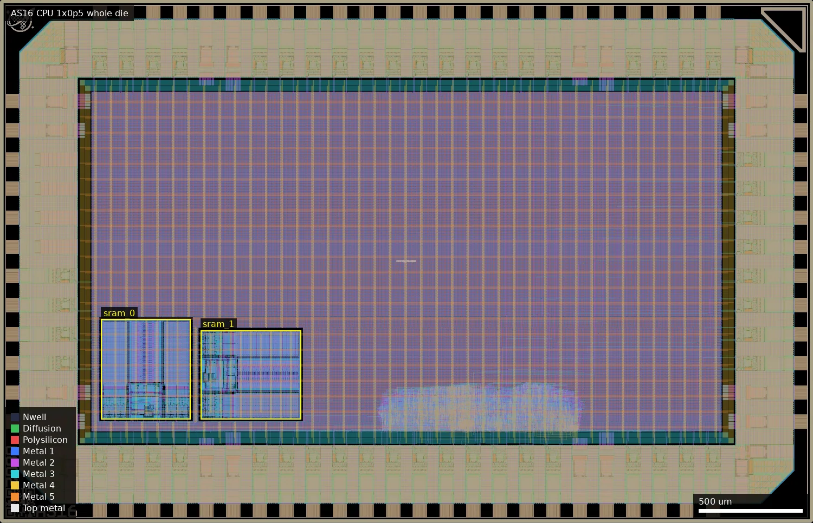
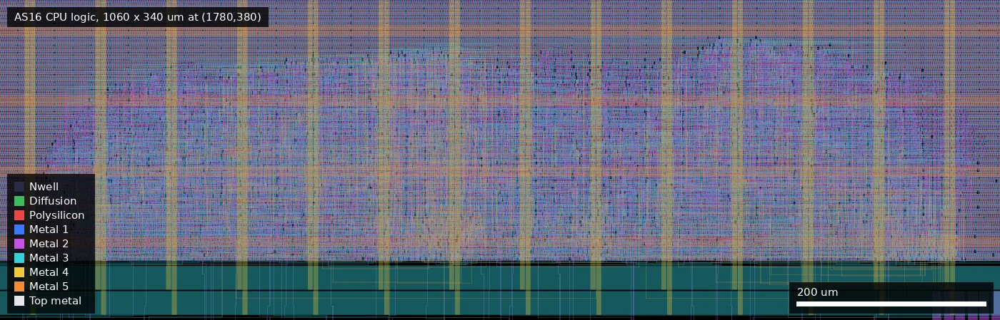
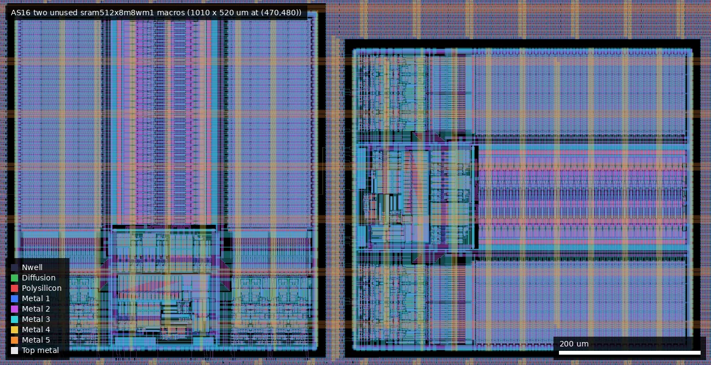

# AS16: AS16 CPU (ws-run2)

| | |
|---|---|
| Repository | https://github.com/SUD0NET/as16 @ 0cfc5a5 (main, last commit 2026-07-17; first commit 2026-07-12) |
| Slot | 1x0p5 (platform; Makefile default is 1x1) |
| Top cell | chip_top |
| Licence in repo | Apache-2.0 |
| README | OK (413 own words on top of the template README) |
| Taped-out layout | AS16_chip_top_0_7, 3932 x 2531 um, 1 placement on the G802 reticle |

## What the repo actually contains

`src/as16.v` (102 lines): a 16-bit RISC CPU with predication (3 predicate bits against C and Z), a 16 x 16-bit register file (R0 = 0, R15 = PC), a 6-state FSM (FETCH0, FETCH1, EA_ED, RDMEM, EXEC, WRMEM), 8 ALU ops (LD, ADD, AND, OR, XOR, ROR, ADC, STO), and 16- or 32-bit instructions. Memory is external only: datain on bidir[15:0], dataout on bidir[15:0] (oe = !rnw), address on bidir[31:16], rnw on bidir[32].

The flow is the wafer.space template: 5 V `gf180mcu_fd_sc_mcu7t5v0`, `gf180mcu_fd_io`, `gf180mcu_fd_ip_sram`. `chip_core.sv` also instantiates two `gf180mcu_fd_ip_sram__sram512x8m8wm1` with CEN=1 and A=0 tied off and `(* keep *)`; they are not connected to the CPU. No analog use.

Not present in the repo: final layout, reports, silicon data (the layout is covered below). The cocotb bench is the template one (a 1-line change adds `as16.v` to the sources) and has no CPU test.

## Taped-out layout

| | |
|---|---|
| Reticle cell | `AS16_chip_top_0_7`, 3932 x 2531 um, 1 placement on G802 (at 0.060, 18.197 mm, r0) |
| Pads / IO cells | 46 `gf180mcu_fd_io__bi_24t`, 5 `in_c`, 1 `in_s`, 8 `dvdd`, 8 `dvss`, 4 `asig_5p0` analog pads (template, not used by the design), 4 corners; fill 1 / 5 / 10 / nc = 226 / 22 / 414 / 20 |
| Standard cells | `gf180mcu_fd_sc_mcu7t5v0` only: 98,044 placements = 5,508 logic + 92,536 fill/tap/antenna |
| Largest cell types | `dlyb_1` 3,585 (65 % of logic cells, hold buffers), `nand2_1` 421, `dffrnq_1` 329, `oai21_1` 320, `dlyc_1` 74, `mux4_1` 56 |
| Flip-flops | 329 `dffrnq_1` (async-reset); consistent with a 15 x 16-bit register file (240) plus PC, FSM and flag state; the register file is flops, not SRAM |
| SRAM macros | 2 x `gf180mcu_fd_ip_sram__sram512x8m8wm1` (4 kbit each), 431.86 x 484.88 um: sram_0 at (490,500) N, sram_1 at (970,500) rotated E, exactly the positions in `librelane/macros/macros_5v.yaml` |
| Oxide | core under Dualgate 55/0 and V5_XTOR 112/1 (5 V library); SramCore 108/5 present in the macros |
| MIM / high-res poly / DNWELL / BJT | none (no such layers in the file) |
| Custom / hand-drawn | none; only the wafer.space logo, QR code, shuttle ID, project ID and marker |

*Whole die (3932 x 2531 um). The two yellow boxes are the SRAM macros at the lower left; the CPU's standard-cell logic is the small blob at about x 1820..2800, y 450..690 um near the bottom of the core. Everything else in the core is power grid.*

### Does it match the repository?
Partly checked. The repository has no GDS or netlist at `0cfc5a5` and no releases exist, so the layout was matched against `librelane/config.yaml`, the macro file and `src/chip_core.sv`. These agree: 5 V mcu7t5v0 cells, `gf180mcu_fd_io` ring with the same 46 bidir + 6 input + 4 analog pad split as the template, two `sram512x8m8wm1` macros at the configured coordinates, 1x0p5 die. The CPU netlist is flat, so the RTL's register file / ALU / FSM cannot be located as blocks; counts are consistent with a ~330-flop CPU. The two SRAMs are physically present; that they are idle rests on their tie-offs (`CEN=1`, `A=0` in `chip_core.sv`), and I did not trace those nets in the layout.

### What the layout adds
- Two SRAM macros (about 0.42 mm2 together) sit beside a very small CPU that never enables them; the CPU itself is about 5,500 cells, two thirds of them hold-fix delay cells.
- The macros are real PDK `gf180mcu_fd_ip_sram` instances on the die, but their address/data pins are tied to constants in the RTL, not to pads, so they cannot be exercised from outside.

*Standard-cell logic region (1780,380)-(2840,720) um: the whole CPU as a single placement blob; the green band at the bottom is the core-edge power ring.*

*The two SRAM macros at (490,500) and (970,500) um, one rotated 90 degrees.*

## Authors and affiliations

| Person | Role | Affiliation | Source |
|---|---|---|---|
| Adnan Saad (GitHub SUD0NET, "Retro Software Programmer") | sole author of the CPU (11 commits) | Year 10 student, Sydney Technical High School per the platform description; not stated in the repo | project.json; GitHub bio |
| Leo Moser | template | not stated | AUTHORS.md |

## Value for GF180MCU characterisation and PDK development

### Verdict: Low

Ordinary synthesised digital on stock 5 V cells; useful as a yield and functional data point.

### Test structures and measurable circuits

Nothing found. A max-clock figure for a small synthesised CPU is possible, but there are no timing numbers in the repo. The two SRAM macros are on the die but inactive and not reachable from pads, so they give no bit-cell data. The CPU is about 5,500 cells with 329 async-reset flops; max clock vs supply would be a coarse delay indicator.

### Candidate PDK additions

Nothing found.

### What would be needed to use it

An external 16-bit memory plus clock and reset to run any program; there is no test program in the repo.

## Notes and caveats

- Slot is 1x0p5 on the platform versus a Makefile default of 1x1 (the CI matrix covers slots).
- The SRAM macros are physically on the die (two, at the template positions) and tied off in RTL (CEN=1, A=0); that they are idle follows from the RTL, not from tracing layout nets.
- "My first ever tapeout" and the Year 10 claim come only from the platform description.
