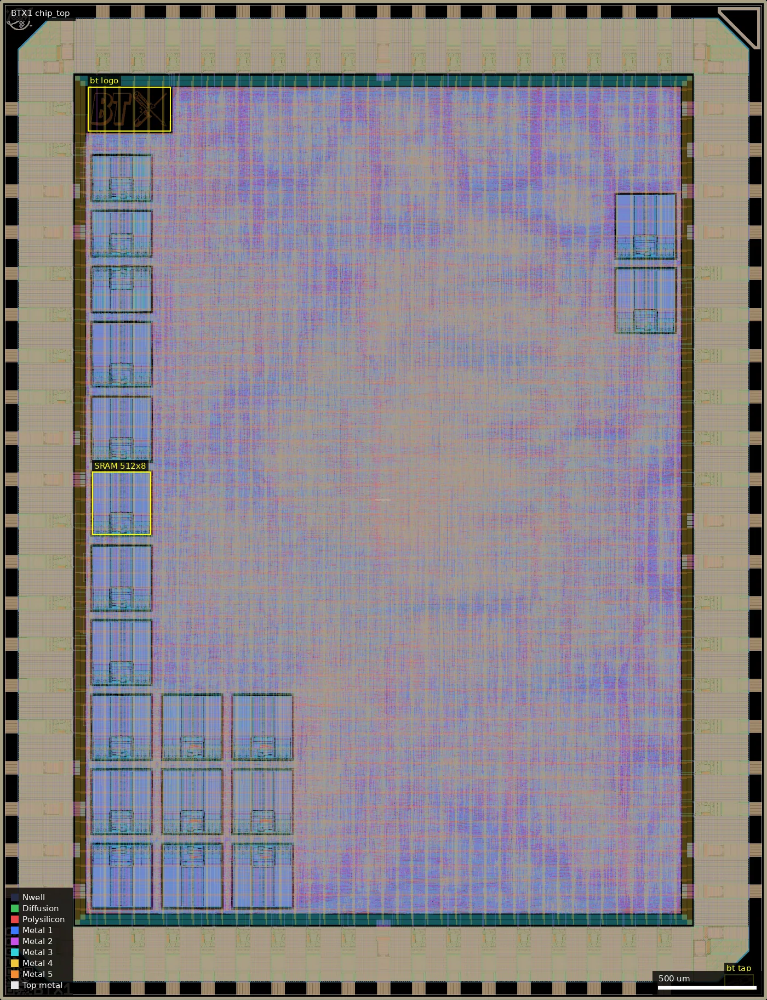
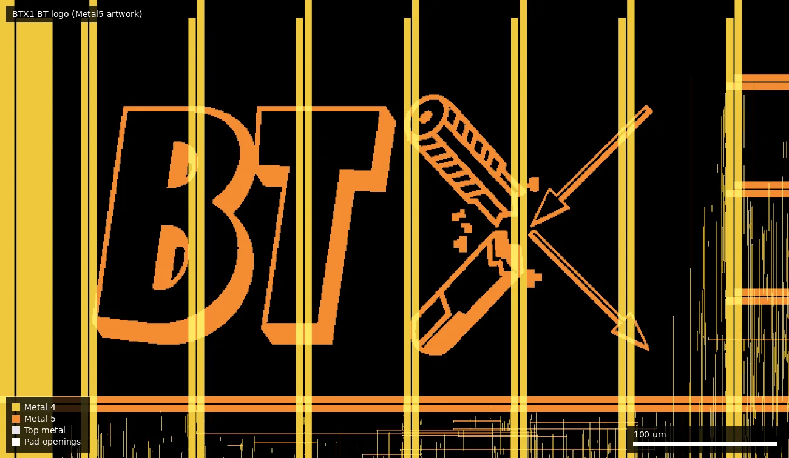
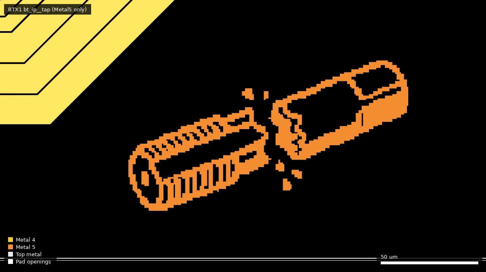
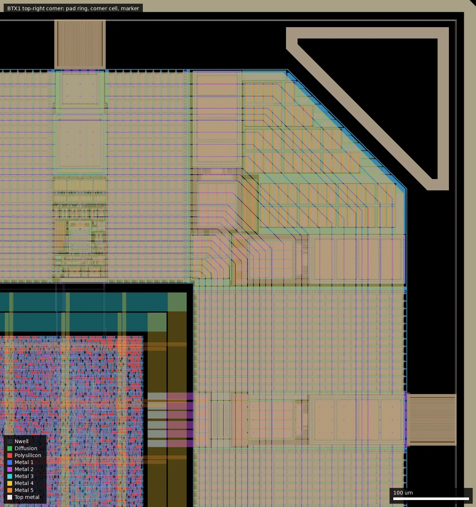

# BTX1: BTX (ws-run2)

| | |
|---|---|
| Repository | none listed on platform.wafer.space (no public lead found in the layout) |
| Slot | 1x1 |
| Top cell | chip_top |
| Licence in repo | n/a |
| README | n/a |
| Taped-out layout | BTX1_chip_top_0_0, 3932 x 5122 um, 1 placement on the G802 reticle |

## What the repo actually contains

No repository was listed for this project, so nothing was cloned and there is nothing to audit. The platform description is "Path-tracing accelerator chip". The layout (`ws-run2`, `BTX1/chip_top.oas`, SHA256 `3e931e0d0dd561d9f03c93f55e4569af7c24a2ef58ad529d0a9bad68b6d6e4e0`) is the only evidence and the basis of this summary.

## Taped-out layout

| Item | Measured |
|---|---|
| Die | 3932 x 5122 um (full 1x1 slot) |
| Standard cells | `gf180mcu_as_sc_mcu7t3v3` (3.3 V, 7-track), 252,619 logic cells (+ 505,451 fill/tap placements) |
| Cell mix | heavily combinational: nand2 24.7 k, buff 23.5 k, xnor2 22.9 k, oai21 17.9 k, ao22 14.6 k, aoi21 13.4 k, nand3 11.7 k, and2 11.3 k, xor2 10.0 k; only about 9.4 k `dfxtp_2` flops (3.7 %) plus 45 `dyn_dfxtp_2` and 1,198 `dlybuff_2` |
| SRAM macros | 19 `gf180mcu_ocd_ip_sram` macros: 16 x `sram512x8m8wm1` (301.3 x 321.9 um) + 3 x `sram256x8m8wm1` (301.3 x 224.9 um) = 8,960 bytes total |
| IO cells | 74 pad cells, all stock `gf180mcu_fd_io`: 40 `bi_24t`, 15 `in_c`, 1 `in_s`, 8 `dvdd`, 10 `dvss`; 4 `cor`; fill 1/5/10/nc; 82 Pad-layer shapes |
| Pads (Metal5 labels) | `bidir_PAD[0..39]`, `input_PAD[0..11]`, `clk_PAD` (in_s), `rst_n_PAD`, `analog_PAD[0..1]`, `VDD`, `VSS` |
| Thick oxide (Dualgate 55/0) | IO cells only; none in the sampled core (1000-2500 x 1000-2500 um); no V5_XTOR (112/1) anywhere |
| Passives / other | no MIM, no DNWELL, no BJT markers; `RES_MK`/`DIODE_MK`/`MOS_CAP_MK` are from IO cells and SRAM macros |
| Custom blocks | none electrical; `gf180mcu_bt_ip__logo` (423.8 x 226.5 um at 450,4450) and `gf180mcu_bt_ip__tap` (147 x 80 um at 3714.5,50), both Metal5 artwork only |

The `analog_PAD[0..1]` pads (at x 526 and 706 um on the top edge) are named analog but are ordinary `in_c` digital input cells (probe of pad stack), so they are digital inputs with a misleading name (or reserved), not analog access.

### Does it match the repository?

No repository to compare. It matches the platform description only in a weak sense: the die is a large synchronous-looking logic block with a lot of XOR/XNOR/NAND (arithmetic datapath, inferred) and nineteen small SRAMs (inferred: scene/BVH or ray buffers; no hierarchy or net names remain to confirm "path-tracing"). Pad names are the stock wafer.space template names (`bidir`, `input`, `clk`, `rst_n`, `analog`). The "BT" logo and the wafer.space ID cells are the only identifying text; no URL or repository name appears. The 40 bidirectional and 12 input pads give far more IO than typical template projects.

Whole die: flat logic sea occupying the core, SRAM macros as a column (472-774 um, y about 2380-4040 and 1000-2400) plus a 3x3 block bottom-left and two at the right edge, BT logo at top-left (450-874, 4450-4677 um), full pad ring on all four edges.

The BT logo, Metal5 artwork at 450-874 x 4450-4677 um over the Metal4 power stripes.

`gf180mcu_bt_ip__tap`, Metal5 artwork at 3714-3861 x 50-130 um (bottom-right, near the die corner), unconnected decoration.

Top-right corner (3300-3932 x 4450-5122 um): `fd_io` pad cells with bondpads, the corner cell, the wafer.space marker, and the core power ring.

## Authors and affiliations

Not stated. Only "BT"/"BTX" artwork on the die (source: layout cell `gf180mcu_bt_ip__logo`).

## Value for GF180MCU characterisation and PDK development

### Verdict: Low

A very large plain 3.3 V digital design on stock `mcu7t3v3` cells with the ocd 3.3 V SRAM macros and stock IO. There are no test structures or analog circuits. Its use would be as a large-scale yield and timing sample of the 3.3 V digital library (about 250 k cells, 19 SRAM macros) if it works at all; also the biggest user of the ocd 512x8 macro (16 copies) for comparing macro behaviour across dies.

Candidate PDK additions: none.

## Notes and caveats

- Function, clock speed, and which pads carry what were not traced; connectivity was not extracted.
- Dualgate/V5_XTOR checked by layer statistics in sampled boxes, not a full-die boolean.
- The `analog_PAD` name does not mean an analog pad (checked: `in_c` cell).
