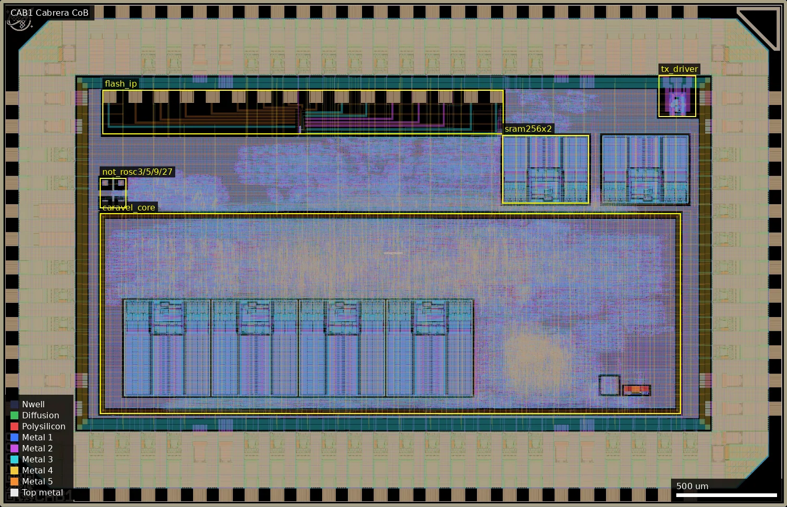
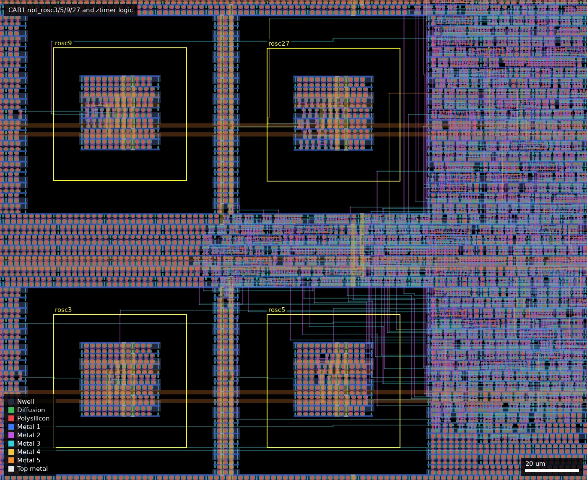
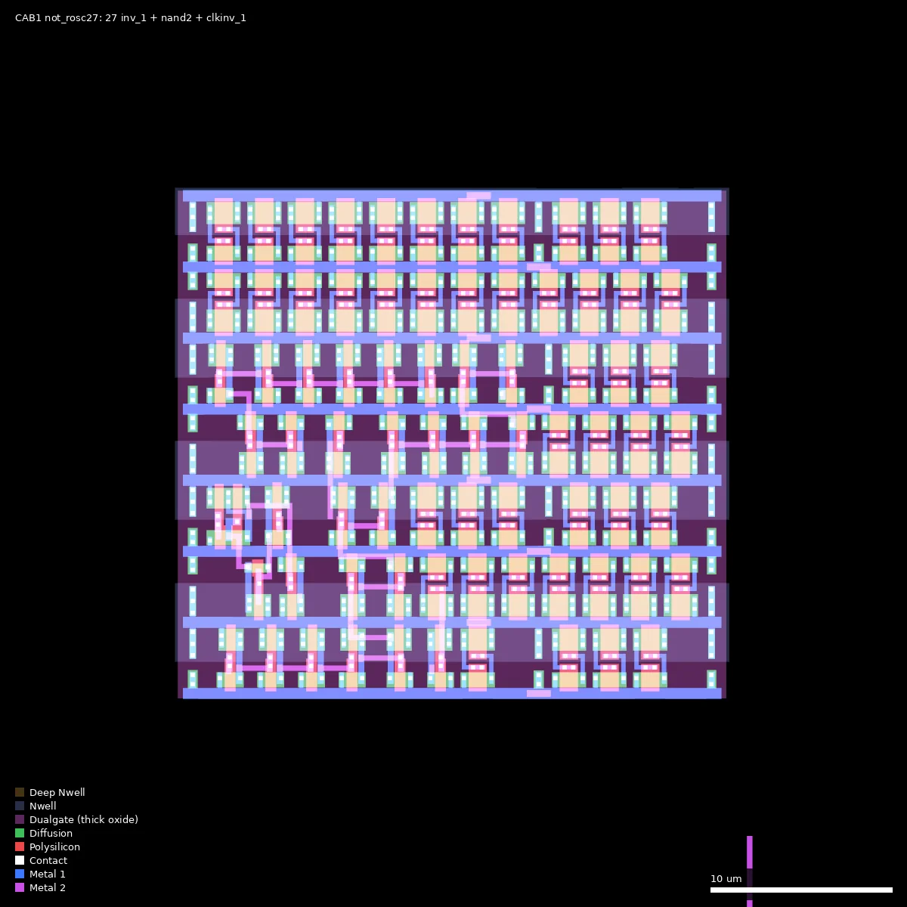
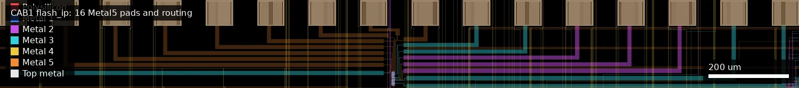
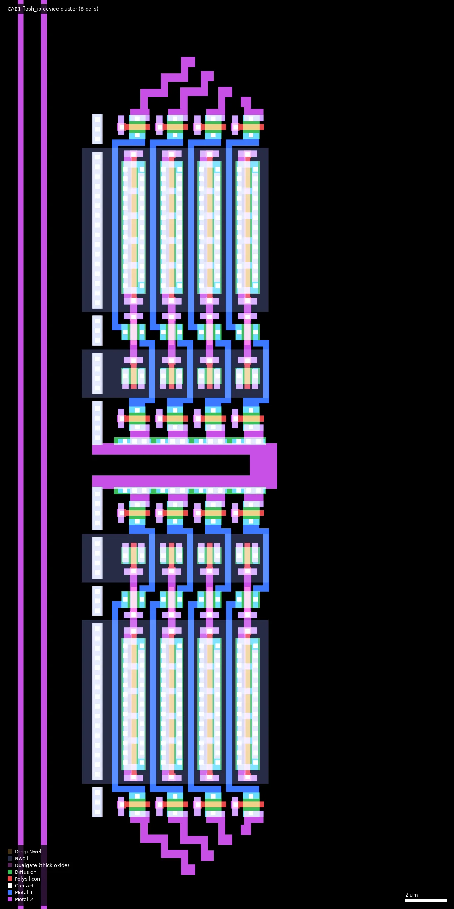

# CAB1: Cabrera CoB (ws-run2)

| | |
|---|---|
| Repository | https://github.com/ZeduloTech/Cabrera @ 2081f9b (main, last commit 2026-07-15) |
| Slot | 1x0p5 (DIE_AREA 0 0 3932 2531 um) |
| Top cell | chip_top |
| Licence in repo | Apache-2.0 (LICENSE; SPDX headers "Zedulo" in source) |
| README | TEMPLATE (100% the wafer.space project-template README, no own text) |
| Taped-out layout | CAB1_chip_top_4_8, 3932 x 2531 um, 1 placement on the G802 reticle |

## What the repo actually contains

Platform description is empty and the README is the template, so this is derived from sources. "CoB" is not explained anywhere in the repo (inferred: chip-on-board; not checkable from the layout). Cabrera is a Caravel-based (VexRiscv SoC from egorxe/gf180mcu-caravel-template, `caravel/`) 5 V design with four user peripherals, built with the leo/gf180mcu LibreLane branch and the standard wafer.space template (`librelane/config.yaml`, `src/chip_core.sv`, `src/chip_top.sv`). Standard cells: gf180mcu_fd_sc_mcu7t5v0. Wishbone clock 20 MHz (commit "clock period set to 20MHz").

Contents of `src/chip_core.sv`:
1. Caravel core (Wishbone master, SPI flash pads, GPIO).
2. LiteEth Ethernet MAC (`EthernetMac/src/liteeth_core.v`, generated, 256x8 MAC memory) with two foundry 5 V SRAM macros `gf180mcu_fd_ip_sram__sram256x8m8wm1` (reader/writer slot0) and a `mii_mux` to route MII either to external pads or to the PHY.
3. 10BASE-T PHY (`ip/tenbaset/`: tenbaset_phy_top.v, tx, rx digital at 80 MHz) with a custom analog transmit driver macro `tenbaset_tx_driver` (207.97 x 186.175 um; GDS cells `dac_cell`, `dac_cell_x2/x4`, `driver_cell`, `driver_half`, built from nfet, pfet and ppolyf_u_resistor pcells; outputs on analog pads TXP/TXN). Commit log says an earlier "PHY ip breaks LVS" and a precheck-clean GDS "with non functional timer and 10BaseT PHY" (`final/gds/cabrera_notimer_testphy.gds.gz`) exist, so the PHY was iterated; final integration commit 2026-07-15 "Update 10BaseT PHY integration".
4. `ztimer` (see below), a pad-accessible time-interval meter with a ring-oscillator bank.
5. `flash_ip`: a 2003 x 222.6 um block with 16 bondpads (Pad1..Pad16, cell `Bondpad_5LM` and `flash_3v3`), instantiated with no ports (`(* keep *) flash_ip flash_ip ();`), placed at (513, 1860). See below.

Other: `ip/simple_por` (SPICE-level power-on-reset with Schmitt trigger testbenches, `ip/simple_por/netlist/*.spice`), `cocotb/` RTL and gate-level testbench, `final/` with hardened outputs (gds.gz, lib, nl, pnl, spef, vh) for the chip and sub-macros, `rosc3/5/9/27/` and `ztimer/` hardened sub-flows including SDF/SPEF/spice at 9 PVT corners. Chip GDS (`final/gds/cabrera_260714.gds.gz`, `chip_top.gds.gz`) is committed. No post-silicon data. No eFuse macros and no SRAM test structure; two foundry SRAM instances are MAC buffers (the layout also has four 512x8 macros in the Caravel core).

## Taped-out layout

| Measured | Value |
|---|---|
| Reticle cell / size | `CAB1_chip_top_4_8`, 3932 x 2531 um, 1 placement at (8.044, 20.788) mm |
| IO cells / pads | 42 `bi_24t` bidirectional, 5 `in_c` + 1 `in_s` input, 8 `asig_5p0` analog, 8 `dvdd`, 8 `dvss`, 4 corner cells; 72 `Bondpad_5LM` placements in the ring plus 16 inside `flash_ip` |
| Standard cells | gf180mcu_fd_sc_mcu7t5v0 only: 52,199 logic placements (buf_2 12,985; nand2_1 5,571; dffq_1 5,348) plus 100,188 fill/tap cells |
| SRAM | 6 foundry macros: 2 x `sram256x8m8wm1` at the top level (first at (2510, 1515), 431.9 x 340.9 um) and 4 x `sram512x8m8wm1` inside `caravel_core` (Caravel RAM wrappers). The repo-derived text counted only the two 256x8 MAC buffers |
| Custom blocks | `not_rosc3/5/9/27` (50 x 50 um each), `flash_ip` (2003 x 222.6 um at (513, 1860)), `tenbaset_tx_driver` (208.0 x 186.2 um at (3291.7, 1947.5)), `simple_por` with a 3 x 3 MIM array (39.0 x 39.6 um) and a `ring_osc2x13` (91.9 x 95.3 um) inside `caravel_core` |
| Devices | 5 V Dualgate/V5_XTOR on everything except `flash_ip`; `flash_ip` gates have no Dualgate overlap (0 of 40), so they are 3.3 V thin-oxide devices |
| Not present | no eFuse macro (the 9 FuseTop shapes at (3156-3193, 566-589) coincide with the 9 MIM plates of `simple_por`), no BJT/diode test array, no extra poly layer |

### Does it match the repository?

Compared `final/gds/chip_top.gds.gz`, `final/gds/cabrera_260714.gds.gz` and `final/gds/cabrera_notimer_testphy.gds.gz` (repo commit 2081f9bda695, the commit recorded for CAB1 in wafer.space-bench `designs.csv`) with the taped-out OAS. All three have die box (0,0;3932,2531) and identical top-level instance counts: `caravel_core` 1, `flash_ip` 1, 2 x sram256x8, 42 bi_24t, 5 in_c, 1 in_s, 8 asig_5p0, 8 dvdd, 8 dvss, 4 corners, `not_rosc3/5/9/27` 1 each, `tenbaset_tx_driver` 1, plus the wafer.space logo/ID/marker/seal-ring cells. The taped-out file has 2731 cells, the same as `chip_top.gds.gz`; `cabrera_260714.gds.gz` has 2737 (extra `$n` copies only, the base cell-name sets are identical), `cabrera_notimer_testphy.gds.gz` has 2730. So the cell-level comparison cannot tell the three apart from the taped-out layout, except that the cell count matches `chip_top.gds.gz`. All three GDS also contain the timer ring macros, so "notimer" refers to the digital timer logic, which is flattened into `chip_top` and has no cell of its own. A geometry XOR was not done. The design is the one the repository describes.

*Whole die (3932 x 2531 um). `flash_ip` spans the top-left of the core area, the four ring-oscillator macros sit at the left edge just above `caravel_core`, the two 256x8 SRAMs are top-right, and the 10BASE-T driver is in the top-right corner.*

### Test-structure locations

| Structure | Cell / position (um) | Size | Details measured from the layout | Pads |
|---|---|---|---|---|
| `not_rosc3` | (500, 1492.15) | 50 x 50 | 3 `inv_1` + 1 `nand2_1` + 1 `clkinv_1` (netlist `rosc3/final/nl` shows the loop: clkinv -> nand2(enable) -> inv x N); `rosc_enable` pin net contains a `tieh` output | via ztimer: start/stop pads and SPI pads (see below) |
| `not_rosc5` | (580, 1492.15) | 50 x 50 | 5 `inv_1` + nand2 + clkinv; enable tied high; `rosc_out` net reaches a `clkbuf_8` input at (644.8, 1550.4) | same |
| `not_rosc9` | (500, 1592.15) | 50 x 50 | 9 `inv_1` + nand2 + clkinv; enable tied high; `rosc_out` reaches a `clkbuf_8` input at (693.6, 1656.2) | same |
| `not_rosc27` | (580, 1592) | 50 x 50 | 27 `inv_1` + nand2 + clkinv; enable tied high | same |
| ztimer logic | flattened into `chip_top`, no cell; the 5 x 32-bit counters, SPI slave and clkbuf_8 buffers sit in the standard-cell field immediately right of the four macros (x 560-700, y 1480-1700) | not delimited | clock buffers and `dffrnq`/`dffq` counters seen on the traced nets | pad indices from `src/pinout.vh` |
| `flash_ip` | (513, 1860) | 2003 x 222.6 (device cluster about 6 x 40 um at (1496-1503, 1867-1900)) | 40 gates: 16 PMOS (8 at L 0.28 / W 6.4 um, 8 at L 0.28 / W 0.8 um) and 24 NMOS (L 0.28 / W 0.8 um), all thin oxide; 16 Metal5 pads at x = 34 + 129 k um (k = 0..15), y = 189 um in cell coordinates | 16, see below |
| `tenbaset_tx_driver` | (3291.7, 1947.5) | 208.0 x 186.2 | 104 gates, all in Dualgate (5 V); driver_half x2 (6 driver_cell each), 4-cell DAC with `cs` cell | TXP/TXN analog pads |
| `simple_por` MIM | inside `caravel_core` | 39.0 x 39.6 | 9 CAP_MK squares of 10.4 um at (3155.7-3193, 565.8-588.6); `Resistor` marker 123.6 x 27 um at (3118, 575.5) | internal |

*Area (480-700, 1480-1660) um. The four yellow boxes are the 50 x 50 um macro cells (rosc9 top-left, rosc27 top-right, rosc3 bottom-left, rosc5 bottom-right); the actual inverter rows occupy about 28 um at the centre of each. The dense logic at the right edge is the ztimer counters and SPI block.*

*not_rosc27 at (580-630, 1592-1642) um: rows of 3.1 um wide `inv_1` cells, one nand2 and one clkinv, all 5 V cells.*

**Ring oscillators.** Inverter counts are confirmed from the layout (3, 5, 9, 27 `inv_1`). Each loop is not N inverters only: the gating `rosc_enable ? loop : 1` was synthesised as `clkinv_1 -> nand2_1`, a non-inverting pair in the loop, so the loop holds N+2 gates and the period is 2 x (N x t_inv + t_clkinv + t_nand2), not 2 N t_inv. The slope of period against N over 3, 5, 9, 27 still gives the `inv_1` delay, the intercept the nand2 + clkinv + clkbuf_8 overhead. In all four macros the `rosc_enable` pin is on a net with a `tieh` cell output, so the rings free-run (layout-level, local net trace). Outputs for ring 5 and ring 9 were traced to `clkbuf_8` inputs; for ring 3 and 27 the net leaves the traced window and was not followed further.

**ztimer / pad access.** The pad assignment in `src/pinout.vh` is: SPI SDO, SCK, SDI, CSB on bidir pads 18-21 and START/STOP on input pads 0 and 1. The layout carries the same IO cell types (bi_24t for the bidirs, in_c/in_s for the inputs), but pad-to-flop connectivity was not extracted from the layout (it would require device-level extraction across the whole chip), so the pad access of the ring/timer path rests on the repository netlist and the ring/enable/clkbuf traces above.

**flash_ip: what it is.** Extracted connectivity (MOS extraction of `flash_ip` on its own, 16 pads) shows 8 identical cells, each with a floating poly node feeding the gate of one NMOS read transistor and the gates of two PMOS used as capacitors (source = drain = a pad; a 6.4 um wide one and a 0.8 um wide one), with a select NMOS on each side. Pads (numbered 1-16 left to right at x = 34 + 129 (k-1) um): bit lines on pads 6-9 each go through select NMOS (gate pad 1) into two cells in parallel; the other end of each cell goes through a second select NMOS (gate pad 14 for the first group of four cells, pad 12 for the second) to a common source line on pads 5 and 13, which are shorted inside the block; large capacitor plates on pads 16 and 10, small capacitor plates on pads 15 and 11. Pads 2, 3 and 4 touch no device. The floating node has no diffusion or metal connection other than those three gates, there is no extra poly layer and no tunnel-oxide marker. This is the topology of a single-poly floating-gate (EEPROM/flash style) bit: control capacitor, tunnelling or coupling capacitor, read transistor. Whether the cell actually stores charge in GF180MCU cannot be settled from layout alone. Nothing outside the block touches its Metal1-5 shapes (checked in the surrounding area), so it is only reachable through its 16 pads, which are probe/bond pads with no IO-cell protection. The device list matches the summary: 16 pfet_03v3 and 24 nfet_03v3.

*flash_ip (513-2516, 1860-2083) um: the 16 Metal5 pads along the top edge and the routing to the device cluster near its centre.*

*Device cluster of flash_ip at (1490-1512, 1862-1906) um, drawn at 1:1 in x/y: two mirrored groups of four cells; the tall n-well blocks are the 6.4 um wide capacitor PMOS, the small ones the 0.8 um capacitor PMOS, the NMOS select/read transistors in between.*

## Authors and affiliations

| Who | Role | Affiliation | Source |
|---|---|---|---|
| Egor Lukyanchenko (egorxe) | Caravel integration, Ethernet MAC, 10BaseT PHY, flash_ip, 32 commits | not stated in repo/GitHub profile; "Zedulo" appears in copyright | git log, AUTHORS (NAX1), README of TZ01 |
| snapaa257 (two identities, Zedulo email addresses) | ztimer, ring oscillators, PADs, CI, 16 commits | Zedulo (email domain hint; source headers say "Zedulo Sweden AB") | git shortlog, SPDX headers |
| Leo Moser | wafer.space template author, 78 commits of template history | wafer.space template maintainer (AUTHORS.md lists him; affiliation not stated) | AUTHORS.md, git log |
| Tim Ansell, TrevorPeyton | one commit each (template) | not stated | git shortlog |
| Zedulo / ZeduloTech org | owner | "Zedulo", location Sweden, zedulo.com | `gh api orgs/ZeduloTech`; header "Zedulo Sweden AB" |

## Value for GF180MCU characterisation and PDK development

### Verdict: High

Contains purpose-built, pad-accessible measurement structures: a bank of four free-running ring oscillators with a timer/time-interval instrument readable over SPI, plus a 16-pad probe-pad block that extracted connectivity shows to be eight single-poly floating-node cells (two capacitor PMOS plus a read NMOS each) in 3.3 V thin oxide. Both are not hidden behind the CPU (the flash_ip pads are isolated from the core; the ring/timer pad path follows the repository netlist).

### Test structures and measurable circuits

| Structure | What it exercises | Access | Where |
|---|---|---|---|
| `not_rosc3/5/9/27`: ring oscillators of 3, 5, 9, 27 `gf180mcu_fd_sc_mcu7t5v0__inv_1` (with `rosc_enable ? loop : 1` gating), each a separate 50x50 um hardened macro, enable tied high (free-running), each buffered by clkbuf_8 into its own 32-bit counter | inv_1 propagation delay at 5 V (period/(2N), slope over N=3..27 separates fixed overhead from per-stage delay), across die and temperature | start/stop on input/analog pads (`PADI_ZTIMER_START/STOP`), SPI slave on 4 bidir pads (CSB/SCK/SDI/SDO) reads five 32-bit counts (xtal reference + 4 ROs), clear via SPI | `ztimer/src/ztimer.sv`, `clk_timer.sv`, `rosc*/src/*.sv`, `rosc*/final/` |
| Reference-clock timer `u_timer_xtal` counting `clk` for the same window | Calibration of the RO counts against external clock | same | `ztimer/src/ztimer.sv` |
| `flash_ip` (`ip/flash_ip/gds/flash_ip.gds`, top cell TOP1, 16 Metal5 bondpads, cell `flash_3v3`) | Eight single-poly floating-node cells in 3.3 V thin oxide, each: a floating poly shared by a read NMOS and two capacitor-connected PMOS (6.4 um and 0.8 um wide, L 0.28 um), with select NMOS on both sides; 16 pfet_03v3 and 24 nfet_03v3 in total, confirmed from the taped-out layout. Charge retention/tunnelling is not established by layout alone | direct probe/bond on the 16 pads; checked isolated from the core (see Taped-out layout) | `ip/flash_ip/` (also `test.gds`, `test.spice`, `Flash_SPI.gds`) |
| `tenbaset_tx_driver` analog driver/DAC | Resistor-DAC and driver cell behaviour; custom nfet/pfet/ppolyf_u_resistor | analog pads TXP/TXN, digital DAC inputs from PHY | `ip/tenbaset/` |

Voltage: core and ring oscillators run at 5 V (7t5v0 cells, 4.5-5.5 V corners); flash_ip uses thin-oxide 3.3 V devices (no Dualgate; pad-driven, supply unspecified); all other custom blocks, the rings and the TX driver are 5 V Dualgate. No Monte Carlo or silicon-correlation data exist; the per-macro SDF/lib files (`rosc3/final/sdf/*`) give STA delays at 9 corners that silicon can be compared against.

### Candidate PDK additions

- Probe-padded single-poly floating-node (flash/EEPROM-style) test cell: `flash_3v3` and `Bondpad_5LM` / `probe_pad` cells exist as GDS (not an official PDK cell). The layout shows control/coupling capacitors made from PMOS gates plus a read NMOS; documentation of intent is absent; the `magic_lef.tcl` still carries commented-out eFuse-compiler lines, so it descends from the eFuse compiler flow.
- A hardened ring-oscillator-bank + timer + SPI block usable as a PDK "characterisation macro".
- Analog drive/DAC macro for 10BASE-T.
- Flow workarounds documented in commit log: "Add PND obstruction to remove superfluous vias and fix DRC", MAGIC_GDS_FLATGLOB entries for flash_ip, "OR optimization crash" workaround with a Wishbone register.

### What would be needed to use it

Packaged dies on a PCB with an SPI master (the SPI pins) plus a pulse generator or the Caravel CPU to produce a start/stop window; flash_ip needs direct pad probing/bonding (16 unprotected pads at 129 um pitch, Metal5) and a cell description; the pad roles derived above (bit lines 6-9, select gates 1/12/14, source line 5/13, capacitor plates 10/11/15/16) are the starting point. A temperature chamber for RO delay versus T. No test plan or PCB in repo.

## Notes and caveats

- Platform description empty; name "Cabrera" and "CoB" are unexplained in repo.
- `flash_ip.v` is a blackbox with no ports. The layout shows it is not an SPI flash: it is a 16-pad array of floating-node cells, electrically isolated from the core. Whether the floating node retains charge is unknown.
- `final/gds` holds three layouts (cabrera_260714, cabrera_notimer_testphy, chip_top); the taped-out layout has the same top-level cells as all three and the same cell count (2731) as `chip_top.gds.gz`; no geometry XOR was done.
- SRAM: the layout has six foundry SRAM macros (2 x 256x8, 4 x 512x8 in the Caravel core), not two. The core also holds a MIM capacitor array and resistor in `simple_por` and a `ring_osc2x13`.
- `ztimer` RO enables are tied high so ring oscillators run permanently (power/self-heating, supply noise on neighbouring logic).
- Relationship: the same team made the Run 1 TZ01 "TillitisZedulo-testchip2025" (eFuse + SRAM + Caravel + UART2GPI). Cabrera reuses the Caravel template/flow from that chip but contains no eFuse macros; its flash_ip/probe-pad block is the nearest successor to the eFuse test blocks. Sibling chip: NAX1 Naxos (same ztimer idea, different peripherals, 3.3 V).
