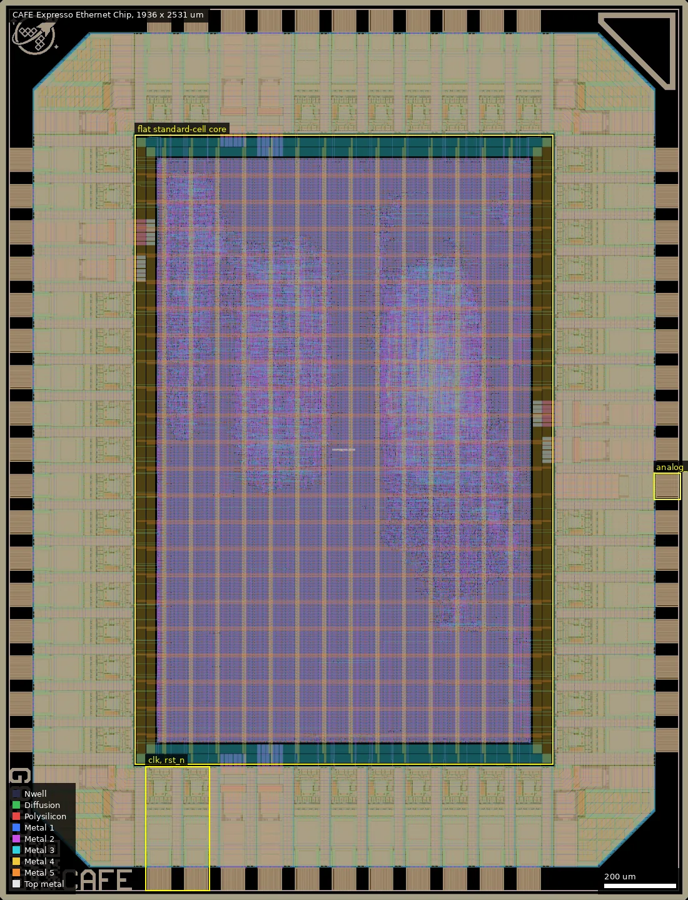
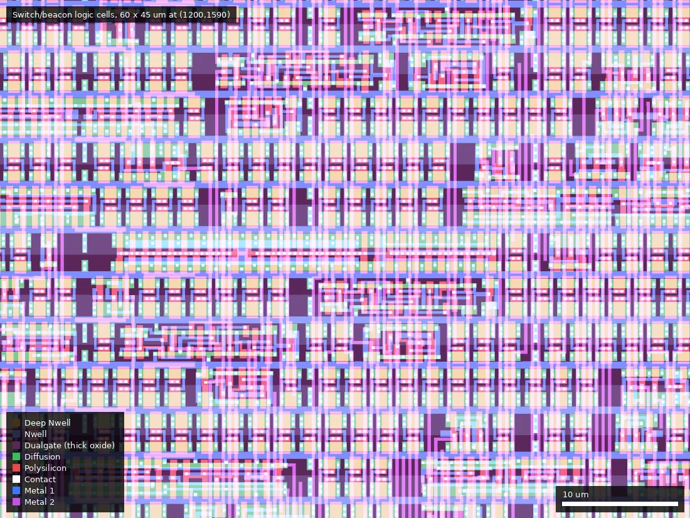

# CAFE: Expresso Ethernet Chip, 100 Mbps switch + heat-death beacon (ws-run2)

| | |
|---|---|
| Repository | https://github.com/Essenceia/Expresso_ASIC_Chip @ 80a20de (main, last commit 2026-07-22) |
| Slot | 0p5x0p5 |
| Taped-out layout | CAFE_chip_top_12_7, 1936 x 2531 um, 1 placement on the G802 reticle |
| Top cell | chip_top |
| Licence in repo | CERN-OHL-S-2.0 (LICENSE; README says strongly reciprocal CERN OHL v2) |
| README | OK (548 words) |

## What the repo actually contains

Two Ethernet IP blocks sharing one clock, reset and power domain in the template padring:
- `coffeepot` (submodule `src/coffeepot`, Essenceia/ethernet_switch_asic): 4-port full-duplex 100BASE-TX unmanaged cut-through Ethernet switch with RMII on PHY0..PHY3 (RMII MAC rx/tx, switch fabric, arbiter, MAC address table in flops `mac_addr_table.v`, replacement policy, lookup).
- `coldbrew` (submodule `src/coldbrew`, Essenceia/Until_Heat_Death_Do_Us_Part): the beacon, "heat death of the Universe" counter that sends an Ethernet frame every second with an uptime count (RMII PHY4, CRC8, MAC tx/rx, broadcast timer).
- `src/chip_core.sv` (5 PHY ports, `PORT_CNT=5`, `PHY_W=2`), template `chip_top.sv`; `docs/pin_mapping.txt/svg` map RMII pins to a LAN8720A PHY footprint (also KSZ8081RNA/RND compatible).
- Flow: LibreLane, `gf180mcu_fd_sc_mcu7t5v0`, `gf180mcu_fd_io` pads. Unusual for the library: the chip targets 3.3 V operation (the PHY is 3.3 V IO), so STA is set up on `nom/min/max_tt_025C_3v30` as default and the other 3v00/3v60 and 5 V corners are also run. `CLOCK_PERIOD: 20` (50 MHz RMII REF_CLK). `RUN_POST_GPL_DESIGN_REPAIR` and `RUN_POST_GRT_DESIGN_REPAIR` are False because OpenROAD "is crashing the system, memory leak", `PNR_EXCLUDED_CELL_FILE: pnr_exclude.cells`. No SRAM macros: the design is flop-based (57,979 instances, 4.41e6 area units). The `MACROS_5v/3v3` files and the foundry-SRAM MAGIC flatten list are template carry-over.
- RMII timing: `librelane/chip_top.sdc` (line ~83 on) carries LAN8720A constraints (RX valid 14 ns / hold 3 ns from REF_CLK, TX setup 4 ns, hold -2 ns), duplicated as `lan8720a.sdc` in each submodule.
- `precheck/`: `chip_top.oas.gz`, md5, `chip_top.png`, `metrics.csv` (LibreLane metrics, 9 corners); `docs/timing_nodes.md`: author's notes with two STA summary tables.
- Tests: cocotb in `cocotb/` and per-submodule `test/` directories (including crc, coffeepot, app_utils). Both designs are stated as validated on an FPGA (README, platform text); the FPGA sources are under each submodule's `fpga/`.
- Submodules: the two real top-level submodules `src/coffeepot` and `src/coldbrew` are present (seeded from mirror). The nested `.gitmodules` inside them declares three further paths that have no entry in the tree: `src/coffeepot/src/bf16` and `src/coldbrew/src/bf16` (Essenceia/BFloat16) and `src/coffeepot/src/sram` (RTimothyEdwards/gf180mcu_ocd_ip_sram, ssh URL). They failed to initialise (clone_status.json errors: "pathspec ... did not match"). Nothing in the final design uses them (no bf16 or SRAM in the synthesised chip, grep of `chip_core.sv` shows none); they look like leftovers from other projects of the author. Note that the declared top-level `.gitmodules` in the root only lists coffeepot and coldbrew; the three missing ones are nested.

## Taped-out layout

| Item | Measured from the layout |
|---|---|
| Die / reticle cell | 1936 x 2531 um, `CAFE_chip_top_12_7`, one placement at (24.012 mm, 18.197 mm) on G802 |
| Pads | 25 `gf180mcu_fd_io__bi_24t` (bidirectional, RMII outputs), 21 `in_c` (20 inputs plus `rst_n`), 1 `in_s` (clock), 1 `asig_5p0` (analog pad), 4 `dvdd`, 4 `dvss`, 4 corner cells, io fill cells; 64 Pad-layer openings |
| Standard cells | `gf180mcu_fd_sc_mcu7t5v0` only: 8,747 logic cells and 48,803 fill/tap/endcap/decap cells (57,550 total) |
| Logic composition | 1,831 `dffq_1` flip-flops, 1,977 `clkbuf_1`, 477 `nand2_1`, 461 `nor2_1`, 412 `oai21_1`, 391 `clkinv_1`, 206 `clkbuf_8`, 21 `dlyb_1` delay cells (the RMII receive-input delays in `chip_core.sv`, inferred from the count), no latches, no clock gates |
| SRAM | none (confirmed: no SRAM macro cell, no SramCore layer) |
| Hierarchy | flat: the reticle file has no block cells apart from pad, logo/ID and fill cells, and no internal net labels, so the placement of `coffeepot` and `coldbrew` inside the core cannot be separated from the layout |
| Oxide | 5 V library: all logic poly is inside Dualgate and V5_XTOR (checked over the core: 357,662 poly polygons inside Dualgate; the 1,622 outside are 5.6 um square dummy-poly fill squares). No 3.3 V-only (thin oxide) cells; the 3.3 V operation is a supply choice on thick-oxide devices |
| Passives and special layers | no MIM, no DNWELL, no high-resistance poly layers drawn. RES_MK (850 shapes), DIODE_MK (815), ESD_MK (94), SAB (1,994) are inside the IO cells; MOS_CAP_MK (8,928) marks the decap cells. No BJT, eFuse or custom cells |
| Custom / analog content | none. The design is only digital MII-style RMII logic: 5 ports x 4 input pads (RXD0, RXD1, RX_DV, RX_ER) and 5 ports x 3 output pads (TXD0, TXD1, TX_EN) on bidir cells, with the remaining 10 bidir pads driven constant 0 with output enabled (`chip_core.sv`); the `asig_5p0` pad exists in the ring (template carry-over, `analog_PAD` at (1878, 1163.5)) and `chip_core.sv` has no analog circuit. No analog Ethernet PHY on the die; an external LAN8720A-class PHY is required |
| Logos / IDs | ws logo (top left), QR-code id, shuttle id and project id, `marker` cell (245 x 245 um, top right) |

Overview of the whole die. The standard-cell core is the box from (380, 381) to (1556, 2151) um and holds two visible logic clusters (about 8,700 logic cells in a mostly fill/decap-filled core); `clk_PAD` and `rst_n_PAD` are at (448, 58) and (552, 58) um, and the unused `analog_PAD` at (1878, 1164) um.

Close-up of placed switch/beacon logic at (1200 to 1260, 1590 to 1635) um: flip-flops and gates in 7-track rows, thick-oxide (Dualgate) shading under every device.

### Does it match the repository?

Yes. The repository carries `precheck/chip_top.oas.gz` at the compared commit (80a20de); its md5 (37309ecc...) equals the committed `chip_top.oas.md5`. Its `chip_top` cell has the same die size (1936 x 2531 um), the same 57,550 standard-cell placements with identical per-type counts, the same pad cell counts (25 bidir, 21 in_c, 1 in_s, 1 asig, 4 dvdd, 4 dvss, 4 corners, fill cells) and the same set of cell names as the taped-out `CAFE_chip_top_12_7`. The summary's statement that there is no SRAM and that the flow is flop-based is confirmed. The "57,979 instances" quoted from the repository metrics is the synthesised count before fill; the layout has 57,550 standard cells including fill.

## Authors and affiliations

| Person | Role | Affiliation | Source |
|---|---|---|---|
| Julia Desmazes (GitHub Essenceia; also git author "Julia Desmazes - ws") | sole designer, 120 commits | not stated (GitHub bio "Designing ASICs for fun", Austin; blog talesonthewire.com) | CITATION.cff, AUTHORS.md, gh api |
| Leo Moser | template author | not stated | AUTHORS.md |

README states "No AI was used by me in the development of this chip".

## Value for GF180MCU characterisation and PDK development

### Verdict: Low
A real synthesised digital design with a genuine IO-timing contract (RMII at 50 MHz against a LAN8720A) and 3.3 V operation of the 7t5v0 library, which is useful as a functional and yield data point and as an early user of the 3.3 V corner, but there are no dedicated structures, and the layout confirms there is no analog or custom content (digital RMII only, no PHY, no SRAM, no MIM/DNWELL/resistors outside stock IO cells).

### Test structures and measurable circuits
No test structures (confirmed: nothing on the die but the stock pad ring, the flat logic core and ID cells). Measurable: functional operation at 3.3 V on the 5 V-library (`tt_025C_3v30` default corner) at 50 MHz, i.e. whether the post-layout slow-corner setup violation noted below is real. RMII timing is checked against the PHY datasheet numbers, not against anything PDK-specific. STA results exist in the repo (`precheck/metrics.csv`, `docs/timing_nodes.md`) for the nine corners plus 5 V corners, and the author-visible numbers are:
- Final `precheck/metrics.csv`: setup WS at `nom_tt_025C_3v30` +4.38 ns, hold WS +1.08 ns, zero violations; `nom_ss_125C_3v00` setup WS -4.20 ns (316 violating endpoints); `nom_ff_n40C_3v60` setup +5.10, hold +0.51; overall `timing__setup__ws` -5.06 ns, `timing__hold__ws` +0.24 ns. Max slew, max cap and fanout violations are non-zero at every corner (e.g. 1053 slew, 166 fanout, 128 cap at tt 3.3 V).
- Silicon bring-up data: none.

### Candidate PDK additions
Nothing found; the die is only stock 5 V 7-track cells and foundry IO cells. Authors' documented workarounds: OpenROAD post-GPL and post-GRT repair disabled because of crashes/memory growth; slow-corner (ss 3.0 V, 125 C) setup not closed at 50 MHz; Magic DRC errors not fatal (`ERROR_ON_MAGIC_DRC: False`).

### What would be needed to use it
A LAN8720A (or KSZ8081) RMII PHY board on 3.3 V, 50 MHz REF_CLK, and Ethernet partners. The README says a dev board with FPGA and PCB are future work.

## Notes and caveats
- The submitted design closes setup only in typical and fast corners at 3.3 V; at the 3.0 V, 125 C slow corner, setup fails by up to about 5 ns at 50 MHz, so operation at temperature extremes and low supply is not guaranteed by the author's own STA (the 5 V corners at 4.5 V ss also show -4.7 ns in the older `timing_nodes.md` snapshot but pass in the final metrics).
- `docs/timing_nodes.md` is a scratch log with two STA tables from 2026-07-13 runs, not a final report; the `precheck/metrics.csv` values are the later ones.
- Nested submodules not populated (see above); `src/coffeepot/lib` contains a copy of Xilinx PLL/MMCM simulation models and a `sg13g2_stdcell_phony.v` (IHP) from FPGA/TT use, unused in this flow.
- CITATION.cff has an invalid release date (2026-15-07).
- The layout is identical in cell content to the repository's committed `precheck/chip_top.oas.gz`, so the STA numbers above describe this exact netlist and placement.
- `coffeepot` and `coldbrew` cannot be told apart in the layout (flat netlist, no labels); chip-level measurements would see both sharing one clock and supply.
