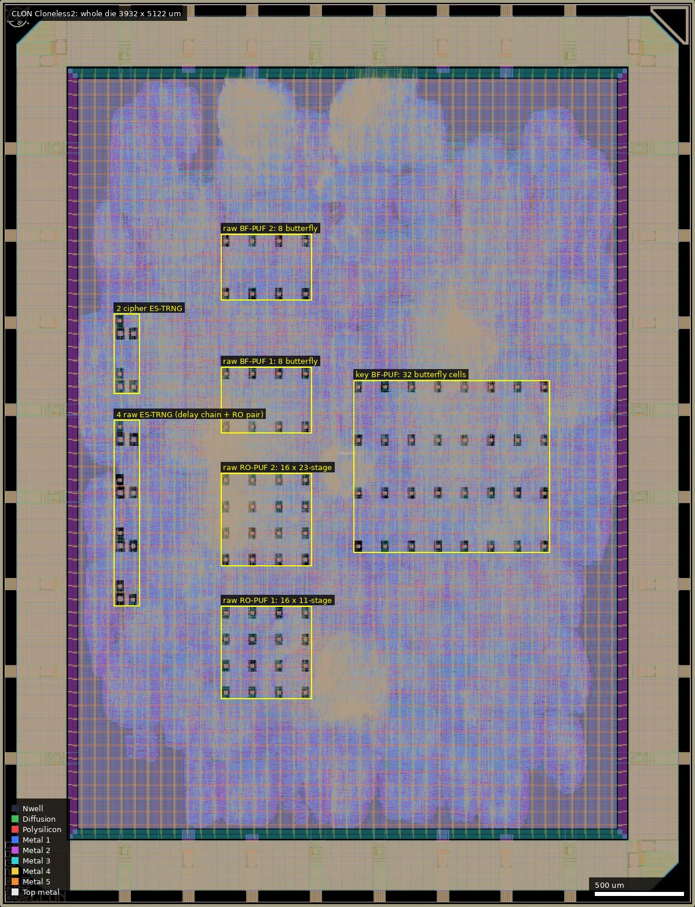
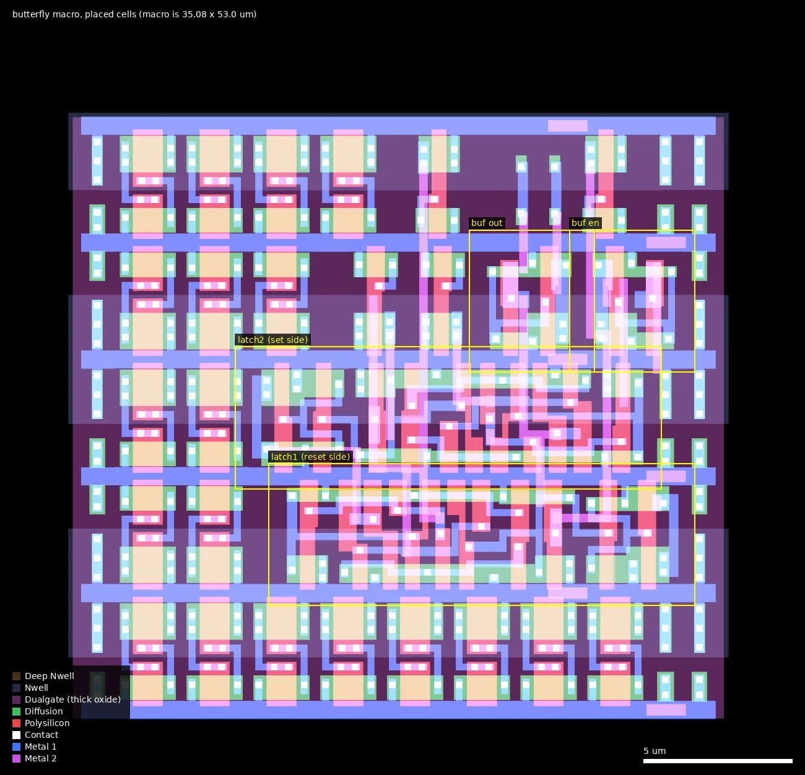
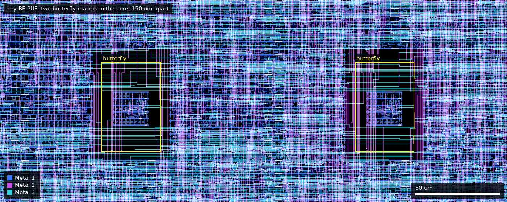
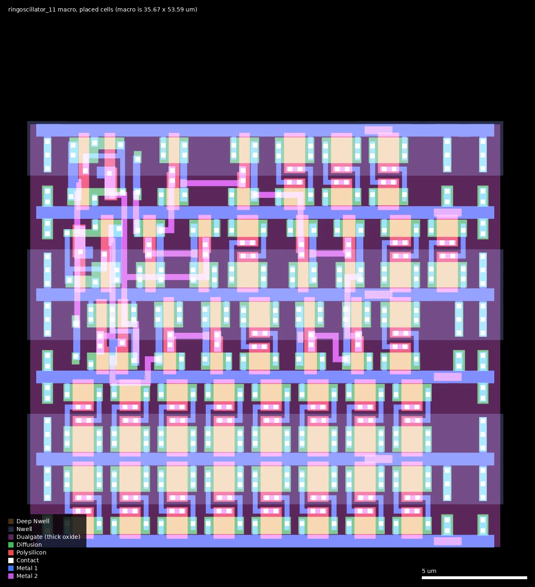
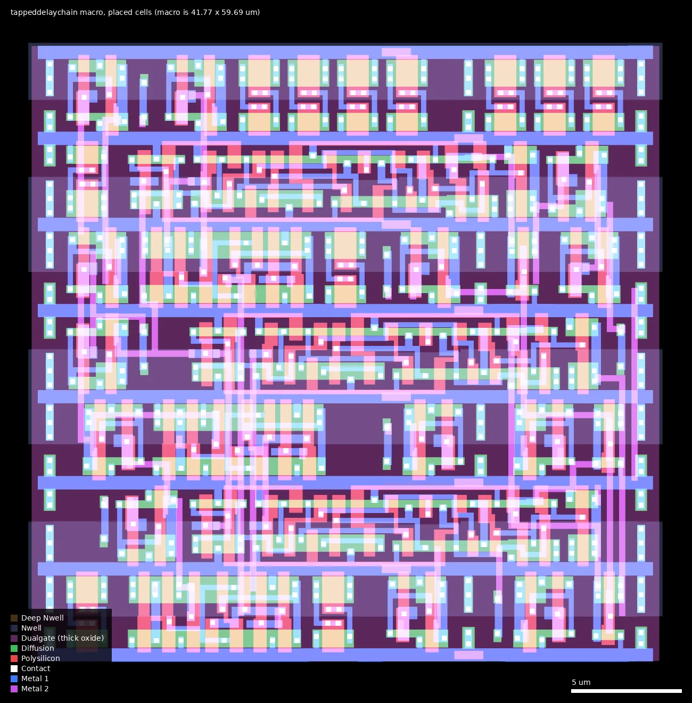

# CLON: Cloneless2 (ws-run2)

| | |
|---|---|
| Repository | https://github.com/ThorbenMoos/Cloneless2 @ a63883b (main, last commit 2026-07-30; release v1 2026-07-27, Zenodo DOI 10.5281/zenodo.21623566) |
| Slot | 1x1 (DIE_AREA 0 0 3932 5122 um) |
| Top cell | chip_top |
| Taped-out layout | CLON_chip_top_2_0, 3932 x 5122 um, 1 placement on the G802 reticle |
| Licence in repo | GPL-3.0 (LICENSE file; no SPDX headers) |
| README | OK (1518 words, own text) |

## What the repo actually contains

Second tapeout in the Cloneless series: same VHDL-to-Verilog (ghdl synth) plus LibreLane flow as Cloneless1, 5 V 7-track stdcells (gf180mcu_fd_sc_mcu7t5v0), 4 MHz clock, wafer.space padring plus a new `trigger_PAD` bidirectional IO cell (chip_top.sv). `ID = G802CLON` in the Makefile, PDK commit d658698, precheck tag 1.7.3. No SRAM, no analog or custom-drawn macros (confirmed on the layout, see below).

Blocks (`src/Cloneless.vhd`):
- mid-pSquare masked block cipher, now with glitch+transition-robust pipelining (formal verification flow referenced from Cloneless_artifacts).
- Two hard-coded shared keys (const_key1, const_key2) for fixed-vs-fixed SCA, plus a third key option with 32 BF-PUF bits mixed in (`mps_ipm_controller.vhd`: 2x bf_puf, 16 bits, 4 parallel, cycles1=5, cycles2=511, factor 7 majority).
- 4x ES-TRNG (RO pairs 11/23, 11/31, 23/47, 23/59) with a buffer-based tapped delay chain (replaces Cloneless1's carry4 emulation).
- Raw-access PUF core: ROPUF1/2 (RO length 11 and 23, windows 127/255 cycles) and BFPUF1/2 (butterfly, cycles1/cycles2 = 5/255 and 10/1023); 8 bits each.
- Trivium PRNG, config/IO registers.

Hardened macros (`macros/`): `butterfly`, `ringoscillator_11/23/31/47/59`, `tappeddelaychain`; instance counts in chip_top.yaml: butterfly x48, ringoscillator_11 x18, _23 x21, _31 x1, _47 x3, _59 x1 (44 ROs), tappeddelaychain x6. Verification as in Cloneless1 (GHDL/iverilog testbenches, gate-level sim, wafer.space precheck). No final GDS in repo (download link, 53 MB zip, not fetched), so the comparison below is between the repository's configuration and the reticle layout. No silicon results in this repo (Cloneless1 measurement results are summarised in the Cloneless1 README only).

## Taped-out layout

Measured on `layout/CLON.oas` (the die as placed on the G802 reticle).

| | |
|---|---|
| Die | 3932 x 5122 um (configured core area (442, 442) to (3490, 4680)). Five metal layers; Metal5 is the top metal, MetalTop is not used |
| Pads | 32 pad cells: 10 `gf180mcu_fd_io__in_c` (rst, read, write, data_in[3:0], address[2:0]), 1 `in_s` (clk, Schmitt), 5 `bi_24t` (data_out[3:0] and trigger; trigger_PAD is at (706, 5064) on the north edge), 8 `gf180mcu_fd_io__dvdd`, 8 `gf180mcu_fd_io__dvss`. No analog pad |
| Standard cells | gf180mcu_fd_sc_mcu7t5v0 only: 323,612 logic cells, 486,676 fill/tap/decap/antenna cells and 244 tie cells (hard macros included). Most used: nand2_1 54,177, xor2_1 50,925, nor2_1 28,564; 12,101 dffq_1 and 536 dffrnq_1 flip-flops; 26,072 dlyb_1/dlyc_1 delay cells |
| Transistors | All gates in every hard macro and in a 600 x 600 um core window lie inside Dualgate with V5_XTOR, apart from 12 of 104,775 in the window that are 5 x 5 um dummy-fill gates: 5 V thick-oxide devices only. The core window contains no resistor, SAB, MOS-capacitor or BJT marker (only antenna diodes); the die has no MIM or fuse layer |
| SRAM | none |
| Hard macros | 48 butterfly, 44 ring-oscillator macros (ringoscillator_11 x18, _23 x21, _31 x1, _47 x3, _59 x1), 6 tappeddelaychain; plus wafer.space logo, marker, QR code, shuttle and project ID |
| Custom cells | none. All standard-cell types on the die have one geometry each, identical between the copies inside the hard macros and those in the core, and identical to the cells on the Cloneless1 die (the 99 cell types used on both dies compared layer by layer; Cloneless1 uses 120 types, Cloneless2 104). The only `latrsnq_1` latches on the die are the 96 inside the butterfly macros |

### Does it match the repository?

Yes, as far as it can be checked without a GDS in the repository.

- All 98 hard-macro instances listed in `chip_top.yaml` (48 butterfly, 18 + 21 + 1 + 3 + 1 ring oscillators, 6 tappeddelaychain) are on the die at exactly the listed coordinates, orientation N. None missing or extra.
- IO cell types and counts match `chip_top.sv` (including the added `trigger_pad` bi_24t), and the pad labels match the PAD_* lists.
- Standard-cell library is mcu7t5v0 only, as configured.
- butterfly macro: 2 `latrsnq_1`, 4 `tieh`, 2 `buf_1` (plus fill, tap and antenna cells). Tracing Metal1 to Metal3 inside the macro gives exactly the netlist of `butterfly.vhd`: each latch's Q drives the other's D, the enables and the unused set/reset pins go to four separate `tieh` cells, `bf_en_n` (through a buf_1) drives RN of one latch and SETN of the other, and `bf_out` is a buf_1 on the first latch's Q.
- Ring-oscillator macros: N-1 `inv_1` + one `nand2_1` in one closed loop (traced), with a `buf_1` on `ro_en` and a `buf_1` driving `ro_out`.
- tappeddelaychain macro: 4 `buf_1` in series from `ro1_out` (traced), taps after buffers 1, 2 and 3 sampled by 3 `dffrnq_1` clocked from `ro2_out`; the fourth buffer's output is unconnected, as in the VHDL. The flow added a `mux2_2` (enable recirculation) in front of each flip-flop and buffers on the pins.

### Where the test structures are

All macros are placed in orientation N on a 75 um grid (x, y = 510 + 75 n). Positions are lower-left corners in die coordinates.

| Structure | Cell (size) | Instances and position | Measured from the layout |
|---|---|---|---|
| Raw BF-PUF 1 (`bfpuf1`) | butterfly (35.08 x 53.0 um) | 8 at x = 1260, 1410, 1560, 1710; y = 2685, 2985 | two latrsnq_1 (21 transistors each), see below |
| Raw BF-PUF 2 (`bfpuf2`) | butterfly | 8 at same x; y = 3435, 3735 | same macro; differs from BF-PUF 1 only in the timing generics |
| Key BF-PUF (`mps_d2_ipm_r2_controller.bfpuf1/2`) | butterfly | 32 at x = 2010 to 3060 step 150; y = 2010, 2310, 2610, 2910 | same macro; not readable raw |
| Raw RO-PUF 1 (`ropuf1`) | ringoscillator_11 (35.67 x 53.59 um) | 16 at x = 1260..1710 step 150; y = 1185..1635 step 150 | 10 inv_1 + nand2_1; ring wiring 69 um in total, 3.7 to 17 um per stage |
| Raw RO-PUF 2 (`ropuf2`) | ringoscillator_23 (34.74 x 52.66 um) | 16 at same x; y = 1935..2385 | 22 inv_1 + nand2_1; ring wiring 180 um |
| ES-TRNG 1 to 4 (raw) | tappeddelaychain (41.77 x 59.69 um) + two RO macros | delay chain at (660, 1710 / 2010 / 2310 / 2610); first RO at (660, y + 75), second RO at (735, y). RO lengths 11/23, 11/31, 23/47, 23/59 | tap-to-tap wires 11, 17 and 17 um |
| ES-TRNG in the cipher (2x) | tappeddelaychain + ringoscillator_23 + ringoscillator_47 | delay chain at (660, 2910) and (660, 3210) | not readable raw |

Butterfly cell, from the layout:

- The two latches are the stock `latrsnq_1` (13.44 x 3.92 um cell boundary, 21 thick-oxide transistors; the smallest gates measure 0.395 x 0.60 um for NMOS and 0.50 x 0.63 um for PMOS), abutted in adjacent rows and rotated 180 degrees with respect to each other, 1.12 um offset in x. They are surrounded by fill-capacitor cells; the active cells occupy 15.4 x 12.6 um in the middle of the 35 x 53 um macro, so with the 5 um halo core logic stays about 12 um or more away.
- The cross-coupled loop is not balanced (traced connectivity on Metal1 to Metal3). The node from latch 1's Q (the reset-side latch, also the output) to latch 2's D is 15.9 um of wire on Metal1/Metal2/Metal3 and also drives the `bf_out` buf_1. The return node from latch 2's Q to latch 1's D is 7.0 um on Metal1/Metal2 with no other load. So one side of the loop has about 2.3 times the wire and an extra gate.
- Electrically the two sides are different anyway: on release, latch 1 has to make a rising transition out of reset and latch 2 a falling transition out of set, through different pins (RN and SETN) of the same cell type. Reasoned from the netlist, not simulated: together with the unequal loading this makes a systematic preference for one output value likely. Since every instance is the same layout, that preference would be common to all 48 cells and all dies, and what is left after removing it is the device mismatch.
- The power grid is the same for all 48 copies (the Metal5 strap pair crosses each at the same relative position). The signal environment is not: chip-level Metal4 wires cross above the two latches in 39 of the 48 instances (up to 18% of the active-cell box), and chip-level Metal2 wires, the same layer as the cross-coupling wires, pass through the active-cell box in 33 of the 48. Every instance has a different pattern. Evidence level: geometry; no parasitic extraction was done. A per-instance offset that repeats from die to die is therefore expected in addition to the common bias.

Ring oscillators, from the layout: same stock cells as Cloneless1 (`inv_1`: NMOS W/L 0.82/0.60 um, PMOS 1.22/0.50 um). The two ROs compared in one PUF bit are 150 um apart vertically. As for the butterfly cells, chip-level Metal4 wires cross the oscillator cells in an instance-specific pattern (ringoscillator_11: 2% to 16% of the active-cell box; ringoscillator_23: 0% to 29%).

## Authors and affiliations

| Who | Role | Affiliation | Source |
|---|---|---|---|
| Thorben Moos (git "Thorben", ThorbenMoos) | sole author, 13 commits | GitHub bio "Cryptography and Security Researcher", blog thorbenmoos.de; commit email @rub.de (hint only) | git shortlog, `gh api users/ThorbenMoos` |
| PBS Foundation | funding | Project SOVereign | README Acknowledgement |

## Value for GF180MCU characterisation and PDK development

### Verdict: Medium

Contains 48 butterfly (cross-coupled latch) cells and 44 ring oscillators (all found on the die at the configured positions), purpose-described as technology characterisation, readable as raw bits. Digital pins only (no analog pad on the die), and the butterfly design's behaviour is explicitly unverified; the layout shows its loop is asymmetric. The layout does not change the verdict.

### Test structures and measurable circuits

| Structure | What it exercises | Access | Where |
|---|---|---|---|
| Butterfly PUF cell: two `gf180mcu_fd_sc_mcu7t5v0__latrsnq_1` latches, enable tied high, each latch D fed from the other's Q; `bf_en_n` low sets one latch and resets the other, release lets the loop resolve to a state set by the two latches' relative delay/mismatch (the netlist is confirmed by tracing the macro's wiring; how it resolves is reasoned from that netlist, not simulated, and the README says the assumptions are "to be verified in silicon") | Latch-to-latch D to Q delay and drive mismatch (local Vth/L variation), metastability resolution vs settling window (255/1023 cycles) | 2 raw 8-bit BF-PUF slices over data bus (select via config register); 32 further cells inside the key path (not readable) | 16 raw cells at x 1260..1710, y 2685/2985 and 3435/3735; 32 key cells at x 2010..3060, y 2010..2910 |
| RO-PUF: pair of identical ring oscillators (inv_1 chain + nand2_1), 16-bit counters, compare after N cycles | Frequency mismatch of identical rings (inverter delay mismatch) | raw bits via interface, comparison bit only | 16 x ringoscillator_11 at x 1260..1710, y 1185..1635; 16 x ringoscillator_23 at y 1935..2385; pair members 150 um apart |
| ES-TRNG: RO pair + 4-buffer (buf_1) tapped delay chain sampled by FFs | Jitter and buffer delay resolution | raw TRNG readable | 6 tappeddelaychain macros at x = 660, y = 1710..3210, each with its two RO macros beside it |

PUF type answer: two PUFs, both digital and built from stock GF180MCU cells only: (1) ring-oscillator PUF, identical to Cloneless1's; (2) butterfly PUF from two latrsnq_1 cells (the Makefile `cell_replacement` target maps VHDL `latch` to latrsnq_1, `buff` to buf_1, `inv` to inv_1, `nand2` to nand2_1, all with `(* keep *)`). Not arbiter, not SRAM, not a custom analog cell, no custom devices. The layout confirms this: the macros contain only library cells with unmodified geometry, and there is no other sensor or analog-like structure on the die.

Placement: macro-level manual placement. Each butterfly cell is a separate hardened macro and chip_top.yaml fixes every instance at explicit coordinates on a grid (`510+75*n` um, matching the 75 um PDN pitch; instances spaced 2-4 grid steps, i.e. 150-300 um apart). Inside each macro the layout is OpenROAD auto place and route (FP_CORE_UTIL 30), and the result is not symmetric (the README says the "automated routing and placement relies on assumptions regarding low-level cell properties"): the two cross-coupling nodes have 15.9 um and 7.0 um of wire, and the longer one also carries the output buffer (measured, see the layout section). All 48 instances are copies of that one layout up to Metal3, so the asymmetry is common to all cells and should show as a bias towards 0 or 1, which is itself measurable. Above Metal3 the instances differ, because chip-level signal wires cross each macro in a different pattern. No SPICE or post-layout simulation comparison data in the repo.

Side-channel/tamper countermeasures depending on layout: masking/transition-robust pipelining are RTL/gate-level; there is no layout shielding or matched routing, either in the flow config (no shield or dummy-wire options) or on the die (no shield mesh or top-metal cover; ordinary signal wires run over the PUF macros). The new IO `trigger` pin and the second fixed key are for measurement convenience. Tamper-evidence is claimed from delay-based PUFs (RO and butterfly): invasive probing changes delay/loading and so changes key material; to be validated experimentally.

### Candidate PDK additions

Nothing found. The latrsnq_1-based cross-coupled latch could in principle become a characterised "butterfly" test structure, but it uses an existing cell.

### What would be needed to use it

Same as Cloneless1: packaged part on authors' PCB with FPGA controller (Cloneless_artifacts repo, not cloned); raw PUF output is only 8 bits per PUF per run so many repeated measurements and dies are required to get bias and reliability statistics. A SPICE model of the latrsnq_1 loop at 5 V would be needed to relate bias to device mismatch.

## What changed from Cloneless1

- Cipher: now provably glitch+transition-robust probing secure (pipelining of [7], formal verification flow); second redundancy/key set: two fixed keys (const_key1/2) instead of one.
- New PUF family: butterfly PUF (48 macro instances, latrsnq_1) added; RO-PUF tuned (RO lengths 11/23 rather than 23-59, shorter windows) and used raw only; the key PUF is now butterfly instead of RO (2x bf_puf, factor 7).
- ES-TRNG: carry4-emulated tapped delay chain (mux2_1/xor2_1) replaced by a 4-buffer (buf_1) chain, for finer resolution; RO lengths 11/23/31/47/59 (new 11).
- RO macro count dropped from 140 (23x20, 31x19, 47x84, 59x17) to 44; the dominant RO-PUF in the key path went away.
- In layout terms the two dies share one floorplan: same die and core size, same 75 um macro grid, and the same macro sites. The four raw PUF blocks at x 1260..1710 changed from 4 x 16 ROs (23/31/47/59 stages) to 16 + 16 ROs (11/23 stages) and 8 + 8 butterfly cells; the key-PUF block at x 2010..3060 changed from an 8 x 8 array of 47-stage ROs (y 2010..3060) to 8 x 4 butterfly cells (y 2010..2910, rows 300 um apart); the six TRNG sites at x 660/735 kept their positions with carry4 replaced by tappeddelaychain.
- The RO macros were re-hardened: ringoscillator_23/31/47/59 have the same outline sizes as in Cloneless1 but different internal placement and routing (for example 180 um of ring wiring in ringoscillator_23 against 238 um in Cloneless1), and the pin buffers are buf_1 instead of dlyb_1. Same-length oscillators on the two dies are therefore not layout-identical and their frequencies should not be compared one to one.
- Power pads changed from the wafer.space `gf180mcu_ws_io__dvdd/dvss` cells (8 + 9) to the foundry `gf180mcu_fd_io__dvdd/dvss` cells (8 + 8); one dvss position on the north edge became the trigger pad.
- Standard cells are the same library with identical cell geometry on both dies.
- New `trigger` output IO cell for SCA; padring/template updated to run 2 (shuttle_id, qrcode_id, project_id, marker macros).
- Flow: Cloneless2 README describes 12-13 h full reproduction including precheck.

## Notes and caveats

- GDS not in repo. The reticle layout was compared against the repository configuration instead (macro list and positions, IO cells, pad labels, cell library): all agree. Macro symmetry was inspected: the butterfly loop is not symmetric (see the layout section).
- The loading asymmetry and the per-instance over-routing were measured as wire length and metal area, not as extracted capacitance or simulated delay; a parasitic extraction and SPICE run of the butterfly macro would say how strong the resulting bias is.
- Which macro instance feeds which PUF bit is taken from the instance names in `chip_top.yaml`; the wiring from macro pins to the readout logic was not traced.
- The README says the butterfly cell's behaviour in silicon is unverified, so the PUF may not function as intended.
- No measured data is in the repo.
