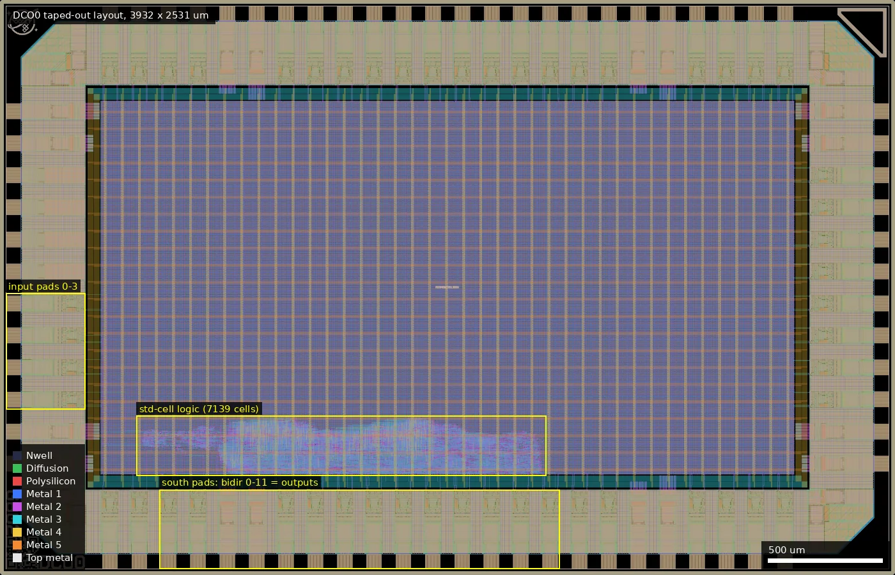
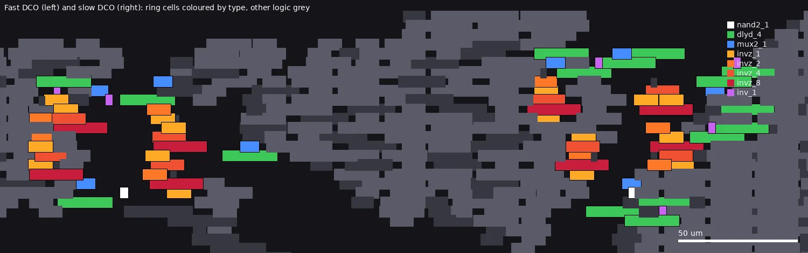
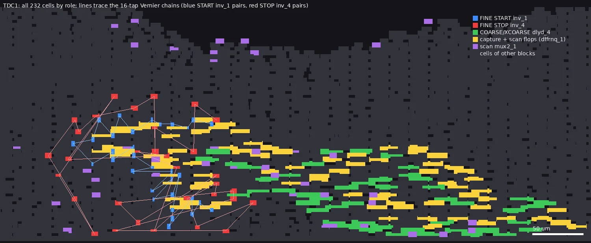
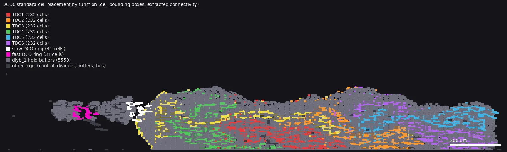

# DCO0: Standard Cell DCO+TDC (ws-run2)

| | |
|---|---|
| Repository | https://github.com/asinghani/ws-dco-tdc @ c5b10fc (main, last commit 2026-07-14; single commit in history) |
| Slot | 1x0p5 (declared). The checked-in `src/slot_defines.svh` selects pad counts per `SLOT_*`; see caveat below |
| Top cell | chip_top |
| Licence in repo | Apache-2.0 (LICENSE; GitHub-detected) |
| README | STUB (19 words: "A very experimental all-standard-cell DCO and TDC in gf180", plus a credit to the evezor docker starter kit) |
| Taped-out layout | DCO0_chip_top_0_6, 3932 x 2531 um, 1 placement on the G802 reticle |
| Commit compared | repository clone at c5b10fc855d7 (main); designs.csv taped-out commit c5b10fc855d7 (identical); the repo's submission/chip_top.gds.gz matches the taped-out layout (see Taped-out layout) |

## What the repo actually contains

A purpose-built timing-measurement chip made only of `gf180mcu_fd_sc_mcu7t5v0` (7-track, 5 V library) standard cells, hand-instantiated in `src/chip_core.sv` with `(* keep *)` / `keep_hierarchy`. There is no macro, SRAM or analog block. I/O uses `gf180mcu_fd_io` (`in_s` clk, `in_c` rst and inputs, `bi_24t` bidirectional pads, `asig_5p0` analog pads, unused). Core and pad supplies are the same 5 V net (see the PADRING_DVDD comments in `src/chip_top.sv`). Flow is LibreLane (config `librelane/config.yaml`, slot YAMLs, `CLOCK_PERIOD: 200` = 5 MHz for the SPI-like control clock only; neither DCO is a constrained clock). `Checker.YosysSynthChecks` is switched off because the DCO deliberately ties tristate `invz_*` outputs together.

Directories:
- `src/chip_core.sv` (449 lines): the whole design (DCOs, TDCs, serial registers, dividers). `src/chip_top.sv`, `slot_defines.svh`: template padring. `src/sim_stubs.v`: sim models.
- `tb/tb_chip_core.sv`, `cocotb/chip_top_tb.py`: RTL testbenches (edge counting on DCO outputs, TDC scan readout).
- `submission/chip_top.gds.gz` (15.6 MB): the submitted layout. No LVS/DRC/STA reports, no `final/` directory in the repo.
- `experiments/`: ~400 ngspice decks in `experiments/spice_sim/`, Python drivers in `experiments/scripts/` (hard-coded `/home/anish/...` paths), a few result text files/PNGs in `experiments/results/`, a small RTL TDC prototype in `experiments/rtl` and `experiments/tb`. `experiments/README.md` says these are "a bunch of random (mostly ai-written) SPICE sims from early experiments".
- `docker/`, `docker-compose.yml`: build/sim containers from the evezor starter kit.

### The oscillators (two independent DCOs)
Both are NAND-gated ring oscillators (`nand2_1` with enable, feedback from `out`); each stage is built from `dco_tunable_stage` / `dco_fixed_stage` modules.
- DCO1 "fast": 7 inversions: `nand2_1` + 6 stages (fs0 tunable, fs1 fixed `inv_1`, fs2 tunable, fs3 fixed, fs4 tunable, fs5 tunable). Each tunable stage has a `dlyd_4` delay cell, a `mux2_1` bypass (coarse bit selects delayed or direct input), then `invz_1` always enabled plus parallel tristate inverters `invz_1`, `invz_2`, `invz_4`, `invz_8` enabled by fine bits [0..3] (binary-weighted drive).
- DCO2 "slow": 9 inversions: `nand2_1` + 8 stages. Every stage has at least one `dlyd_4` before an `inv_1`; the 4 tunable stages have two `dlyd_4` in series with a mux selecting 1 or 2, and the same `invz` fine-drive bank.
- Control: 16-bit shift register (`dco_shift_clk`, `dco_shift_data`); when `dco_shift_latch`=1 on the clock edge the word is captured: `dco1_word = {coarse[3:0], fine[3:0]}` from bits [7:0], `dco2_word` from bits [15:8]. Reset state is 0 (so coarse=0, fine=0 = the weakest-drive, no-extra-delay setting).
- So coarse: 4 bits, each adding one `dlyd_4` into one stage (thermometer-like by stage, 16 combinations, 1 inserted dlyd_4 per set bit); fine: 4 bits binary-weighted drive strength (16 steps), applied to all four tunable stages at once.

### The TDCs (six instances of `tdc_three_level`)
Each has three delay lines, all started by `start`, sampling `stop` with D flip-flops (`dffrnq_1`) clocked from the delayed `start` taps:
- FINE: 16-tap Vernier. START chain is 2x `inv_1` per tap, STOP chain is 2x `inv_4` per tap; the capture flop for tap i has CLK = START tap, D = STOP tap. The intended resolution is the per-tap difference of the two inverter-pair delays (the author's SPICE implies roughly 17 ps per tap, see below).
- COARSE: 16 taps, one `dlyd_4` per tap, `stop` sampled directly by each tap flop.
- XCOARSE: 8 taps, four series `dlyd_4` per tap.
- 40 capture bits per TDC (FINE[0..15], COARSE[0..15], XCOARSE[0..7]) are copied through a `mux2_1` + `dffrnq_1` scan chain (`scan_capture_dff`): latch=1 loads captures, latch=0 shifts toward `scan_out` (chain order FINE[0..15], COARSE[0..15], XCOARSE[0..7]; `scan_in` is tied to 0 and XCOARSE[7] is the stage that drives `scan_out`).
- Instances: TDC1 start=A stop=B, TDC2 start=B stop=A (swapped, to extract pad/path skew), TDC3 start=DCO1 out stop=C, TDC4 start=C stop=DCO1, TDC5 start=DCO2 stop=D, TDC6 start=D stop=DCO2. A..D are external inputs through `clkbuf_4` input buffers.

### Readout and I/O mapping (from the header of `chip_core.sv`)
- Inputs (core indices): 0 DCO1 enable, 1 DCO2 enable, 2 DCO shift data, 3 DCO shift clock, 4 DCO shift latch, 5 TDC scan clock, 6 TDC scan latch, 7..10 TDC A, B, C, D.
- Outputs on bidir pads 0..11: 0 DCO1 (through two `clkbuf_16`), 1 DCO1/2, 2 DCO1/8, 3 DCO2, 4 DCO2/2, 5 DCO2/8 (dividers are `dffrnq_1` toggle flip-flops reset by DCO enable), 6..11 scan-out of TDC1..TDC6 (each through a `buf_16`). Bidir pads 0..11 are output-enabled, all other bidirs are inputs. The DCO frequency is measured by an external counter/scope on pad 0..5, the TDC codes by clocking the scan chain from outside. No on-chip counter, no UART/SPI.
- Output pads are `bi_24t` with CS=0, SL=0 (CMOS, fast slew). A 100-300 MHz DCO through the pad/bond/probe will be bandwidth-limited; the /2 and /8 outputs are for that reason (inferred).

### Simulation data in the repo (what silicon could be compared against)
All ngspice, 5.0 V, `temp=25`, typical models only (`experiments/spice_sim/sm141064_typical.spice` and `smbb000149_typical.spice` are copied into the repo, with `mc_skew=3` style params set in the header). No voltage or temperature sweep, no corner runs, no Monte Carlo. Results that are actually saved:
- `experiments/spice_sim/dco_alt.log`: alternating tunable/fixed rings, 11 stages: 99.8 MHz (code 0), 124.0 (8), 126.7 (16), 127.9 (24), 128.5 (32); 13 stages: 92.4 to 116.5 MHz. Saturates quickly with the 32-code thermometer fine drive used in those earlier variants (code 0 vs 8 is a ~24 % jump, then steps of ~0.1-1 MHz).
- `dco_11st.log` (tail): 146 to 1189 MHz over 33 codes, 8.12x range, median step 0.74 MHz, last steps 0.3 MHz around 187-193 MHz. `dco_therm_scan.log` and `dco_therm_scan2.log`: ring-length scans (9-19 stages) with fixed delay cells; several runs TIMEOUT (no oscillation), and some rings ran at 2.85-2.95 GHz, i.e. inverter-only rings, an unphysical-looking regime the author was probing.
- `experiments/results/spice_ringosc.txt`, `spice_3inv.txt`, `spice_synth_ringosc.txt`, `spice_out.txt`: waveform tables of small rings (raw columns: time and node voltages). No summary table.
- TDC: `tdc_sweep.log`, `tdc3_sweep.log`, `tdc3d_sweep.log`, `tdc_wide.log` give thermometer codes vs injected start-stop delay. FINE: 0 ps gives 10 ones of 16, 50 ps 7, 100 ps 4, 150 ps 1, 200 ps 0, i.e. the code falls about 3 taps per 50 ps, which is roughly 17 ps per tap (inferred from those numbers), with a usable fine range of about 0-200 ps. COARSE: about 1.2 ns per `dlyd_4` tap (16 taps, ~19 ns span; ones count drops 1 per ~1.0-1.2 ns), XCOARSE: ~4.9 ns per tap (8 taps, ~40 ns span). Summary of the author's own resolution analysis (tdc3_sweep.log): FINE and COARSE overlap between 0 and ~225 ps.
- `experiments/spice_sim/dly_meas_*.sp` (inv_1, dlya/b/c/d_1/2/4, buf_*, clkbuf_*): decks that measure the 50 % to 50 % rising delay of each cell with `.meas`, but the repo has no output of them (no table in the log files). `run_dly_meas.py` would reproduce these.
- `post_harden_dco.sp` plus `run_post_harden_dco.py`: attempted full-chip SPICE from the Magic-extracted `chip_top_nostubs.spice` with DCO word at reset (fine 0, coarse 0). The only log (`post_harden_dco.log`) is one line ("Generated ... with 58 chip_top ports"), so there is no post-layout frequency result in the repo.
- `scripts/run_final_dco_spice.py` simulates the exact final fast and slow ring structures (fine/coarse sweeps) but no log or result file from it is in the repo. The comments in `chip_core.sv` give expected bands only: fast DCO "roughly 100-300 MHz", slow DCO "roughly 10-50 MHz".

Layout facts from the GDS (parsed top-cell instance counts, read directly): 304 `dlyd_4`, 198 `inv_1`, 192 `inv_4`, 518 `dffrnq_1`, 248 `mux2_1`, 16/8/8/8 `invz_1/2/4/8`, 2 `nand2_1`, 6 `buf_16`, 8 `clkbuf_16`, 6 `clkbuf_4`, 8 `buf_4`, 46 `bi_24t`, 4 `asig_5p0`, 5 `in_c`, 1 `in_s`, plus 5550 `dlyb_1` (hold-fix buffers inserted by the resizer; the layout shows they are on the reset net, see Taped-out layout) and ~3.3e4 `filltie`/fillcaps. The dlyd_4/inv/dff counts match six TDCs plus both DCOs exactly (6x48+16 dlyd_4, 6x32 inv_4, 518 DFFs), so the whole structure is in the submitted layout.

## Taped-out layout

| Item | Measured from `layout/DCO0.oas` |
|---|---|
| Reticle cell / size / placements | `DCO0_chip_top_0_6`, 3932 x 2531 um, 1 placement on the G802 reticle |
| Pads and IO cells | 46 `bi_24t`, 5 `in_c` (4 inputs + `rst_n`), 1 `in_s` (`clk`), 4 `asig_5p0`, 8 `dvdd` + 8 `dvss` (the 1 VDD and 1 VSS pad are also `dvdd`/`dvss` cells), 4 corner cells. This is the `SLOT_1X0P5` pad map |
| Standard cells | `gf180mcu_fd_sc_mcu7t5v0` only: 7139 logic placements (5550 of them `dlyb_1`) plus about 100 000 fill/tap/tie cells |
| Logic area | all 7139 cells sit in x 443-2388 um, y 442-1046 um; all but one (an input buffer at y 1046 um) are in y 442-700 um, i.e. a strip along the south edge of the core (about 1950 x 260 um). The rest of the 3050 x 1650 um core is tap/fill only |
| SRAM / analog / custom blocks | none. No MIM, no SRAM, no non-library cell except the wafer.space logo, QR/ID marks and marker. The only non-logic devices are inside the foundry IO cells (ESD clamps, `nmoscap`, `ppolyf_u` series resistors) |
| Supply | one 5 V domain; core and IO rails are the same net, as the repo comments say |
| Comparison basis | repository clone at `c5b10fc855d7` (`main`, single commit); `designs.csv` (wafer.space-bench) lists taped-out commit `c5b10fc855d7`: same commit |

*Whole die (3932 x 2531 um). The 7139 logic cells occupy only the strip marked at x 600-2400, y 436-700 um; the four input pads are on the west edge (x 26-376 um, y 730-1240 um) and the twelve used output pads on the south edge (x 700-2460 um, y 26-376 um). The rest of the core is tap and fill cells and the power grid.*

### Does it match the repository?

Yes. `submission/chip_top.gds.gz` in the repository was loaded and compared with the taped-out OASIS (reticle cell `DCO0_chip_top_0_6` vs `chip_top` in the repo GDS: both load with 1008 cells and the same top-cell box 0,0 to 3932,2531; the only difference is the top-cell name). All 43 library-cell and IO-cell types have identical placement counts, and the set of (cell type, lower-left position, orientation) of all 7897 non-fill library-cell and IO-cell instances is identical (symmetric difference 0). The numbers of top-level shapes on Metal2, Metal3, Metal4 and Metal5 are also identical (24398, 11719, 911, 175). So the layout on the die is the repo's `submission/chip_top.gds.gz`, which is the design `src/chip_core.sv` describes, with the pad-count caveat below. The repo summary's cell counts (304 `dlyd_4`, 198 `inv_1`, 192 `inv_4`, 518 `dffrnq_1`, 248 `mux2_1`, 5550 `dlyb_1`, ...) are confirmed. Two cell types the earlier text did not list are present: 32 `mux2_2` (the load/shift select in front of the 16 shift flops and 16 word flops of the DCO tuning registers) and 6 `clkinv_1` (the toggle-flop feedback inverters of the dividers).

Connectivity was extracted with `klayout.db.LayoutToNetlist` over Metal1-5 and Via1-5 (flat, the design's own routing and every cell's internal metal), with Contact-on-Poly2 and Poly2 added so that multi-island cell inputs (`inv_4`) join. Nets were labelled by the cell pin text. Logic connectivity comes from a run over the core region (x 430-2500, y 430-1110, tie cells included); pad connectivity from a full-die run (without the poly step, which does not matter for the pad buffers). I read the result as "extracted connectivity shows", not as an LVS against a netlist: the repo has no netlist to compare to.

### Where the pads go (extracted connectivity)

The pad names are the Metal5 labels in the layout (`input_PAD[n]`, `bidir_PAD[n]`, `rst_n_PAD`, `clk_PAD`; coordinates are the label positions); pad order follows `librelane/slots/slot_1x0p5.yaml`.

| Pad | Label position (um) | What it reaches | Matches repo map? |
|---|---|---|---|
| `input_PAD[0]` | 58, 1195 | `buf_4` (469, 576) -> `nand2_1` A1 of the fast DCO and the divider-reset `and2_1` | yes, DCO1 enable |
| `input_PAD[1]` | 58, 1054 | `clkbuf_8` (443, 1046) -> `buf_4` (894, 568) -> `nand2_1` of the slow DCO and its `and2_1` | yes, DCO2 enable |
| `input_PAD[2]` | 58, 913 | `buf_4` (630, 627) -> `mux2_2` I0 (first stage of the DCO shift register) | yes, DCO shift data |
| `input_PAD[3]` | 58, 772 | `clkbuf_4` (615, 635) -> chain of `dlyb_1` -> the 32 DCO shift/word flop clocks | yes, DCO shift clock |
| `rst_n_PAD` | 612, 58 | `clkbuf_8`/`buf_8`/`buf_4` tree and `dlyb_1` chains (up to 17 in series) -> the reset pin of all 518 `dffrnq_1` (512 directly through `dlyb_1`, 6 divider flops through two `and2_1`) | yes |
| `clk_PAD` | 482, 58 | the `in_s` cell's Y output has no load at all | yes (`clk` is only kept, not used) |
| `bidir_PAD[0]` | 740, 58 | fast DCO output: ring node (an `invz_1` output) -> two `clkbuf_16` -> one `dlyb_1` -> pad | yes, DCO1 |
| `bidir_PAD[1]` | 870, 58 | `clkbuf_16` driven by the first divider flop (ring node is its clock): DCO1/2 | yes |
| `bidir_PAD[2]` | 1257, 58 | `clkbuf_16` driven by the third flop of the divider chain: DCO1/8 | yes |
| `bidir_PAD[3]` | 1386, 58 | slow DCO output: ring `inv_1` -> `buf_4` -> two `clkbuf_16` -> pad | yes, DCO2 |
| `bidir_PAD[4]`, `[5]` | 1515, 1644; y 58 | `clkbuf_16` from the first / third divider flop on the slow ring: DCO2/2, DCO2/8 | yes |
| `bidir_PAD[6]` ... `[11]` | 1773, 1902, 2031, 2160, 2289, 2418; y 58 | `buf_16` driven by the last flop of the 40-flop scan chain of TDC1 ... TDC6 | yes, scan out |
| `bidir_PAD[12]` ... `[45]` | | the `A` (data-out) pins have no driver in the logic and the `Y` (data-in) pins feed nothing | yes (unused) |
| `analog_PAD[0..3]` | 58, 1336-1759 | `asig_5p0` cells with only their pad pin; nothing in the core touches them | yes (unused) |

**Seven of the eleven control inputs are tied to ground on the die.** `chip_core.sv` reads `input_in[0..10]` but the 1x0p5 slot has only four input pads (`NUM_INPUT_PADS=4`). The extracted netlist shows all eleven input buffers are present, but the input pins of the seven for indices 4 to 10 are driven by `tiel` cells, not by any pad:

| Signal (repo map) | Input buffer (x, y um) | Input driven by |
|---|---|---|
| 4 DCO shift latch | `buf_4` (672, 639), drives the 32 select pins of the `mux2_2` word flops | `tiel` (663, 623) |
| 5 TDC scan clock | `clkbuf_4` (1767, 564), drives 240 flop clocks | `tiel` (1792, 560) |
| 6 TDC scan latch | `buf_4` (1384, 478), drives 240 `mux2_1` selects | `tiel` (1352, 482) |
| 7, 8, 9, 10 TDC A, B, C, D | `clkbuf_4` (1649, 509), (1443, 497), (1493, 572), (1952, 576) | one `tiel` each at (1678, 529), (1443, 505), (1502, 541), (1952, 592) |

Consequences, read from the connectivity and the RTL together: the DCO word registers can never be loaded (latch low), so both DCOs stay at the reset code (coarse 0, fine 0: no extra `dlyd_4`, only the base `invz_1` driving); the TDC scan clock never toggles, so the scan chains never shift and `bidir_PAD[6..11]` can only show the reset level (0); and the TDC start/stop inputs A to D are constants, so TDC1, TDC2 never see an edge, and TDC3 to TDC6 see an edge only on their DCO side. The TDCs therefore cannot be read out on the manufactured die. What can still be measured is the frequency of the two DCOs at code 0 on pads 0 and 3, with the /2 and /8 outputs on pads 1, 2, 4, 5, as a function of the DCO enable pins, supply and temperature.

### The oscillators in the layout

Both rings were found as the only combinational loops (strongly connected components) in the extracted netlist; no `dlyb_1` or other hold buffer is inside either loop.

| Item | Fast DCO (DCO1) | Slow DCO (DCO2) |
|---|---|---|
| Loop cells | 31: `nand2_1` x1, `dlyd_4` x4, `mux2_1` x4, `invz_1` x8, `invz_2` x4, `invz_4` x4, `invz_8` x4, `inv_1` x2 | 41: `nand2_1` x1, `dlyd_4` x12, `mux2_1` x4, `invz_1` x8, `invz_2` x4, `invz_4` x4, `invz_8` x4, `inv_1` x4 |
| Stages after the NAND | 4 tunable stages (`dlyd_4` + `mux2_1` bypass + five parallel `invz`: one always on `invz_1`, then `invz_1/2/4/8` for the fine bits), 2 fixed `inv_1` stages: 7 inversions | 4 tunable stages (two `dlyd_4` + `mux2_1` + five `invz`), 4 fixed stages (`dlyd_4` + `inv_1`): 9 inversions; 8 `dlyd_4` are always in the loop, 4 more switch in with the coarse bits |
| Extent of the loop cells | x 706.9-811.9, y 564.1-619.8 um (105 x 56 um) | x 916.9-1021.9, y 556.2-631.6 um (105 x 75 um) |
| Pads | `bidir_PAD[0]` (/1), `[1]` (/2), `[2]` (/8) | `bidir_PAD[3]` (/1), `[4]` (/2), `[5]` (/8) |
| Enable | `input_PAD[0]` | `input_PAD[1]` |
| Code on this die | fixed at 0 (see tied inputs) | fixed at 0 |

*Fast DCO (left, x 707-812 um) and slow DCO (right, x 917-1022 um), y 545-645 um: the ring cells are coloured by type (grey is all other logic). The cells are not grouped as macros: each ring is spread over about 100 um interleaved with unrelated cells, so its wires are several tens of um long and carry routing parasitics that the author's cell-only SPICE did not include.*

### The TDCs in the layout

Each of the six TDCs is 232 standard cells, matching the repo exactly: FINE 16 taps (32 `inv_1` on START, 32 `inv_4` on STOP, 16 capture `dffrnq_1`), COARSE 16 `dlyd_4` taps with 16 capture flops, XCOARSE 8 taps of four `dlyd_4` each (32 `dlyd_4`) with 8 capture flops, and the scan chain of 40 `mux2_1` + `dffrnq_1` pairs ending in a `buf_16`. All 40 capture flops of each TDC were traced: FINE flop clock = START tap (`inv_1`), D = STOP tap (`inv_4`); COARSE and XCOARSE flop clocks = `dlyd_4` taps, D = the stop net. The first scan-chain input (`scan_in`) of every chain is a `tiel`. The six TDCs are not placed as blocks; their cells are interleaved over about 570-1100 um of the logic strip.

| TDC | Scan-out pad | START from | STOP from | Cell bounding box (x, y um) | Hold buffers (`dlyb_1`) in series with its inputs |
|---|---|---|---|---|---|
| TDC1 | `bidir_PAD[6]` | A | B | 1228-1796, 446-663 | none |
| TDC2 | `[7]` | B | A | 1513-2093, 446-694 | none |
| TDC3 | `[8]` | DCO1 output | C | 953-2048, 450-683 | START side: 1 in front of the FINE chain, 1 to 2 in front of the first COARSE and XCOARSE cells |
| TDC4 | `[9]` | C | DCO1 output | 966-1533, 446-686 | STOP side: 3 in front of the FINE STOP chain; 1, 2 or 3 (4, 6 and 14 flops) in front of the 24 COARSE/XCOARSE capture D pins |
| TDC5 | `[10]` | DCO2 output | D | 1757-2388, 462-671 | START side: 1 in front of the FINE chain, 1 to 2 in front of the first COARSE/XCOARSE cells |
| TDC6 | `[11]` | D | DCO2 output | 1728-2382, 446-698 | STOP side: none in front of the FINE STOP chain; 1 (5 flops) or 2 (19 flops) in front of the 24 COARSE/XCOARSE D pins |

A, B, C, D are the outputs of the four `clkbuf_4` input buffers listed above (all four inputs are tied low on the die). The 5550 `dlyb_1` cells are therefore not in the delay lines. Following each one to the pins it finally feeds: 5523 feed flop reset pins (chains up to 17 in series, 512 reset pins), 16 feed the AND gates that combine reset with the DCO enables, 4 feed the 32 DCO shift/word flop clocks, and 7 are on the DCO-side start/stop nets of TDC3 to TDC6 listed above. Nothing in the FINE Vernier START chains, FINE STOP chains (except the entry of TDC4), or COARSE/XCOARSE tap chains has a hold buffer. This settles the repo summary's earlier concern.

*TDC1 (x 1215-1800 um, y 440-670 um): its 232 cells coloured by role; the lines connect consecutive inverter pairs of the 16-tap FINE START chain (blue) and STOP chain (red). Consecutive STOP stages are often 30 to 160 um apart (median origin-to-origin hop 31-62 um across the six TDCs, maximum 110-165 um; START chains 18-31 um median, 47-55 um maximum), so the Vernier per-tap difference is not set by cell strength alone but is mixed with a placement-dependent wire load that the author's cell-to-cell SPICE ignored.*

*The logic strip (x 420-2420 um, y 436-1000 um drawn, logic ends near y 700): the two DCO ring cells (white = slow, magenta = fast, far left) and the 232 cells of each TDC in a separate colour, over grey `dlyb_1` hold buffers and other logic. The TDCs overlap each other spatially.*

## Authors and affiliations

| Person | Role | Affiliation | Source |
|---|---|---|---|
| Anish Singhani (GitHub asinghani) | sole committer; design, SPICE experiments | not stated in repo; GitHub bio "Open-source FPGA & ASIC tooling", New York City, no company | `git shortlog` (author "Anish"), GitHub profile (gh api) |
| evezor (Andrew Wingate) | author of the docker starter kit this is based on | Evezor (GitHub profile / README link) | README, gh api |
| Leo Moser / wafer.space | upstream project template | not stated | template files (AUTHORS not present here) |

## Value for GF180MCU characterisation and PDK development

### Verdict: Medium
The design is a purpose-built characterisation vehicle: two tunable NAND-gated ring oscillators and six Vernier/delay-line TDCs, all out of stock 5 V standard cells, with direct pad access to the oscillator outputs. The layout shows that on the manufactured die only the two oscillators are usable, and only at their reset code: seven of the eleven control inputs (DCO word latch, TDC scan clock and latch, TDC A to D) are tied low because the 1x0p5 slot has only four input pads, so the tuning words cannot be loaded and the six TDCs cannot be started or read. What remains is a pair of fixed, cell-only rings (fast: 7 inversions with 4 optional `dlyd_4`, slow: 9 inversions with 8 always-in-loop and 4 optional `dlyd_4`; both at the weakest `invz` drive setting) with /1, /2, /8 outputs on pads, which are directly useful to check `inv_1`, `dlyd_4`, `invz_1`, `nand2_1` and `mux2_1` delay against SPICE and liberty over supply and temperature, but not the Vernier TDC resolution or the tuning ranges the repo is built around. The verdict was High on the repository alone and is lowered to Medium on this evidence.

### Test structures and measurable circuits
All in the 5 V core domain (VDD 5 V, single supply for core and pads), library `gf180mcu_fd_sc_mcu7t5v0`. Positions and pads are given in the "Taped-out layout" section.

| Structure | What it exercises | Access on the manufactured die | Where (layout) |
|---|---|---|---|
| DCO1 fast ring (31 cells: `nand2_1`, 4 `dlyd_4`, 4 `mux2_1`, 2 `inv_1`, 20 `invz_*`) | `dlyd_4` and inverter delay, tristate-inverter drive | measurable: frequency on `bidir_PAD[0]`, /2 on `[1]`, /8 on `[2]`; enable `input_PAD[0]`; code fixed at 0 | x 707-812, y 564-620 um |
| DCO2 slow ring (41 cells: `nand2_1`, 12 `dlyd_4`, 4 `mux2_1`, 4 `inv_1`, 20 `invz_*`) | long-delay-cell (`dlyd_4`) delay | measurable: `bidir_PAD[3]` (/1), `[4]` (/2), `[5]` (/8); enable `input_PAD[1]`; code fixed at 0 | x 917-1022, y 556-632 um |
| TDC FINE Vernier x6 (16 taps, `inv_1` pair vs `inv_4` pair) | inverter delay difference by drive strength | not usable: scan clock/latch and start/stop inputs tied low; scan-out pads `bidir_PAD[6..11]` can only show reset level | interleaved over x 953-2388, y 446-698 um |
| TDC COARSE (16x `dlyd_4`) and XCOARSE (8x4 `dlyd_4`) x6 | `dlyd_4` delay (~1.2 ns per cell in the author's typical SPICE) | not usable (as above) | same |
| TDC1/TDC2 swapped start/stop on A, B | pad/input-buffer skew calibration | not usable (A, B tied low) | same |
| TDC3-6 (DCO vs external C/D edge) | DCO period/phase vs external reference | not usable | same |
| Simulation baseline | ngspice typical 5 V 25 C only | `experiments/spice_sim/*.log`, `experiments/results/` | repo only |

Simulation results do exist in the repo for typical corner (DCO frequencies vs code, TDC thermometer codes vs delay), but no per-cell delay tables are saved, there are no PVT corner results, and no post-layout (extracted) results. Comparing silicon across voltage and temperature to liberty `tt/ss/ff` needs a fresh simulation of the extracted netlist (the Magic extraction was done by the author but is not in the repo; only the GDS is). The layout adds one useful fact for that comparison: the rings are not compact macros, each ring is spread over about 105 um interleaved with unrelated logic, and the cell-only SPICE decks of the repo do not include this wiring.

### Candidate PDK additions
Nothing found as a new cell or macro; the die contains no custom cell. Observations relevant to the PDK: (a) the design needs the Yosys conflicting-driver check turned off for tied-together tristate `invz_*` outputs (config comment); the extracted layout does contain the five parallel `invz` per ring stage, so the check bypass is real; (b) the author bridged a PDK extracted-netlist mismatch in SPICE (`gf180mcu_fd_sc_mcu7t5v0__endcap` defined with two ports in the Magic extraction but four in the PDK SPICE, see `post_harden_dco.sp` comment); (c) a cell-only ring/TDC is a convenient PDK regression test for liberty versus SPICE, but this layout shows that an automatically placed-and-routed delay line gets 30 to 160 um wires between stages, so a PDK-supplied pre-placed ring-oscillator or delay-line macro (or a hold-buffer-free flow recipe) would give a cleaner cell-delay measurement; (d) the flow inserted 5550 `dlyb_1` hold buffers, chains up to 17 deep on the reset net, to meet hold on async resets, which is a place where liberty `dlyb_1` delays are exercised but not observable.

### What would be needed to use it
- Packaged or bare-die access to 4 input pads (the DCO enables on `input_PAD[0]`, `[1]`; shift data/clock on `[2]`, `[3]` have no effect on this die), `rst_n`, 6 output pads for the DCOs (`bidir_PAD[0..5]`) and power; a fast scope or frequency counter (use the /2 and /8 pads for the fast ring), a bench supply (5 V core, sweep roughly 4.5-5.5 V) and a temperature chamber.
- The TDCs and the DCO tuning words cannot be exercised on this die; to use them one would need a respin with the 1x1 pad map (12 inputs) or the control signals multiplexed onto the available pads. The pad map is only in the header comment of `chip_core.sv` and in the table above. The README is a stub.
- Simulation of the extracted netlist at the same corners, with the code-0 ring configuration and the actual wiring.

## Notes and caveats
- **Pad-count mismatch (now settled from the layout).** The die has the `1x0p5` pad map (4 inputs, 46 bidir, 4 analog). The extracted connectivity shows that inputs 4 to 10 of `chip_core.sv` are tied to ground by `tiel` cells, so the DCO word latch, TDC scan clock/latch and TDC A to D are not reachable; only DCO1 enable, DCO2 enable, DCO shift data and DCO shift clock are, and the last two have no effect since the latch is low. The bidirectional pads 12 to 45 have no function. Evidence level: extracted connectivity from the placed layout; I did not have the netlist, so there is no LVS.
- **Hold buffers (settled).** The 5550 `dlyb_1` are almost all on the reset net (5523) and on the divider reset gates (16) and the shift clock (4); 7 sit in the DCO-side start/stop paths of TDC3 to TDC6 (table above); none are in the Vernier or tap chains. They would have shifted the code of TDC4 and TDC6 (stop = DCO) by 1 to 3 `dlyb_1` delays on the capture D pins and, for TDC4, on the whole FINE STOP chain, but that is moot since the TDCs cannot be read.
- STA is only against a 5 MHz virtual clock on `clk_PAD`; the rings and TDC sampling have no timing constraints, so liberty/STA says nothing about them.
- The experiments directory is mostly AI-written by the author's own description; scripts have hard-coded `/home/anish/wafer_space_docker_based_starter_kit/...` paths; some earlier ring variants (thermometer-coded 32-step `invz` banks) differ from the final 4+4 bit design in `chip_core.sv`.
- Final-design (`run_final_dco_spice.py`) results were not saved, so the "100-300 MHz" and "10-50 MHz" figures are expectations in code comments, not recorded simulation results. At the code actually on the die (0) the rings are at their slowest/weakest-drive setting, so the die's frequencies are expected below the middle of those ranges (inferred; not simulated here).
- Which of the four tunable stages is which in the ring order (fs0/fs2/fs4/fs5 in the RTL) was not traced; the ring cell counts, cell types and loops match the RTL.
- No releases, no silicon test results.
