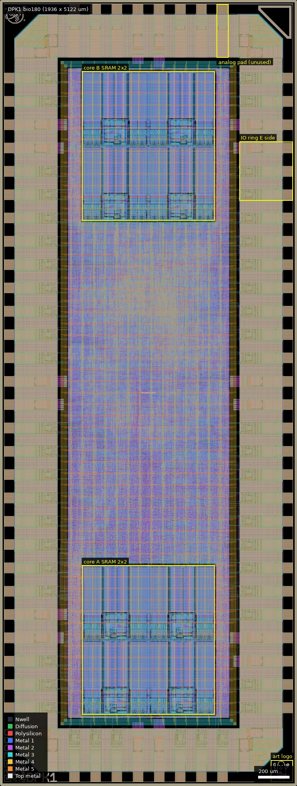
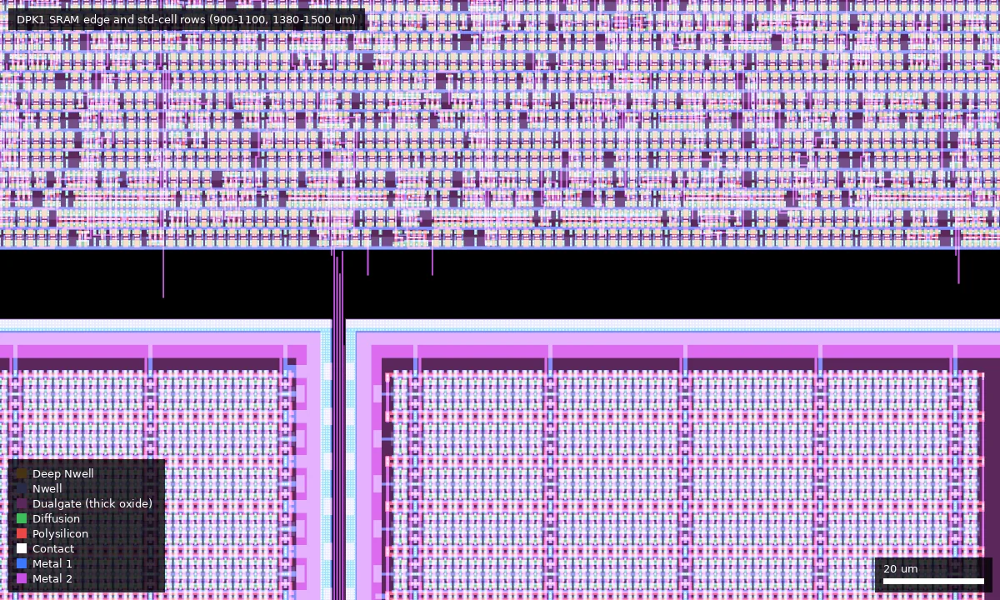
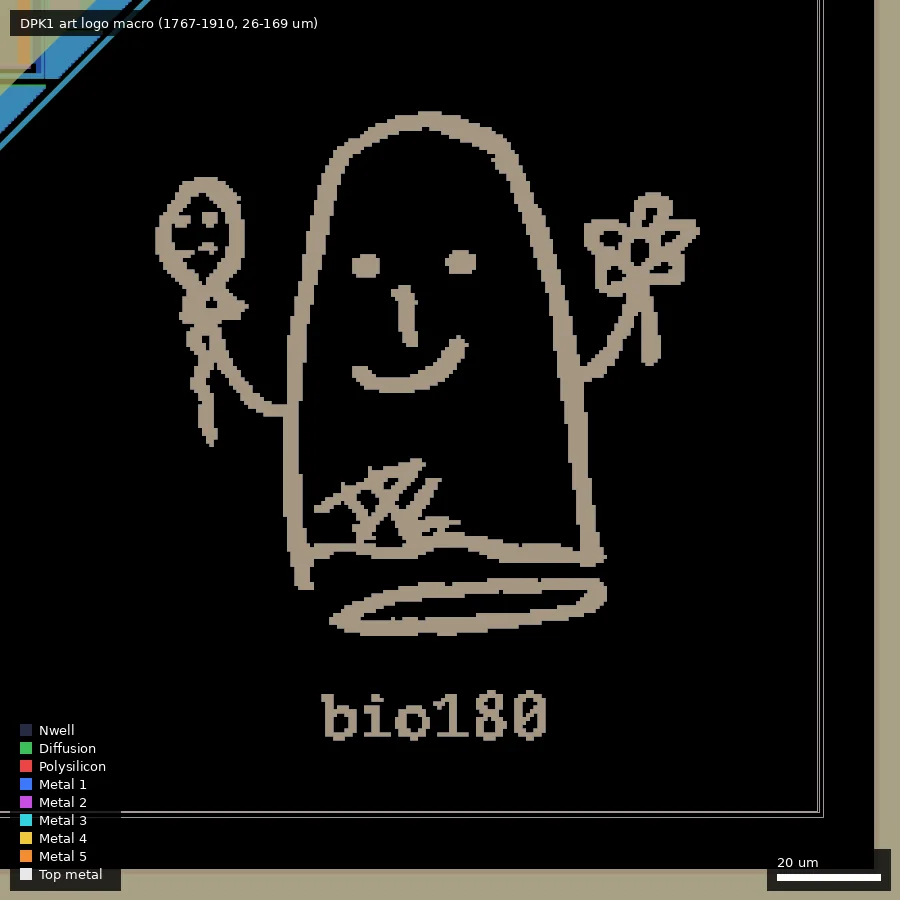

# DPK1: bio180 (ws-run2)

| | |
|---|---|
| Repository | https://github.com/dpks2003/bio-core @ 0fe3252 (bio180, last commit 2026-07-20) |
| Slot | 0p5x1 |
| Top cell | chip_top |
| Licence in repo | CERN-OHL-W-2.0 (changed from Apache-2.0 in the last commit "license oversigh use CERN OHL2") |
| Taped-out layout | DPK1_chip_top_12_4, 1936 x 5122 um, 1 placement(s) on the G802 reticle |
| README | OK (630 words) |

## What the repo actually contains

A dual-core programmable I/O coprocessor ported from bunnie Huang's BIO (Betrusted I/O, baochip-1x) to GF180MCU: two PicoRV32 (RV32I, `fast_mult` enabled) cores each with a 2 KiB instruction memory, 4 shared FIFOs, 32 bidirectional GPIO with GPIO-invert, SPI slave bridge (RP2040 host, burst IMEM loading, 9-bit addressing), IRQ[0..1] outputs, clock gating per core (`src/icg_gf180.sv`: behavioural latch-less ICG, `en_r` sampled on negedge, CKG = CK & en_r, a plain RTL clock gate, not the library ICG cell).
- Cells: `gf180mcu_fd_sc_mcu7t5v0` at 5 V, `gf180mcu_fd_io` pads, 8 SRAM macros `gf180mcu_fd_ip_sram__sram512x8m8wm1` (per core 4 x 512x8 via `src/sram_512x32.v`, total 2 x 2 KiB = 4 KiB; the platform text says "4Kb", it is 4 KiB / 32 kbit). A 3.3 V variant of the macro config (`gf180mcu_ocd_ip_sram`) exists in `librelane/macros/macros_3v3.yaml`, but the default Makefile is 5 V.
- Flow: LibreLane, `SYNTH_STRATEGY: "AREA 3"`, `CLOCK_PERIOD: 100` (10 MHz target), SDC false-paths reset and all pad inputs (`set_false_path -from [get_ports {input_PAD[*] bidir_PAD[*]}]`).
- Other files: `src/bio_lite.sv`, `bio_lite_top.sv`, `picorv32.v`, `pio_divider.v`, `regfifo.v`, `spi_bio_bridge.sv`, `spi_slave.v`, `rst_sync.v`; `ip/gf180mcu_dpk_ip__logo` (a custom art logo macro in addition to the wafer.space ID macros); `pinout.md`; `assests/` (chip render, art "ghost with flower and balloon").
- Verification: `sim/cocotb/` has ~30 tests (RTL and gate-level: bootstrap corners, stall races, FIFO reset, GPIO invert, walking-1, UART TX, bunnie reference, SPI). No DRC/LVS/STA reports in the tree.
- Releases: `B_1.0` (ws_run2_submission) contains `bio180.gds.gz`, two 241 MB tarballs of the run output (`bio180.tar.gz`, `bio180ws2.tar.gz`) and `key.log` (assets are listed in releases.json; downloaded under `releases/`, I did not unpack them).

## Taped-out layout

| | |
|---|---|
| Die | 1936 x 5122 um, reticle cell `DPK1_chip_top_12_4`, 1 placement |
| Pads / IO cells | 72 pads plus 4 corner cells: 44 `gf180mcu_fd_io__bi_24t` (bidir_PAD[0..43]), 5 `in_c` + 1 `in_s` (clk, rst_n, input_PAD[0..3]), 6 `asig_5p0` (analog_PAD[0..5]), 8 `dvdd`, 8 `dvss` |
| Standard cells | `gf180mcu_fd_sc_mcu7t5v0` only: 66,232 logic cells (nand2_1 20,040, oai21_1 5,522, clkinv_1 5,316, nand3_1 5,240, dffq_1 3,634, dffrnq_1 1,012, dlyc_1 3,251, dlyb_1 854) plus 120,983 fill/tap/endcap cells; about 4,650 flip-flops |
| SRAM | 8 x `gf180mcu_fd_ip_sram__sram512x8m8wm1`, each 431.9 x 484.9 um, as two 2x2 blocks (x 536-1400): y 466-1437 and y 3685-4656 (one block per core, 4 x 512x8 = 2 KiB) |
| Custom / analog | none. No DNWELL, no MIM, no BJT; RES_MK, DIODE_MK, ESD_MK, MOS_CAP_MK and ISOSUB shapes lie only inside the stock IO cells (RES_MK and diode markers) or the SRAM/std cells. Dualgate and V5_XTOR appear in the SRAM, the IO cells and all 5 V standard cells (by area, std cells 3.5 and 2.7 Mum2) |
| Art / ID | `gf180mcu_dpk_ip__logo` (143 x 143 um, 1767-1910, 26-169) plus wafer.space logo, QR, project and shuttle ID, marker |

### Does it match the repository?
The commit in designs.csv (0fe3252) holds no chip GDS (only the logo and wafer.space ID macro GDS); the full GDS is the release asset `B_1.0/bio180.gds.gz` (top cell `chip_top`). I counted every `gf180mcu*` and `018SRAM*` cell instance recursively in both the reticle cell and that release GDS: 137 distinct library cell names in each, zero differences in count, same 1936 x 5122 um bounding box. The only extra cell in the reticle file is the seal ring. Block structure agrees with the repo: two PicoRV32 cores with 4 SRAM macros each, flat synthesised logic, 5 V mcu7t5v0 cells, a `gf180mcu_dpk_ip__logo` macro, 5 V `gf180mcu_fd_io` pads. The release tarballs were not unpacked,. The release GDS is a release asset, not in the git tree.

### Is there an analog front end or sensor?
No. "BIO" is bunnie's Betrusted I/O, a programmable digital I/O coprocessor, not biosignal sensing. The six `analog_PAD` cells (`asig_5p0`, top edge x 485-1451) are template slot pads; the RTL states they are unused (`chip_core.sv`: "Analog pads (unused)"), and the layout contains no resistor, MIM, BJT, DNWELL or amplifier structure outside the stock IO cells. Whether those six pads are wired to anything inside the core was not traced; RTL says no.

## Authors and affiliations

| Person | Role | Affiliation | Source |
|---|---|---|---|
| Deepak Sharda (dpks2003) | port, RTL fixes, SPI bridge, sims (58+ commits) | GitHub bio: "ASIC/FPGA @ Vicharak", India | gh api users/dpks2003 |
| bunnie Huang | original BIO (Betrusted I/O) | not stated in repo | README (credit only) |
| Leo Moser | template author (102 template commits in history) | not stated | AUTHORS.md, git shortlog |
| Tim Ansell, TrevorPeyton | one template commit each | not stated | git shortlog |

## Value for GF180MCU characterisation and PDK development

### Verdict: Medium
Eight foundry SRAM macros in a working RISC-V system (instruction memory read/write through SPI, executed at 10 MHz) make it a functional test of `gf180mcu_fd_ip_sram__sram512x8m8wm1` at 5 V, including clock-gated operation. It is not built as a characterisation vehicle.

### Test structures and measurable circuits
| Structure | What it exercises | Access | Where |
|---|---|---|---|
| 8 x sram512x8m8wm1 (4 KiB total) as IMEM | SRAM function, access timing at the chosen clock, retention of loaded program | SPI burst load/readback by host | `src/sram_512x32.v`, `src/bio_lite.sv` |
| Clock-gated PicoRV32 cores | standard-cell timing of a CPU at 10 MHz and ICG-style RTL gating | GPIO output toggle rate by firmware | `src/bio_lite.sv` |
Simulation data: only RTL/GL functional testbenches, no timing or power measurements to compare.

### Candidate PDK additions
Nothing found in the layout either (stock cells, macros and IO only; the six analog pads are unused). Authors fixed an X propagation in the clock gate during multiplier generation; used a hand-written ICG instead of a library clock-gate cell (gf180mcu 7t5v0 has `icgtp` cells; I did not check why they were not used).

### What would be needed to use it
Packaged chip, RP2040 SPI host, 10 MHz clock source, firmware loader. A test plan for SRAM characterisation (margins, Vmin, access time) is not provided.

## Notes and caveats
- README says "2 KiB SRAM" per core; project.json says "4Kb". The consistent figure is 2 x 2 KiB = 4 KiB.
- The release `bio180.gds.gz` was compared with the reticle layout (cell counts identical); the large tarballs were not unpacked and the platform hash was not checked.
- Directory name `assests` is a typo in the repo.
