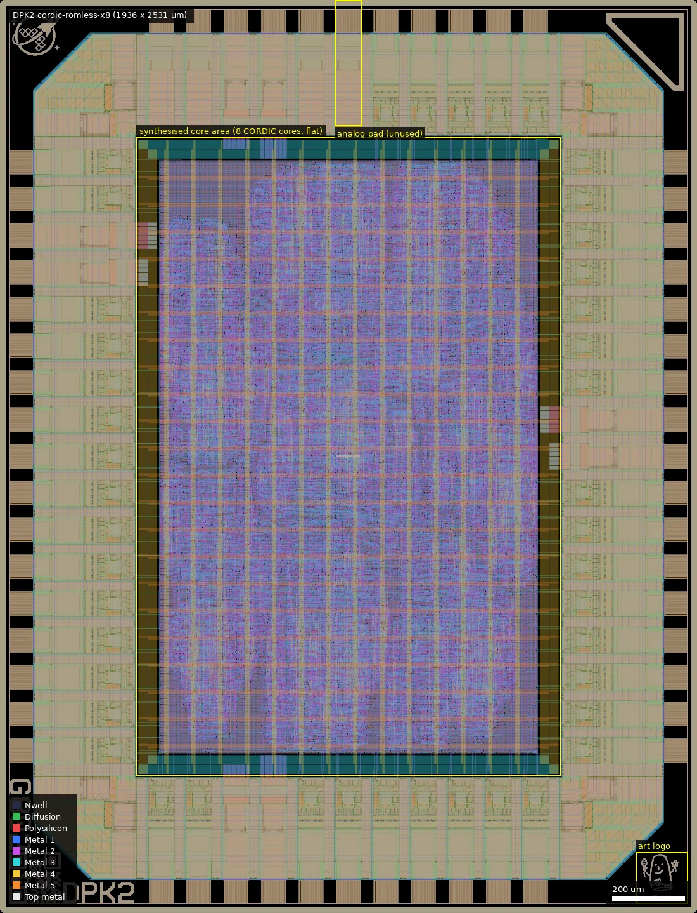
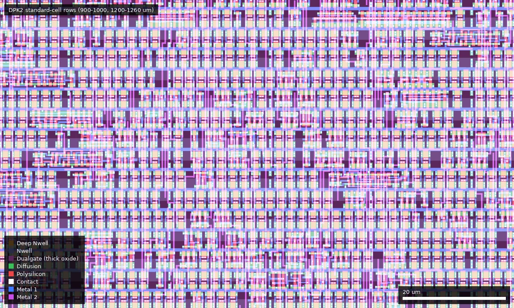

# DPK2: cordic-romless-x8 (ws-run2)

| | |
|---|---|
| Repository | https://github.com/dpks2003/cordic-romless @ b1fa2b4 (ws2-x8, last commit 2026-07-15) |
| Slot | 0p5x0p5 |
| Top cell | chip_top |
| Licence in repo | Apache-2.0 (LICENSE) |
| Taped-out layout | DPK2_chip_top_13_7, 1936 x 2531 um, 1 placement(s) on the G802 reticle |
| README | OK (774 words) |

## What the repo actually contains

Eight independent copies of a 16-bit CORDIC rotation engine (Q3.12: 1 sign, 3 integer, 12 fraction bits; 13 iterations, two clock phases per iteration, 26 cycles per rotation) with no coefficient ROM: the arctan micro-rotation angles are generated on the fly by a Taylor-series approximator (`src/dynamic_atan.v`). Each core has its own SPI slave (`src/spi_slave.v`, mode 0, write 8 bytes `{in_atan_0, in_alpha, in_y, in_x}`, read 6 bytes `{alpha, cos, sin}`), RDY and MISO outputs; only clock and reset are shared.
- It is the second silicon of the author's Tiny Tapeout SKY25a single-core CORDIC (reference repo rohanverma94/ttsky-romless-cordic-engine); `info.yaml` is the leftover Tiny Tapeout descriptor (author "Vicharak").
- Cells: `gf180mcu_fd_sc_mcu7t5v0` (5 V), `gf180mcu_fd_io`; no SRAM, no analog. Flow: LibreLane, `SYNTH_STRATEGY: "AREA 3"`, `CLOCK_PERIOD: 40` (25 MHz).
- Pad map (parametric in `src/chip_core.sv`): inputs[0..3] = CSn0..3, bidir[0..7] SCLK, [8..15] MOSI, [16..19] CSn4..7, [20..27] MISO, [28..35] RDY, [36..37] spare outputs low.
- Files: `src/` (RTL: `CORDIC_Engine_v1.v`, `top_CORDIC_Engine_v1.v`, `top_fsm.v`, `project.v`, ...), `cocotb/chip_top_tb.py` (8 cores sequential and concurrent with golden vector), `test/` (Tiny Tapeout testbench), `fpga/` (ULX3S-85F and Vaaman targets), `docs/info.md` (math, accuracy plots), `assets/`.
- Release `ws_1.0`: `cordic-romless-x8.gds.gz`, a 123 MB tarball of the run, `key.txt`.

## Taped-out layout

| | |
|---|---|
| Die | 1936 x 2531 um, reticle cell `DPK2_chip_top_13_7`, 1 placement |
| Pads / IO cells | 56 pads plus 4 corner cells: 38 `gf180mcu_fd_io__bi_24t` (bidir), 5 `in_c` + 1 `in_s` (clk, rst_n, 4 inputs), 4 `asig_5p0` (analog_PAD[0..3], top edge, e.g. [0] at x 968), 4 `dvdd`, 4 `dvss` |
| Standard cells | `gf180mcu_fd_sc_mcu7t5v0` only: 33,464 logic cells (nand2_1 8,965, clkinv_1 3,906, nand3_1 3,196, dffq_1 3,118, aoi21_1 2,806, oai21_1 2,283) plus 73,753 fill/tap cells; about 3,100 `dffq_1` flip-flops among the top cell types |
| SRAM | none |
| Custom / analog | none (no DNWELL, MIM, BJT; RES_MK/diode/ESD markers only inside the stock IO cells) |
| Art / ID | `gf180mcu_dpk_ip__logo` at 1767-1910, 26-169 um plus the wafer.space ID cells |

### Does it match the repository?
The repo commit (b1fa2b4) contains no chip GDS; the release `ws_1.0/cordic-romless-x8.gds.gz` (top cell `chip_top`) does. Recursive instance counts of every `gf180mcu*` cell agree exactly between it and the reticle cell (102 distinct library cells, identical counts, same 1936 x 2531 um box); only the seal ring cell differs. The 8 cores are synthesised flat, so no per-core blocks exist to locate; eight-fold replication is only visible in the RTL and in the roughly 33 k cells being consistent with eight 16-bit CORDIC engines plus SPI slaves. Pad counts (38 bidir, 4 input) match the 0p5x0p5 slot map in the repo.

## Authors and affiliations

| Person | Role | Affiliation | Source |
|---|---|---|---|
| Deepak Sharda (dpks2003; also appears as "deepak") | 8-core port, ws2 flow | GitHub bio "ASIC/FPGA @ Vicharak", India | gh api users/dpks2003 |
| Rohan Verma (rohanverma94) | original TT CORDIC engine, ULX3S support | GitHub bio "Working on ASICs"; no company; `info.yaml` author field says Vicharak (hint only) | gh api, git log, info.yaml |
| Kasetty-Praveen-Kumar, Marcvi19 (Rishik Ram) | minor contributions | not stated | git shortlog |
| Leo Moser | template author | not stated | AUTHORS.md |

## Value for GF180MCU characterisation and PDK development

### Verdict: Low
Eight identical synthesised digital cores on stock cells; useful as a yield/functional data point. The eight-fold replication gives some copy-to-copy comparability but no designed measurement.

### Test structures and measurable circuits
No structures designed for measurement. The author's reference vector (`in_x=0x09B8, in_alpha=0x3244` gives `cos=0xF001, sin=0x0012, alpha=0xFFFF`) gives a pass/fail functional signature per core, and the maximum SPI/core clock at which all 8 still give the same answer is a coarse speed indicator against the claimed STA slack (README: setup slack +5.56 ns at 40 ns period on `max_ss_125C_4v50`, so about 34.4 ns, roughly 29 MHz, at that corner; this is the author's statement, no report in repo). No simulation results to compare against beyond RTL golden vectors.

### Candidate PDK additions
Nothing found; the layout contains only stock cells and IO.

### What would be needed to use it
Packaged chip, RP2040 (or any SPI master) at SCLK up to about core_clk/4, 25 MHz clock source.

## Notes and caveats
- README internal inconsistencies: "Timing closed on 40 ns" and `config.yaml` agrees (`CLOCK_PERIOD: 40`), but the build section says `CLOCK_PERIOD: 50`; the SPI section assumes a 20 MHz core clock. Also "the only ROM-less CORDIC" is the author's claim.
- Mean absolute error 0.003 over 1000 samples vs MATLAB is claimed in README; not checked.
- Platform description says "Q3.16" but the data is 16 bits (3 integer + 12 fraction + sign), i.e. Q3.12.
