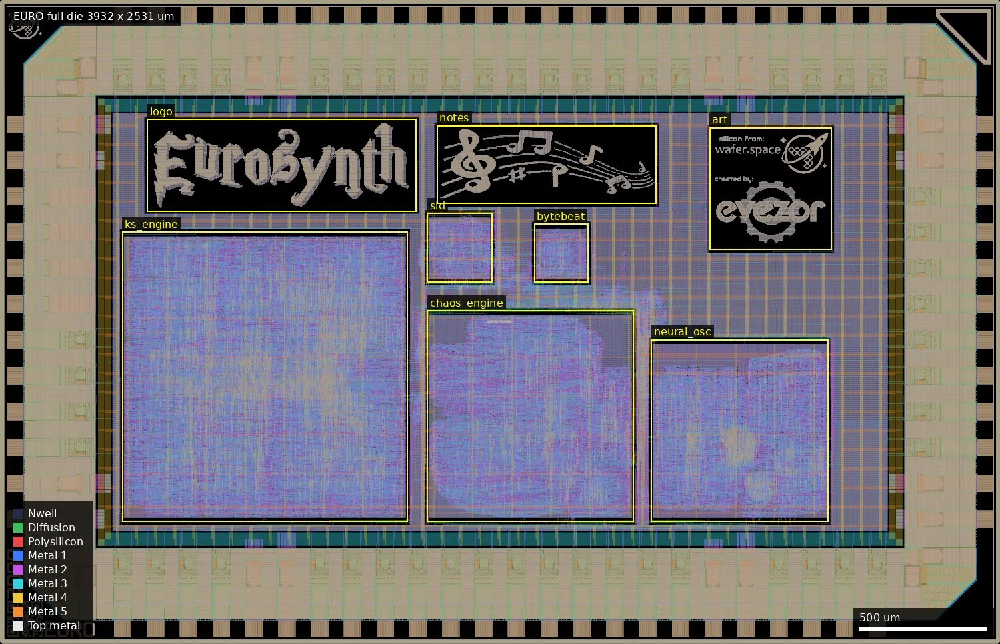
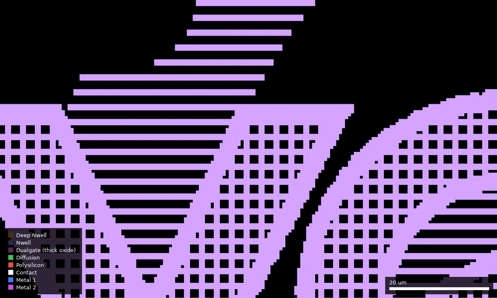

# EURO: EuroSynth (ws-run2)

| | |
|---|---|
| Repository | https://github.com/anfroholic/eurosynth @ 606cb4d (main, last commit 2026-07-05) |
| Slot | 1x0p5 |
| Top cell | chip_top |
| Licence in repo | Apache-2.0 (LICENSE) |
| README | OK (641 words) |
| Taped-out layout | EURO_chip_top_2_7, 3932 x 2531 um, 1 placement on the G802 reticle |

## What the repo actually contains

A fully digital "kitchen-sink" Eurorack synthesiser voice: a timing spine (`src/synth_spine.sv`: tick generator, voice mux, I2S serialiser, bypass ramp), an SPI config block (`src/spi_config.sv`), and five isolated sound engines, each hardened separately as a macro and dropped into `chip_top` through LibreLane's hierarchical macro flow: neural oscillator (`neural_osc.sv`, weights in `neural_weights_init.svh`), chaos engine, Karplus-Strong string (`ks_engine.sv`), SID engine and bytebeat. Audio leaves as I2S (`i2s_bclk` = clk/32, `i2s_ws` = clk/1024, 16-bit) to an external DAC, with a resistor-ladder alternative. Pitch, pluck and voice select are async control pad inputs.
- Cells: `gf180mcu_fd_sc_mcu7t5v0` 5 V, `gf180mcu_fd_io`, 66,906 standard cells per README for the KS-only milestone; the final chip includes all five engine macros (hardened macros in `ip/`, `librelane/blocks/`, `librelane/macros/engines.yaml` merged into `macros_5v.yaml`). No foundry SRAM (the author notes that a 256:1 delay-line mux would be better as an SRAM macro, not done). Clock `CLOCK_PERIOD: 40` (25 MHz template default); the audio side only needs about 48 kHz sample ticks, with reset and async control inputs set as false paths.
- Verification: bit-exact Python reference models (`models/*_ref.py` with golden hex vectors for ks, sid, chaos, neural, bytebeat), standalone Verilog testbenches in `tb/` (no PDK needed), a PyScript web playground in `web/`. Reports: `docs/chip_signoff_report.md` (run RUN_2026-07-03_01-07-23) says setup worst +5.51 ns, hold +0.235 ns, DRC (Magic and KLayout), LVS, antenna all pass, max-slew 0 over nine corners, residual max-cap on I/O pads (about 93 per corner, 3.53 pF OUTPUT_CAP_LOAD artifacts); `final_chip/reports/sta_summary.rpt` (final worst setup +3.85 ns at `max_ss_125C_4v50`, hold +0.288 ns).
- Layouts: `final_chip/gds/chip_top.gds.gz` (21.7 MB, "final gds with art", 2026-07-04) is the latest; `final_roster_v7/gds/chip_top.gds.gz` (20.9 MB, 2026-06-24) is an earlier upload. `metal-halftone-studio/SPEC.md` and `docs/chip_art*.md` describe a halftone renderer for metal artwork on the die (art macros).
- Large amounts of planning/process docs (`PLAN.md`, `PROGRESS.md`, `NOTES.md`, `REFACTOR_PLAN.md`, `docs/`), apparently largely written with AI assistance (not explicitly stated in the README).

## Taped-out layout

| Measured | Value |
|---|---|
| Die | 3932 x 2531 um (1x0p5 slot), one placement |
| Pad ring | 72 pads: 46 `bidir` (`gf180mcu_fd_io__bi_24t`), 5 `in_c` + 1 `in_s` input cells, 4 `asig_5p0` analog cells, 8 DVDD + 8 DVSS, 4 corners; labels `bidir_PAD[n]`, `input_PAD[n]`, `analog_PAD[n]` are on Metal5 |
| Standard cells | `gf180mcu_fd_sc_mcu7t5v0` only; 68,077 logic cells (nand2_1 12,011, buf_1 6,804, oai21_1 6,205, dffq_1 6,176 flip-flops, xor2_1 3,595), 129,324 fill/endcap/tap placements |
| Macros | five hardened engines (`ks_engine` 1122 x 1140 um, `chaos_engine` 812 x 830, `neural_osc` 698 x 716, `sid_engine` 255 x 273, `bytebeat` 213 x 231) plus the glue logic in the top cell; no SRAM macros |
| Artwork | three metal-only macros `eurosynth_logo` (1058 x 362 um at 578,1700), `eurosynth_notes` (862 x 307 um at 1718,1730), `eurosynth_art` (480 x 480 um at 2790,1550: wafer.space and evezor logos); layers Metal1 to Metal5 only (identical shape set on each, no vias, no devices), plus a PMNDMY marker |
| Oxide, passives | the 5 V cell library drawn with Dualgate (55/0) and V5_XTOR (112/1) inside the stock cells only; no MIM, no high-resistance poly, no DNWELL, no eFuse, no BJT |
| Custom or analog content | none in the circuit; the only non-library geometry is the artwork. The 4 analog pad cells are placed but the RTL leaves `analog` unused |

### Does it match the repository?
Yes. I unpacked `final_chip/gds/chip_top.gds.gz` at commit 606cb4d (21.7 MB, not a release asset; the repo has no releases) and compared the top-cell instance counts, after stripping `$n` suffixes, with the taped-out layout: all 123 distinct child cell names have identical counts (five engines, three artwork cells, all IO cell types, every standard cell type, fill and via cells), both have 1387 cells and the same 3932 x 2531 um bounding box. So `final_chip` (with art) is the submitted design, which settles the earlier doubt about `final_roster_v7`. The README's description of a Karplus-Strong-only chip is stale: all five engines are on the die. Logic cell count is 68,077 against the README's 66,906 for the KS-only milestone.

*Whole die, 3932 x 2531 um: KS engine lower left (480,480), chaos engine centre (1680,480), neural oscillator right (2560,480), SID and bytebeat small macros above them (1680,1420 and 2100,1420), artwork across the top (logo 578,1700; notes 1718,1730; wafer.space/evezor art 2790,1550). The pad ring is at the edge.*

*Close-up of the notes artwork's Metal2 at about 2900,1700 (100 x 60 um): artwork is drawn as horizontal bars and square-holed slabs; this is the slotting the author describes for the wide-metal rule.*

Pad function from the RTL: the 46 bidir pads are the I2S, heartbeat and sample-tick outputs, a 16-bit parallel sample mirror, pitch/pluck inputs and an SPI config port; the input pads carry voice select and bypass. The analog pad cells have no function in the design. No pad is connected to any device other than digital logic; there is no analog audio output or R-2R ladder on the die (the resistor-ladder DAC mentioned in the README is external).

## Authors and affiliations

| Person | Role | Affiliation | Source |
|---|---|---|---|
| Andrew Wingate (anfroholic) | sole committer, 83 commits | Evezor (GitHub profile company field), Chicago | git shortlog, gh api |
| evezor | author of the docker starter kit the flow is built on | Evezor | README |
| Leo Moser | template author | not stated | AUTHORS.md |

## Value for GF180MCU characterisation and PDK development

### Verdict: Low
Synthesised digital audio logic on stock 5 V cells, 68k cells and about 6.2k flip-flops across five macros; the layout confirms there is nothing custom or analog beyond metal artwork. A yield/functional data point only. The main reusable content is documentation of hierarchical hardening and of the metal-density/slotting limits for art.

### Test structures and measurable circuits
No test structures (confirmed from the layout: no MIM, resistor, DNWELL, eFuse or analog circuit). The I2S output at 25 MHz / 32 gives a quick functional check of each engine against the golden models (bit-exact), and the self-test "bypass" mode confirms the chip is alive. Signoff STA numbers for 9 corners exist in `final_chip/reports/sta_summary.rpt` and `docs/chip_signoff_report.md`, but no silicon bring-up data.

### Candidate PDK additions
Nothing found as a cell or macro. PDK/flow notes documented by the author: (1) `docs/renderer_metal_limits.md`: wide-metal slotting rule MSLOT, solid metal must stay under about 30 um in its short dimension on M1-M5, derived from DRC runs on art macros; min width/space 0.23 um (M1), 0.28 um (M2-M5); (2) the PDK KLayout antenna and LVS decks call `pmap`, which was missing from the Nix/container environment and crashed at step 60 `KLayout.Antenna` (fixed with procps); (3) PDK bumped to `d658698b` (template 1.5.7 / precheck 1.7.1) for the wafer.space density-rule update; (4) LibreLane does not deep-merge `MACROS` across config files (a separate `engines.yaml` silently overrode the marker macros); (5) the 1024:1 and 256:1 mux variants had -21.7 ns setup at 25 MHz in the flat flow.

### What would be needed to use it
Packaged chip, 25 MHz clock, I2S DAC, an Arduino or MCU for SPI config, the hardware guide in `docs/HARDWARE_GUIDE.md`.

## Notes and caveats
- README headline describes the Karplus-Strong engine as the hardened one; the later commits and the signoff report show all five engines in the submitted chip, so the README is stale.
- Two GDS files in the repo (`final_roster_v7` and `final_chip`): `final_chip` is the one that matches the taped-out layout cell for cell (checked, see Taped-out layout).
- Signoff claims (all checks pass) are from the author's report; I did not re-run anything.
