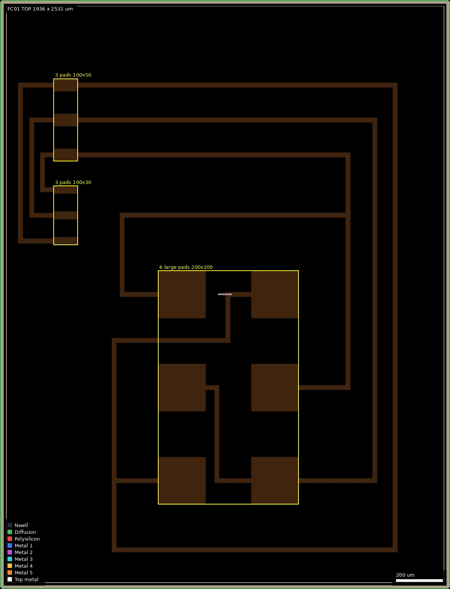
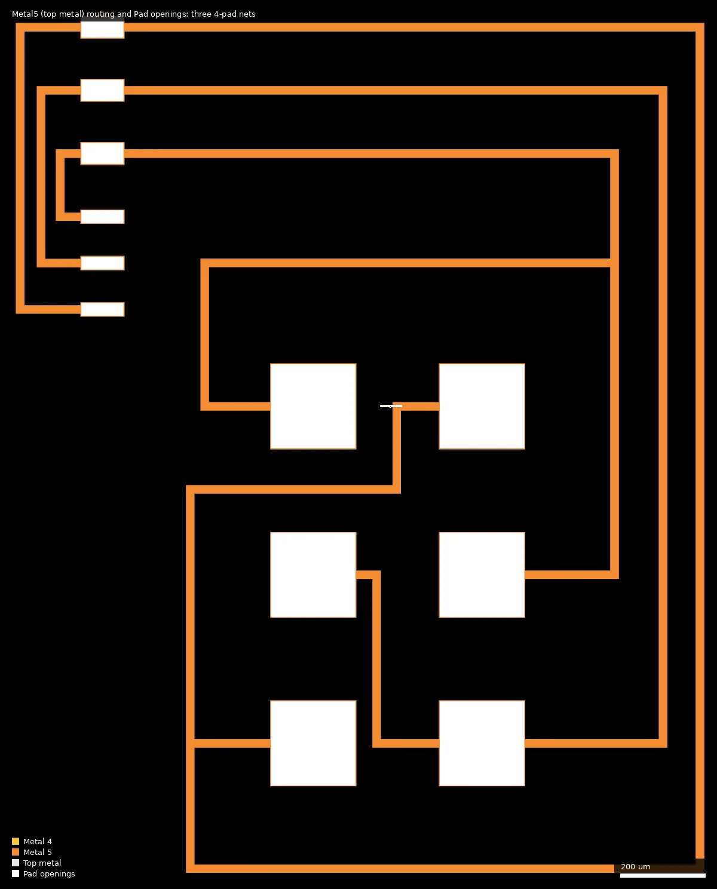

# FC01: Flip Chip pad test version 1 (ws-run2)

| | |
|---|---|
| Repository | none listed on platform.wafer.space |
| Slot | 0p5x0p5 |
| Top cell | TOP |
| Licence in repo | n/a |
| README | n/a |
| Taped-out layout | FC01_TOP_12_6, 1936 x 2531 um, 1 placement on the G802 reticle |

## What the repo actually contains

No repository was listed for this project, so nothing was cloned and there is nothing to audit. The only first-hand information is the platform record in `project.json`. Platform description: "Just some test pads for flip chip bonding trials".

The manufactured layout is in the public reticle (`ws-run2`, layout `FC01/TOP.oas`, SHA256 `c86059407e89f9fcb4137a675fea252d3a97a222b6d438960018e57723909cfb`) and is the only evidence about the design.

## Taped-out layout

| Item | Measured |
|---|---|
| Die (reticle cell `FC01_TOP_12_6`) | 1936 x 2531 um, seal ring around the whole outline |
| Pads | 12 `Pad` (37/0) openings, all on Metal5 (the topmost metal; MetalTop 53/0 is not used) |
| Large pads | 6 openings of 200 x 200 um in a 2 x 3 array, 400 um pitch in x and y, centres x = 782.5 and 1182.5 um, y = 465, 865, 1265 um; Metal5 plate 204 x 204 um under each |
| Small pads | 3 openings of 100 x 50 um (centres x = 282.5, y = 1865, 2015, 2165, 150 um pitch) and 3 of 100 x 30 um (y = 1495, 1605, 1715, 110 um pitch) on the left edge |
| Metal5 slots | `Metal5_Slot` (81/3) bars of 184 x 10 um, five in each large pad plate and one in each 100 x 50 pad plate |
| Routing | 20 um wide Metal5 traces only, 21 drawn Metal5 shapes in total (12 pad plates, 9 traces) |
| Devices | none: no Nwell, diffusion (COMP), poly, contact, Metal1 to Metal4 or via shapes other than the foundry dummy fill that wafer.space adds |
| Bump layers | none: no UBM layers (183/0, 184/0, 185/0) and no Via5 in the file |
| Standard cells, IO cells, SRAM, labels | none |

### Does it match the repository?

There is no repository. The layout agrees with the platform description (pads for flip-chip trials) and with the `designs.csv` row (no library cells, no transistors; Metal5 17.89 % and Metal4 0 % are fill-dominated numbers, see below).

*Whole die. The six 200 um pads sit in the middle (x 680 to 1285 um, y 363 to 1368 um); the two groups of three small pads are on the left edge (x 230 to 335 um, y 1478 to 2193 um). Everything shown is Metal5; the empty surround is dummy fill (hidden) and the seal ring.*

*Metal5 and `Pad` openings only (box 40,120 to 1740,2230 um). White rectangles are the 12 passivation openings, orange is the 20 um Metal5 wiring that joins them into three nets.*

### Connectivity (Metal5 shape merge)

A Metal5 polygon merge of the non-fill shapes gives three separate nets of four pads each, with no vias, so every connection is on one metal layer. Pad centres in um:

| Net | Pads | Approx. trace length |
|---|---|---|
| A | (1182, 865), (782, 1265), (282, 1865) 100x50, (282, 1715) 100x30 | about 4.1 mm |
| B | (1182, 465), (782, 865), (282, 2015) 100x50, (282, 1605) 100x30 | about 4.3 mm |
| C | (782, 465), (1182, 1265), (282, 2165) 100x50, (282, 1495) 100x30 | about 7.4 mm |

Trace length is the merged Metal5 area minus the pad plates, divided by the 20 um width (rough). The traces wrap around the pad array and the three 100 um pad pairs, so each net is a long on-die loop rather than a short link. Because the four pads of a net are shorted on the die, the nets can only be used as a continuity or contact-resistance test when the mating substrate connects them in a different order (a daisy chain closed through the bumps); the die by itself carries no information about the substrate pattern.

## Authors and affiliations

Not stated in the manifest, and the layout carries no text or artwork naming anyone. The submitter's identity is held on platform.wafer.space.

## Value for GF180MCU characterisation and PDK development

### Verdict: Low

This is a packaging experiment, not a device or process test. It has no transistors, resistors or capacitors, and it is not a GF180MCU electrical characterisation structure. Its use is mechanical and electrical-contact data on flip-chip bump attach to a Metal5 pad with a 200 um opening (and 100 x 50 and 100 x 30 um openings), together with the sheet resistance of long 20 um Metal5 traces.

### Test structures and measurable circuits

| Structure | Exercises | Access |
|---|---|---|
| 3 Metal5 nets of 4 pads, 6 x 200 x 200 um pads on a 400 um pitch | Flip-chip bump or solder attach yield and contact resistance on a Metal5 pad opening; open and short checks between nets after assembly | Probe or bump the pads directly; substrate wiring decides the loop (not known) |
| 6 smaller pads (100 x 50 and 100 x 30 um, 110 to 150 um pitch) | Fine-pitch and non-square opening behaviour of the same attach process | Same |
| 20 um Metal5 traces, 4 to 7 mm long | Four-wire Metal5 trace resistance per net (assuming the pads of a net are probed) | Direct probing |

### Candidate PDK additions

None. A small set of bump-pad geometry (opening size, Metal5 plate enclosure of 2 um, slot pattern in wide Metal5) could be a design example for wafer.space's flip-chip pad rules if those are written down.

### What would be needed to use it

The substrate or probe card that connects the pads, and the assembly process itself. Neither is in the layout. The bump process and UBM are not described by any layer in the file.

## Notes and caveats

- The summary text before the layout check guessed that the code prefix means a wafer.space-internal or packaging-partner test die; the layout cannot settle that and there is no author text on the die.
- The Metal5 17.89 % and Metal4 0 % in `designs.csv` come from the full layout including dummy fill; the drawn pad and trace metal is about 0.6 mm2 of a 4.9 mm2 die (about 12 %). The fill (Metal1 to Metal5, poly and COMP dummies, about 2.3 million cells) is wafer.space's, not the submitter's.
- The three nets were identified from drawn Metal5 only; no extraction against a layout-versus-schematic reference was run (there is none).
- Whether the pad openings are intended for bumping or wire bonding is not stated; the 200 um square openings and the name say flip chip.
