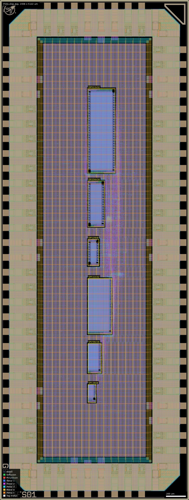
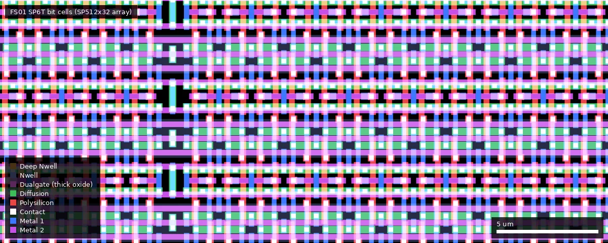
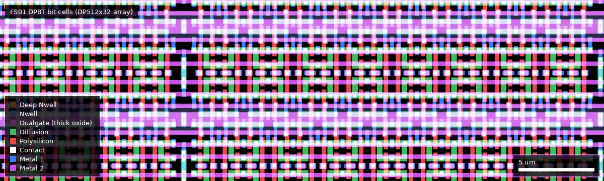
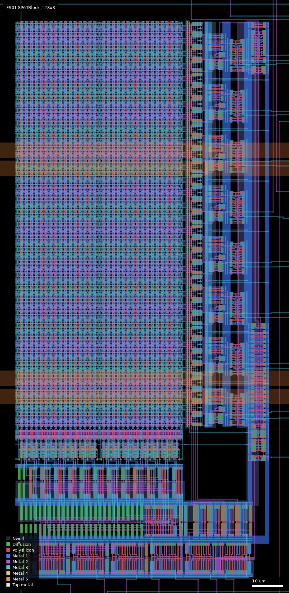

# FS01: Test chip with 3.3V SRAM blocks using regular design rules (ws-run2)

| | |
|---|---|
| Repository | https://gitlab.com/Chips4Makers/arrakeen-sram-testchip @ 2ce18db (main, tag v0.3, last commit 2026-07-21) |
| Slot | 0p5x1 |
| Top cell | chip_top |
| Taped-out layout | FS01_chip_top_14_0, 1936 x 5122 um, 1 placement on the G802 reticle |
| Licence in repo | No LICENSE at top level; Apache-2.0 SPDX headers in the scripts and `verilog/chip_top.sv`; `template/LICENSE` (Apache-2.0) covers the vendored wafer.space template |
| README | Present, short (133 words): build instructions only |

## What the repo actually contains

A generator project, not a layout archive. Running it produces three test chips, one per wafer.space submission (FS01, FS02, FS03), each holding six SRAM blocks from the Chips4Makers "Arrakeen" memory generator. The README: "This is version 0.3 and corresponds with the state of the repo for the G802 tape-out of wafer.space from July 2026."

**This chip (FS01): 3.3 V SRAM, regular design rules.** Built with `template/librelane/config_TestChip.yaml` from `views/TestChip_Blocks.*` and `verilog/TestChip.v`. Macros: `SP6TBlock_128x8`, `SP6TBlock_256x16`, `SP6TBlock_512x32`, `DP8TBlock_128x8`, `DP8TBlock_256x16`, `DP8TBlock_512x32`, generated by `SPSRAMFactory` / `DPSRAMFactory` with default arguments, i.e. the bit cells are drawn to the ordinary logic design rules. This is the baseline die: lowest layout risk, largest cells, and the reference against which FS02 (same circuits in SRAM rules) is compared. It has existed since v0.1 of the repo (2026-07-14).

**How the three variants are generated** (`run_all.sh`):

1. `scripts/gen_views.py` calls the SRAM factories in the Python package `c4m.pdk.gf180mcu` and writes GDS, LEF and Verilog views into `views/` (not committed) for three libraries:
   - `TestChip_Blocks`: `SPSRAMFactory(lib)` and `DPSRAMFactory(lib)`; cells `SP6TBlock_*`, `DP8TBlock_*` (FS01)
   - `TestChipR_Blocks`: the same factories with `sram_rules=True`, `name_prefix="SP6TR"` / `"DP8TR"`; cells `SP6TRBlock_*`, `DP8TRBlock_*` (FS02)
   - `TestChip5V_Blocks`: `SPSRAM5V0Factory(lib)` and `DPSRAM5V0Factory(lib)`; cells `SP6T5VBlock_*`, `DP8T5VBlock_*` (FS03)
   
   Each library has the same six blocks: single-port 128x8 (1 write-enable bit), 256x16 (2), 512x32 (4), and dual-port 128x8, 256x16, 512x32. The names indicate 6T single-port and 8T dual-port bit cells.
2. `scripts/gen_verilog.py` (Amaranth) writes `verilog/TestChip.v`, `TestChipR.v`, `TestChip5V.v` (git-ignored): the same `TestChip` core module, differing only in the macro name prefix.
3. `make librelane-klayoutdrc` is run three times in `template/` with `librelane/config_TestChip.yaml`, `config_TestChipR.yaml`, `config_TestChip5V.yaml`. The three configs differ only in the Verilog/GDS/LEF file names, the macro cell names, and (5 V only) four macro placement coordinates.

So the three chips share pad ring, pinout, glue logic and flow; only the six SRAM hard macros differ.

**Chip structure.** `verilog/chip_top.sv` (hand-written, used for all three): 72 pads in a 0p5x1 slot (die 1936 x 5122 um): 9 `gf180mcu_fd_io__dvdd` + 9 `__dvss`, 5 clock inputs on `gf180mcu_fd_io__in_s`, 33 inputs on `__in_c` (with pull-downs), 16 outputs on `__bi_24t`. It contains `assign VDD = DVDD; assign VSS = DVSS;`, so there is one supply for pads, glue logic and SRAMs. The core `TestChip`:

- shared inputs `a[8:0]`, `d[15:0]`, `we[3:0]`
- `clk_sp` clocks all three single-port blocks; `clk1_dp` / `clk2_dp` clock port 1 / port 2 of all dual-port blocks
- `d32h_clk` latches `d` into a 16-bit register that supplies the upper half of the 32-bit data word
- `port2_clk` latches `a`, the 32-bit data and `we` into registers that drive port 2 of the dual-port blocks
- `q[15:0]` is a 12-way mux selected by `q_idx[3:0]`: 0 = SP 128x8, 1 = SP 256x16, 2/3 = SP 512x32 low/high half, 4-7 = the same for DP port 1, 8-11 = DP port 2

**Directory contents.** `scripts/` (the two generators), `verilog/chip_top.sv`, `pyproject.toml` + `uv.lock` (dependency pins), `run_all.sh`, and `template/` (a git-subtree copy of https://github.com/wafer-space/gf180mcu-project-template v1.5.8 with three added configs, `chip_top_TestChip.sdc` and `pdn/pdn_TestChip.tcl`). The template's own `src/chip_top.sv`, `src/chip_core.sv`, `cocotb/chip_top_tb.py` and default `config.yaml` are unused leftovers.

**Where the SRAM generator lives.** Not in this repo and not a submodule: it is pulled as Python packages, pinned in `uv.lock`:

| Package | Source | Pinned commit |
|---|---|---|
| c4m-flexmem (memory compiler) | https://gitlab.com/Chips4Makers/c4m-flexmem, branch `dev_SRAM` | 3921698 |
| c4m-pdk-gf180mcu (GF180MCU technology + SRAM factories) | https://gitlab.com/Chips4Makers/c4m-pdk-gf180mcu, branch `dev` | 53fc200 |
| c4m-flexcell | https://gitlab.com/Chips4Makers/c4m-flexcell, branch `dev` | f41582f |
| PDKMaster | https://gitlab.com/Chips4Makers/PDKMaster, branch `dev_SRAM` | e53ed2b |
| pdkmaster-io-spice | https://gitlab.com/Chips4Makers/pdkmaster-io-spice, branch `dev_SRAM` | a92d790 |

Flow: LibreLane "Chip" flow from the template, PDK gf180mcuD at commit f6eeac7. `run_all.sh` passes no `SCL`/`PAD` override, so the Makefile defaults apply: standard cells `gf180mcu_fd_sc_mcu7t5v0` and pads `gf180mcu_fd_io` for all three variants (inferred from `template/Makefile`; the config also excludes `gf180mcu_fd_sc_mcu7t5v0__dly*`). SDC: five 50 ns clocks. Magic DRC is skipped (`librelane-klayoutdrc`); KLayout DRC runs all decks except antenna, density and "cup".

Not in the repo: any GDS/OAS, LEF, SPICE netlist, LibreLane run directory, DRC/LVS/timing report, simulation, testbench for this chip, pinout document, or silicon data. The release `v0.3` ("Code as used for G802 wafer.space MPW test chip tape-out") has one asset named "gds files" that is a link to GitLab package 64578677; the file saved in `releases/v0.3/` is the HTML of that package page (38 kB), not layout data.

## Taped-out layout

| | |
|---|---|
| Reticle cell, placement | `FS01_chip_top_14_0`, one placement at x = 28.004 mm, y = 0.060 mm |
| Die size | 1936 x 5122 um (0p5x1 slot) |
| Pads / IO cells | 72 IO cells: 9 `gf180mcu_fd_io__dvdd`, 9 `__dvss`, 5 `__in_s`, 33 `__in_c`, 16 `__bi_24t`, 4 `__cor`, plus IO fill; 80 shapes on the Pad layer |
| Standard cells | library `gf180mcu_fd_sc_mcu7t5v0` only: 3540 logic placements, of which about 3350 are `buf_1/2/4` and `clkbuf_1/2`; the functional logic is 61 `dffq` (16 for `d32h`, 45 for the port-2 register: 9 + 32 + 4), 69 `aoi22_1`, a few `aoi222`, `and4`, `nand3`, `nor4`; 87332 fill/tap-type placements |
| SRAM | 6 generated macros, no foundry `gf180mcu_fd_ip_sram` / `gf180mcu_ocd_ip_sram` macros: 21504 SP6T + 21504 DP8T = 43008 bit cells |
| Bit-cell devices | all bit-cell transistors have drawn gate 0.28 x 0.36 um (4 n+ / 2 p+ in the 6T cell; 6 n+ / 2 p+ in the 8T cell), no Dualgate, no V5_XTOR |
| Custom blocks | the six SRAM macros (all periphery drawn by the generator); nothing else custom on the die. wafer.space logo, QR ID, project ID, shuttle ID and marker cells present |
| Other devices | no MIM or eFuse layers on the die; RES_MK (1068 shapes) and DIODE_MK (about 940) marker shapes exist, expected from the foundry IO and standard cells and not examined individually |

### Does it match the repository?

Yes, as far as the repository can be checked. The repo commits no chip GDS/OAS (only the template's logo, QR, ID and marker GDS/LEF, which are on the die as `gf180mcu_ws_ip__*` cells) and the release asset is an HTML page, so the comparison is against the sources: `config_TestChip.yaml`, `gen_views.py`, `gen_verilog.py`, `chip_top.sv`. The die has exactly the six macros `SP6TBlock_{128x8,256x16,512x32}` and `DP8TBlock_{128x8,256x16,512x32}`, each once; the macro origins in the layout (x = 900, y = 1000, 1300, 1700, 2400, 2800, 3350 um, minus the 0.43 um LEF offset) match the config; pad counts and cell types (9 + 9 + 5 + 33 + 16 = 72) match `chip_top.sv`; the standard-cell library is `mcu7t5v0` and the IO library `gf180mcu_fd_io`, as inferred from the Makefile. Bit counts match the macro names (1024, 4096, 16384 per type). The wafer.space layout is built from commit `2ce18dbe27df`, the commit in `wafer.space-bench/data/designs.csv` for FS01, FS02 and FS03; the repo clone used here is at the same commit (`2ce18dbe27df529a08bd67099f419e75fd43b69c`). The layout was not built from the later `origin/dev` commit c2cd868.

### SRAM macros in the layout

Shared by FS01, FS02 and FS03 (measured once, on all three): same die size, same 72-cell IO ring with the same cell counts, same standard-cell library, the same six-macro architecture (single-port 6T 128x8, 256x16, 512x32 and dual-port 8T of the same sizes, 21504 bit cells of each type), the same macro periphery cell names (apart from the `R` / `5V` name prefix), the same bit-cell topology (6 and 8 gates), the same glue logic (61 flops, ~69 `aoi22`) and the same Metal3 pin-label names. What differs is the drawing of the SRAM cells and macros. FS01 (this die) is the baseline: regular 3.3 V design rules.

| Macro (cell) | Bits | Cell size (um) | Placed box x0,y0 - x1,y1 (um) | Area (1000 um2) | um2 per bit (whole macro) | Array (rows x columns) |
|---|---|---|---|---|---|---|
| `SP6TBlock_128x8` | 1024 | 183.86 x 83.47 | 900.00, 999.57 - 983.48, 1183.43 | 15 | 14.6 | 32 x 32 (CM4) |
| `SP6TBlock_256x16` | 4096 | 304.12 x 137.40 | 900.00, 1299.57 - 1037.40, 1603.69 | 42 | 10.3 | 64 x 64 (2 column blocks of 64R x 32) |
| `SP6TBlock_512x32` | 16384 | 570.36 x 245.24 | 900.00, 1699.57 - 1145.24, 2269.93 | 140 | 8.5 | 128 x 128 (4 column blocks of 128R x 32) |
| `DP8TBlock_128x8` | 1024 | 271.66 x 113.96 | 899.98, 2399.57 - 1013.94, 2671.23 | 31 | 30.3 | 32 x 32 (CM4) |
| `DP8TBlock_256x16` | 4096 | 468.78 x 169.16 | 899.98, 2799.57 - 1069.14, 3268.35 | 79 | 19.3 | 64 x 64 (2 column blocks of 64R x 32) |
| `DP8TBlock_512x32` | 16384 | 863.02 x 279.56 | 899.98, 3349.57 - 1179.54, 4212.59 | 241 | 14.7 | 128 x 128 (4 column blocks of 128R x 32) |

Macros are placed rotated by 90 degrees (the layout box is the cell size with width and height swapped). Bit-cell data: `SP6TCell` 4.54 x 2.82 um bounding box, `SP6TArray_128X32BC` (4096 bits) 133.5 x 217.0 um = 7.07 um2/bit; `DP8TCell` 6.54 x 2.86 um bounding box, `DP8TArray_128X32BC` (4096 bits) 197.5 x 222.2 um = 10.71 um2/bit. Bit-cell structure is read from the cells: the 6T cell has 6 gates and the 8T cell 8 gates (poly over diffusion), i.e. the names are right. Organisation is read from the cell names and instance counts: 4:1 column multiplexing (`CM4`), word-line count = words / 4, 8 bits per column block, one write-enable per 8 bits.

Each macro is a hierarchy of generator cells: a bit-cell array (`*Array_<rows>X32BC`, built from `*Array_2X1/2X2/4X2` tiles and `*BulkConn` strap cells), column periphery (`*ColPeriph8B_...`, one per 8-bit column block; two per macro on the dual-port macros, `_bl1` and `_bl2`), a wordline driver column (`*WLDriverCol_...`, one `*WLDriver_N56L120WP56L240W` per row plus `*WLDriverBC` boundary cells), row predecoders and decoders (`*RowPredecoders_...`, `*RowDecPage_...`, `*RowDecLastStageBC_N3DH`, `*DirectColDec_A2B2R`), and a clock generator with a non-overlapping clock (`*ClockGen_8S11341D1R`, `*NonOvlClock_...`). The decoders and clock generator use small custom cells (`Dec_dff_x1` address flops, `Dec_inv_*`, `Dec_nand2_x0`, `inv_x*`, `nand2_x0`, `buf_x*`) that are not part of the foundry standard-cell library. The macros use Metal1 to Metal3 only; Metal4/Metal5 inside the macro footprints belong to the top-level power grid. The word-line pitch is two rows per `2X1` tile.

Whole die (1936 x 5122 um, style `full`). The six macros are the labelled boxes in one column at x = 900-1180 um, from SP128x8 at the bottom (y = 1000) to DP512x32 at the top (y = 3350-4213); the pad ring (east/west/north/south, 350 um deep) surrounds the core, whose remaining area is the Metal4/Metal5 power grid and the glue logic and buffers, concentrated at x = 1000-1500 um along the macro column. The image is 593 kB, above the 400 kB target, because the whole die is dense fine detail at this height.

Close-up of the single-port 6T bit cells inside `SP6TBlock_512x32` at x = 1000-1030, y = 2000-2012 um (detail style: diffusion green, poly red, Metal1 blue, Metal2 magenta; no Dualgate tint, i.e. thin-oxide devices). The vertical gaps are the `BulkConn` strap columns.

Close-up of the dual-port 8T bit cells inside `DP8TBlock_512x32` at x = 1000-1040, y = 3700-3712 um, same style; two wordline directions give the denser poly pattern.

The smallest macro, `SP6TBlock_128x8`, at x = 895-990, y = 995-1190 um (style `full`, rotated 90 degrees): two bit-cell halves (32 x 32 in total) at the top left, the wordline-driver column and row decoder at the right, column periphery (sense amplifiers / write drivers / mux) and clock generation at the bottom.

### Test structures located in the layout

| Structure | Cell | Position (um) | Size (um) | Details measured | Pads |
|---|---|---|---|---|---|
| 6T single-port 128x8 | `SP6TBlock_128x8` | 900.00, 999.57 - 983.48, 1183.43 | 183.86 x 83.47 | 1024 bits | not traced; pin labels `a`, `d`, `q`, `we`, `vdd`, `vss` (Metal3 text) exist inside each macro |
| 6T single-port 256x16 | `SP6TBlock_256x16` | 900.00, 1299.57 - 1037.40, 1603.69 | 304.12 x 137.40 | 4096 bits | not traced; pin labels `a`, `d`, `q`, `we`, `vdd`, `vss` (Metal3 text) exist inside each macro |
| 6T single-port 512x32 | `SP6TBlock_512x32` | 900.00, 1699.57 - 1145.24, 2269.93 | 570.36 x 245.24 | 16384 bits | not traced; pin labels `a`, `d`, `q`, `we`, `vdd`, `vss` (Metal3 text) exist inside each macro |
| 8T dual-port 128x8 | `DP8TBlock_128x8` | 899.98, 2399.57 - 1013.94, 2671.23 | 271.66 x 113.96 | 1024 bits | not traced; pin labels `a`, `d`, `q`, `we`, `vdd`, `vss` (Metal3 text) exist inside each macro |
| 8T dual-port 256x16 | `DP8TBlock_256x16` | 899.98, 2799.57 - 1069.14, 3268.35 | 468.78 x 169.16 | 4096 bits | not traced; pin labels `a`, `d`, `q`, `we`, `vdd`, `vss` (Metal3 text) exist inside each macro |
| 8T dual-port 512x32 | `DP8TBlock_512x32` | 899.98, 3349.57 - 1179.54, 4212.59 | 863.02 x 279.56 | 16384 bits | not traced; pin labels `a`, `d`, `q`, `we`, `vdd`, `vss` (Metal3 text) exist inside each macro |
| Glue logic and registers | `gf180mcu_fd_sc_mcu7t5v0__*` at top level | mostly x 1000-1500 um, along the macro column and the right-hand side of the core (centres span x 445-1491, y 445-4675) | 61 `dffq` flops | the `d32h` and port-2 registers of `gen_verilog.py` (16 + 45 = 61 flops, matches) | not traced |

Pad connectivity (which pad reaches which macro pin) was not extracted; the summary's pad-to-function assignment still rests on the configs and `chip_top.sv`.

## Authors and affiliations

| Person / organisation | Role | Affiliation | Source |
|---|---|---|---|
| Staf Verhaegen (GitLab `FatsieFS`) | Sole author of the test-chip code (13 commits, including the template subtree merges); author of the release | Chips4Makers (GitLab group owning the repo and all generator packages); GitLab display name "Staf Verhaegen (FibraServi)" | git log; `releases.json`; `pyproject.toml` |
| "Arrakeen" | Named in the README title ("Arrakeen's memory generator") | not stated (relationship to Chips4Makers / FibraServi not explained in the repo) | `README.md` |
| Leo Moser | Author of the vendored project template | not stated | `template/AUTHORS.md` |

## Value for GF180MCU characterisation and PDK development

### Verdict: High

A purpose-built SRAM test chip for a new open memory compiler: six macros per die, two bit-cell types, three sizes, direct pad access, and three dies that isolate regular rules versus SRAM rules and 3.3 V versus 5 V.

### Test structures and measurable circuits

| Structure | What it exercises | Access | Where |
|---|---|---|---|
| Single-port 6T blocks 128x8, 256x16, 512x32 | Bit-cell read/write margins, minimum VDD, retention, access time versus array size | `a_pad[8:0]`, `d_pad[15:0]`, `we_pad[3:0]`, `clk_sp_pad`; read on `q_pad[15:0]` with `q_idx_pad` = 0..3 | `scripts/gen_views.py`, `scripts/gen_verilog.py` |
| Dual-port 8T blocks 128x8, 256x16, 512x32 | The same, plus port-to-port disturb and simultaneous read/write on the two ports with independent clocks | port 1: same pads with `clk1_dp_pad`; port 2: address/data/we latched by `port2_clk_pad`, clocked by `clk2_dp_pad`; `q_idx_pad` = 4..11 | same |
| Upper data half register, port-2 register | Ordinary flops in the stock standard cells; they sit in the write path of the 32-bit and port-2 tests | `d32h_clk_pad`, `port2_clk_pad` | `scripts/gen_verilog.py` |
| Cross-die comparison FS01 / FS02 / FS03 | Effect of SRAM-rule layout on yield and margins; 3.3 V versus 5 V device variants of the same architecture | three separate dies with identical pinout | `template/librelane/config_TestChip*.yaml` |

Devices and voltage domain (from the layout): all SRAM transistors in FS01 are thin-oxide 3.3 V devices (no Dualgate or V5_XTOR anywhere in the macros; gates 0.28 um long in the bit cells), while the pad ring and the glue logic are the 5 V foundry libraries (`gf180mcu_fd_io`, `mcu7t5v0`, with Dualgate). Whether the single supply is run at 3.3 V is an operating choice not visible in the layout. FS01 and FS02 therefore differ from FS03 in the bit-cell devices, as the summary had inferred.

Simulation results to compare silicon against: none in this repo. Any characterisation (SPICE, `.lib`) would be in the c4m-flexmem / c4m-pdk-gf180mcu repositories, which were not examined. The generated Verilog views contain only behavioural models (inferred from `cell.verilog()`).

### Candidate PDK additions

- A parametric, scripted SRAM compiler for GF180MCU with single-port 6T and dual-port 8T architectures in 3.3 V and 5 V, emitting GDS, LEF and Verilog. The PDK today has only fixed foundry 5 V single-port macros (`gf180mcu_fd_ip_sram`) and the 3.3 V `gf180mcu_ocd_ip_sram` set; a dual-port SRAM and arbitrary sizes would be new.
- Layout drawn to the foundry SRAM design rules by an open generator (FS02). Whether the open KLayout/magic DRC decks check those rules correctly is a question this chip raises; the repo records no DRC waivers or deck changes.
- Flow details that may matter upstream: the LEFs are written with a hard-coded `input_gate_area=0.4928` for antenna checking; `pdn/pdn_TestChip.tcl` shows how the macros are tied into the PDN (`vdd`/`vss` pins, grid `-starts_with POWER`); the config keeps the template's `Metal2_ignore_active` filler option.
- No PDK bugs or workarounds are documented in this repo.

### What would be needed to use it

Packaged or chip-on-board parts (0p5x1 slot, 72 pads). A digital pattern generator / logic analyser or FPGA with 38 inputs and 16 outputs at the chosen supply (3.3 V for FS01/FS02, 5 V for FS03; the device types are confirmed by the layout, the intended supply is inferred), a variable supply and source-meter for minimum-VDD, retention and standby current. Note that because VDD is tied to DVDD the SRAM supply cannot be swept independently of the IO and glue logic, and the 3.3 V variants run the 5 V standard cells and 5 V IO cells at 3.3 V (the library is confirmed in the layout; the 3.3 V operation is inferred), which will slow the periphery and must be separated out of access-time measurements. Missing: pinout table (derivable from `PAD_SOUTH/EAST/NORTH/WEST` in the configs), test plan, timing specification, reference simulation data, and a committed copy of the layouts (the taped-out layout is available from wafer.space; the repo itself needs `uv` + `nix` to regenerate it).

## Notes and caveats

- FS01, FS02 and FS03 are the same repository at the same commit; which die is which follows only from the config file names and the platform project names.
- Nothing generated is committed; the layout facts in this summary come from the wafer.space reticle file, not from a repo GDS, so a repo-GDS-versus-taped-out comparison was not possible. DRC/LVS status remains unknown. Reproducing the tape-out depends on five external repositories at branch heads `dev` / `dev_SRAM`; `uv.lock` pins the commits, but branch `origin/dev` of this repo already has a later "Update depdendencies" commit (c2cd868, 2026-07-23).
- The release asset is a web page, not GDS; the real files are in GitLab package 64578677 (not downloaded).
- `template/cocotb/chip_top_tb.py` is the untouched template testbench (drives `clk_PAD`, `rst_n_PAD`, `input_PAD`) and does not match this `chip_top`.
- `chip_top_TestChip.sdc` creates two clocks with the same name `clk1` (on `clk_sp_pad` and `clk1_dp_pad`); the second likely replaces the first, leaving `clk_sp_pad` unconstrained (inferred; no reports to confirm and not checkable from layout).
- `q_idx` is 4 bits but only 12 mux inputs exist; behaviour for 12-15 is whatever Amaranth generated (not settled: it would need the generated netlist or a trace of the mux gates in the glue logic).
- The platform "details" field is empty for all three projects. The commit message of 2ce18db notes that the 5 V work "also [has] some changes on the other blocks so they have also been updated for the tape-out".
