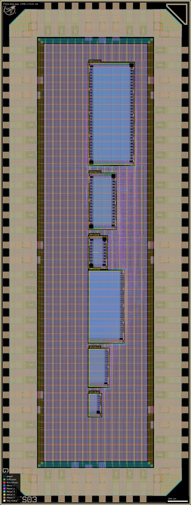
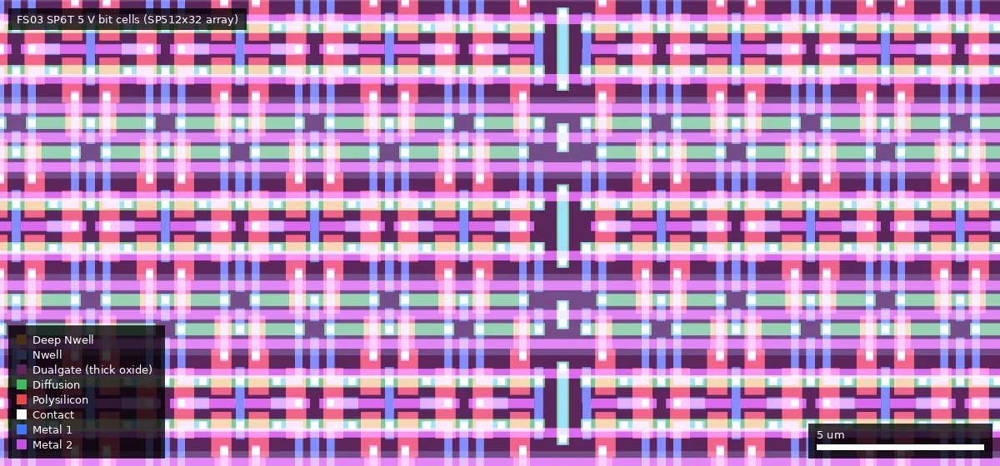
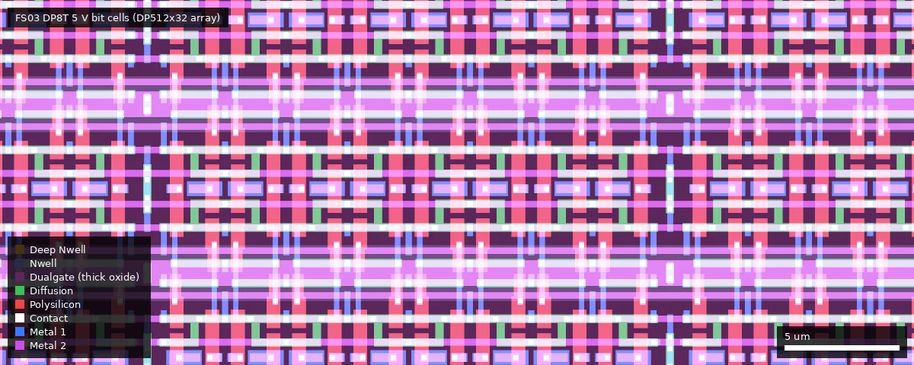
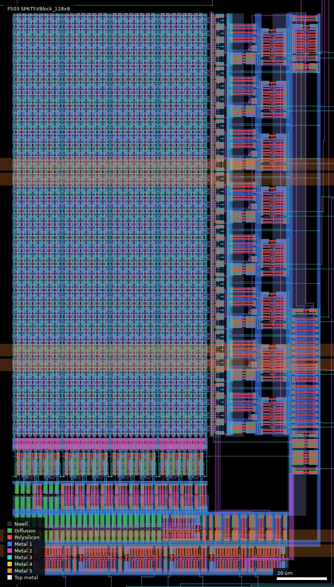

# FS03: Test chip with 5V SRAM blocks (ws-run2)

| | |
|---|---|
| Repository | https://gitlab.com/Chips4Makers/arrakeen-sram-testchip @ 2ce18db (main, tag v0.3, last commit 2026-07-21) |
| Slot | 0p5x1 |
| Top cell | chip_top |
| Taped-out layout | FS03_chip_top_12_0, 1936 x 5122 um, 1 placement on the G802 reticle |
| Licence in repo | No LICENSE at top level; Apache-2.0 SPDX headers in the scripts and `verilog/chip_top.sv`; `template/LICENSE` (Apache-2.0) covers the vendored wafer.space template |
| README | Present, short (133 words): build instructions only |

## What the repo actually contains

A generator project, not a layout archive. Running it produces three test chips, one per wafer.space submission (FS01, FS02, FS03), each holding six SRAM blocks from the Chips4Makers "Arrakeen" memory generator. The README: "This is version 0.3 and corresponds with the state of the repo for the G802 tape-out of wafer.space from July 2026."

**This chip (FS03): 5 V SRAM.** Built with `template/librelane/config_TestChip5V.yaml` from `views/TestChip5V_Blocks.*` and `verilog/TestChip5V.v`. Macros: `SP6T5VBlock_128x8`, `SP6T5VBlock_256x16`, `SP6T5VBlock_512x32`, `DP8T5VBlock_128x8`, `DP8T5VBlock_256x16`, `DP8T5VBlock_512x32`, generated by `SPSRAM5V0Factory` / `DPSRAM5V0Factory` (no `sram_rules` argument; the layout has no `SramCore` marker, so regular rules, confirmed). Four macro origins differ from the 3.3 V configs (y = 900, 1200, 1650, 3450 instead of 1000, 1300, 1700, 3350), consistent with the larger 5 V macros (confirmed: 1.8-2.0 times the area of FS01's). This is the only one of the three where SRAM, standard cells and IO all run at their native voltage, and it is directly comparable with the foundry `gf180mcu_fd_ip_sram` 5 V macros. The README calls it "5.5V"; the platform says 5 V. Added in the tape-out commit 2ce18db (2026-07-21).

**How the three variants are generated** (`run_all.sh`):

1. `scripts/gen_views.py` calls the SRAM factories in the Python package `c4m.pdk.gf180mcu` and writes GDS, LEF and Verilog views into `views/` (not committed) for three libraries:
   - `TestChip_Blocks`: `SPSRAMFactory(lib)` and `DPSRAMFactory(lib)`; cells `SP6TBlock_*`, `DP8TBlock_*` (FS01)
   - `TestChipR_Blocks`: the same factories with `sram_rules=True`, `name_prefix="SP6TR"` / `"DP8TR"`; cells `SP6TRBlock_*`, `DP8TRBlock_*` (FS02)
   - `TestChip5V_Blocks`: `SPSRAM5V0Factory(lib)` and `DPSRAM5V0Factory(lib)`; cells `SP6T5VBlock_*`, `DP8T5VBlock_*` (FS03)
   
   Each library has the same six blocks: single-port 128x8 (1 write-enable bit), 256x16 (2), 512x32 (4), and dual-port 128x8, 256x16, 512x32. The names indicate 6T single-port and 8T dual-port bit cells.
2. `scripts/gen_verilog.py` (Amaranth) writes `verilog/TestChip.v`, `TestChipR.v`, `TestChip5V.v` (git-ignored): the same `TestChip` core module, differing only in the macro name prefix.
3. `make librelane-klayoutdrc` is run three times in `template/` with `librelane/config_TestChip.yaml`, `config_TestChipR.yaml`, `config_TestChip5V.yaml`. The three configs differ only in the Verilog/GDS/LEF file names, the macro cell names, and (5 V only) four macro placement coordinates.

So the three chips share pad ring, pinout, glue logic and flow; only the six SRAM hard macros differ.

**Chip structure.** `verilog/chip_top.sv` (hand-written, used for all three): 72 pads in a 0p5x1 slot (die 1936 x 5122 um): 9 `gf180mcu_fd_io__dvdd` + 9 `__dvss`, 5 clock inputs on `gf180mcu_fd_io__in_s`, 33 inputs on `__in_c` (with pull-downs), 16 outputs on `__bi_24t`. It contains `assign VDD = DVDD; assign VSS = DVSS;`, so there is one supply for pads, glue logic and SRAMs. The core `TestChip`:

- shared inputs `a[8:0]`, `d[15:0]`, `we[3:0]`
- `clk_sp` clocks all three single-port blocks; `clk1_dp` / `clk2_dp` clock port 1 / port 2 of all dual-port blocks
- `d32h_clk` latches `d` into a 16-bit register that supplies the upper half of the 32-bit data word
- `port2_clk` latches `a`, the 32-bit data and `we` into registers that drive port 2 of the dual-port blocks
- `q[15:0]` is a 12-way mux selected by `q_idx[3:0]`: 0 = SP 128x8, 1 = SP 256x16, 2/3 = SP 512x32 low/high half, 4-7 = the same for DP port 1, 8-11 = DP port 2

**Directory contents.** `scripts/` (the two generators), `verilog/chip_top.sv`, `pyproject.toml` + `uv.lock` (dependency pins), `run_all.sh`, and `template/` (a git-subtree copy of https://github.com/wafer-space/gf180mcu-project-template v1.5.8 with three added configs, `chip_top_TestChip.sdc` and `pdn/pdn_TestChip.tcl`). The template's own `src/chip_top.sv`, `src/chip_core.sv`, `cocotb/chip_top_tb.py` and default `config.yaml` are unused leftovers.

**Where the SRAM generator lives.** Not in this repo and not a submodule: it is pulled as Python packages, pinned in `uv.lock`:

| Package | Source | Pinned commit |
|---|---|---|
| c4m-flexmem (memory compiler) | https://gitlab.com/Chips4Makers/c4m-flexmem, branch `dev_SRAM` | 3921698 |
| c4m-pdk-gf180mcu (GF180MCU technology + SRAM factories) | https://gitlab.com/Chips4Makers/c4m-pdk-gf180mcu, branch `dev` | 53fc200 |
| c4m-flexcell | https://gitlab.com/Chips4Makers/c4m-flexcell, branch `dev` | f41582f |
| PDKMaster | https://gitlab.com/Chips4Makers/PDKMaster, branch `dev_SRAM` | e53ed2b |
| pdkmaster-io-spice | https://gitlab.com/Chips4Makers/pdkmaster-io-spice, branch `dev_SRAM` | a92d790 |

Flow: LibreLane "Chip" flow from the template, PDK gf180mcuD at commit f6eeac7. `run_all.sh` passes no `SCL`/`PAD` override, so the Makefile defaults apply: standard cells `gf180mcu_fd_sc_mcu7t5v0` and pads `gf180mcu_fd_io` for all three variants (inferred from `template/Makefile`; the config also excludes `gf180mcu_fd_sc_mcu7t5v0__dly*`). SDC: five 50 ns clocks. Magic DRC is skipped (`librelane-klayoutdrc`); KLayout DRC runs all decks except antenna, density and "cup".

Not in the repo: any GDS/OAS, LEF, SPICE netlist, LibreLane run directory, DRC/LVS/timing report, simulation, testbench for this chip, pinout document, or silicon data. The release `v0.3` ("Code as used for G802 wafer.space MPW test chip tape-out") has one asset named "gds files" that is a link to GitLab package 64578677; the file saved in `releases/v0.3/` is the HTML of that package page (38 kB), not layout data.

## Taped-out layout

| | |
|---|---|
| Reticle cell, placement | `FS03_chip_top_12_0`, one placement at x = 24.012 mm, y = 0.060 mm |
| Die size | 1936 x 5122 um (0p5x1 slot) |
| Pads / IO cells | 72 IO cells: 9 `gf180mcu_fd_io__dvdd`, 9 `__dvss`, 5 `__in_s`, 33 `__in_c`, 16 `__bi_24t`, 4 `__cor`, plus IO fill; 80 shapes on the Pad layer |
| Standard cells | library `gf180mcu_fd_sc_mcu7t5v0` only: 3788 logic placements, of which about 3600 are buffers (`buf_1/2/4`, `clkbuf_1/2`); the same functional logic (61 `dffq`, 66 `aoi22_1`, ...); 78222 fill/tap-type placements |
| SRAM | 6 generated macros, no foundry `gf180mcu_fd_ip_sram` / `gf180mcu_ocd_ip_sram` macros: 21504 SP6T + 21504 DP8T = 43008 bit cells |
| Bit-cell devices | bit-cell transistors have drawn gates 0.36 x 0.60 um (n+, 4 in the 6T cell, 6 in the 8T cell) and 0.36 x 0.50 um (p+, 2 in each); each transistor has its own V5_XTOR rectangle (6 / 8 per cell) inside one Dualgate rectangle |
| Custom blocks | the six SRAM macros (all periphery drawn by the generator); nothing else custom on the die. wafer.space logo, QR ID, project ID, shuttle ID and marker cells present |
| Other devices | no MIM or eFuse layers on the die; RES_MK (1068 shapes) and DIODE_MK (about 940) marker shapes exist, expected from the foundry IO and standard cells and not examined individually |

### Does it match the repository?

Yes, as far as the repository can be checked. No chip GDS/OAS is committed and the release asset is an HTML page, so the comparison is against the sources (`config_TestChip5V.yaml`, `SPSRAM5V0Factory` / `DPSRAM5V0Factory`, `chip_top.sv`). The die has exactly the six macros `SP6T5VBlock_*` and `DP8T5VBlock_*` once each, and the four displaced origins the summary noted are confirmed: the layout boxes start at x = 899.4 and y = 899.4, 1199.4, 1649.4, 2399.4, 2799.4, 3449.4 um (rounded to the config's 900, 1200, 1650, 2400, 2800, 3450); the SP128x8, SP256x16, SP512x32 and DP512x32 origins differ from FS01's (1000, 1300, 1700, 3350), as the config says. Pads (72), IO cell types and the `mcu7t5v0` standard cells match as for FS01. `designs.csv` lists commit `2ce18dbe27df` for FS03, equal to the clone's HEAD (`2ce18dbe27df529a08bd67099f419e75fd43b69c`), the commit whose message added the 5 V blocks.

### SRAM macros in the layout

Shared with FS01 and FS02 (measured once): die size, IO ring, standard-cell library (still the 5 V `mcu7t5v0`), the six-macro architecture and periphery cell names, bit-cell topology, glue logic. What differs in FS03 is that all SRAM transistors, cells and periphery are 5 V thick-oxide devices (Dualgate + V5_XTOR) at minimum 5 V gate lengths; the macros are 1.8 to 2.0 times the area of FS01's (SP 512x32: 260 vs 140 thousand um2; DP 512x32: 476 vs 241).

The 5 V periphery is also thick-oxide: the macros contain 19375 (SP512x32) and 20285 (DP512x32) Dualgate shapes and 100685 / 135929 V5_XTOR shapes, and the custom decoder cells have their own 5 V versions (`Dec5V_dff_x1_5v0`, `Dec5V_inv_x1_5v0`, ...). In FS01/FS02 the macros have no Dualgate at all.

| Macro (cell) | Bits | Cell size (um) | Placed box x0,y0 - x1,y1 (um) | Area (1000 um2) | um2 per bit (whole macro) | Array (rows x columns) |
|---|---|---|---|---|---|---|
| `SP6T5VBlock_128x8` | 1024 | 227.90 x 125.72 | 899.40, 899.40 - 1025.12, 1127.30 | 29 | 28.3 | 32 x 32 (CM4) |
| `SP6T5VBlock_256x16` | 4096 | 385.18 x 203.16 | 899.40, 1199.40 - 1102.56, 1584.58 | 78 | 19.0 | 64 x 64 (2 column blocks of 64R x 32) |
| `SP6T5VBlock_512x32` | 16384 | 725.66 x 358.04 | 899.40, 1649.40 - 1257.44, 2375.06 | 260 | 15.9 | 128 x 128 (4 column blocks of 128R x 32) |
| `DP8T5VBlock_128x8` | 1024 | 324.64 x 185.28 | 899.40, 2399.40 - 1084.68, 2724.04 | 60 | 58.6 | 32 x 32 (CM4) |
| `DP8T5VBlock_256x16` | 4096 | 561.44 x 276.80 | 899.40, 2799.40 - 1176.20, 3360.84 | 155 | 37.8 | 64 x 64 (2 column blocks of 64R x 32) |
| `DP8T5VBlock_512x32` | 16384 | 1035.04 x 459.84 | 899.40, 3449.40 - 1359.24, 4484.44 | 476 | 29.1 | 128 x 128 (4 column blocks of 128R x 32) |

Macros are placed rotated by 90 degrees (the layout box is the cell size with width and height swapped). Bit-cell data: `SP6T5VCell` 5.70 x 3.80 um bounding box, `SP6T5VArray_128X32BC` (4096 bits) 170.7 x 311.3 um = 12.98 um2/bit; `DP8T5VCell` 8.03 x 4.24 um bounding box, `DP8T5VArray_128X32BC` (4096 bits) 237.4 x 367.6 um = 21.31 um2/bit. Bit-cell structure is read from the cells: the 6T cell has 6 gates and the 8T cell 8 gates (poly over diffusion), i.e. the names are right. Organisation is read from the cell names and instance counts: 4:1 column multiplexing (`CM4`), word-line count = words / 4, 8 bits per column block, one write-enable per 8 bits.

Each macro is a hierarchy of generator cells: a bit-cell array (`*Array_<rows>X32BC`, built from `*Array_2X1/2X2/4X2` tiles and `*BulkConn` strap cells), column periphery (`*ColPeriph8B_...`, one per 8-bit column block; two per macro on the dual-port macros, `_bl1` and `_bl2`), a wordline driver column (`*WLDriverCol_...`, one `*WLDriver_N56L120WP56L240W` per row plus `*WLDriverBC` boundary cells), row predecoders and decoders (`*RowPredecoders_...`, `*RowDecPage_...`, `*RowDecLastStageBC_N3DH`, `*DirectColDec_A2B2R`), and a clock generator with a non-overlapping clock (`*ClockGen_8S11341D1R`, `*NonOvlClock_...`). The decoders and clock generator use small custom cells (`Dec_dff_x1` address flops, `Dec_inv_*`, `Dec_nand2_x0`, `inv_x*`, `nand2_x0`, `buf_x*`) that are not part of the foundry standard-cell library. The macros use Metal1 to Metal3 only; Metal4/Metal5 inside the macro footprints belong to the top-level power grid. The word-line pitch is two rows per `2X1` tile.

Whole die (1936 x 5122 um, style `full`); same ring and glue as FS01 and FS02 but the macros are much larger, so the column now spans y = 900-4484 um with the DP512x32 box at the top (x = 899-1359 um). The image is 602 kB because the die is dense fine detail at this height.

Close-up of 5 V 6T bit cells in `SP6T5VBlock_512x32` at x = 1000-1030, y = 2000-2014 um (detail style). The dark purple tint over everything is Dualgate (thick oxide), absent in FS01 and FS02; the cells are about 1.8 times larger.

Close-up of 5 V 8T bit cells in `DP8T5VBlock_512x32` at x = 1100-1140, y = 3900-3916 um.

`SP6T5VBlock_128x8` at x = 895-1030, y = 895-1132 um (style `full`, rotated 90 degrees), the 5 V counterpart of FS01's smallest macro: array halves (four sub-blocks visible), wordline drivers and decoder at the right, column periphery and clock generation at the bottom.

### Test structures located in the layout

| Structure | Cell | Position (um) | Size (um) | Details measured | Pads |
|---|---|---|---|---|---|
| 6T single-port 128x8 | `SP6T5VBlock_128x8` | 899.40, 899.40 - 1025.12, 1127.30 | 227.90 x 125.72 | 1024 bits | not traced; pin labels `a`, `d`, `q`, `we`, `vdd`, `vss` (Metal3 text) exist inside each macro |
| 6T single-port 256x16 | `SP6T5VBlock_256x16` | 899.40, 1199.40 - 1102.56, 1584.58 | 385.18 x 203.16 | 4096 bits | not traced; pin labels `a`, `d`, `q`, `we`, `vdd`, `vss` (Metal3 text) exist inside each macro |
| 6T single-port 512x32 | `SP6T5VBlock_512x32` | 899.40, 1649.40 - 1257.44, 2375.06 | 725.66 x 358.04 | 16384 bits | not traced; pin labels `a`, `d`, `q`, `we`, `vdd`, `vss` (Metal3 text) exist inside each macro |
| 8T dual-port 128x8 | `DP8T5VBlock_128x8` | 899.40, 2399.40 - 1084.68, 2724.04 | 324.64 x 185.28 | 1024 bits | not traced; pin labels `a`, `d`, `q`, `we`, `vdd`, `vss` (Metal3 text) exist inside each macro |
| 8T dual-port 256x16 | `DP8T5VBlock_256x16` | 899.40, 2799.40 - 1176.20, 3360.84 | 561.44 x 276.80 | 4096 bits | not traced; pin labels `a`, `d`, `q`, `we`, `vdd`, `vss` (Metal3 text) exist inside each macro |
| 8T dual-port 512x32 | `DP8T5VBlock_512x32` | 899.40, 3449.40 - 1359.24, 4484.44 | 1035.04 x 459.84 | 16384 bits | not traced; pin labels `a`, `d`, `q`, `we`, `vdd`, `vss` (Metal3 text) exist inside each macro |
| Glue logic and registers | `gf180mcu_fd_sc_mcu7t5v0__*` at top level | mostly x 1000-1500 um, along the macro column and the right-hand side of the core (centres span x 445-1491, y 445-4675) | 61 `dffq` flops | the `d32h` and port-2 registers of `gen_verilog.py` (16 + 45 = 61 flops, matches) | not traced |

Pad connectivity (which pad reaches which macro pin) was not extracted; the summary's pad-to-function assignment still rests on the configs and `chip_top.sv`.

## Authors and affiliations

| Person / organisation | Role | Affiliation | Source |
|---|---|---|---|
| Staf Verhaegen (GitLab `FatsieFS`) | Sole author of the test-chip code (13 commits, including the template subtree merges); author of the release | Chips4Makers (GitLab group owning the repo and all generator packages); GitLab display name "Staf Verhaegen (FibraServi)" | git log; `releases.json`; `pyproject.toml` |
| "Arrakeen" | Named in the README title ("Arrakeen's memory generator") | not stated (relationship to Chips4Makers / FibraServi not explained in the repo) | `README.md` |
| Leo Moser | Author of the vendored project template | not stated | `template/AUTHORS.md` |

## Value for GF180MCU characterisation and PDK development

### Verdict: High

A purpose-built SRAM test chip for a new open memory compiler: six macros per die, two bit-cell types, three sizes, direct pad access, and three dies that isolate regular rules versus SRAM rules and 3.3 V versus 5 V.

### Test structures and measurable circuits

| Structure | What it exercises | Access | Where |
|---|---|---|---|
| Single-port 6T blocks 128x8, 256x16, 512x32 | Bit-cell read/write margins, minimum VDD, retention, access time versus array size | `a_pad[8:0]`, `d_pad[15:0]`, `we_pad[3:0]`, `clk_sp_pad`; read on `q_pad[15:0]` with `q_idx_pad` = 0..3 | `scripts/gen_views.py`, `scripts/gen_verilog.py` |
| Dual-port 8T blocks 128x8, 256x16, 512x32 | The same, plus port-to-port disturb and simultaneous read/write on the two ports with independent clocks | port 1: same pads with `clk1_dp_pad`; port 2: address/data/we latched by `port2_clk_pad`, clocked by `clk2_dp_pad`; `q_idx_pad` = 4..11 | same |
| Upper data half register, port-2 register | Ordinary flops in the stock standard cells; they sit in the write path of the 32-bit and port-2 tests | `d32h_clk_pad`, `port2_clk_pad` | `scripts/gen_verilog.py` |
| Cross-die comparison FS01 / FS02 / FS03 | Effect of SRAM-rule layout on yield and margins; 3.3 V versus 5 V device variants of the same architecture | three separate dies with identical pinout | `template/librelane/config_TestChip*.yaml` |

Devices and voltage domain (from the layout): the SRAM transistors in FS03 are 5 V devices: every bit-cell transistor has V5_XTOR inside Dualgate, gate 0.60 um (n) and 0.50 um (p) long, matching the foundry 5 V minimum lengths; the decoder and clock cells have 5 V versions as well. The pad ring and glue logic are the 5 V foundry libraries, so the whole die is native 5 V.

Simulation results to compare silicon against: none in this repo. Any characterisation (SPICE, `.lib`) would be in the c4m-flexmem / c4m-pdk-gf180mcu repositories, which were not examined. The generated Verilog views contain only behavioural models (inferred from `cell.verilog()`).

### Candidate PDK additions

- A parametric, scripted SRAM compiler for GF180MCU with single-port 6T and dual-port 8T architectures in 3.3 V and 5 V, emitting GDS, LEF and Verilog. The PDK today has only fixed foundry 5 V single-port macros (`gf180mcu_fd_ip_sram`) and the 3.3 V `gf180mcu_ocd_ip_sram` set; a dual-port SRAM and arbitrary sizes would be new.
- Layout drawn to the foundry SRAM design rules by an open generator (FS02). Whether the open KLayout/magic DRC decks check those rules correctly is a question this chip raises; the repo records no DRC waivers or deck changes.
- Flow details that may matter upstream: the LEFs are written with a hard-coded `input_gate_area=0.4928` for antenna checking; `pdn/pdn_TestChip.tcl` shows how the macros are tied into the PDN (`vdd`/`vss` pins, grid `-starts_with POWER`); the config keeps the template's `Metal2_ignore_active` filler option.
- No PDK bugs or workarounds are documented in this repo.

### What would be needed to use it

Packaged or chip-on-board parts (0p5x1 slot, 72 pads). A digital pattern generator / logic analyser or FPGA with 38 inputs and 16 outputs at the chosen supply (3.3 V for FS01/FS02, 5 V for FS03; the device types are confirmed by the layout, the intended supply is inferred), a variable supply and source-meter for minimum-VDD, retention and standby current. Note that because VDD is tied to DVDD the SRAM supply cannot be swept independently of the IO and glue logic, and the 3.3 V variants run the 5 V standard cells and 5 V IO cells at 3.3 V (the library is confirmed in the layout; the 3.3 V operation is inferred), which will slow the periphery and must be separated out of access-time measurements. Missing: pinout table (derivable from `PAD_SOUTH/EAST/NORTH/WEST` in the configs), test plan, timing specification, reference simulation data, and a committed copy of the layouts (the taped-out layout is available from wafer.space; the repo itself needs `uv` + `nix` to regenerate it).

## Notes and caveats

- FS01, FS02 and FS03 are the same repository at the same commit; which die is which follows only from the config file names and the platform project names.
- Nothing generated is committed; the layout facts in this summary come from the wafer.space reticle file, not from a repo GDS, so a repo-GDS-versus-taped-out comparison was not possible. DRC/LVS status remains unknown. Reproducing the tape-out depends on five external repositories at branch heads `dev` / `dev_SRAM`; `uv.lock` pins the commits, but branch `origin/dev` of this repo already has a later "Update depdendencies" commit (c2cd868, 2026-07-23).
- The release asset is a web page, not GDS; the real files are in GitLab package 64578677 (not downloaded).
- `template/cocotb/chip_top_tb.py` is the untouched template testbench (drives `clk_PAD`, `rst_n_PAD`, `input_PAD`) and does not match this `chip_top`.
- `chip_top_TestChip.sdc` creates two clocks with the same name `clk1` (on `clk_sp_pad` and `clk1_dp_pad`); the second likely replaces the first, leaving `clk_sp_pad` unconstrained (inferred; no reports to confirm and not checkable from layout).
- `q_idx` is 4 bits but only 12 mux inputs exist; behaviour for 12-15 is whatever Amaranth generated (not settled: it would need the generated netlist or a trace of the mux gates in the glue logic).
- The platform "details" field is empty for all three projects. The commit message of 2ce18db notes that the 5 V work "also [has] some changes on the other blocks so they have also been updated for the tape-out".
