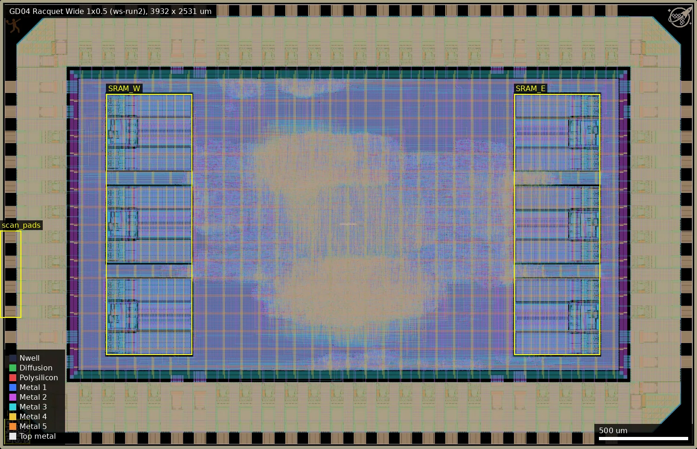

# GD04: Racquet Wide 1x0.5 (ws-run2)

| | |
|---|---|
| Repository | https://github.com/gregdavill/gf180mcu-racquet-1x0.5 @ a64a899 (develop, last commit 2026-04-05; tag release-r1p0 = aa954be, 2025-12-11) |
| Slot | 1x0p5 (die 3932 x 2531 um) |
| Top cell | chip_top |
| Taped-out layout | `GD04_chip_top_8_7`, 3932 x 2531 um, 2 placements on the G802 reticle |
| Licence in repo | Apache-2.0 (LICENSE file) |
| README | TEMPLATE: 100% identical to the wafer-space project-template README, 0 words of own text |

Run 1 and run 2 point at the same repository and commit, and the taped-out layouts are the same design (see "Run 1 versus run 2" below); the two summaries differ only in the taped-out layout details and images.

## What the repo actually contains

A 6-core SERV multi-core SoC (the "wide" half-height configuration of Racquet): `NUM_PROC_CORES = 6` (commit aa954be "Drop to 6 cores", earlier 8 and 9), six `gf180mcu_fd_ip_sram__sram512x8m8wm1` macros placed in two columns of three (`librelane/config.yaml`), Wishbone crossbar with GPIO/UART/timer/queue peripherals, SPI-flash boot loader. Same RTL family as GD02/GD03.

What is different from the siblings:
- **Standard cells: `gf180mcu_fd_sc_mcu9t5v0` (9-track, 5 V)** instead of 7t, selected in `librelane/slots/slot_1x0p5.yaml` (commit "feat: Use 9t cells"). Release netlist: 139,690 9t5v0 cells.
- **DFT scan chain with Difetto** (Donn's Yosys/LibreLane DFT plugin, `github:donn/difetto/978f710` in `flake.nix`). The custom flow list in `config.yaml` replaces Yosys.Synthesis with `Difetto.Synthesis`, `Difetto.Resynthesis`, `Difetto.ScanReplace`, `Difetto.Cut`, and inserts `Difetto.Chain` before CTS. `librelane/gf180_mapping.json` maps every dffq/dffrnq/dffsnq/dffrsnq (_1/_2/_4) to the matching `sdff*` scan cell. Four extra pads: `tm_pad` (test mode), `sce_pad` (scan enable), `sci_pad` (scan in), all `gf180mcu_fd_io__in_s`, and `sco_pad` (scan out, `bi_24t`, OE tied 1); scan clock is the functional `clk_PAD` (`DFT_TEST_CLOCK_WIRE: clk_PAD2CORE`). These pads sit together on the west edge. In the release netlist there are **3,555 scan flops** (1,434 sdffq + 1,994 sdffrnq + 127 sdffsnq) and no plain flops left; with one sci/sco pair this is, by inference, a single chain of about 3.5k cells. Difetto.BoundaryScan is commented out ("Looks incompatible with top-level I/O macros"). The `chip_core` DFT ports are commented out in `chip_top.sv`; Difetto wires them by name pattern (`DFT_SCAN_IN_PATTERN: sci_pad/Y`, etc.).
- Pads: 51 `bi_24t` (50 bidir + sco), 4 `in_s`, 1 `in_c`, 8 `dvdd`/8 `dvss` (ws_io). No analog.
- Clock 100 ns (10 MHz), `MAX_FANOUT_CONSTRAINT: 15`, `PL_TARGET_DENSITY_PCT: 75`, Yosys strategy `AREA 3`, `deferred_flatten`.
- Comment in config: "Issues seen with SCAN_IN/OUT pins not mapping.." (before `OpenROAD.RCX`), i.e. the authors hit LibreLane/Difetto problems with scan pins.
- Release r1p0 (only release, tag at aa954be, 2025-12-11): gds.gz, tar with lib/sdf/spef/odb/netlists/`metrics.json`. Metrics: 140,457 instances, die 3932 x 2531, stdcell utilisation 61%, **setup violated at slow corner**: max_ss_125C_4v50 WNS -4.26 ns (15 endpoints), nom_ss +0.48 ns, min_ss +4.4 ns; tt +43 to +48 ns; hold WNS +2.8 ps (max_ff_n40C_5v50, essentially zero margin). LVS 0, antenna 0, XOR 0, detailed-route DRC 0 after 25 iterations (an unusually long repair, counts up to 908 errors on iteration 4). Magic/KLayout DRC counts are not present in this metrics.json even though the flow lists those steps (not verified).
- No ATPG patterns, scan test bench, or scan documentation in the repo; `cocotb/` is the single functional bench. Scan was not simulated in the repo as far as I can see.

## Taped-out layout

| Fact | Measured from the reticle layout |
|---|---|
| Die | 3932 x 2531 um (top cell `chip_top` inside `GD04_chip_top_8_7`), 2 placements on the G802 reticle at (16.028, 18.197) mm and (20.02, 18.197) mm |
| Pads and IO cells | 72 pad positions: 51 `gf180mcu_fd_io__bi_24t`, 4 `in_s`, 1 `in_c`, 8 `gf180mcu_ws_io__dvdd`, 8 `dvss`, plus 4 corner cells; 682 IO fill cells. Same counts as the repo netlist. Pad labels (Metal5_Label) include `tm_PAD` (58.5, 772), `sci_PAD` (58.5, 1054), `sco_PAD` (58.5, 1195), `rst_n_PAD` (611.5, 58.5), `bidir_PAD[0..49]` |
| Standard cells | `gf180mcu_fd_sc_mcu9t5v0` only. 35,525 logic cells plus 104,165 fill/tap/antenna cells = 139,690 placements (the repo's "139,690 cells" figure includes fill and taps). Top logic types: nand2_1 7,375; dlyd_1 2,774 (hold-fix delay cells); oai21_1 2,556; clkinv_1 2,456 |
| Flip-flops | 3,555, all scan type: sdffrnq_1 1,993 + sdffq_1 1,434 + sdffsnq_1 127 + sdffrnq_2 1. No plain `dff*` cell is placed |
| SRAM | 6 x `gf180mcu_fd_ip_sram__sram512x8m8wm1`, each 431.86 x 484.88 um, in two columns of three: x = 600 and x = 2900 um, y = 529, 1049, 1569 um (3 KiB in total) |
| Oxide | Dualgate (55/0) and V5_XTOR (112/1) cover the whole core: in a 200 x 200 um logic window and in a 485 x 432 um SRAM window both layers cover 98.5 to 100 % of the area and every Poly2 shape lies inside Dualgate. All transistors in the core are 5 V thick oxide (library is 5 V) |
| Not present | No MIM capacitor, no DNWELL, no BJT, no custom or analog cell. RES_MK (110/5, 1,072 shapes) and DIODE_MK (115/5) marker shapes exist; each `bi_24t` IO cell carries 14 RES_MK and 16 DIODE_MK shapes (ESD structures), and DIODE_MK also covers about 12 % of a logic window (library diode and antenna cells), so these are library content, not test structures |
| Other cells | `gf180mcu_gsd__logo` 190.5 x 162 um at (26, 2343) um, wafer.space logo 143 x 143 um at (3763, 2362), ID block `gf180mcu_ws_ip__id` 143 x 143 um at (26, 26) |

Overview of the die (0,0 to 3932,2531 um; the small marked box at (26, 26) is the ID block): the SRAM macros sit in two columns of three at x = 600 and x = 2900 um, and the synthesised logic fills two lobes in the middle (around y = 1650 and y = 900 um) between them; the pad ring is all `bi_24t` with eight power pairs.

### Does it match the repository?

Compared the run 2 layout with the run 1 layout and with the release GDS `gf180mcu-racquet-1x0.5-r1.0.gds.gz` (tag release-r1p0 = aa954be; the repo itself holds no GDS and its develop HEAD a64a899 changes only flake files). Top-cell children and counts are identical: 6 SRAMs, 51 `bi_24t`, 4 `in_s`, 1 `in_c`, 8 `dvdd`, 8 `dvss`, 4 corners, 414/22/226/20 IO fill cells, 139,690 9t5v0 placements, 461,325 router via placements, and the die size 3932 x 2531 um. The only top-level difference is the wafer.space ID block, logo and seal ring added to the reticle copy. Against run 1 see "Run 1 versus run 2": same layout, only the ID block differs. So the manufactured design is the r1p0 release layout, including the scan chain cells (3,555 scan flops, no plain flops), and the summary's description of the repo is confirmed. The summary's earlier inference that sci/sco form a single chain of about 3.5k cells is still inferred (the pads and flop count agree, but I did not trace connectivity). An XOR of the run 1 layout against the release GDS (same numbers apply to run 2, which is identical to run 1 outside the ID block) on COMP, Poly2 and Metal5 (81/0) leaves 15,751, 9,681 and 163,911 polygons spread over the whole die (27 to 3906 um), and none on Pad (37/0), Dualgate (55/0) or V5_XTOR (112/1); the release GDS has no wafer.space dummy fill (the reticle copy has), which is the expected source of those differences, but I did not separate fill from signal polygon by polygon. The cell hierarchy, counts and placement positions of every non-fill cell agree.

Close-ups are identical to run 1 (same coordinates) and are in the ws-run1 audit of GD04: `images/scan_pads_west.webp` (the tm/sce/sci/sco pads on the west edge, x ~ 58 um, y = 772 to 1195 um) and `images/cells_detail.webp` (9t5v0 logic at (1500, 1020) um).

## Authors and affiliations

| Person | Role | Affiliation | Source |
|---|---|---|---|
| Greg Davill | design, Difetto integration (85 commits) | not stated (GitHub: Australia, gregdavill.com) | git shortlog, `gh api users/gregdavill` |
| Leo Moser | template author (74 commits) | not stated in repo | AUTHORS.md |
| Tim Ansell, TrevorPeyton | 1 commit each | not stated | git shortlog |
| Donn (difetto author) | DFT plugin used | not stated in repo | flake.nix input `github:donn/difetto` |

## Value for GF180MCU characterisation and PDK development

### Verdict: Medium
Not built as a test chip, but it is a 140k-cell 9-track 5 V design with a full scan chain reachable from four pads. A scan chain gives direct controllability and observability of ~3.5k flops (sdffq/sdffrnq/sdffsnq cells), which makes it the most useful of the Racquet set for yield and cell-level fault data and for checking the 9t library in silicon. It stops short of High because no ATPG vector set or fault model ships in the repo and there is no analog or device-level structure.

### Test structures and measurable circuits
| Structure | Exercises | Access | Where |
|---|---|---|---|
| Scan chain, ~3,555 scan flops | flop and scan-mux function of gf180mcu_fd_sc_mcu9t5v0 sdffq/sdffrnq/sdffsnq; stuck-at/transition fault data on 140k cells if patterns are generated; shift speed gives scan-path hold/setup | pads tm_PAD (58.5, 772), sce_PAD (58.5, 913), sci_PAD (58.5, 1054), sco_PAD (58.5, 1195) um, clk_PAD; flop count of 3,555 confirmed in the layout (sdffrnq 1,994, sdffq 1,434, sdffsnq 127), chain order not traced | `librelane/config.yaml` (DFT_*), `librelane/gf180_mapping.json`, `src/chip_top.sv` |
| 6 x sram512x8m8wm1 | foundry SRAM at 5 V (functional) | cores / SPI loader; macros at x = 600 and 2900 um, y = 529, 1049, 1569 um (431.9 x 484.9 um each) | `librelane/config.yaml` |
| 9-track vs 7-track comparison | 9t5v0 timing/power vs the 7t5v0 siblings GD02/GD03 on the same RTL | pads | compare with GD02/GD03 metrics |

STA/SDF/SPEF for nine corners exist in the release; hold slack at max_ff is only 2.8 ps and slow-corner setup is -4.3 ns, so Fmax and hold behaviour vs temperature/voltage would test those margins.

### Candidate PDK additions
- A reusable scan-cell mapping for the 9t5v0 library (`gf180_mapping.json`: dff -> sdff for 11 cell variants); a similar file for 7t5v0 is not in the repo.
- Documented flow gap: Difetto boundary scan incompatible with top-level IO macros; scan pins not mapping (config comments).
- DRC repair difficulty on the 9t library shows in the route DRC iteration history (not a documented PDK bug).

### What would be needed to use it
Packaged part and a tester able to drive a 3.5k-bit chain at the 10 MHz clock; the scan-in/scan-out order (chain order) and ATPG patterns are not in the repo (would have to be regenerated from the netlist with Difetto/quaigh, or reconstructed from the release `pnl` netlist); need to hold tm_PAD high and sce_PAD for shift/capture. Test-mode behaviour of the SRAM macros (they are not scannable) and of the reset/clock path in test mode is not documented.

## Run 1 versus run 2

- Repository: the same repository at the same HEAD (a64a899) was cloned for ws-run1 and ws-run2. A `diff -r` of the two `repo/` trees shows no difference outside `.git/` metadata. The releases (`gf180mcu-racquet-1x0.5-r1.0.gds.gz` 22,140,152 bytes and `.tar.gz` 221,842,753 bytes) are identical in size; `releases.json` is identical.
- Layout: the two taped-out layouts are the same design. Top-cell child counts are identical (6 SRAM, 51 `bi_24t`, 4 `in_s`, 1 `in_c`, 8+8 power IO, 4 corners, 139,690 9t5v0 placements, 461,325 router via placements, 1,725 distinct cells). An XOR of the full-die flattened layers gives zero area on COMP, Poly2, Contact, Via1, Via2, Pad, Dualgate, V5_XTOR and Nwell. Metal1, Metal2, Metal3, Metal4 and Metal5 each differ by 4,850 um2 in 27 polygons, all inside the box (26, 26) to (168.8, 168.8) um, which is the wafer.space ID block (`gf180mcu_ws_ip__id`, 142.8 um square) at the lower-left corner: the chip ID differs, nothing else. Via3/Via4 were not XORed.
- Reticle: run 1 reticle cell `GD04_chip_top_6_8` (placements at (12.036, 20.788) and (20.02, 20.788) mm), run 2 `GD04_chip_top_8_7` (placements at (16.028, 18.197) and (20.02, 18.197) mm).
- project.json differs only in the layout reference (run 1 `GD04/chip_top.gds`, run 2 `GD04/chip_top.oas`) and description formatting. The only commit after the release tag is a64a899 (flake.nix/flake.lock only), so it does not distinguish the runs.

## Notes and caveats

- Silicon has two identical submissions (checked: same layout apart from the chip-ID block, see above), so comparing run 1 and run 2 dies tests run-to-run repeatability of the same layout. The two runs are on different reticles (G801 and G802), which also means the dies come from different wafers.
- README is the untouched template; the platform description is the only prose.
- Setup is violated by 4.26 ns at max_ss_125C_4v50 in the shipped release (from the release metrics; not re-checked on the layout).
- The layout has no hierarchy below the pad ring, SRAMs and flat standard cells, so the six SERV cores, the crossbar and the peripherals cannot be told apart from the layout; only the 6 SRAM positions and the two logic lobes are visible. The scan chain order and which pads reach which flops were not traced (would need LayoutToNetlist extraction or the release netlist).
