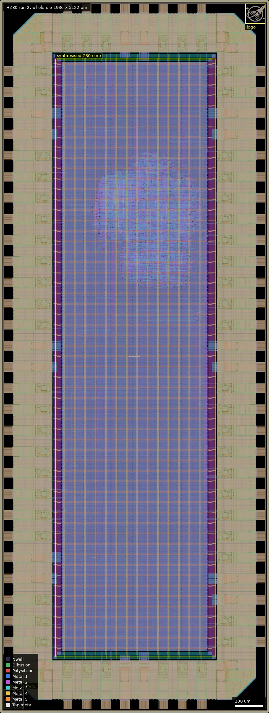

# HZ80: FOSSi open-source replacement for Z80 classic 8-bit CPU (0.5 x 1 slot) (ws-run2)

| | |
|---|---|
| Repository | https://github.com/rejunity/ws0-z80-open-silicon-gf180mcu @ 56308db (main, last commit 2025-12-19), 10 remote branches. The checked-out tree is `main` whatever the slot |
| Slot | 0p5x1, built from `origin/halfv_slot_mcu9tv50` (af797d0), same as run 1 HZ80 |
| Top cell | chip_top |
| Licence in repo | Apache-2.0 (`LICENSE`); TV80 files carry Guy Hutchison's MIT-style header; `src/ws_z80.v` has an Apache-2.0 SPDX header |
| Taped-out layout | HZ80_chip_top_12_2, 1936 x 5122 um, 1 placement on the G802 reticle |
| README | TEMPLATE+NOTE (90% the wafer.space template README plus 57 words of the author's own text) |

**This variant (HZ80, ws-run2).** Run 2 resubmission of the half-width Z80 (0p5x1), with the layout delivered as OASIS. Nothing in the repo identifies a run 2 change (the last commit is 2025-12-19 and there are no releases), and the layouts have now been compared: they are identical except for the chip ID, so the run 1 and run 2 dies form a run-to-run repeatability pair. The tree checked out in `repo/` is `main`; the variant is on branch `origin/halfv_slot_mcu9tv50`.

## What the repo actually contains
A pin-compatible Z80 clone for the wafer.space template, aimed at a DIP40 chip-on-board package. The README (a template README with a header added) links the base repo https://github.com/rejunity/z80-open-silicon. The CPU is Guy Hutchison's TV80 (`src/tv80_*.v`, 2004, OpenCores) wrapped by `src/ws_z80.v` (Renaldas Zioma) and `src/chip_core.sv`. There is no RAM, ROM or SRAM macro; the template's SRAM example is commented out in `chip_core.sv`.

**Pins:** the Z80 pins are mapped onto the template pads, deliberately keeping the Z80's scrambled data-pin order for the DIP40 board.
- 8 bidirectional data pads.
- 16 address outputs.
- 8 control outputs: M1, MREQ, IORQ, RD, WR, RFSH, HALT, BUSAK.
- 4 Z80 inputs: WAIT, INT, NMI, BUSRQ.
- clk (Schmitt `in_s`) and rst_n (`in_c`).
- 6 extra "early signal" configuration inputs, `input[9:4]`.

Address and data pads float during RESET and BUSAK, and MREQ/RD/WR/IORQ float during BUSAK, via `bidir_oe`. Unused pads are inputs with weak pull-downs; the commit credits "LukeW" for advising that pads can otherwise float to mid-rail and draw current.

**Configuration pads:** `early_signals[5:0]` select, per output, between normal and "early" timing of MREQ, IORQ and RD. The defaults are set by pull-ups and pull-downs (`6'b100010`): early long MREQ cut with RFSH, and early long RD. This is the only on-chip tunable timing feature.

**Flow:**
- LibreLane Chip flow, PDK `gf180mcuD` (`PDK_TAG ?= 1.6.6`), wafer.space template.
- Standard cells: `gf180mcu_fd_sc_mcu9t5v0` (9-track, 5 V).
- `CLOCK_PERIOD: 40` (25 MHz). `PL_TARGET_DENSITY_PCT: 20` (spread out deliberately because there is a lot of area). Hold margin 0.5 ns, setup margins 4.0 and 1.0 ns, resizer hold buffer limit 100%.
- Commits 416a4c0 and d20f889 raised setup margins to fix setup violations at `ss_125C_4v50`. The operating voltage is not stated; 5 V is inferred from the library and corner names.
- Pads: `gf180mcu_fd_io__bi_24t` (outputs, with Y unconnected), `in_c`, `in_s`, and `gf180mcu_ws_io__dvdd/dvss`. Chip-ID and logo macros under `ip/`.

**Slot handling:**
- `chip_top.sv` does not use `slot_defines.svh`. It sets pad counts itself in the module header per slot macro.
- All slot yamls are in `main`. `main` has full pad maps for 1x1 and 0p5x0p5. Its 0p5x1 map is only the generic template, and the header comment says 0p5x1 is not supported.
- The variants are therefore separate branches, not separate RTL.

| Slot | DVDD/DVSS | Inputs | Bidirs |
|---|---|---|---|
| 1x1 | 8/10 | 4+18 | 32 |
| 0p5x1 | 8/8 | 4+18 | 32 |
| 0p5x0p5 | 4/4 | 4+10 | 32 |

**Branches:**

| Branch | Tip | Role |
|---|---|---|
| main | 56308db, 2025-12-19 | 1x1 default; this is RZ80 |
| halfv_slot_mcu9tv50 | af797d0, 2025-12-19 | `DEFAULT_SLOT = 0p5x1`; hand-written 0p5x1 pad map in slot_0p5x1.yaml, with STD_CELL_LIBRARY duplicated in the slot yaml; only chip_top comments differ otherwise |
| quarter_slot_mcu9t5v0 | a3c37fb, 2025-12-19 | `DEFAULT_SLOT = 0p5x0p5`; differs from main by Makefile default and a comment fix in slot_0p5x0p5.yaml |
| quarter_slot, quarter_slot_mcu7t5v0 | 2025-11-30 | older quarter-slot attempts (7t5v0 cells, PDK 1.1.2) |
| mcu7t5v0 | 2025-11-25 | older 1x1 on 7t5v0 cells (PDK 1.1.0) |
| mcu9t5v0, mcu9t5v0_new_pad_mapping | 2025-11-24 to 12-04 | 9t5v0 trials and pad remapping |
| macos_fix | 2025-11-24 | hold-margin fix "specific to MacOS" |

The platform does not record the branch. The slot-to-branch assignment above is inferred from each branch's `DEFAULT_SLOT` and pad map.

**Not in the repo:** no GDS or OASIS and no releases (so the submitted layouts cannot be checked). No LibreLane logs or reports and no silicon results for GF180. Testbench: `cocotb/chip_top_tb.py` with 15 tests (reset, NMI, INT and BUSREQ sequences, fetch/read/write sub-cycle timing, NOP, LD, IN and OUT). A ZEXDOC fix for DAA is mentioned in the history. A gate-level NMI workaround is in the last commit.

**"Silicon proven":** this refers to the author's earlier Sky130 (Tiny Tapeout 7, eFabless CI2406) and IHP SG13G2 tape-outs, per the upstream README. The GF180 line there says WIP, chip-on-board DIP40. Nothing in this repo shows GF180 silicon.

## Taped-out layout
| Measured | Value |
|---|---|
| Die | 1936 x 5122 um, one placement at (24.012, 5.242) mm on the reticle |
| Pad ring | 72 pads: 32 `gf180mcu_fd_io__bi_24t`, 23 `in_c`, 1 `in_s`, 8 `gf180mcu_ws_io__dvdd`, 8 `dvss`, plus 4 corner cells and filler cells. Labels: `bidir_PAD[0..31]`, `input_PAD[0..21]`, `clk_PAD`, `rst_n_PAD`, `VDD`, `VSS` |
| Signal pads | 56 (8+16+8 Z80 outputs/bus, 4 Z80 inputs, clk, rst_n, 6 early-timing config inputs, the rest unused inputs and bidirs). A Z80 needs 38 signals plus supply; the die has 18 spare signal pads |
| Standard cells | `gf180mcu_fd_sc_mcu9t5v0` (9-track, 5 V): 5143 logic cells and 80093 fill/tap/decap cells. 367 flip-flops (170 dffq, 143 dffrnq, 54 dffsnq), 615 delay cells (304 dlyd, 263 dlyc, 48 dlya, from hold fixing), 703 nand2_1, 350 nor2_1, 309 mux2_1 |
| SRAM | none |
| Oxide | Dualgate (55/0) and V5_XTOR (112/1) each cover 94% of the core box as one merged polygon; 749301 of 749969 poly polygons in the core box lie inside Dualgate, 668 (19000 um2) outside. The logic is therefore 5 V (thick-oxide) cells, consistent with the 5 V I/O design goal |
| MIM, DNWELL, high-res poly | none in the core (no MIM or DNWELL layer is present; RES_MK/DIODE_MK/ESD_MK markers occur only in the I/O cells) |
| Custom content | none beyond wafer.space chip ID (`gf180mcu_ws_ip__id`, 142.8 um at (26,26)) and logo (143 um at (1767,4953)); no custom analog cells |

### Does it match run 1?
Yes. Child counts (1028 distinct cells, 1029 in the file, 5143 logic and 80093 fill cells, 72 pad-ring cells) are the same as run 1. A boolean XOR of the flattened layers COMP, Poly2, Nwell, Dualgate, V5_XTOR, MOS_CAP_MK and Pad (22/0, 30/0, 21/0, 55/0, 112/1, 166/5, 37/0) is empty, and Metal1 to Metal5 differ only in a 24-polygon, 5020 um2 region inside the chip ID block at (26,26)-(169,169) um. So run 2 is the same build as run 1, resubmitted with a different chip ID: a run-to-run repeatability pair.

### Does it match the repository?
Partly checked. No branch or tag of the repository holds a full-chip GDS or OASIS (the only GDS files in any branch are `ip/gf180mcu_ws_ip__id` and `ip/gf180mcu_ws_ip__logo`), and there are no releases, so the layout cannot be compared cell by cell. Compared instead with the config: library mcu9t5v0, no SRAM macro, and the pad counts of the 0p5x1 slot (8 DVDD, 8 DVSS, 32 bidirs, 4+18 inputs plus clk and rst_n = 24 inputs) all agree with the layout. The layout is consistent with `origin/halfv_slot_mcu9tv50` (0p5x1 pad map) and not with `main` (1x1, 10 DVSS pads, wider die); that settles the branch assignment from the layout size and pad counts, though not the exact commit. The 5143 logic cells and 20% placement density (huge, mostly empty core with a denser logic blob in the upper middle of the core) match a synthesised 8-bit CPU with a 25 MHz target.

Whole die, 1936 x 5122 um: pad ring around the edge, the large mostly-empty core (400-1550, 400-4700 um) with the logic blob near (800-1400, 3100-4000), chip ID at the lower left (26,26) and logo at the upper right.

Close-ups are in `ws-run1/HZ80/summary.md`; the layout is identical.

## Authors and affiliations
| Person | Role | Affiliation | Source |
|---|---|---|---|
| Renaldas Zioma ("rej", ReJ; GitHub rejunity) | Z80 integration, wafer.space port (97 commits) | GitHub bio: "Research", "Neuromorphic chip enthusiast"; no company named | git shortlog, ws_z80.v header, gh api users/rejunity |
| Guy Hutchison | TV80 core (2004) | not stated beyond the opencores address in the header | src/tv80_core.v header |
| Leo Moser | wafer.space template (78 commits) | not stated | AUTHORS.md (the only name listed), git shortlog |
| "LukeW" | pull-down advice credited in a commit | not stated | commit 76b628c |
| Tim 'mithro' Ansell, TrevorPeyton | one template commit each | not stated | git shortlog |

## Value for GF180MCU characterisation and PDK development
### Verdict: Low
Ordinary synthesised digital (about 8-bit CPU, 25 MHz) on stock 9t5v0 5 V cells (5143 logic cells, 367 flops) with no macros, MIM or DNWELL. There are no analog or probe structures. It is useful as a functional and fmax data point and for the pad-timing knobs.

### Test structures and measurable circuits
| Structure | What it exercises | Access | Where |
|---|---|---|---|
| Whole-CPU fmax | 9t5v0 cell delay (25 MHz target; margins tuned to ss_125C_4v50) | clk pad, run a Z80 program | librelane/config.yaml |
| Early MREQ/IORQ/RD timing selector | clk-to-output delay and pad timing, selectable per signal | `input[9:4]`, pull defaults 100010; drive pads to change | src/ws_z80.v |
| bi_24t output/tristate on a bus | pad drive and float behaviour (BUSAK, RESET) | address/data/control pads on the DIP40 board | src/chip_core.sv |

No STA or other simulation output is in the repo to compare with silicon; only the cocotb sub-cycle timing tests (RTL and gate-level).

### Candidate PDK additions
Nothing new. Documented flow quirks: librelane honours STD_CELL_LIBRARY only from the first yaml file (workaround: duplicate it in the slot yamls, commit d181f67); MacOS-specific hold violations (macos_fix); the template's Magic DRC and Metal2 fill workarounds (ERROR_ON_MAGIC_DRC False, MAGIC_GDS_FLATGLOB, Metal2_ignore_active); the inherited OpenROAD bug comment (issue 8229).

### What would be needed to use it
Packaged or bonded die in a DIP40 board (the repo has pad and ceramic layout images in `docs/`), a 25 MHz clock, a memory and I/O model or a ZX/RC2014-style board, and Z80 test programs (ZEXDOC is mentioned but not included). No test plan or measured data are in the repo.

## Notes and caveats
- The cloned tree is `main` for all four projects, so the HZ80 and QZ80 sources are only on branches. The mapping is inferred.
- The taped-out layout confirms the 0p5x1 build (pad counts, die size) but no repo GDS exists, so the exact commit is not confirmed.
- The run-2 projects have the same HEAD (2025-12-19), which predates run 2; nothing identifies a change.
- The operating voltage is not stated; the core is 5 V (thick-oxide) cells per the layout.
