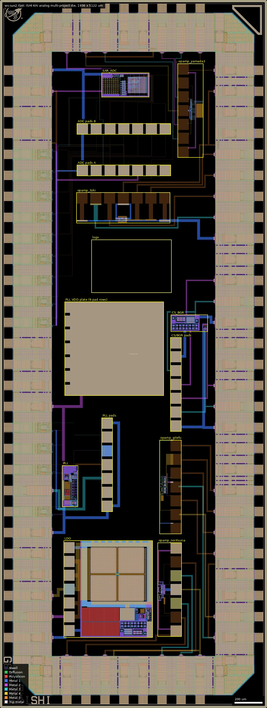
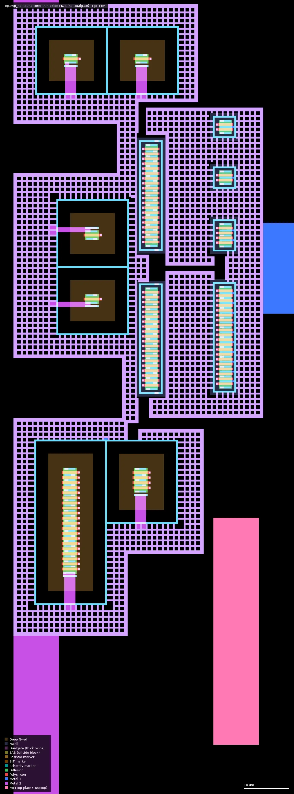
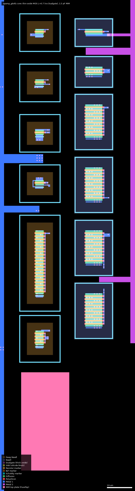
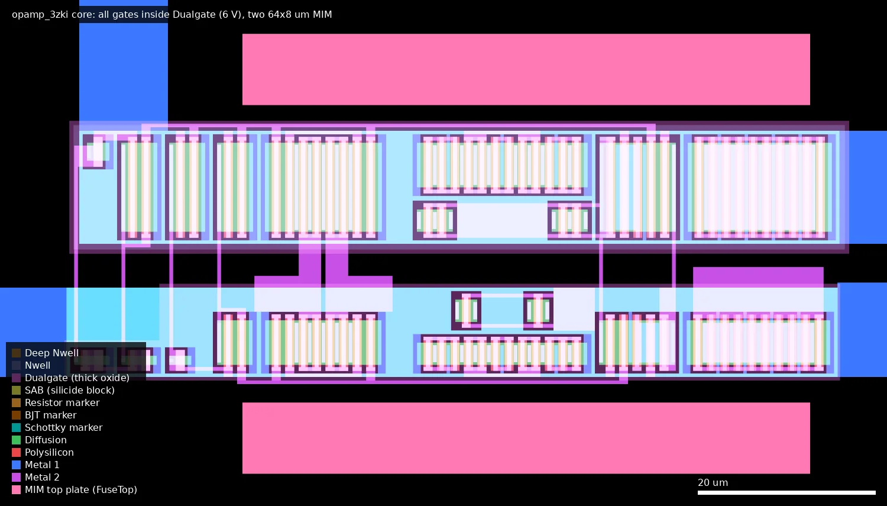
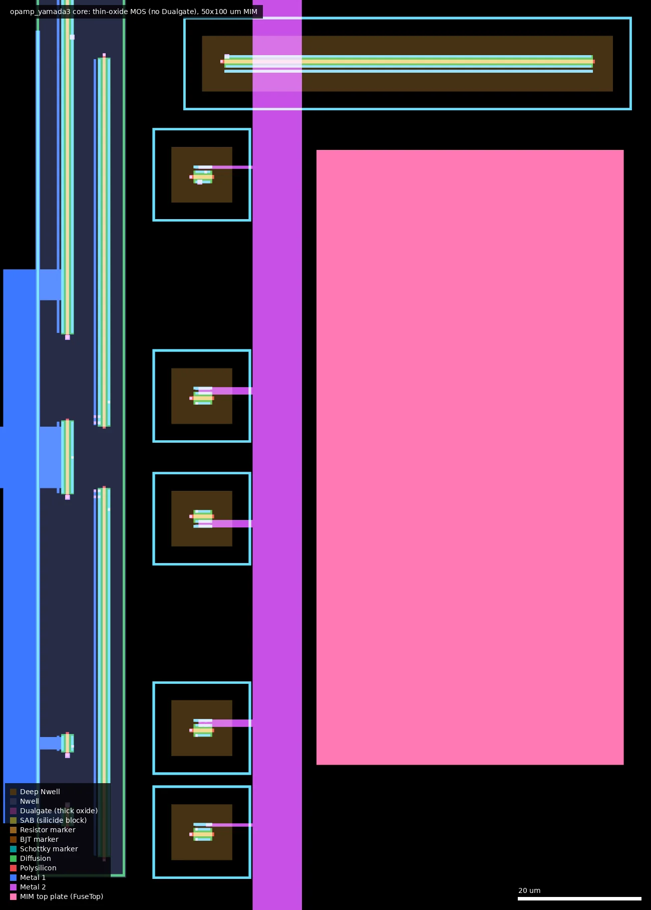
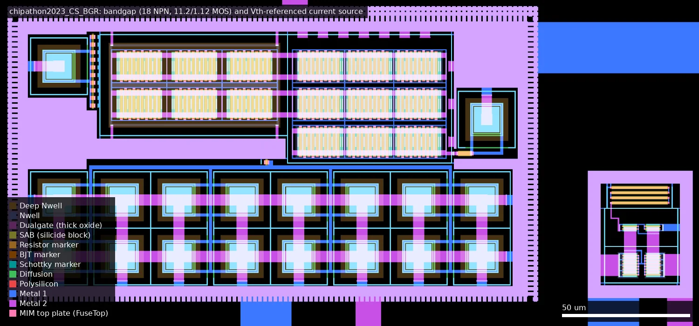
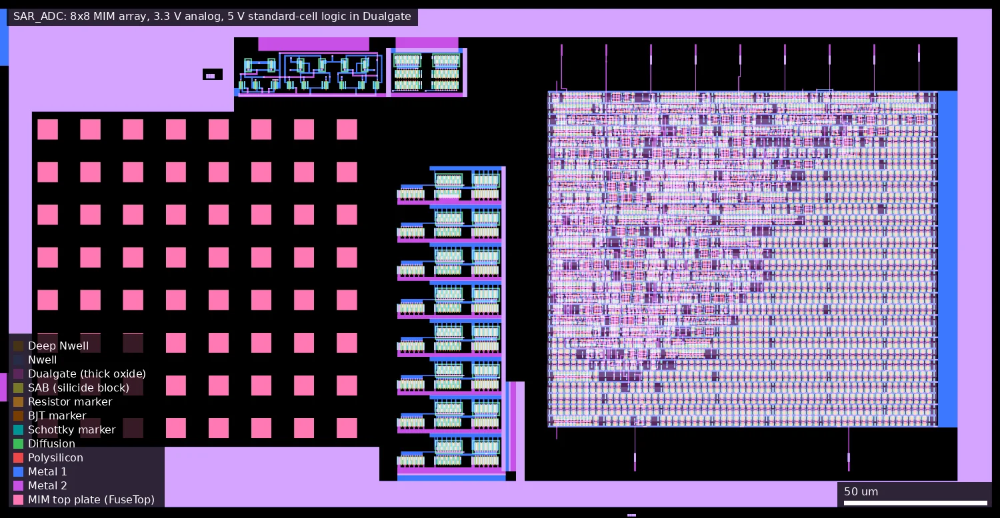
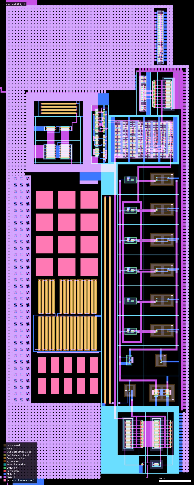
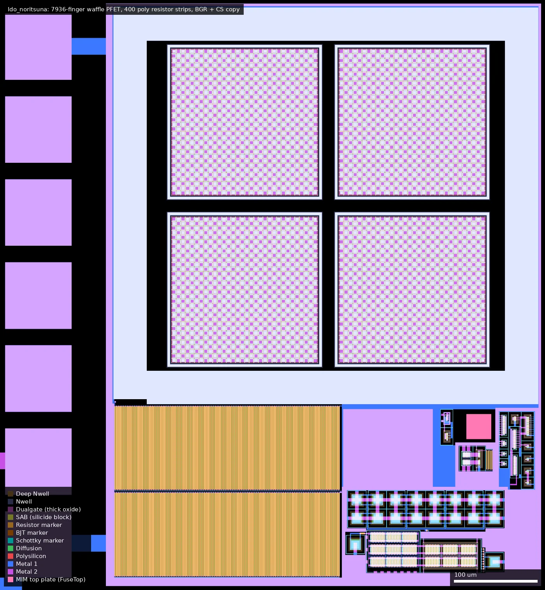
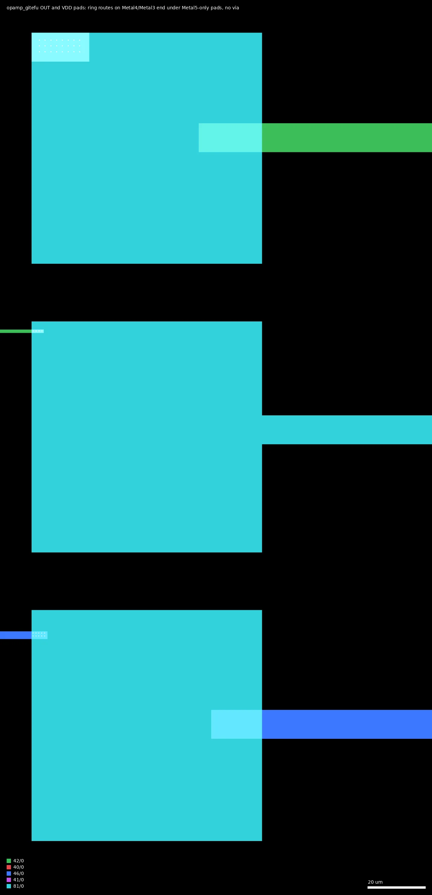

# ISHI: ISHI-KAI_Multiple_Projects_WaferSapce-GF180-2 (ws-run2)

| | |
|---|---|
| Repository | https://github.com/ishi-kai/ISHI-KAI_Multiple_Projects_WaferSapce-GF180-2 @ 1a0be37 (main, last commit 2026-07-14) |
| Slot | 0p5x1 (die 1936 x 5122 um) |
| Taped-out layout | ISHI_ISHI-KAI_WS_RUN2_13_4, 1936 x 5122 um, 1 placement(s) on the G802 reticle |
| Top cell | ISHI-KAI_WS_RUN2 |
| Licence in repo | Apache-2.0 (`LICENSE`, copyright line left as the unfilled template "[yyyy] [name of copyright owner]") |
| README | OK by word count (1668), but it is the run 1 README with sections deleted; several statements and links are wrong for this repo |

## What the repo actually contains

A half-width re-spin of the run 1 ISHI-KAI analog multi-project die (see
`ws-run1/ISHI/summary.md`). Nine of the fifteen run 1 circuits (in eight cells) are carried over
unchanged, re-placed inside a new, narrower pad ring. The repo was created and
finished in one day (four commits on 2026-07-14, all by Noritsuna Imamura).

Like run 1 it is a layout-and-logs repo: no schematics, netlists, testbenches or
simulation results. `schematic/README.md` links to the same three external
repositories as run 1.

| Path | Content |
|---|---|
| `gds/ISHI-KAI_WS_RUN2.zip` | Final top GDS (230 MB unzipped, 1423 cells) with fill. The only layout file; no per-member GDS, no frame GDS, no fill-free copy |
| `docs/pin_list.xlsx`, `pin_list.pdf` | 74-row pad list (wrong in several places; the traced pad map is under "Taped-out layout") |
| `precheck_log/RUN_2026-07-14_11-31-08/` | One precheck run, all checks clean (density, zero-area, antenna, Magic DRC, KLayout DRC all 0), plus a render |
| `images/` | Annotated layout picture, precheck and submission screenshots, PLL pictures |

### Sub-designs

"Change from run 1" comes from a layer-by-layer XOR of each cell against the
run 1 cell (re-verified 2026-10-24; an earlier version of this table called
several changed cells identical). Device layers (COMP, Poly2, Dualgate) are
unchanged in every cell except `chipathon2023_CS_BGR`. Devices and designers
are as in the run 1 summary.

| Cell | Designer | Circuit | Devices (upstream schematic; measured devices are under "Taped-out layout") | Change from run 1 |
|---|---|---|---|---|
| `opamp_3zki` | 3zki (Mizuki Mori) | Rail-to-rail op-amp, 5 V | nfet_06v0 / pfet_06v0 L=1 um, 2 MIM caps | Device layers identical; routing changed: run 2 lacks wide Metal3 and Metal5 strips (Metal3 13,577 to 7,767 um2, Metal5 98,044 to 68,707 um2); now rotated to a horizontal pad row |
| `opamp_gitefu` | gitefu | Two-stage op-amp | Schematic nfet/pfet_06v0_dn L=0.7; drawn without Dualgate | Identical |
| `opamp_noritsuna` | noritsuna | Two-stage op-amp | Schematic nfet_05v0_dn / pfet_05v0; drawn without Dualgate | Identical shapes; tap cell renamed |
| `opamp_yamada3` | yamada3 (Miho Yamada) | Two-stage op-amp | Schematic nfet_05v0_dn / pfet_06v0; drawn without Dualgate | Device layers identical; Metal1 area 1,313 to 1,252 um2, plus 1.6 um2 changes on Metal2 to Metal4 and the vias |
| `chipathon2023_CS_BGR` | A. Tsuchiya (bandgap), yamada3 (current source) | 1.2 V bandgap and 20 uA Vth-referenced source | npn_10p00x10p00 (18), nfet/pfet_03v3, ppolyf_u | Changed: the same area on every layer, but the cell is 122.8 um tall instead of 116.0 and the geometry differs on 16 layers, device layers included (moved or redrawn, around the bandgap part) |
| `SAR_ADC` | Maple0705, Gitefu, Tseng, Kinako | 6-bit SAR ADC, 8 MHz, 3.3 V | nfet/pfet_03v3 L=0.28, 64 MIM 7x7 um, 798 sc7 5 V cells | Identical except one 1.6 x 15 um Metal4 shape removed (24 um2) |
| `chipathon2023_pll` | A. Tsuchiya | Analog PLL, 8 MHz to 48/40 MHz | nfet/pfet_03v3 L=0.33 VCO and charge pump, sc7 5 V cells, high-res poly, 22 MIM (no 6 V devices in the layout) | Identical |
| `ldo_noritsuna` | noritsuna and others | LDO 3.3 V to 3.2 V, 4 mA | pfet_03v3 waffle array m=7936, ppolyf_u, npn bandgap | Device layers identical; power metal reduced: Metal1 -6,600 um2, Metal4 -12,400 um2, Metal5 -28,200 um2, small via changes |

**Dropped from run 1:** the five-inverter block `inverter_all` (noritsuna,
ajisai, homelith, bols-blue, ponzu840w) and ice458's dynamic comparator
`cmp_ice458`. The README member list was trimmed accordingly but still opens
with "14 novice semiconductor designers" and still lists ajisai, who has no
circuit on this die.

### What else changed between the run 1 and run 2 submissions

- Slot halved from 1x1 to 0p5x1. Pad ring rebuilt with 72 pads (8 bottom, 28 right, 8 top, 28 left; confirmed in the layout) instead of 74: 21 `asig_5p0`, 8 `bi_24t`, 5 `in_c`, 17 `dvdd`, 21 `dvss`. Run 1 used the `gf180mcu_ws_io__dvdd/dvss` wrappers; run 2 instantiates `gf180mcu_fd_io__dvdd/dvss` directly.
- Two new filler variants, `fill10_noVDD` (37 placed, only DVSS/VSS rail labels) and `fill10_supplyVDD` (28 placed, DVDD/VDD/DVSS/VSS labels), alongside stock `gf180mcu_fd_io__fill10`. Extracted connectivity confirms a segmented supply ring: each of the 17 `dvdd` pads is on its own net that reaches only two to twelve neighbouring IO cells (nine go to one circuit each, eight "reserved" ones go nowhere), while all 21 `dvss` pads are one common ground net.
- Top-level structure changed: the frame is now a `TOP_FRAME` cell, member cells sit directly in the top cell, and top-level routing is drawn in the top cell.
- New wafer.space cells: `gf180mcu_ws_ip__project_id`, `__shuttle_id`, `__qrcode_id`, `__marker` in place of run 1's single `gf180mcu_ws_ip__id`.
- The logo is now an array of 81,286 instances of a 1 x 1 um Pad-layer square (`GRID` of `CELL`) rather than 325,554 flat Pad polygons.
- The large single Pad opening over abutted probe-pad rows is kept. In this layout it is 720 x 680 um over nine `pads_ishikai` rows, (467.7, 2258.7) to (1187.7, 2938.7), and the whole Metal1-to-Metal5 plate is on the PLL VDD net (extracted).
- Precheck moved to a newer flow: 16 steps including a render step, `WS_SLOT`/`WS_ID` variables, DRC decks selected as `all,-antenna,-density,-cup`. The precheck design name is `TOP_ISHI-KAI` reading `TOP_ISHI-KAI.gds`, while the committed file's top cell is `ISHI-KAI_WS_RUN2`.
- The platform record points at an `.oas` layout; the repo has only a zipped `.gds`. The two have the same 1423 cells and identical circuit geometry (see below).

**No run 1 measurement results are published here or in the run 1 repo.** The
run 1 repo has optical photos of fabricated dies and chip-on-board assemblies
only. This README's "Chips / Sample Bare Die" section is copied from run 1 and
links to a `chip_photo/` directory that does not exist in this repo.

## Taped-out layout

Measured from `layout/ISHI.oas` (the die as placed on the G802 reticle).

| | |
|---|---|
| Die | 1936 x 5122 um, five metal layers (Metal5 is the top metal; no 53/0 MetalTop) |
| Pad ring | 72 pads, 60 x 60 um openings: 21 `gf180mcu_fd_io__asig_5p0`, 8 `bi_24t`, 5 `in_c`, 17 `dvdd`, 21 `dvss`, 4 `cor`; fillers `fill10` (457), `fill5`, `fill1`, `fillnc`, plus custom `fill10_noVDD` (37) and `fill10_supplyVDD` (28) |
| Probe pads | 126 pad positions of 80 x 80 um on 100 um pitch: 63 with their own opening, 63 under one 720 x 680 um opening (the PLL VDD plate) |
| Standard cells | No library cell instances except 63 `gf180mcu_fd_sc_mcu7t5v0` tie and tap cells (34 `tiel`, 8 `tieh`, 21 `filltie`); the 5 V 7-track logic of the ADC and PLL is flattened into `SAR_ADC` and `chipathon2023_pll` |
| SRAM | None |
| Custom blocks | `ldo_noritsuna` 646 x 702 um, `opamp_3zki` 680 x 221, `opamp_yamada3` 187 x 680, `opamp_noritsuna` 174 x 680, `opamp_gitefu` 160 x 680, `SAR_ADC` 345 x 175, `chipathon2023_pll` 116 x 300, `chipathon2023_CS_BGR` 269 x 123, 12 `pads_ishikai` + 1 `pads_ishikai_PLL` probe rows, `logo_ishikai` (579 x 385 um, Pad layer only) |
| Thick oxide | Dualgate only in `opamp_3zki` (6 V devices), in the standard-cell logic of the ADC and PLL (with V5_XTOR, 5 V) and in the IO cells. None in the other three op-amps, the LDO or the bandgap/current source |

### Does it match the repository?

Yes. The repo's `gds/ISHI-KAI_WS_RUN2.zip` was loaded next to the reticle copy:
both have the same 1423 cells (names differ only by KLayout's `$n` suffixes and the top cell's name), the
same top-level children (8 circuit cells, 13 pad rows, logo, `TOP_FRAME`, 113
`VIA_FULL_STACK`) and the same die box. An XOR of COMP, Poly2, Dualgate,
V5_XTOR, Metal1 and Metal5 is empty for every circuit cell, both pad-row cells,
the logo and the two custom fillers. `TOP_FRAME` differs only where wafer.space
replaced the ID cells, and the fill shape counts differ (fill datatypes merged).
So the missing Dualgate and the open routes described below are in the
submitted GDS, not an artefact of reticle assembly.

### Thick-oxide check per circuit

Every gate (Poly2 over COMP) was tested against Dualgate 55/0 and V5_XTOR 112/1
with `layout_query.py overlap` per cell and again with a flat region check in
the top cell (so a Dualgate shape drawn at the top level would have been found).

| Cell | Gates in Dualgate | Gates in V5_XTOR | Fabricated as | Documented class | Agrees? |
|---|---|---|---|---|---|
| `opamp_3zki` | 90 of 90 | 0 | 6 V (`nfet_06v0`/`pfet_06v0`), L = 1.0 um | "Vdd = 5.0 V" (README), 06v0 schematic | Yes |
| `opamp_gitefu` | 0 of 71 | 0 | 3.3 V thin oxide, L = 0.7 um | `nfet_06v0_dn`/`pfet_06v0` schematic, 5 V testbench | **No** |
| `opamp_noritsuna` | 0 of 96 | 0 | 3.3 V thin oxide, L = 0.6 / 0.56 um | `nfet_05v0_dn`/`pfet_05v0` schematic | **No** |
| `opamp_yamada3` | 0 of 12 | 0 | 3.3 V thin oxide, L = 0.6 / 0.5 um | `nfet_05v0_dn`/`pfet_06v0` schematic | **No** |
| `chipathon2023_CS_BGR` | 0 of 170 | 0 | 3.3 V thin oxide | 3.3 V (README) | Yes |
| `ldo_noritsuna` | 0 | 0 | 3.3 V thin oxide | 3.3 V in, 3.2 V out (README) | Yes |
| `SAR_ADC` | 4308 logic gates in; 475 analog gates out | same 4308 | 5 V 7-track logic cells; 3.3 V analog at L = 0.28 um | 3.3 V supply (README) | Yes (5 V cells run at 3.3 V) |
| `chipathon2023_pll` | 281 logic gates in; 232 analog gates out | same 281 | 5 V 7-track logic cells; 3.3 V analog at L = 0.33 / 0.56 um | 3.3 V (README) | Yes; there are no 6 V devices |

The three op-amps keep their DNWELL (the n-channel devices sit in isolated
wells, as `_dn` devices would) and their 5 V/6 V channel lengths, but with no
Dualgate they were manufactured as thin-oxide `nfet_03v3_dn`/`pfet_03v3`.

### Circuits, devices and pads

Device sizes are drawn gate dimensions measured from Poly2-over-COMP rectangles
(W = edge shared with source/drain, per finger); counts are fingers. Probe-pad
coordinates are pad centres. "Ring pad" is the bond pad centre the probe pad's
net reaches by extracted Metal1-to-Metal5 connectivity (dummy fill excluded).

| Cell, box (um) | Devices measured | Probe pads (centre) and ring pads |
|---|---|---|
| `opamp_noritsuna` (1143, 517)-(1317, 1197); core at (1150, 750)-(1200, 906) | thin-oxide nMOS in DNWELL 28 x 3.0/0.6; pMOS 68 x 2.8/0.56; MIM 10 x 50 um (about 1 pF) | x = 1276.6: y 556.9 VSS, 656.9 OUT -> (623, 58), 756.9 VINP -> (1175, 58), 856.9 VDD -> dvdd (1451, 58), 956.9 VINN -> (1313, 58), 1056.9 IB -> (761, 58), 1156.9 VSS. All connected |
| `opamp_gitefu` (1156, 1259)-(1316, 1939); core at (1165, 1498)-(1204, 1678) | thin-oxide nMOS in DNWELL 28 x 3.5/0.7; pMOS 43 x 7.0/0.7; MIM 19.2 x 39 um (1.5 pF) | x = 1275.9: y 1298.7 VSS, 1398.7 OUT, 1498.7 VINP -> (1878, 1117), 1598.7 VDD, 1698.7 VINN -> (1878, 1269), 1798.7 IB -> (1878, 1421), 1898.7 VSS. **OUT and VDD are not connected to the ring** (routes from (1878, 661) and dvdd (1878, 509) end under the pads without a via) |
| `opamp_3zki` (554, 3508)-(1234, 3729); core at (835, 3519)-(924, 3548) | 6 V nMOS 25 x 5.0/1.0, 14 x 2.5/1.0, 5 x 1.0/1.0; 6 V pMOS 29 x 10/1.0, 12 x 5.0/1.0, 4 x 2.5/1.0, 1 x 2.0/1.0; two MIM 64 x 8 um (about 1 pF each) | y = 3688.8: x 594.3 VSS, 694.3 VB -> (1878, 3549), 794.3 VINN -> (1878, 3701), 894.3 VDD -> dvdd (1878, 4461), 994.3 VINP -> (1878, 4005), 1094.3 OUT -> (1878, 3853), 1194.3 VSS. All connected |
| `opamp_yamada3` (1289, 3982)-(1475, 4662); core at (1378, 4253)-(1474, 4390) | thin-oxide nMOS in DNWELL 1 x 60/0.6, 5 x 3.0/0.6; pMOS 3 x 60/0.5, 1 x 12/0.5, 2 x 3.0/0.5; MIM 50 x 100 um (about 10 pF) | x = 1328.5: y 4021.6 VSS, 4121.6 IB, 4221.6 VINN, 4321.6 VDD, 4421.6 VINP, 4521.6 OUT -> (1451, 5064), 4621.6 VSS. **IB, VINN, VDD and VINP are not connected to the ring** (routes from (761, 5064), (1175, 5064), dvdd (623, 5064) and (1313, 5064) end under the pads without a via) |
| `chipathon2023_CS_BGR` (1239, 2722)-(1507, 2845): bandgap at left, current source at (1470, 2730)-(1500, 2780) | Bandgap: 18 NPN with 10 x 10 um emitters in DNWELL (2 x 8 array plus two singles), nMOS in DNWELL 60 x 11.2/1.12, pMOS 90 x 11.2/1.12. Current source: pMOS 16 x 5.6/0.56, nMOS 4 x 5.6/0.56, four p-poly resistor strips 22 x 0.8 um (SAB, unsalicided). All thin oxide | Shared column x = 1276.2: y 2040.7 VSS, 2140.7 CS `vb` -> (1878, 2181), 2240.7 CS VDD -> dvdd (1878, 2333), 2340.7 BGR VDD -> dvdd (1878, 3093), 2440.7 BGR `vout` -> (1878, 2941), 2540.7 VSS, 2640.7 not connected |
| `SAR_ADC` (736, 4420)-(1081, 4595) | 64 MIM 7 x 7 um on a 15 um pitch (8 x 8, about 98 fF each) at (746, 4444)-(858, 4556); thin-oxide analog (comparator, switches, latch) nMOS 289 x 2.8/0.28 and pMOS 186 x 2.8/0.28; flattened 5 V logic at (925, 4448)-(1062, 4566) with 2149 n and 2159 p gates | Row y = 3889.2: x 597.5 VSS, 697.5 VIN -> asig (485, 5064), 797.5 XRST <- `in_c` (58, 2789), 897.5 CLK <- `in_c` (58, 2941), 997.5 VDD -> dvdd (58, 4461), 1097.5 EOC -> `bi_24t` (58, 3093), 1197.5 not connected. Row y = 4189.2: x 597.5 VSS, 697.5 OUT[0] -> (58, 4005), 797.5 OUT[1] -> (58, 3853), 897.5 OUT[2] -> (58, 3701), 997.5 OUT[3] -> (58, 3549), 1097.5 OUT[4] -> (58, 3397), 1197.5 OUT[5] -> (58, 3245) |
| `chipathon2023_pll` (450, 1455)-(566, 1755) | Thin oxide: nMOS 88 x 1.0/0.33, 22 in DNWELL at L = 0.33 (W 0.42 to 2.0); pMOS 60 x 3.0/0.33, 20 x 2.0/0.33, 15 smaller at 0.33. 33 high-resistance poly strips 1.0 x 20 um (Resistor 62/0 layer), two p-poly strips 0.8 x 130 um, 12 MIM 11 x 11 um and 10 MIM 5 x 10 um. A copy of the current source (16 p + 4 n at 5.6/0.56, four 22 x 0.8 um resistors). Flattened 5 V logic with 139 n and 142 p gates | Column x = 777.2 (`pads_ishikai_PLL`): y 1460.1 VSS, 1560.1 not connected, 1660.1 VCTRL -> asig (58, 1573), 1760.1 CLK_OUT -> `bi_24t` (58, 1877), 1860.1 REF_CLK <- `in_c` (58, 1725), 1960.1 DISABLE <- `in_c` (58, 2029), 2060.1 VSS. FREERUN has no probe pad, only `in_c` (58, 1421). VDD: dvdd (58, 2181) and the 720 x 680 um plate. The `DEBUG` Metal2 pin is not routed |
| `ldo_noritsuna` (461, 510)-(1107, 1211) | Pass device: 7936 thin-oxide pMOS fingers 4.38/0.5 in four waffle arrays (total W about 34.8 mm); feedback network of 400 p-poly strips 0.8 x 100 um (SAB) at (593, 522)-(865, 726); MIM 30 x 30 um (1.8 pF); a full copy of the bandgap (18 NPN, 60 n + 90 p at 11.2/1.12) and of the current source; error amplifier nMOS 28 x 2.8/0.56 in DNWELL and pMOS 68 x 2.8/0.56 | Column x = 501.1: y 559.7 VSS, 659.7 VOUT, 759.7 VOUT, 859.7 VDD -> dvdd (58, 813), 959.7 VOUT, 1059.7 VOUT, 1159.7 VSS. VOUT -> asig (58, 661) |

The bandgap therefore exists twice (stand-alone and inside the LDO) and the
Vth-referenced current source three times (stand-alone, LDO, PLL bias).

### Open routes between the ring and two op-amps

The 12 `pads_ishikai` rows and the LDO pads are solid Metal1-to-Metal5 stacks,
so a top-level wire on any layer that touches them connects. The pads inside
`opamp_gitefu`, `opamp_noritsuna`, `opamp_yamada3` and `opamp_3zki` are Metal5
only. Six top-level wires reach such pads on a lower metal and stop 4 to 27 um
inside the pad outline with no via and no same-layer shape of the cell within
38 um. Hierarchical net extraction and a separate flat check of each pad
window agree that these are open:

| Pad | Route layer | Ring pad left unconnected |
|---|---|---|
| `opamp_gitefu` OUT (1275.9, 1398.7) | Metal4 | asig (1878, 661) |
| `opamp_gitefu` VDD (1275.9, 1598.7) | Metal3 | dvdd (1878, 509) |
| `opamp_yamada3` IB (1328.5, 4121.6) | Metal3 | asig (761, 5064) |
| `opamp_yamada3` VINN (1328.5, 4221.6) | Metal2 | asig (1175, 5064) |
| `opamp_yamada3` VDD (1328.5, 4321.6) | Metal4 | dvdd (623, 5064) |
| `opamp_yamada3` VINP (1328.5, 4421.6) | Metal3 | asig (1313, 5064) |

Both op-amps remain fully usable from their own probe pads. Through bond wires
alone `opamp_gitefu` has no supply and no output, and `opamp_yamada3` has only
its output and ground. The precheck did not include LVS, so nothing flagged it.

### Ring pad map (traced)

Counter-clockwise from the lower-left corner, pad centres in um. "res" is a
`dvdd` pad whose supply net reaches no circuit.

- Bottom, y = 58, x = 485 to 1451: dvss; noritsuna OUT; noritsuna IB; dvss; dvdd res; noritsuna VINP; noritsuna VINN; dvdd noritsuna VDD.
- Right, x = 1878, y = 509 to 4613 in 152 um steps: dvdd (gitefu VDD, open); asig (gitefu OUT, open); dvss; dvdd res; gitefu VINP; gitefu VINN; gitefu IB; dvss; dvss; dvss; dvss; CS `vb`; dvdd CS VDD; dvss; dvdd res; dvss; BGR `vout`; dvdd BGR VDD; dvss; dvss; 3zki VB; 3zki VINN; 3zki OUT; 3zki VINP; dvss; dvdd res; dvdd 3zki VDD; dvss.
- Top, y = 5064, x = 1451 down to 485: yamada3 OUT; asig (yamada3 VINP, open); asig (yamada3 VINN, open); dvdd res; dvss; asig (yamada3 IB, open); dvdd (yamada3 VDD, open); ADC VIN.
- Left, x = 58, y = 4613 down to 509: dvss; dvdd ADC VDD; dvdd res; dvss; `bi_24t` ADC OUT[0]; OUT[1]; OUT[2]; OUT[3]; OUT[4]; OUT[5]; EOC; `in_c` ADC CLK; `in_c` ADC XRST; dvdd res; dvss; dvss; dvdd PLL VDD; `in_c` PLL DISABLE; `bi_24t` PLL CLK_OUT; `in_c` PLL REF_CLK; asig PLL VCTRL; `in_c` PLL FREERUN; dvss; dvdd res; dvss; dvdd LDO VDD; asig LDO VOUT; dvss.

The Metal5 labels on the ring pads (`bidir_PAD[n]`, `input_PAD[n]`, `clk_PAD`,
`rst_n_PAD`, `analog_PAD[n]`) are left over from the wafer.space template and
say nothing about function. For the digital pads the core-side net was traced
into the IO cell outline; which pin of the cell it lands on, and how the
`D_BI_T_CON`/`D_IN_C_CON` glue cells tie the control pins, was not traced.

## Authors and affiliations

| Person or organisation | Role | Affiliation | Source |
|---|---|---|---|
| ISHI-KAI (Inter-linked Society on Homemade IC Kai) | Organiser | Community, https://ishi-kai.org/ | README, `gh api orgs/ishi-kai` |
| Noritsuna Imamura (`noritsuna`) | Sole committer (4 commits), integration; op-amp, LDO | SIProp.org | git log; GitHub profile company field |
| Akira Tsuchiya (`atuchiya`) | PLL, bandgap, original current source | Not stated (README calls him "Prof. Tsuchiya") | README |
| Mizuki Mori (`3zki`) | Rail-to-rail op-amp | Not stated | README, upstream ADC README |
| Miho Yamada (`keropiyo`, "yamada3") | Op-amp, current source | Not stated | README |
| `Gitefu` | Op-amp, ADC comparator | Not stated (graduate student, per README) | README |
| `maple0705`, `kinako71`, `tsengs0` | ADC logic and integration; latch and switches; MIM array | Not stated; not stated; JAIST | upstream ADC README; GitHub profile for tsengs0 |
| ajisai | Listed as member, no circuit on this die | Not stated | README |

## Value for GF180MCU characterisation and PDK development

### Verdict: High

The same probe-accessible analog blocks as run 1 on a second fabrication run,
which makes run-to-run comparison of the bandgap voltage, the 20 uA reference,
VCO frequency and op-amp offsets possible: three cells are identical to run 1 and four keep
their device layers with changed routing metal; only the bandgap/current-source cell changed. Every circuit
was found in the taped-out layout with its devices measured and its pads traced.
As in run 1 there are no stand-alone device structures, three op-amps are
thin-oxide where their schematics are 5 V/6 V, and in this run two op-amps can
only be fully reached by probing because six ring routes are open.

### Test structures and measurable circuits

Probe pads are 80 x 80 um openings on 100 um pitch in rows of seven. Cell
positions, measured devices, probe-pad coordinates and ring pads are in the
table under "Taped-out layout"; this table says what each structure exercises.

| Structure | Exercises | Access | Reference simulation (upstream only) |
|---|---|---|---|
| `opamp_3zki` | 6 V MOS (L = 1.0 um) rail-to-rail op-amp at 5 V: gain, offset, GBW, input range | Probe row or ring | None |
| `opamp_noritsuna` | Two-stage op-amp on 3.3 V devices at L = 0.6 / 0.56 um | Probe column or ring | AC testbench and PEX netlist, but for 5 V devices |
| `opamp_gitefu` | Two-stage op-amp on 3.3 V devices at L = 0.7 um | Probe column; ring lacks VDD and OUT | Testbench and PEX netlist, but for 6 V devices |
| `opamp_yamada3` | Two-stage op-amp on 3.3 V devices, 60 um wide single fingers | Probe column; ring has only OUT and VSS | None |
| Current source | nfet_03v3 Vth, p-poly resistor 22 x 0.8 um strips, pfet_03v3 mirror at 5.6/0.56 | Probe column x = 1276.2 or ring (`vb`, own VDD) | 20 uA with supply and temperature sweeps |
| Bandgap | 10 x 10 um NPN Vbe and ratio, 11.2/1.12 um MOS mirrors | Same column or ring (`vout`, own VDD) | 1.2 V with supply and temperature sweeps |
| SAR ADC | 8 x 8 MIM matching (7 x 7 um units), 3.3 V comparator at L = 0.28, 5 V sc7 logic at 3.3 V | Two probe rows or ring | Transient CSVs, PEX netlist |
| PLL | VCO frequency versus `VCTRL`, free-run mode (ring pad only), lock at 48/40 MHz; 3.3 V devices at L = 0.33 | Probe column x = 777.2 or ring | Testbench, no numbers |
| LDO | 34.8 mm wide pfet_03v3 waffle pass device, 400 x 100 um p-poly strips, second bandgap | Probe column x = 501.1 (VOUT on four pads) or ring | PEX testbench |

Devices on the die: nfet_03v3, pfet_03v3, nfet_03v3 in DNWELL, nfet_06v0 and
pfet_06v0 (only in `opamp_3zki`), npn 10 x 10 (36 in total), unsalicided p-poly
and high-resistance poly resistors, MIM (Metal4 to Metal5, 2 fF/um2 option
assumed for the capacitance figures), and flattened `gf180mcu_fd_sc_mcu7t5v0`
logic. Chipathon blocks run at 3.3 V; `opamp_3zki` at 5 V; the other three
op-amps must be treated as 3.3 V circuits.

### Candidate PDK additions

- `fill10_noVDD` and `fill10_supplyVDD`: IO filler variants that break or carry the VDD rail. The layout shows they work as intended: 17 separate supply islands on one common ground. This is what a multi-supply analog die needs and the stock IO library does not offer.
- A check for "wire ends under a pad on another layer with no via" (or simply LVS in the precheck): it would have caught the six open routes.
- Probe-pad cells should state their metal stack: the full-stack `pads_ishikai` and the Metal5-only op-amp pads look the same from above and were treated the same by the integrator.
- `pads_ishikai` 7-pad probe row, and the pad glue cells (`ANALOG_CON`, `D_BI_T_CON`, `D_IN_C_CON`, `VDD_VSS_CON`), unchanged from run 1.
- Logo drawn as a Pad-layer array of 1 um squares: a useful stress case for Pad-layer DRC and density rules.
- PDK problems documented by the authors are all in the run 1 repo and the upstream repos (missing 5 V PFET model, MIM LVS naming, label-induced precheck failures, KLayout deep-DRC crash); nothing new is recorded here.

### What would be needed to use it

- Bare-die probing (7-pin 100 um pitch) or wire bonding to the 72-pad ring. `opamp_gitefu` and `opamp_yamada3` need probing (or a bond wire onto their 80 um probe pads) because their ring routes are open. Whether a wafer.space chip-on-board carrier fits this 72-pad arrangement is not stated.
- The pad maps traced above instead of the committed pin list. Each circuit needs its own `dvdd` ring pad powered (also when probing, so that the ESD rails of its `asig_5p0` pads are not left floating); ground is common.
- Care with the digital inputs: the ADC CLK/XRST and PLL REF_CLK/DISABLE probe pads sit on the core-side nets driven by the `in_c` cells (geometry; pin function not traced), so drive those signals from the ring pads or expect contention.
- SMUs, scope, 8 MHz clock source, 20 uA bias source. No test plan exists.
- Re-simulation of the gitefu, noritsuna and yamada3 op-amps with `nfet_03v3_dn`/`pfet_03v3` at the measured sizes, and a 3.3 V supply limit when measuring them.

## Notes and caveats

- **Three op-amps have no Dualgate or V5_XTOR** (`opamp_gitefu`, `opamp_noritsuna`, `opamp_yamada3`): confirmed on the taped-out layout gate by gate, and identical in the repo GDS. Their schematics use 5 V and 6 V devices; the silicon has thin-oxide transistors at L = 0.5 to 0.7 um and should not be run at 5 V. The run 1 summary records that the run 1 member GDS files still had Dualgate; this repo has no member files, so the same comparison cannot be repeated here. No LVS was run by the authors or for this summary.
- **Six ring routes are open** (two on `opamp_gitefu`, four on `opamp_yamada3`), from extracted connectivity; see "Open routes". Not checked: whether Metal5 fill or anything outside Metal1 to Metal5 bridges them (dummy fill was excluded and is floating by construction).
- The LDO VDD probe pad (501.1, 859.7) has Metal1 to Metal4 but no Metal5 under its 80 x 80 um opening, and the PLL REF_CLK probe pad (777.2, 1860.1) has solid Metal1 to Metal3 with only a 5 x 5 array of 2 um Metal4/Metal5 squares. Whether a probe makes contact there depends on how the passivation etch behaves over a missing top metal; use the ring pads for those two signals.
- The 720 x 680 um Pad opening over nine pad rows is one metal plate on the PLL VDD net. Its purpose is not documented; it is the only probe access to PLL VDD and a large bare-metal area.
- Three probe pads are unconnected spares: (1276.2, 2640.7), (1197.5, 3889.2) and (777.2, 1560.1).
- `docs/pin_list` has 74 rows but the layout has 72 pads; `OPAMP_noritsuna IB` (pins 3 and 8) and `ADC EOC` (pins 50 and 57) are duplicated. With the second IB and the first EOC row removed it follows the traced map counter-clockwise from the lower-left pad, except that on the bottom edge the first and last pads are VSS and VDD (listed the other way round), the dvss/dvdd order is swapped in places on the top and left edges, and it does not show that six of the listed connections are open. Use the traced map.
- `logo_ishikai` is 81,286 one-micron Pad-layer squares with no metal of its own; it does not appear in the metal renders.
- README errors carried over from run 1: the "Project List" and schematic links point at the run 1 repo; the "Submitted Project" link is the run 1 project URL; the `chip_photo/` images do not exist; `gds/frame_ISHI-KAI.gds` and `gds/member_project/` do not exist. The second WSL image is still the run 1 precheck environment.
- No hash comparison with the platform is possible: the platform layout is OASIS, the repo layout is GDS.
- Schematics remain in three external repositories on mutable branches, so the exact sources of what was fabricated are not pinned.
- Authorship of individual blocks is taken from the run 1 README and the upstream repositories; this repo's history shows only the integrator.
