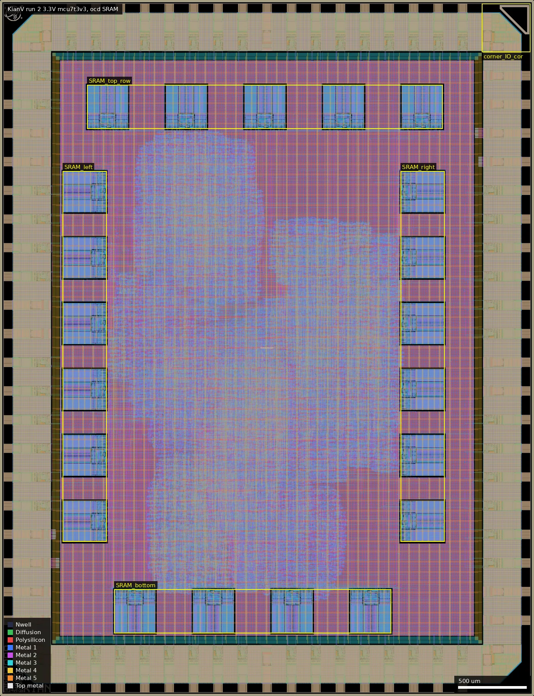
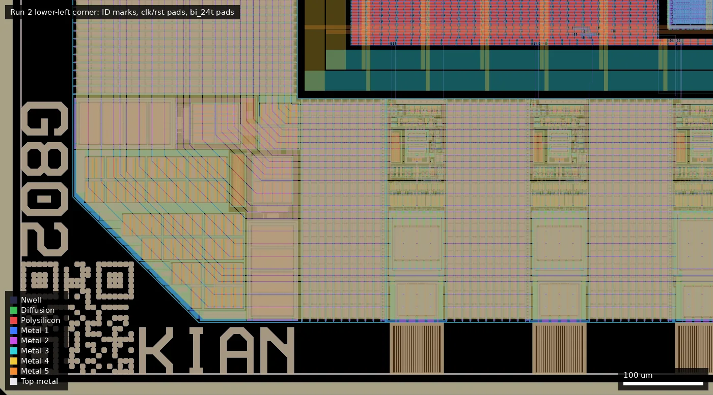
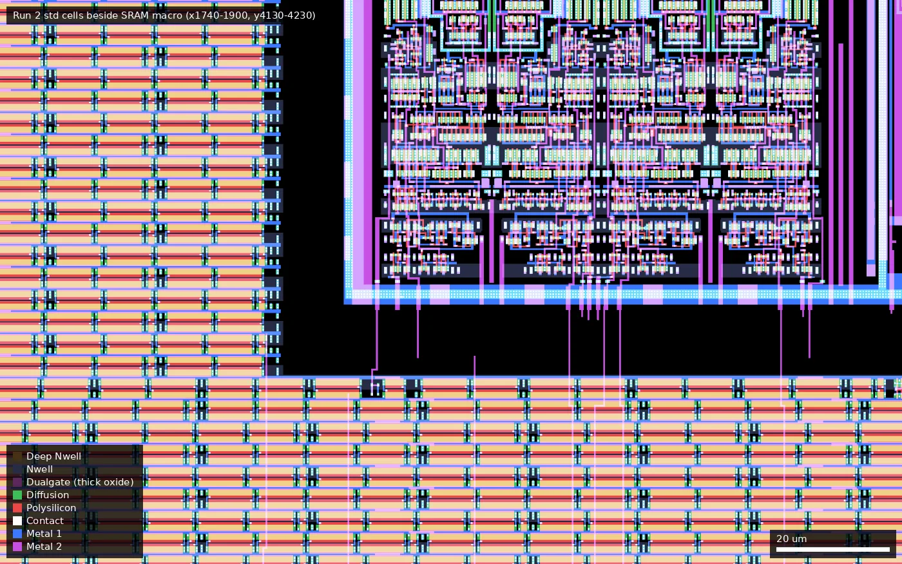

# KIAN: KianV: A 32-bit RISC-V Linux SoC taped out on GF180MCU Run 2 (ws-run2)

| | |
|---|---|
| Repository | https://github.com/splinedrive/gf180mcu-kianv-rv32ima-sv32-ws02 @ 0b383ba (main, last commit 2026-07-14) |
| Slot | 1x1 |
| Top cell | chip_top |
| Licence in repo | Apache-2.0 |
| README | THIN (original but only 61 words) |
| Taped-out layout | KIAN_chip_top_4_0, 3932 x 5122 um, 1 placement on the G802 reticle |

## What the repo actually contains

The same KianV RV32IMA SV32 Linux/XV6 SoC as run 1, ported to the 3.3 V flow: `gf180mcu_as_sc_mcu7t3v3` standard cells, 21 `gf180mcu_ocd_ip_sram__sram512x8m8wm1` macros and `gf180mcu_ocd_io` pads.

The git history is template pulls plus one migration commit (81a2e77). There are no final views, metrics or releases in the repo, so there is no timing evidence.

### Changes from run 1

| | Run 1 | Run 2 |
|---|---|---|
| Standard cells | `gf180mcu_fd_sc_mcu9t5v0` | `gf180mcu_as_sc_mcu7t3v3` |
| SRAM | foundry 512x8 (5 V) | ocd 512x8 (3.3 V); wrapper is a one-line change |
| Pads | `gf180mcu_fd_io` | `gf180mcu_ocd_io` |
| Power pads | 8 DVDD / 10 DVSS, shorted to core | 6 DVDD / 8 DVSS plus 2 VDD / 2 VSS, separate |
| Clock tree | | adds an explicit `clkbuff_12` clock buffer (`clk_core_clock_buffer`) |
| Config | inline macros | `macros_3v3.yaml` |

Unchanged: 33 ns clock target, 3932 x 5122 um die, 54 bidir pads. The run 2 repo has no final GDS and no `fpga/` directory.

Measured from the layouts (see below): logic cells 88,941 (run 1) to 76,850 (run 2); fill/tap 246,524 to 445,794; SRAM macro 431.9 x 484.9 um to 301.3 x 321.9 um (46% of the area, same 512 x 8 organisation and same positions); core oxide changes from all Dualgate/V5_XTOR (5 V) to thin oxide only; hold-fix delay cells go from about 10.0k to 20.4k (dlybuff_2). The RTL is the same design, so it is the same chip rebuilt on different libraries, not a different SoC; run 1's committed GDS matches its tape-out, whereas this run has no GDS to compare.

## Taped-out layout

| Measured | Value |
|---|---|
| Die | 3932 x 5122 um (20.1 mm2), one placement on G802 |
| Pads | 54 `gf180mcu_ocd_io__bi_24t` (labels `bidir_PAD[0..53]`), `in_s` (clk_PAD), `in_c` (rst_n_PAD), 6 `ocd_io__dvdd`, 8 `ocd_io__dvss`, 2 `ocd_io__vdd`, 2 `ocd_io__vss` (labels DVDD, DVSS, VDD, VSS), 4 `ocd_io__cor`; 82 shapes on the Pad layer |
| Standard cells | `gf180mcu_as_sc_mcu7t3v3`: 76,850 logic cells, 445,794 fill/tap/endcap placements. Top types: dlybuff_2 20,354, dfxtp_2 10,286 (so about 10.3k flip-flops), buff_2 7,313, ao22_2 6,377, and2_2 5,146 |
| SRAM | 21 x `gf180mcu_ocd_ip_sram__sram512x8m8wm1` (512 x 8 bit, 301.3 x 321.9 um each, 21 x 4 kbit = 10.5 kB) |
| Oxide | Core and SRAM are thin-oxide 3.3 V only: no Dualgate or V5_XTOR shapes in the std cells or the SRAM macro. Dualgate and V5_XTOR (672 shapes) appear only in the IO cells (bi_24t has 648 V5_XTOR shapes, about 3,200 um2, plus Dualgate in the pad drivers/ESD) |
| MIM, DNWELL, high-res poly, BJT | None on the die (no MIM or DNWELL layer shapes; RES_MK appears only inside the IO cells) |
| Custom content | None beyond the wafer.space QR ID, project ID ("KIAN"), shuttle ID ("G802"), marker and logo cells; no hand-drawn cells |

SRAM positions (lower-left x,y in um; macros are 301 x 322, rotated 90 degrees on the left and right columns): bottom row at y=462: x=842, 1421, 2000, 2579; left column at x=462, y=1135, 1620, 2105, 2590, 3075, 3560; right column at x=2950 with the same six y values; top row at y=4175: x=642, 1221, 1800, 2379, 2958. These lower-left corners are the same as in the run 1 floorplan; only the macro is smaller. As the RTL is the same, the 21 are the I-cache (2 ways x 7 tiles = 14) and D-cache (7 tiles); the mapping of macros to caches cannot be told from the flat layout. No TLB SRAM exists: the SV32 TLB is in flip-flops.

Pad-ring function, from the RTL index map in `chip_core.sv` (same as run 1): PAD[0..3] inputs (UART RX, SPI0/flash/SPI1 MISO), PAD[4..13] UART TX and SPI0/flash/SPI1 CS/SCLK/MOSI, PAD[14..52] a 16-bit SDR SDRAM interface (clk, cke, DQM, address, bank, control, 16 DQ), PAD[53] GPIO. No PSRAM.

### Does it match the repository?

Partly checkable. The repo has no GDS and no release, so no layout comparison is possible; the layout was compared with the RTL/config instead. Matches: 54 bidir pads, clk and reset pads, 6 DVDD / 8 DVSS plus 2 VDD / 2 VSS ocd power pads, 21 ocd SRAMs, `mcu7t3v3` standard cells, the `falsepath_anchor` buffer and the clock buffer `clk_core_clock_buffer` (`clkbuff_12`, present as a cell in the layout). The DVDD/DVSS nets (IO supply) are labelled separately from VDD/VSS (core supply), as in the repo; whether they are tied off-chip is a board matter. The repo's RTL is the run 1 HEAD sources (identical `src/` apart from `chip_top.sv`, the SRAM wrapper and `slot_defines.svh`), so the run 1 design with the later `cache.v` change; that change is in a branch that is off by default.

Overview: same SRAM boxes as run 1, but the macros are only 301 x 322 um, and the standard-cell logic forms clusters in the middle (roughly x 800-3000, y 1000-3900) with fill elsewhere. Corner box (3550-3906, 4740-5096) is an `ocd_io__cor` and the wafer.space marker.

Lower-left corner (x 0-900, y 0-500): QR ID cell at (26,26), shuttle ID text "G802" along the left edge, project ID "KIAN" along the bottom, and the first pads of the bottom edge.

Close-up at x 1740-1900, y 4130-4230 (detail style): 7-track 3.3 V standard cells next to the corner of the SRAM macro at (1800,4175); no Dualgate tint anywhere in this region.

## Authors and affiliations

| Person | Role | Affiliation | Source |
|---|---|---|---|
| Hirosh Dabui (GitHub splinedrive) | CPU and SoC (9 commits) | GitHub bio: "M.Sc.CE., Technical University of Berlin", Berlin | GitHub profile |
| Leo Moser (mole99) | project template | not stated | git log |

## Value for GF180MCU characterisation and PDK development

### Verdict: Low

Ordinary synthesised digital; the layout shows no purpose-built structures. Its value is as a large functional test of the new 3.3 V standard cells, 3.3 V SRAM macros and ocd IO, and as the second half of a like-for-like comparison with the run 1 chip (same RTL, same 33 ns target).

### Test structures and measurable circuits

Nothing purpose-built (confirmed from the layout). 21 ocd 3.3 V SRAM macros (no thick oxide) are exercised functionally as I-cache and D-cache; about 10.3k flops and 76,850 logic cells on 7-track 3.3 V cells, with about 20.4k delay buffers.

### Candidate PDK additions

Nothing found.

### What would be needed to use it

A board with SDRAM and SPI flash, with separate core and IO supplies. No test plan in the repo.

## Notes and caveats

- No layout, reports or release in the repo; the taped-out layout is the only physical evidence and could not be compared with a committed GDS.
