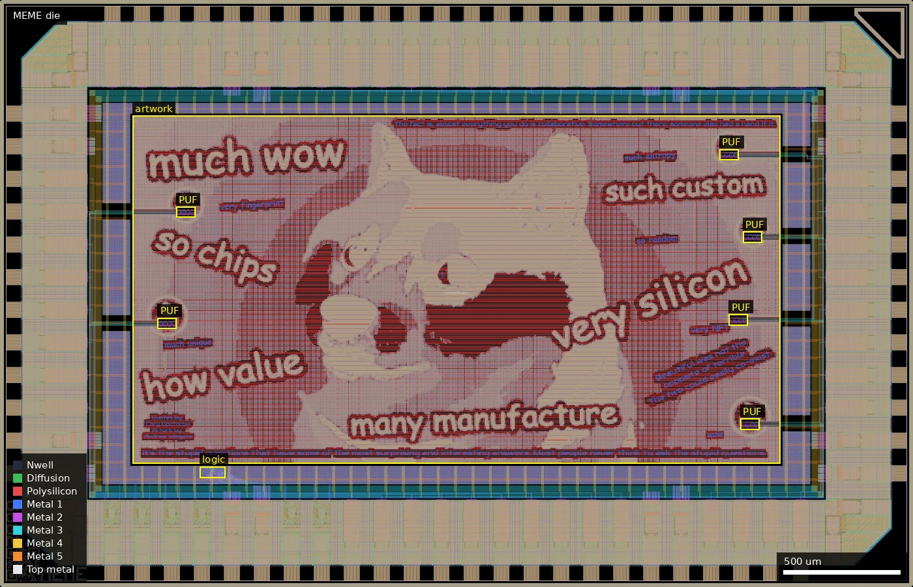
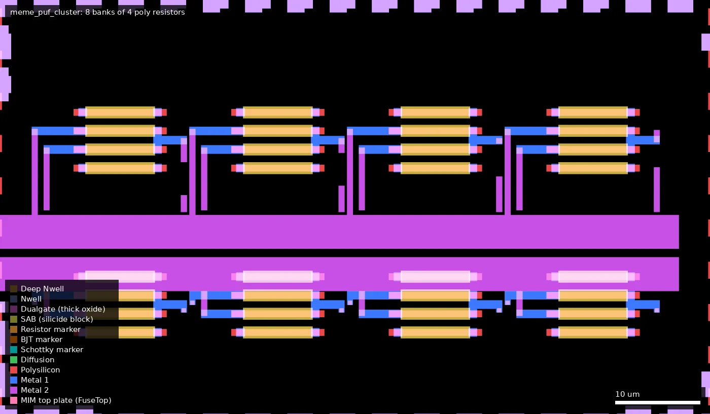
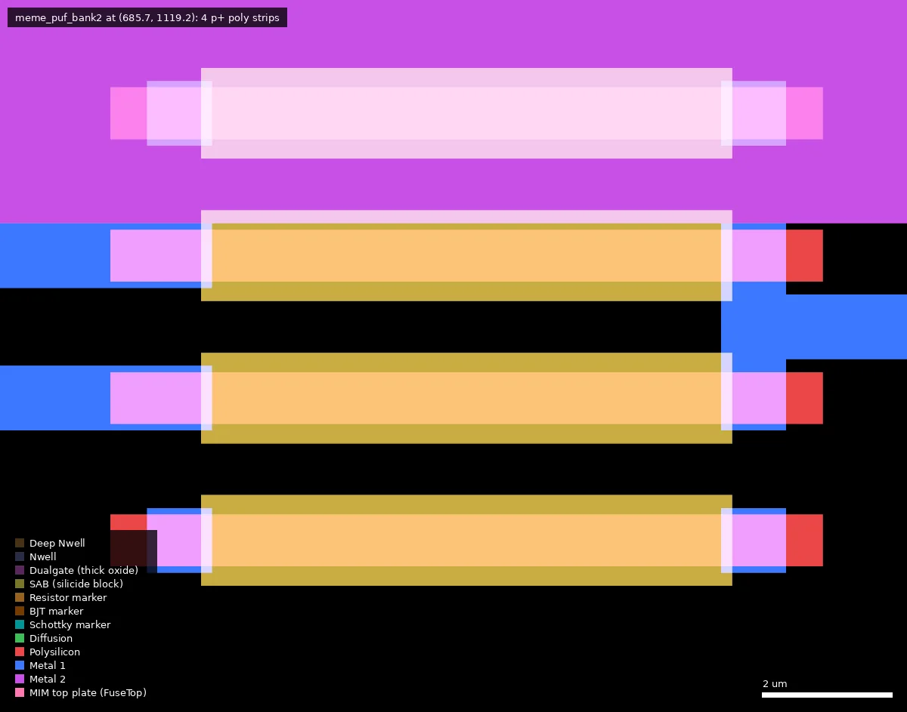

# MEME: Artwork Meme Chip (ws-run2)

| | |
|---|---|
| Repository | https://github.com/anfroholic/meme_chip @ c11dda5 (main, last commit 2026-07-14) |
| Slot | 1x0p5 |
| Top cell | chip_top |
| Taped-out layout | `MEME_chip_top_8_6`, 3932 x 2531 um, 2 placements on the G802 reticle |
| Licence in repo | MIT (LICENSE; no SPDX headers) |
| README | OK (251 words), but it does not mention the PUF/resistor structures in the GDS |

## What the repo actually contains
Artifacts only, no source: `chip_top_submission.oas` (1.1 MB), `gds/meme.gds.gz` (20 MB; the README names `gds/chip_top.gds(.gz)`, which do not exist), `render/chip_top.png`, `precheck_metrics.json` (klayout DRC, antenna, density, zero-area and magic DRC all 0). README says the generator code is "coming soon". Two commits, one author.

I parsed the GDS with a hand-written record parser (shape counts and areas per cell and layer; layer meanings from the GF180MCU GDS map; now confirmed against the layout):
- **Artwork:** a Doge meme with captions ("much wow", "so chips", "such custom", "very silicon", "how value", "many manufacture"). Cell `meme` sits at (571, 532) um with a 4.185 mm^2 boundary and the same bitmap on **Poly2 (30/0, 355 polygons, 1.66 mm^2) and Metal1 to Metal5 (34, 36, 42, 46, 81; each about 94,400 polygons, about 1.65 mm^2, about 39 % of the artwork boundary)**. No COMP, so the poly is field poly. Stock fill cells (METAL1..5_FILL, POLY2_FILL, COMP_FILL) are present; precheck density gave 0 errors, so this is a density/DRC data point for a pixel-art pattern on poly and every metal.
- **Undocumented test structure:** `meme_puf_bank2` is a 12.3 x 8.7 um cell with four 11.0 x 0.8 um Poly2 strips, each with a Pplus cover, an 8.2 x 1.4 um SAB and RES_MK block over the body, contacts at both ends and M1 pads. Labels in the cell: `HI`, `LO`, `t1`. That is an unsilicided p+ poly resistor (rpolyp-like; SAB, Pplus and RES_MK confirmed in the layout). Right ends of strips 2 and 3 are joined by M1. `meme_puf_cluster` (8 banks via SREF) is instanced 2 times at the left edge (x about 680 to 760 um); `meme_puf_cluster_e` (8 banks flattened) 4 times at the right edge (x about 3100 to 3200 um): 48 banks, about 192 resistors. `puf_routes` (M1 to M3 and M5) wires them; `puf_blocker` (129 x 48 um, 6 instances) is marker-only (probably a fill exclusion, inferred).
- Pads: **50 `gf180mcu_fd_io__asig_5p0` analog pads (analog_PAD[0..49])**, 4 `bi_24t` bidir, `in_c` (clk_PAD) and `in_s` (rst_n_PAD). A small 5 V digital block (gf180mcu_fd_sc_mcu7t5v0: 26 dffq_1, nand/nor/aoi, 89 buf_1) sits near (870 to 960, 475 to 515) um, probably bank select/readout (inferred, no netlist seen).
- The wafer.space ID IPs (qrcode_id, shuttle_id, project_id, marker) are present.

## Taped-out layout
| Fact | Measured from the taped-out layout |
|---|---|
| Die | 3932 x 2531 um (1x0p5 slot), placed twice on the reticle at (16.028, 15.606) and (20.020, 15.606) mm |
| Pads / IO cells | `gf180mcu_fd_io`: 50 asig_5p0 (`analog_PAD[0..49]`), 4 bi_24t, 1 in_c, 1 in_s, 8 dvdd + 8 dvss, 4 corners; Pad shapes: 80 |
| Standard cells | `gf180mcu_fd_sc_mcu7t5v0` (5 V library, so Dualgate and V5_XTOR are used): 226 logic placements (26 dffq_1, 89 buf_1, a few nand/nor, tie cells) plus 15,682 fill, tap and endcap placements |
| SRAM | none |
| Artwork | cell `meme`, 2790 x 1500 um at (571, 532): the same Doge bitmap and captions on Poly2 and Metal1 to Metal5 |
| Resistor array | 6 PUF clusters (2 x `meme_puf_cluster` at the left, 4 x `meme_puf_cluster_e` at the right), 8 `meme_puf_bank2` each = 48 banks x 4 = 192 poly resistors, wired by `puf_routes` |
| Other | `puf_blocker` x6 (129 x 48 um, marker-only), wafer.space id, QR, logo and marker |

### Does it match the repository?
Partly, and the answer depends on the file. The repo's `gds/meme.gds.gz` (the file the earlier summary parsed) matches the taped-out layout: same 3932 x 2531 um extent, the same 84 distinct instance names at top level with identical counts, and identical total area for `meme`, `puf_routes`, `meme_puf_bank2`, `meme_puf_cluster`, `meme_puf_cluster_e` and `puf_blocker`. The repo's `chip_top_submission.oas` does not: it is a different earlier or alternative layout with 4 asig_5p0 and 46 bi_24t pads (taped-out die: 50 asig_5p0 and 4 bi_24t), 5 in_c, many more buffers (343 buf_4), and no PUF cells at all. So the file named "submission" is not what was manufactured; the GDS is. (The platform sha of the reticle OAS was not compared with the repo OAS directly.)

Overview (3932 x 2531 um): the artwork fills (571-3361, 532-2032) um; boxes mark the six resistor clusters (left at x about 680-840 um, right at x about 3100-3280 um) and the small 5 V digital block near (860-970, 470-520) um.

One `meme_puf_cluster` at (679.7, 1113.3) um, 80.6 x 44.9 um: 8 banks in a 4 x 2 grid.

Close-up of a bank at (685.7, 1119.2) um: 11.0 x 0.8 um poly strips under SAB/Resistor markers, contacts at both ends and Metal1 jumpers; a Metal2 plate runs over the top strip.

### Resistor array (measured)
| Item | Value |
|---|---|
| Cell | `meme_puf_bank2`, 12.3 x 8.7 um, 48 placements, 192 strips in total |
| Resistor | Poly2 strip 11.0 um x 0.8 um, Pplus over all four, SAB and RES_MK over the 8.2 x 1.4 um body (contact to contact about 8.7 um, about 10 squares): unsalicided p+ poly, the rpolyp / ppolyf_u kind. Drawn W 0.8 um, L about 8.2 um. No diffusion, no Dualgate |
| Per bank | strips 1 and 4: stand-alone, both ends on separate Metal1 pads; strips 2 and 3: right ends joined by Metal1 (net `t1`), left ends `HI` and `LO`: a series pair of 2R with a mid tap. 7 distinct nets per bank |
| Count | 48 banks: 96 single resistors and 48 tapped pairs |
| Pads | 50 analog pads exist and the PUF clusters connect to the die edge by `puf_routes` (Metal1 to Metal3 and Metal5). My Metal1 to Metal5 trace (hierarchical `LayoutToNetlist`, artwork excluded) put every analog pad label in one net, so it cannot be used for a pad map; which bank terminal reaches which pad is not settled. Probing the pads, or a careful label-based trace, would settle it |
| Measurable? | Probably, with 50 analog_5p0 pads and 192 resistors, but 7 x 48 = 336 terminals do not map one-to-one onto 50 pads, so there must be sharing or a selector; the 26-flop 5 V block near (870-960, 475-515) um is the likely selector (inferred, no netlist traced) |

## Authors and affiliations
| Person | Role | Affiliation | Source |
|---|---|---|---|
| Andrew Wingate (anfroholic) | sole committer | Evezor, Chicago (GitHub profile) | `git shortlog`, `gh api users/anfroholic` |

## Value for GF180MCU characterisation and PDK development
### Verdict: Medium
Built as artwork, but the GDS carries about 192 identical drawn p+ poly resistors on 50 analog pads. That is a process-variation vehicle, undocumented; the resistor interpretation is confirmed from the layout geometry (Pplus, SAB, RES_MK); pad connectivity is not.
### Test structures and measurable circuits
| Structure | What it exercises | Access | Where |
|---|---|---|---|
| `meme_puf_bank2` x 48 (4 poly resistors each) | p+ poly sheet resistance, within-bank and within-die mismatch, CD/etch variation | 50 `asig_5p0` pads (analog_PAD[0..49]); labels HI/LO/t1 | `gds/meme.gds.gz`, cells `meme_puf_cluster*`, `puf_routes` |
| Pixel-art on Poly2, M1 to M5, about 39 % coverage | density and DRC behaviour on irregular small features | none (layout/yield) | cell `meme` |
No simulation results, netlist, schematic or test plan in the repo.
### Candidate PDK additions
Nothing found.
### What would be needed to use it
Probing of the analog pads with an SMU or ADC; pad-to-resistor-tap mapping (not in repo, generator unpublished, ask the author; my automatic trace did not resolve it); the function of the digital select logic. Compare against the PDK rpolyp model.
## Notes and caveats
README does not mention the PUF/resistors; file names in the README do not match the repo; the repo's `chip_top_submission.oas` is NOT the taped-out design (different pad set, no PUF cells); `gds/meme.gds.gz` is. The platform OAS sha 01cef474... was not compared directly.
