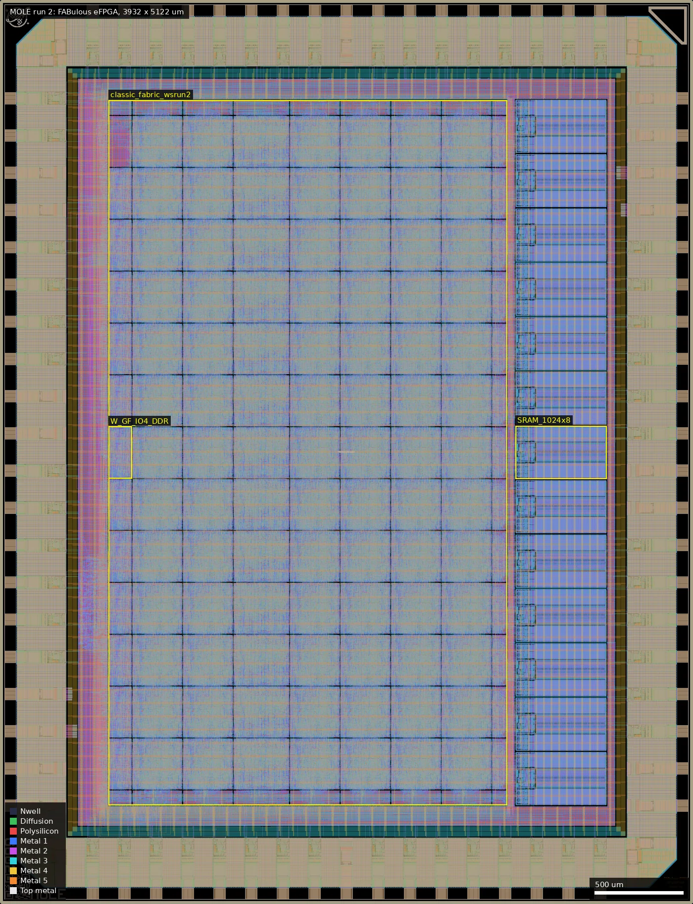
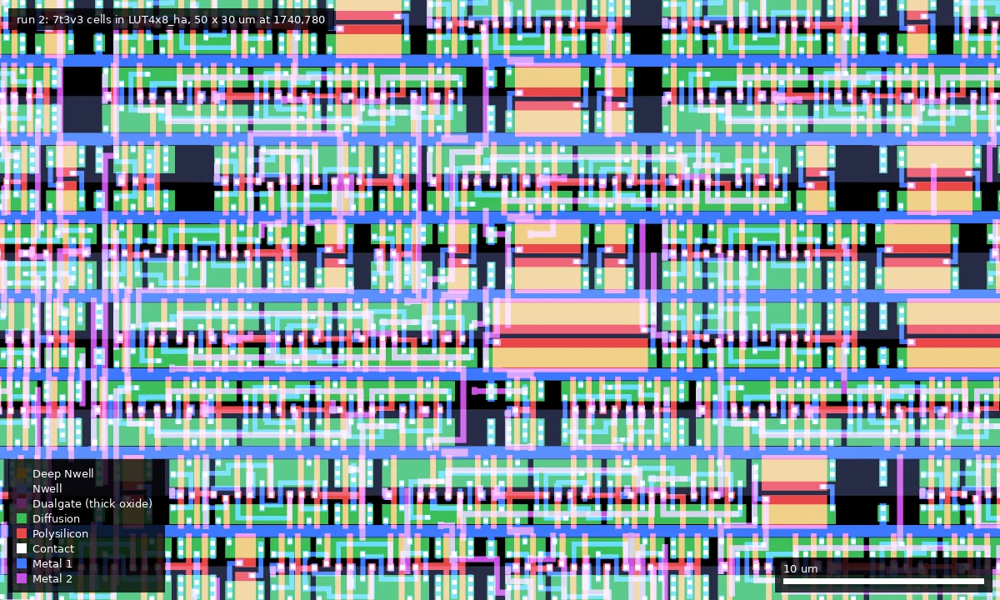
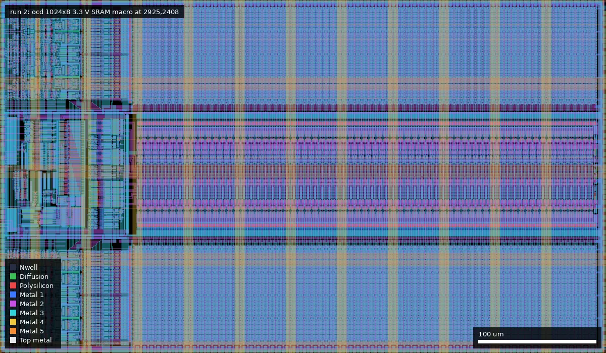

# MOLE: FABulous FPGA (ws-run2)

| | |
|---|---|
| Repository | https://github.com/mole99/wsrun2-fabulous-fpga @ 282dda8 (main, last commit 2026-09-16); submodule `ip/fabulous-tiles` @ 276f289 |
| Slot | 1x1 |
| Top cell | chip_top |
| Taped-out layout | MOLE_chip_top_8_0, 3932 x 5122 um, 1 placement on the G802 reticle |
| Licence in repo | Apache-2.0 |
| README | TEMPLATE+NOTE (91% the project-template README plus about 160 words of own text) |

## What the repo actually contains

An improved FABulous eFPGA on the 3.3 V flow: 624 LUT4, 13 tiles each with a 3.3 V 1024x8 SRAM (`gf180mcu_ocd_ip_sram__sram1024x8m8wm1`), 13 `RAM_32x4_2R_1W` register files, 48 `GF_IOBUF` with input/output DDR registers (48 IDDR, 48 ODDR), 4 global buffers, WARMBOOT and SYS_RESET.

Libraries, read from the release netlist: 80,355 instances of `gf180mcu_as_sc_mcu7t3v3` standard cells, 13 ocd `sram1024x8`, and `gf180mcu_ocd_io` pads (53 `bi_24t`, 2 `in_c`, 1 `in_s`, 6 DVDD, 8 DVSS, 2 VDD, 2 VSS), so core and IO supplies are separate.

The repo has no `final/` directory. The release `final.zip` (in `../releases/`) holds SDF for 9 corners, SPEF (nom/min/max) and metrics: setup WNS 0 at every corner, worst slack +17.8 ns at max_ss_125C_3v00 against a 40 ns clock, 0 Magic and KLayout DRC errors, 0 LVS differences, 0 antenna violations, 81,515 instances (21,296 standard cells, 662 sequential), 29.6 mW flow power estimate. The release also has `chip_top.oas` and `classic_fabric_wsrun2.zip` (pips and bitstream spec).

### Changes from run 1

| | Run 1 | Run 2 |
|---|---|---|
| Standard cells | `gf180mcu_fd_sc_mcu7t5v0` | `gf180mcu_as_sc_mcu7t3v3` |
| SRAM | 6 x foundry 512x8, 5 V | 13 x ocd 1024x8, 3.3 V |
| Pads | `gf180mcu_fd_io`, core and IO supply shorted | `gf180mcu_ocd_io`, separate supplies |
| LUT4 | 480 | 624 |
| MAC tiles | 6 | removed |
| Register files | 12 | 13 |
| IO | plain pad config | GF_IOBUF with registers, IDDR/ODDR |
| Other | | SYS_RESET, 4 GBUF; repo split into `fabulous-tiles` submodule, extra tiles and fabrics; core ring moved from Metal2/3 to Metal4/3 |

Clock target is unchanged at 40 ns.

## Taped-out layout

| Measured | Value |
|---|---|
| Die | 3932 x 5122 um, one placement at (16.028, 0.06) mm on G802 |
| Pads / IO cells | 56 signal pads: 53 `gf180mcu_ocd_io__bi_24t`, 2 `in_c`, 1 `in_s`; supplies 6 `dvdd`, 8 `dvss`, 2 `vdd`, 2 `vss`; 4 corners; 82 Pad shapes |
| Fabric | `classic_fabric_wsrun2` 2260.16 x 3994.48 um at (616, 560). Tile instances: 78 `LUT4x8_ha` (= 624 LUT4), 13 `RegFile`, 13 `E_GF_SRAM_single` (SRAM interface), 12 `W_GF_IO4_DDR` (= 48 IOs) + 1 `W_GF_term_single`, 5 + 6 single terminations, 2 RegFile terminations, 1 `S_WARMBOOT`, 4 corner terminations. No MAC/DSP tile |
| Config storage | latches: 53,544 `dlxtp_2` (plus 5,009 `dlxfp_2` latches and 3,290 `dfxtp_2` flops). No SRAM or flop array for config. Counts are not split between config bits, RegFile storage and IO registers |
| SRAM macros | 13 x `gf180mcu_ocd_ip_sram__sram1024x8m8wm1` (301.3 x 515.8 um each) in a column at x 2925 to 3441, outside the fabric macro |
| Standard cells | `gf180mcu_as_sc_mcu7t3v3`: 211,813 logic placements (expanded through the tiles), 341,915 fill/tap/cap; most used `buff_2` 56,669, `dlxtp_2` 53,544, `mux4_2` 27,497, `mux2_2` 20,921, `inv_2` 8,470 |
| Device flavour | fabric: 3.3 V only (no Dualgate or V5_XTOR inside `classic_fabric_wsrun2`, 4.39 mm2 of COMP). SRAM macros: no Dualgate. IO cells: Dualgate plus V5_XTOR (672 V5_XTOR shapes in the whole die; by per-cell area they are in the `bi_24t`, `in_c` and `in_s` signal pad cells only, none in the supply pad cells, SRAM or fabric) |
| MIM, DNWELL, high-res poly | none: no MIM or DNWELL layer in the file; RES_MK 1,096 shapes, same as run 1 (pad-cell resistors, not tested per cell) |
| Custom / hand-drawn cells | none in the logic: tiles are synthesised standard cells. Drawn geometry is the ocd IO library, the ocd SRAM, and wafer.space marker, logo, credits and id cells. No eFuse or POR cells are present |
| `buff_8` | 118 placements of `gf180mcu_as_sc_mcu7t3v3__buff_8` directly at chip level, 13 `buff_16`, 842 `clkbuff_8` |

### Does it match the repository?

Taped-out layout against the release: the release `chip_top.oas` (top cell `chip_top`, same 3932 x 5122 um box) and the reticle cell differ only by the wafer.space fill. Checked: COMP differs by exactly 610,700 um2, which equals the COMP_FILL cell area; Dualgate, V5_XTOR and Pad have zero XOR; Poly2 differs by 649,121 um2 (fill; the POLY2_FILL area was not separately measured); the metal layers were not compared (too slow to merge). The repository itself holds no fabric GDS (the tile library is a submodule and the hardened macros are only in the release), so a layout-versus-source comparison was done on structure: tile counts (78 LUT4x8_ha = 624 LUT4, 13 RegFile, 13 SRAMs, 12 x 4 = 48 IOs) and the pad set (53 + 2 + 1 signal, 6/8/2/2 supply) agree with the README, release netlist and summary above; no eFuse or `simple_por` cells exist in the layout, which agrees with their removal in a6bd586. The "80,355 instances" in the release netlist is a count at tile level (tiles are macros); the layout's 211,813 logic placements are the same cells expanded through all tile copies.

### What can be measured on this die

No dedicated test structures; everything is reachable only through a bitstream.

| Structure | Cell / position | Size and devices | Pads |
|---|---|---|---|
| Programmable logic | 78 `LUT4x8_ha`, 286.7 x 294.0 um each, first at (1643, 646) | 3.3 V cells, 8 LUT4 per tile | 12 `W_GF_IO4_DDR` tiles on the west edge, 133.3 x 294 um, first at (616, 2410) |
| SRAM interface | 13 `E_GF_SRAM_single`, 86.2 x 294 um, x 2790 to 2876 | connects to 13 ocd 1024x8 3.3 V macros | fabric |
| Register files | 13 `RegFile`, 320.3 x 294 um, first at (1323, 2410) | latch-based | fabric |
| Pad ring | 53 `bi_24t` + 2 `in_c` + 1 `in_s`; separate `vdd/vss` core and `dvdd/dvss` IO supply pads | ocd IO, 3.3/5 V | 56 |

### Run 1 to run 2 in the layout

Same die, slot and 56 signal pads. Fabric 2324 x 3596 um to 2260 x 3994 um (LUT tile 287.3 x 287.3 to 286.7 x 294.0 um); LUT4 480 to 624; MAC/DSP 6 to 0; RegFile 12 to 13; SRAM 6 x 512x8 5 V (432 x 485 um) to 13 x 1024x8 3.3 V (301 x 516 um); cell library `mcu7t5v0` to `as_sc_mcu7t3v3`; fabric devices from 100 % Dualgate+V5_XTOR to none; IO library `gf180mcu_fd_io` to `gf180mcu_ocd_io` with extra core supply pads; config storage unchanged (latches, `latq_1` to `dlxtp_2`); new IO tile `W_GF_IO4_DDR` with DDR registers. The fabric origin moved from (640, 750) to (616, 560).

## Authors and affiliations

| Person | Role | Affiliation | Source |
|---|---|---|---|
| Leo Moser (GitHub mole99) | sole author (51 commits; 116 in the tiles submodule) | not stated (GitHub location: Austria) | git shortlog, GitHub profile |

## Value for GF180MCU characterisation and PDK development

### Verdict: Medium

Same programmable-test-vehicle argument as run 1, and stronger: separate core and IO supplies allow a core-voltage sweep (3.0 to 3.6 V) on programmed oscillators, the exact routed path of any bitstream can be reconstructed from `pips.txt`/`bitStreamSpec`, and the chip is an early full-scale user of the 3.3 V standard cells, 3.3 V SRAMs and ocd IO. Comparison data is STA only (SDF/SPEF), no SPICE.

### Test structures and measurable circuits

| Structure | Exercises | Access | Where |
|---|---|---|---|
| Post-fab programmable ring oscillators and delay lines | `as_sc_mcu7t3v3` cell and routing delay versus the 9-corner SDF | 48 fabric IOs | `ip/fabulous-tiles`, release `classic_fabric_wsrun2.zip` |
| 13 x 3.3 V ocd SRAM 1024x8 | SRAM macro function and timing | from fabric | SRAM tiles |
| `GF_IOBUF` | `bi_24t` slew, Schmitt, pull settings | pads | IO tiles |
| IDDR/ODDR registers | 2x-clock sampling of internal edges | pads | IO tiles |

### Candidate PDK additions

None taken to silicon. An eFuse macro set (`ip/gf180mcu_re_efuse`, from egorxe's gf180_efuse_compiler, 5 V libraries, 7 GDS) and a hand-built power-on reset (`ip/simple_por`: spice, GDS, LEF, Schmitt) were integrated on 2026-06-16 and removed in commit a6bd586 (2026-07-01); `macros_3v3.yaml` has them commented out and the final netlist contains neither. No reason for the removal is given.

Documented PDK/flow issues:

- DUALGATE / 3.3 V devices inside the foundry SRAM layout need a MAGIC_GDS_FLATGLOB list (`dcap_103*`, `din_*`, `mux821_*`, `rdummy_*`, `pmoscap_*`, `xdec_*`, `sa_*`, ...).
- `Metal2_ignore_active` for fill density.
- KLayout deck run as "all,-antenna,-density,-cup (disable CUP for now)".
- The Makefile marks `gf180mcu_osu_sc_gp9t3v3` and `gp12t3v3` as "(broken)".
- Commit 96cb2a4 "3.3V SCL fix" (PDK bump to f6eeac7).
- 478 antenna diodes inserted by manual ECO because the fabric macro has no standard cells.

### What would be needed to use it

Packaged or bonded die with separate core and IO supplies, SPI configuration, the Yosys/nextpnr flow for this fabric, and oscillator/delay-line bitstreams, which do not exist yet. FABulous's physical timing model exists only for sky130 and IHP.

## Notes and caveats

- Final views exist only in the release, not in git.
- No bring-up data or oscillator designs in the repo.
- Library names read from the release netlist are confirmed by the layout (`as_sc_mcu7t3v3`, `ocd_ip_sram`, `ocd_io`).
- The `buff_8` cell: the 3.3 V library cell flagged as broken for Tiny Tapeout (see `ws-run2/T0P3`, tile `tt_um_fabulous_gf_0p3_3v3`) is also used here, 118 times at chip level. Its geometry here is not the same as in T0P3: against `NP_gf180mcu_as_sc_mcu7t3v3__buff_8` the Poly2, N+, P+ and Nwell areas agree but COMP (22.6 vs 23.3 um2), Contact and Metal1 differ, which fits the repo's later "3.3V SCL fix" (96cb2a4, PDK bump). No short check was run on either cell, so whether this revision is the fixed one is not established. The 118 `buff_8` instances are worth including in any measurement of this die's chip-level logic.
