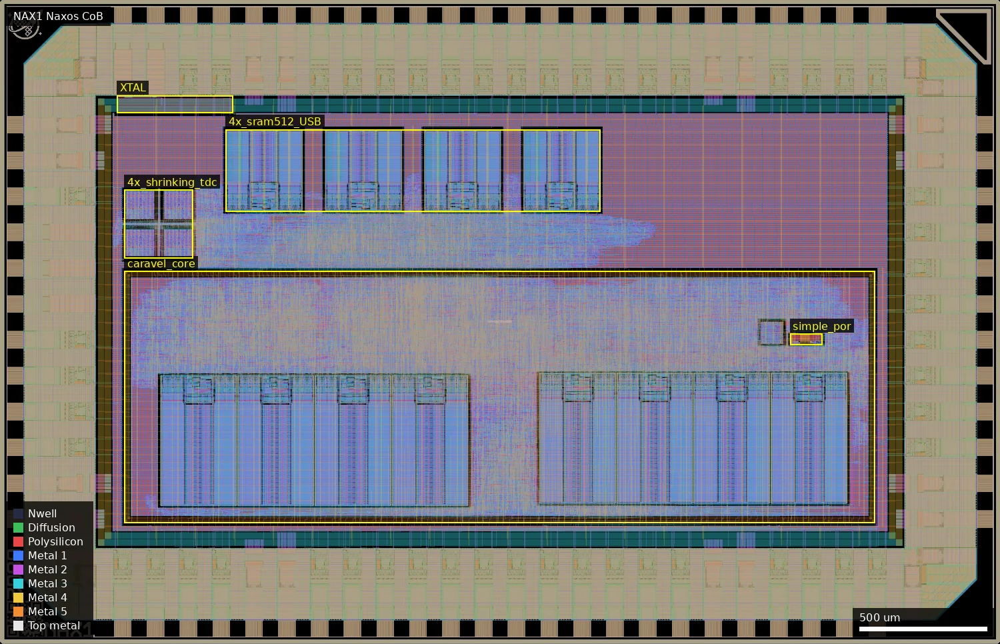
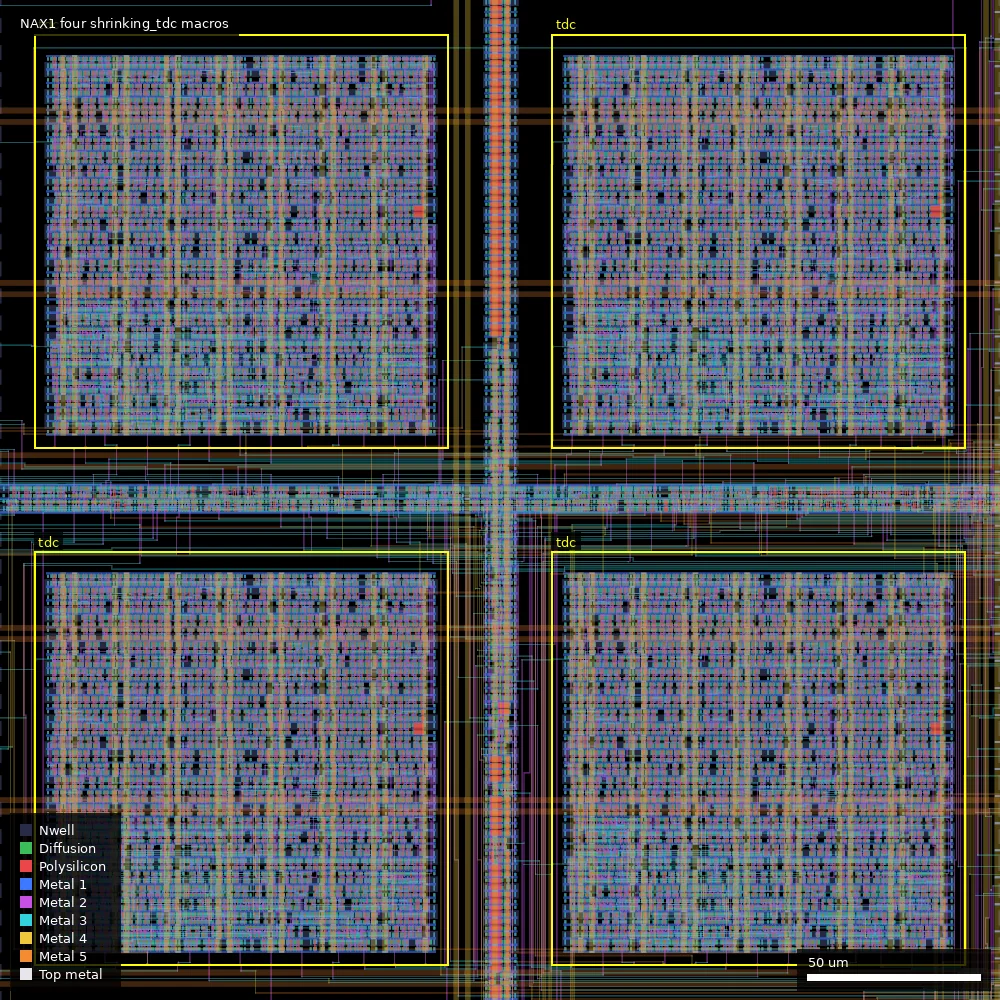
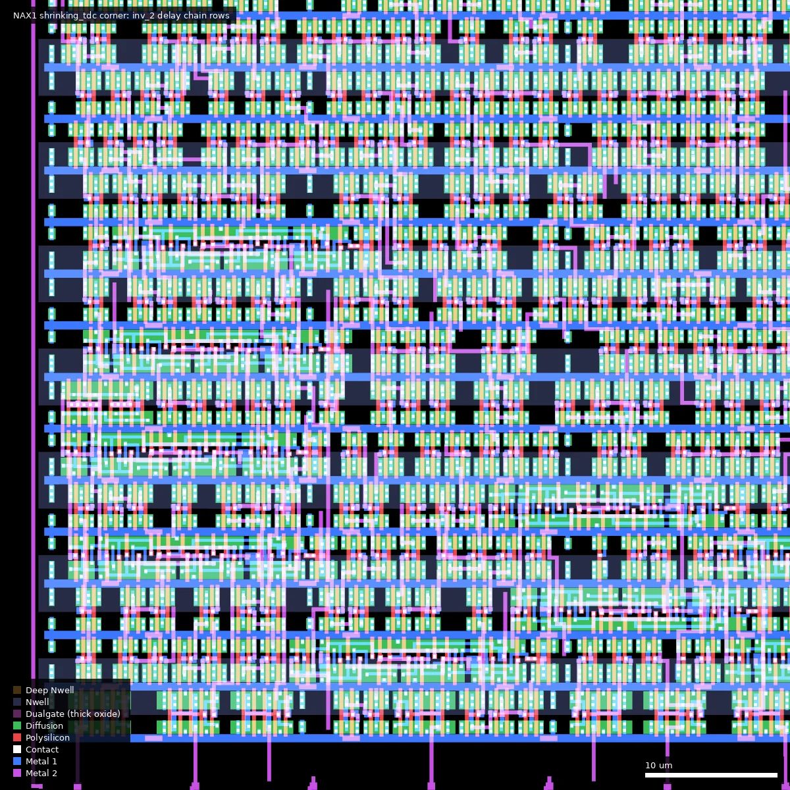
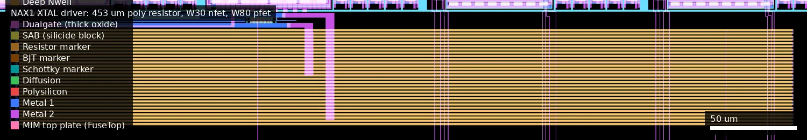
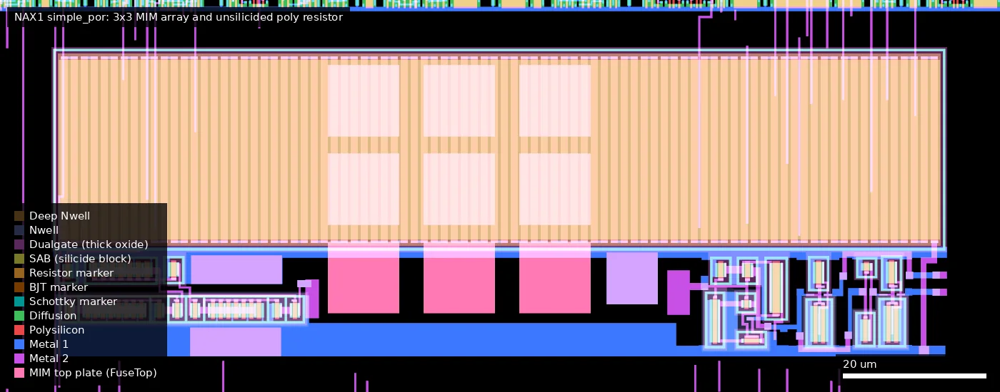

# NAX1: Naxos CoB (ws-run2)

| | |
|---|---|
| Repository | https://github.com/ZeduloTech/Naxos @ 17da59e (main, last commit 2026-07-15) |
| Slot | 1x0p5 |
| Top cell | chip_top |
| Licence in repo | Apache-2.0 (LICENSE; SPDX headers in sources) |
| README | TEMPLATE (100% the wafer.space project-template README, no own text) |
| Taped-out layout | NAX1_chip_top_2_8, 3932 x 2531 um, 1 placement on the G802 reticle |

## What the repo actually contains

Platform description is empty and the README is the template, so this is derived from sources. Naxos is a sibling of CAB1 Cabrera: same Caravel (VexRiscv) harness, same Zedulo team, same repo layout, but the whole chip runs in the 3.3 V domain with the `gf180mcu_as_sc_mcu7t3v3` standard-cell library (`STD_CELL_LIBRARY` in `librelane/config.yaml`; commit "Update gf180mcu_as_sc_mcu7t3v3 due to hotfix"). Clock 50 MHz (CLOCK_PERIOD 20). Build: `run.sh` hardens `ztimer/` first, then the chip with LibreLane (leo/gf180mcu branch).

Contents of `src/chip_core.sv`:
1. Caravel core (VexRiscv, SPI flash, GPIO), selectable CMOS or crystal clock via `gf180mcu_as_sc_mcu7t3v3__mux2_4`.
2. `XTAL` custom analog crystal-oscillator driver macro (`ip/XTAL3P3/XTAL.gds/.lef`, 456.7 x 68.5 um in the layout, pins OSC1, OSC2, VCLOCK, own VDD_XTAL/VSS_XTAL; layout confirms one W30 nfet, one W80 pfet (both L 0.28 um) and a 30-strip ppolyf_u_resistor, all thin oxide). Simulation model is a fixed 48 MHz clock. Clock also fed back to pad `PAD_SYS_CLK_FB`.
3. OpenTitan USB full-speed device (`otUSB/src/usbdev*.sv`, `usb2sram`, wrapper `naxos_usb_wrapper`) with four foundry 3.3 V SRAM macros `gf180mcu_ocd_ip_sram__sram512x8m8wm1` (`i_chip_core.usb.sram_0..3`, macros_3v3.yaml) giving 2 kB packet buffer (wrappers for 1024x8 and 512x8 in `ip/sram/`). Behavioural sim passes USB enumeration.
4. `ztimer`: SPI-read timer built around four copies of a pulse-shrinking time-to-digital converter `shrinking_tdc` (`pstdc/`), see below.
5. `apad_helper` cells to route analog pads (EXTPULSE, START, STOP) via OpenROAD.

No eFuse, no flash block, no ring-oscillator macros (the only ring oscillator is the Caravel `ring_osc2x13`); the layout has 12 SRAM macros: the four USB buffers plus eight 1024x8 in the Caravel core. `final/gds/naxos.gds.gz` is the committed chip layout. No silicon data. `PAD_MARK_DOWN.md` lists pads for ztimer (CSB 43, SDI 42, SCK 41, SDO 40, STOP/START analog[3]/[2], ROSC_EN input[1], the last a leftover from the Cabrera-style ring-oscillator design; the Naxos code has no ROSC_EN).

## Taped-out layout

| Measured | Value |
|---|---|
| Reticle cell / size | `NAX1_chip_top_2_8`, 3932 x 2531 um, 1 placement at (4.052, 20.788) mm |
| IO cells | 45 `bi_24t` bidirectional, 5 `in_c` + 1 `in_s` input, 5 `asig_5p0` analog, 8 `dvdd`, 8 `dvss`, 4 corners |
| Standard cells | `gf180mcu_as_sc_mcu7t3v3`: 49,717 logic placements (+110,228 fill/tap); a small `mcu7t5v0` remainder (202 logic cells) is the Caravel `ring_osc2x13` |
| SRAM | 12 foundry-style 3.3 V macros: 4 x `gf180mcu_ocd_ip_sram__sram512x8m8wm1` (301.3 x 321.9 um, USB buffer, at y 1700-2022) and 8 x `sram1024x8m8wm1` (301.3 x 515.8 um) inside `caravel_core` as Caravel RAM. The repo-derived text counted only the four USB macros |
| Custom blocks | 4 x `shrinking_tdc` (120 x 120 um), `XTAL` (456.7 x 68.5 um), 3 x `apad_helper` (44.3 x 1 um), `simple_por` (125.8 x 43.6 um) and `ring_osc2x13` (91.9 x 95.3 um) inside `caravel_core` |
| Oxide | no Dualgate over `shrinking_tdc` (4782 gates), `XTAL` (34), the SRAM macros or the 3.3 V logic: 3.3 V thin oxide as claimed. Dualgate only over IO cells, `ring_osc2x13` (2334 gates, also V5_XTOR) and `simple_por` (44 gates, Dualgate without V5_XTOR) |
| Passives | `simple_por`: 9 MIM capacitors (10.4 x 10.4 um CAP_MK each, MIM top plates on FuseTop) plus one 123.6 x 27 um unsilicided (SAB) poly resistor block; `XTAL`: 30 `ppolyf_u_resistor` strips, total block 452.7 x 56.6 um, SAB-blocked |

### Does it match the repository?

Compared `final/gds/naxos.gds.gz` (repo commit 17da59e0f961, the commit recorded for NAX1 in wafer.space-bench `designs.csv`) with the taped-out OAS: same die box, same 2480 cells, identical top-level instance counts (`caravel_core` 1, `shrinking_tdc` 4, `XTAL` 1, `apad_helper` 3, 4 x sram512x8, 45 bi_24t, 5 asig_5p0, 5 in_c, 1 in_s, 8 dvdd, 8 dvss, 4 corners, ID/logo/marker/seal-ring cells). The design is the one the repository describes. Geometry XOR was not done.

*Whole die. XTAL is at the top-left edge (460-917, 2087-2156); the four USB SRAMs form a row at (888-2359, 1700-2022); the four shrinking_tdc macros are the 2 x 2 block at (490-760, 1515-1785); `caravel_core` fills the lower part (490-3440, 475-1465) and holds the eight 1024x8 SRAMs and the POR.*

### Test-structure locations

| Structure | Cell / position (um) | Size | Measured | Pads |
|---|---|---|---|---|
| `shrinking_tdc` x4 | (490, 1515), (640, 1515), (490, 1665), (640, 1665) | 120 x 120 each | per macro: 1037 `inv_2` (1024 delay-chain + 13 counter-stage inverters), 2 `nand2_4`, 13 `dfsrtp_2`, 13 `buff_4`, 13 `tieh_4`; no Dualgate | start/stop/extpulse analog pads via `apad_helper`; SPI pads |
| `XTAL` | (460.5, 2087.5) | 456.7 x 68.5 | 1 nfet (W 30 um, L 0.28 um), 1 pfet (W 80 um, L 0.28 um), 30-strip `ppolyf_u_resistor` (452.7 x 56.6 um, SAB), one `clkbuff_12`; thin oxide | `asig_5p0` pads at (444.8, 2155) and (573.8, 2155), directly above |
| `apad_helper` x3 | (375.9, 1595.8), (375.9, 1454.8), (375.9, 1313.8) | 44.3 x 1 | one Metal2 strip (label PAD) and one Metal3 strip (label SIG) tied by 142 Via2: a metal jumper, no devices | the three left-edge `asig_5p0` cells at y 1580-1656, 1439-1515, 1298-1374 (traced, see below) |
| `simple_por` | (3107, 1175) | 125.8 x 43.6 | 9 MIM, 1 SAB poly resistor, Schmitt inverter | internal (npor) |
| 8 x 1024x8 SRAM | in `caravel_core` | 301.3 x 515.8 | Caravel RAM, 3.3 V `ocd` macro, no Dualgate | Wishbone |
| 4 x 512x8 SRAM | (888-2359, 1700) | 301.3 x 321.9 | USB packet buffer | USB block |

**Analog pad access (traced in the layout).** A Metal1-5 connectivity flood from each `apad_helper` (PAD side on Metal2, SIG on Metal3) shows that the `asig_5p0` pad cell, the helper and the downstream logic are one connected net: the lowest left pad (y 1298-1374) reaches the `pulse_in` pin of the `shrinking_tdc` at (640, 1665) um directly (and a `nand2_4` input at (646, 1753)), consistent with the EXTPULSE-to-`sc_direct` path; the other two (y 1439-1515 and 1580-1656) end on ordinary logic inputs (`dfsrtp_2` D, `nand2_2`, `oai21_2`, `aoi21_2` pins at x 447-622, y 1550-1590), i.e. the START/STOP synchronisation logic in front of the TDC pulse generators. Which of the two is START and which is STOP, and the EXTPULSE assignment, rest on that structural match and the repo pin table, not on pad labels (the layout carries none). SPI pad access (pads 40-43) was not traced. The two top-edge `asig_5p0` pads sit directly above the XTAL macro.

*The 2 x 2 block of 120 x 120 um shrinking_tdc macros at (490-760, 1515-1785); each is a dense field of 3.3 V standard cells, the delay chain of `inv_2` is the main content.*

*Corner of the macro at (490-550, 1515-1575): rows of `inv_2` cells (3.1 um wide) with Metal1-2 links; thin oxide only.*

*XTAL at (455-925, 2080-2162): the 453 um long poly resistor strips (orange) fill the right three quarters; the large pfet and nfet driver sit at the left end.*

*simple_por at (3100-3240, 1170-1225): the unsilicided poly resistor array at the top, the 3 x 3 MIM plates (pink top plates) in the middle and the Schmitt/buffer devices at lower right.*

## Authors and affiliations

| Who | Role | Affiliation | Source |
|---|---|---|---|
| Egor Lukyanchenko (egorxe) | Caravel integration, USB, psTDC model, 41 commits | not stated; Zedulo copyright in headers | git log, AUTHORS.md |
| snapaa257 (several identities, Zedulo emails) | ztimer, USB, pads, CI, 42 commits | Zedulo (header "Zedulo Sweden AB"; email domain hint) | git shortlog, SPDX headers |
| Leo Moser | wafer.space template, 98 commits | wafer.space template maintainer (AUTHORS.md; affiliation not stated) | AUTHORS.md |
| Tim Ansell, TrevorPeyton, ZeduloAdmin | single commits | not stated | git shortlog |
| ZeduloTech org | owner | "Zedulo", Sweden, zedulo.com | `gh api orgs/ZeduloTech` |

## Value for GF180MCU characterisation and PDK development

### Verdict: High

Contains a purpose-built 3.3 V pulse-shrinking TDC (picosecond-class gate-delay measurement), a custom analog crystal-oscillator driver macro, and uses a new 3.3 V standard-cell library and the 3.3 V foundry SRAM at scale, all pad-accessible via SPI/analog pads.

### Test structures and measurable circuits

| Structure | What it exercises | Access | Where |
|---|---|---|---|
| `shrinking_tdc` x4 (sc_start, sc_stop, sc_cal, sc_direct): `shrink_unit` = NAND gate + loop of 1024 `gf180mcu_as_sc_mcu7t3v3__inv_2` closed through nand2_4 (each trip about 48 ns per ztimer.sv comments), feeding a 13-bit ripple counter of `dfsrtp_2` flops. A negative pulse loses about 30 ps per trip (author's comment); the number of trips before it vanishes is the count | Rise/fall delay asymmetry of inv_2 at 3.3 V (pulse shrink per stage), absolute inverter delay (loop time), dfsrtp_2 clk-to-Q; subnanosecond timing; 1037 `inv_2` per macro measured in the layout (1024 chain + 13 counter inverters) | START/STOP/EXTPULSE analog pads (via apad_helper), reset-synchronised; counts read through SPI (CSB/SCK/SDI/SDO pads) | four macros at (490/640, 1515/1665) um, 120 x 120 um; `pstdc/shrinking_tdc.v`, `pstdc/final/{gds,lef,spice}`, `ztimer/src/*.sv` |
| Post-layout extracted netlist and SPICE bench for the TDC | Direct simulation reference: `pstdc/pex/shrinking_tdc.pex.spice` (3.6 MB), `digital_shrink_test.ngspice` / `.xyce` use `sm141064.ngspice` typical models at 3.3 V, 25 C, transient 150 ns | silicon vs simulation comparison possible. Checked: files exist; bench uses 3.3 V, 25 C, a model path on the author's machine, and reads an 8-bit Q0-Q7 while the hardened macro has 13 counter bits, so the bench is a reduced version | `pstdc/pex/` |
| `clk_timer` on core clock | Reference count of the same window | SPI | `ztimer/src/clk_timer.sv` |
| `XTAL` crystal oscillator driver | Analog oscillator start-up/gain; nfet W 30 / L 0.28 um, pfet W 80 / L 0.28 um (thin oxide, confirmed: no Dualgate) and a 453 um x 56.6 um unsilicided `ppolyf_u_resistor` (30 strips) at (460.5, 2087.5) um | OSC1/OSC2 analog pads (external crystal), VCLOCK to core mux and feedback pad | `ip/XTAL3P3/` |
| 3.3 V `gf180mcu_as_sc_mcu7t3v3` library (inv, nand2, dfsrtp, mux2, clkbuff) used chip-wide | Library delay/power at 3.3 V for a full SoC | functional at 50 MHz STA target | `librelane/config.yaml` |
| 3.3 V SRAM macros `gf180mcu_ocd_ip_sram__sram512x8m8wm1` x4 (USB buffer) and `sram1024x8m8wm1` x8 (Caravel RAM, in `caravel_core`); no Dualgate in either, so the 3.3 V claim holds | via Caravel Wishbone/USB | `librelane/macros/macros_3v3.yaml` |

### Other devices worth measuring (not in the repository summary)

- `simple_por` in `caravel_core` at (3107, 1175) um: 9 MIM capacitors (10.4 um squares, CAP_MK/MIM_L_MK/FuseTop) and a 123.6 x 27 um SAB-blocked poly resistor block, plus a Schmitt inverter; its 44 gates are in Dualgate but without V5_XTOR. These are internal nodes (power-on reset), so reachable only through the `npor` behaviour.
- The XTAL poly resistor (452.7 x 56.6 um, 30 strips) is a large unsilicided poly resistor, reachable only through the OSC pads.

### Candidate PDK additions

- The pulse-shrinking TDC flow (hardened at 120x120 um with a custom pin order, timing steps disabled) as a reusable delay-measurement macro, with a PEX netlist and SPICE bench.
- `gf180mcu_as_sc_mcu7t3v3` 3.3 V library exercised on a whole SoC; the Egor commit log shows a hotfix to it during the project (unmapped-cell and latch issues "Fix latches", "unmapped cells fixed").
- `apad_helper` cell workaround so OpenROAD can route analog pads; analog `XTAL` macro with separate supplies.
- Flow notes: PDN_MACRO_CONNECTIONS for SRAM and XTAL supplies, 3.3 V core ring layers changed to Metal3/Metal4.

### What would be needed to use it

Packaged die with SPI master, a pulse source with controllable width (ps-class pulse width needs an external generator or the EXTPULSE pad), and a crystal for the XTAL test. Documentation of the TDC calibration (sc_cal) and register map is only in code comments (`ztimer/src/ztimer.sv`, `spi_device.sv`).

## Notes and caveats

- Platform description empty; "Naxos"/"CoB" unexplained in the repo.
- `ztimer.sv` selects `sctimer` (behavioural, with simulated delays 0.047 ns/inverter) for SIM and `shrinking_tdc` for synthesis, so RTL simulation does not exercise the real delay line; only the PEX SPICE bench does.
- The XTAL and shrinking_tdc layouts were opened in the taped-out OAS: gate dimensions, inverter counts and the absence of Dualgate are measured. Their electrical behaviour is not.
- Relationship to earlier chips: TZ01 (Run 1 eFuse+SRAM test chip, Zedulo/Egor with Tillitis support) used the same Caravel template; Naxos has no eFuse or SPI-SRAM test blocks. CAB1 Cabrera is the 5 V sibling with Ethernet/10BASE-T, 4-RO ztimer and a flash_ip probe block; Naxos is the 3.3 V sibling with USB, XTAL and the psTDC ztimer.
