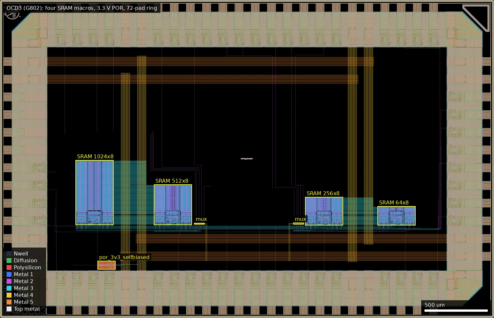
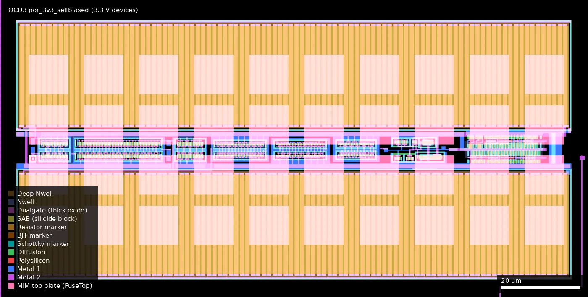
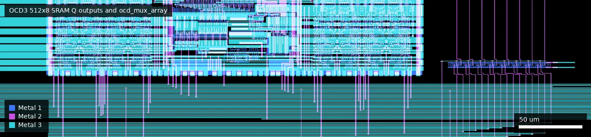
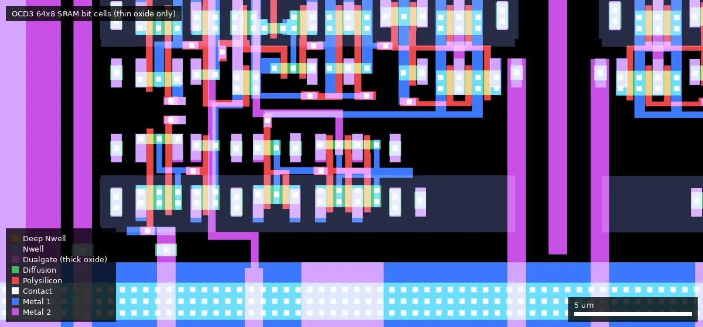
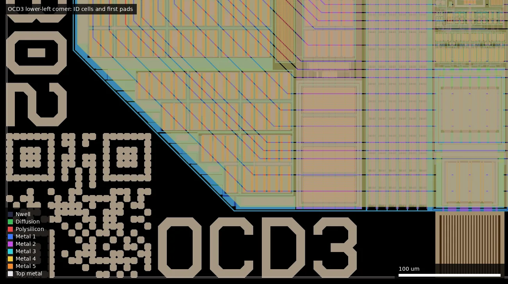

# OCD3: 3.3V SRAM test 2 (ws-run2)

| | |
|---|---|
| Repository | https://github.com/RTimothyEdwards/gf180mcu_ocd_sram_test @ 6d4f609 (main, last commit 2026-07-04) |
| Slot | 1x0p5 |
| Taped-out layout | OCD3_gf180mcu_ocd_sram2_top_4_7, 3932 x 2531 um, 1 placement on the G802 reticle |
| Top cell | gf180mcu_ocd_sram2_top |
| Licence in repo | No LICENSE file; Apache-2.0 SPDX headers in sources (Open Circuit Design, LLC; some files derived from Efabless Caravel) |
| README | Missing at top level; the documentation is `doc/README` (pinout, build, bench test setup) |

## What the repo actually contains

One repository holds two generations of the same break-out test chip for the 3.3 V SRAM library `gf180mcu_ocd_ip_sram`. Each SRAM macro has its control, address and data pins wired straight to pads, with no logic in between except an 8-bit 2:1 output multiplexer.

**This chip (OCD3, run 2).** Top cell `gf180mcu_ocd_sram2_top`, submitted to G802, and the design at HEAD. Relative to run 1 it swaps the second 256-byte macro for the new `gf180mcu_ocd_ip_sram__sram64x8m8wm1` (address A0-A5 only; shares the Q51-60 output group with the 256-byte macro through pad 69) and replaces the 5 V POR with the new `por_3v3_selfbiased` in `ip/simple_por_3v3_regulated/`, whose enable is driven from the `rst_n` pad and whose `porb` output is on pad 4. It also adds the wafer.space COB alignment markers and project/shuttle code cells. All test results in `doc/README` are from the run-1 chip; the README states the same test setup "should be valid for both versions". No run-2 silicon data is in the repo.

**Which files belong to which chip**

| | Run 1 chip (OCD2, `gf180mcu_ocd_sram_top`) | Run 2 chip (OCD3, `gf180mcu_ocd_sram2_top`) |
|---|---|---|
| Where | git history only; last complete state at commit e2539ed | HEAD (6d4f609) |
| Top layout | `magic/gf180mcu_ocd_sram_top.mag`, `magic/gf180mcu_ocd_sram_test.mag` | `magic/gf180mcu_ocd_sram2_top.mag`, `magic/gf180mcu_ocd_sram_test2.mag` |
| GDS | `gds/gf180mcu_ocd_sram_top.gds.gz`, `gds/gf180mcu_ocd_sram_filled.gds.gz` | `gds/gf180mcu_ocd_sram2_top.gds.gz` (18.6 MB), `gds/gf180mcu_ocd_sram2_filled.gds.gz` (24 MB) |
| Netlist (LVS source) | `verilog/gf180mcu_ocd_sram_test.v` | `verilog/gf180mcu_ocd_sram_test2.v` |
| Extracted netlist | `magic/gf180mcu_ocd_sram_test.spice` | `netlist/layout/gf180mcu_ocd_sram_test2.spice` |
| SRAM macros | `sram1024x8m8wm1`, `sram512x8m8wm1`, 2x `sram256x8m8wm1` | `sram1024x8m8wm1`, `sram512x8m8wm1`, `sram256x8m8wm1`, `sram64x8m8wm1` |
| POR | `ip/simple_por/` (`simple_por`, 5 V devices, powered from DVDD, output through `lvlshift_down`) | `ip/simple_por_3v3_regulated/` (`por_3v3_selfbiased`, 3.3 V devices, powered from VDD) |
| DRC report | `validate/sram_top_drc_klayout.lyrdb` (0 items) | `validate/sram2_top_drc_klayout.lyrdb` (0 items) |
| LVS | `validate/comp.out` at e2539ed: "Circuits match uniquely" | `validate/comp.out` at HEAD: "Circuits match uniquely" |
| wafer.space cells | `magic/wafer_space/gf180mcu_ws_ip__id.mag` | `..._marker`, `..._project_id`, `..._shuttle_id`, `..._qrcode_id` (COB alignment markers, added in 6d4f609) |

The run-1 files were renamed/replaced in commit 1bbbd1b (2026-07-04, "Updating from chip version 1 to chip version 2"). Shared by both and present at HEAD: `verilog/chip_half_frame.v` + `magic/chip_half_frame.mag` (padframe), `verilog/ocd_mux_array.v` + `magic/ocd_mux_array.mag` (8x `gf180mcu_as_sc_mcu7t3v3__mux2_4`, hand placed), `constant_block`, `gf180mcu_ocd_io__fill10x`, `lvlshift_down`, `ip/simple_por/` (still in the tree but not instantiated in the run-2 netlist), `scripts/`, `validate/`, and `doc/` (README, `hashes.txt`, layout picture `gf180mcu_ocd_sram_test.png`, `chip_photo.jpg`, `4bit_count_bench_test.png`).

Build: hand-assembled in magic, no synthesis or P&R flow. `scripts/run_gen_gds.sh` writes GDS from magic, `scripts/run_fill_gds.sh` runs the KLayout fill script, `validate/run_lvs.sh` runs netgen against the PDK SPICE libraries for `gf180mcu_ocd_io`, `gf180mcu_as_sc_mcu7t3v3` and each SRAM macro (full transistor-level comparison since commit 959e10b), `validate/run_drc.sh` runs the KLayout deck.

Padframe (`doc/README`): a wafer.space half-height frame re-drawn with `gf180mcu_ocd_io` cells; every other DVDD/DVSS pair replaced by VDD/VSS (3.3 V) pads; 24 mA drive pads replaced by selectable-drive pads; analog pads unused; each bidirectional pad is hard-programmed as input or output through local loopback constants from `constant_block` inside the 10 um filler cells. Pads are 5 V (DVDD), core 3.3 V (VDD).

Where the library under test lives: nowhere in this repo and there are no submodules. The LVS script reads `${PDK_ROOT}/gf180mcuD/libs.ref/gf180mcu_ocd_ip_sram/spice/*.spice`, so the macros come from the open_pdks installation. The commit log refers to "the SRAM macro repository" / "SRAM library (gf180mcu_ocd_ip_sram)" without a URL.

Silicon data in the repo (all from the run-1 chip): `doc/chip_photo.jpg` (COB bench setup), `doc/4bit_count_bench_test.png` (Digilent WaveForms capture dated 2026-06-30 showing Q[3:0] of a 256-byte macro reading back a 0-15 count; about 16 values per 0.65 us read off the screenshot, i.e. roughly a 25 MHz read rate, my estimate), the bench wiring table in `doc/README`, and the commit message of 1bbbd1b: the first chip "has been tested on silicon" and the original PoR "although functional, has a 14 to 16 second delay period when the chip is operated at a 3.3V external supply".

Not present: SRAM SPICE simulations, timing characterisation data, a working digital testbench (`verilog/README`: "Currently the testbench does not run because 'inout' ports are not allowed to be driven by registers"), or the tester driver code ("will be committed to the repository when it is available").

## Taped-out layout

| Measured on `layout/OCD3.oas` | |
|---|---|
| Reticle cell, size | `OCD3_gf180mcu_ocd_sram2_top_4_7`, 3932 x 2531 um (chip frame `gf180mcu_ocd_sram_test2` 3880 x 2479 um at 26,26), 1 placement on G802 (x 8.044 mm, y 18.197 mm) |
| Pads | 72 openings (Pad 37/0), same ring as OCD2: 46 `gf180mcu_ocd_io__bi_a`, 5 `__in_c`, 1 `__in_s`, 4 `__asig_5p0` (analog, unused), 4 each `__vdd`, `__vss`, `__dvdd`, `__dvss`; 4 corner cells |
| SRAM macros | `sram1024x8m8wm1` at (602.8, 738.8) 301.3 x 515.8 um; `sram512x8m8wm1` at (1225.7, 738.8) 301.3 x 321.9 um; `sram256x8m8wm1` at (2428.8, 736.3) 301.3 x 224.9 um; `sram64x8m8wm1` at (3006.6, 736.3) 301.3 x 152.2 um. Thin oxide only (no Dualgate in any macro) |
| Standard cells | `gf180mcu_as_sc_mcu7t3v3` only: 16 `mux2_4` (two `ocd_mux_array`), 2 `buff_12`, 1 `inv_4`, 26 fill. No 5 V library cells and no `lvlshift_down` |
| Custom blocks | `por_3v3_selfbiased` at (778.0, 386.3) 142.0 x 66.7 um; `ocd_mux_array` at (1545.8, 743.8) and (2334.9, 745.3); `copyright_block` at (3556.2, 36.2); wafer.space `qrcode_id` (26, 26), `project_id` (175.6, 26), `shuttle_id` (26, 175.6), `logo` (26, 2361.8), COB alignment `marker` (3651, 2250) 245 x 245 um |

### Does it match the repository?

Yes. At the pinned commit 6d4f609 the HEAD GDS is the run-2 chip, so the comparison is direct: I extracted `gds/gf180mcu_ocd_sram2_top.gds.gz` at 6d4f609 and at 1bbbd1b (scratch copies) and XORed the cells layer by layer against the OAS.

- All four SRAM cores, `por_3v3_selfbiased`, `chip_half_frame` and `ocd_mux_array` are geometrically identical to the GDS at both commits. The chip frame cell's own shapes and instance list are identical to 6d4f609. At 1bbbd1b only the `copyright_block` position differs (it was moved in 6d4f609, which also added the COB marker and the project/shuttle/QR cells).
- Cell types and counts agree with the repo's run-2 description: 1024, 512, 256 and 64 byte macros, one POR, 16 mux cells, 72 pads. The `$n`-suffixed names, fill, seal ring and the wafer.space ID cells are the foundry flow's additions (the ID cells differ in content from the repo's placeholders, as expected). The platform sha256 differs from the repo hashes because the slot file is an OAS re-export; the geometry compared equal.

Whole OCD3 die (0,0 to 3932,2531 um): the same layout as OCD2 except that the right-hand 256x8 macro is replaced by the shorter 64x8 macro at (3006.6, 736.3) and the 3.3 V POR sits at (778.0, 386.3); the triangular COB marker is in the upper-right corner and the QR/ID cells in the lower-left.

### Test structures and pad access

Pad access was traced as for OCD2: flattened metal 1 to 5 extraction, following nets from IO cell output pins (`bidir_Y[n]`, `input_Y[n]`, `clk_Y`) to macro pins and from the mux outputs to the IO cell input pins (`bidir_A[n]`). The step from the pad opening to the IO cell pin passes through the IO cell's buffer devices, which this metal-only trace does not cross. Pad numbers are the author's, via `doc/README`.

| Structure | Cell, position, size | What the layout shows | Pads |
|---|---|---|---|
| 1024x8 SRAM | `sram1024x8m8wm1`, (602.8, 738.8), 301.3 x 515.8 | A0-A7, A8 and A9 reach it (A9 only this macro) | A0-A7 = bidir 9..2 (pads 14..7), A8 = pad 70, A9 = pad 68; CEN = pad 27 |
| 512x8 SRAM | `sram512x8m8wm1`, (1225.7, 738.8), 301.3 x 321.9 | A0-A8 reach it | CEN = pad 28 |
| 256x8 SRAM | `sram256x8m8wm1`, (2428.8, 736.3), 301.3 x 224.9 | A0-A7 reach it | CEN = pad 29 |
| 64x8 SRAM | `sram64x8m8wm1`, (3006.6, 736.3), 301.3 x 152.2 | only A0-A5 reach it (A6 and A7 nets stop at the 256 macro) | CEN = pad 30 |
| Shared bus | all four macros | CLK (`clk_Y`, pad 1), GWEN (bidir 0, pad 3), D0-D7 (bidir 17..10) and WEN0-WEN7 (bidir 22..29) each reach all four macros on one net | as listed |
| Output muxes | `ocd_mux_array` x2: (1545.8, 743.8) for 1024/512, (2334.9, 745.3) for 256/64 | select = `input_Y[0]` (pad 67) and `input_Y[2]` (pad 69); A input = first macro of the pair, B = second; bit order reversed (Q0 enters mux bit 7) | select pads 67, 69 |
| Q outputs | mux outputs to IO cell input pins | the 256/64 mux drives bidir_A[30..37] and the 1024/512 mux bidir_A[38..45]: the same assignment as OCD2, and the reverse of the `doc/README` labels (README: 43-50 = 1024/512, 51-60 = 256/64) | pads 43-50 (256/64) and 51-60 (1024/512), README numbering |
| `por_3v3_selfbiased` | (778.0, 386.3), 142.0 x 66.7 | 253 gate regions, 141 n and 112 p (by nwell), all thin oxide: no Dualgate or V5_XTOR anywhere in the block; most are 0.28 um long, a few 0.56 um long x 3 or 6 um wide, and 1 um squares (bounding boxes); two poly resistor serpentines of 100 x 25 um segments, 1 um wide, 2500 um each (inside the resistor marker, no Dualgate); 40 MIM plates of 10.4 x 10.4 um (the 36 + 4 of the schematic); one diode marker (the `ena` diode) | `ena` is connected to `rst_n_Y` (pad 2); `porb` goes straight to bidir_A[1] (pad 4), no level shifter; `por` and `por_unbuf` are not routed to pads |
| IO ring | `chip_half_frame` | identical to OCD2: 5 V (Dualgate, V5_XTOR) IO cells with loopback-constant programming (`constant_block` in `gf180mcu_ocd_io__fill10x`, `mcu7t3v3` `buff_12` cells) | all signal pads |

`por_3v3_selfbiased` at (778.0, 386.3) to (920.0, 453.0): two resistor serpentines (orange stripes) above and below a central strip of 3.3 V transistors, with the 40 MIM plates (pale squares) laid over the resistors; the Schmitt buffer is at the right end.

The 512x8 macro's Q pins (top) running down to the first `ocd_mux_array` at (1545.8, 743.8), box x 1190-1660, y 690-800 um, metal 1 to 3 (identical to OCD2).

Thin-oxide 6T bit cells of the new 64x8 macro, box x 3010-3040, y 738-752 um (near its lower-left corner at 3006.6, 736.3); no Dualgate is drawn in the macro. The bit cell is the same as in the other macros.

Lower-left corner (20-520, 20-300 um): the wafer.space QR ID cell at (26, 26), the "OCD3" project code at (175.6, 26) and the rotated shuttle code at (26, 175.6), beside the chamfered pad ring.

**Devices on the die.** Thin-oxide 3.3 V: the four SRAM macros (8192, 4096, 2048 and 512 bits), the 16 mux cells and the whole POR. Thick-oxide 5/6 V (Dualgate + V5_XTOR): only the IO ring. High-value poly resistors: `por_3v3_selfbiased` only (2 x 2500 um of 1 um poly, 3.3 V, no Dualgate). MIM capacitors: forty 10.4 x 10.4 um plates, `por_3v3_selfbiased` only. No BJT, LDMOS, eFuse or native devices were identified. In contrast to OCD2 nothing on OCD3 except the ring uses 5/6 V devices.

### What differs from OCD2

| | OCD2 (G801) | OCD3 (G802) |
|---|---|---|
| SRAM | 1024 + 512 + 2 x 256 | 1024 + 512 + 256 + 64 (A0-A5 only) |
| POR | `simple_por`, 5/6 V (Dualgate + V5_XTOR), 9 MIM, 2200 um poly, `por` through `lvlshift_down` to pad 4 | `por_3v3_selfbiased`, 3.3 V only, 40 MIM, 5000 um poly, `porb` direct to pad 4 |
| `rst_n` (pad 2) | not connected | `ena` of the POR |
| 5 V standard cells | `inv_8`, `inv_12` (level shifter) | none |
| Frame, mux, shared SRAM bus, pad wiring | same | same |
| wafer.space cells | ID and logo | QR, project, shuttle ID, logo, COB marker |

## Authors and affiliations

| Person / organisation | Role | Affiliation | Source |
|---|---|---|---|
| R. Timothy Edwards (GitHub `RTimothyEdwards`) | Sole committer (12 commits); layout, POR designs, verification, bench test | Open Circuit Design, LLC | git log; "Written by Tim Edwards" headers; "SPDX-FileCopyrightText: 2025 Open Circuit Design, LLC"; GitHub profile company "Open Circuit Design" |
| Efabless Corporation | Origin of padframe/POR concept (caravel-gf180mcu) | Efabless | file headers citing https://github.com/efabless/caravel-gf180mcu/ |
| "rebelmike" | COB breakout board used for testing (https://codeberg.org/rebelmike/ws-breakout) | not stated | `doc/README` |
| Avalon Semiconductor | 3.3 V standard cells used for the mux and POR buffers | not stated | cell names; POR README |

## Value for GF180MCU characterisation and PDK development

### Verdict: High

A purpose-built memory test chip: new 3.3 V SRAM macros with every pin on a pad, plus a power-on-reset test circuit with a pad output, clean LVS/DRC, a documented pinout and bench setup, and (for the run-1 chip) first silicon results. For this chip the layout confirms the repository: the four SRAM macros and the 3.3 V POR are on the die as described, the POR is the only high-value-resistor and MIM structure, and the only 5/6 V devices are in the pad ring, so it characterises a purely 3.3 V design. No run-2 silicon results exist in the repo.

### Test structures and measurable circuits

| Structure | What it exercises | Access (pad numbers from `doc/README`, counter-clockwise from lower left) | Where |
|---|---|---|---|
| `gf180mcu_ocd_ip_sram__sram1024x8m8wm1`, `__sram512x8m8wm1`, `__sram256x8m8wm1` (both chips); second `__sram256x8m8wm1` (run 1 only); `__sram64x8m8wm1` (run 2 only) | 3.3 V 6T bit-cell read/write margins, minimum operating VDD, data retention voltage, access time (clock to Q), setup/hold on A/D/WEN, per-bit write mask, standby current per macro via CEN | Shared CLK (1), GWEN (3), A0-A7 (14..7), A8 (70), A9 (68), D0-D7 (24..21, 18..15), WEN0-7 (40..37, 34..31), one CEN per macro (27-30), Q on two 8-bit groups (43-50 and 51-54, 57-60), output select inputs 67 and 69 | `verilog/gf180mcu_ocd_sram_test2.v` (run 2), `verilog/gf180mcu_ocd_sram_test.v` at e2539ed (run 1) |
| `ocd_mux_array` x2 | `gf180mcu_as_sc_mcu7t3v3__mux2_4` in the Q path (adds a fixed delay to access-time measurements); confirmed in the layout at (1545.8, 743.8) and (2334.9, 745.3) | select pads 67, 69 (traced to the mux S pins) | `verilog/ocd_mux_array.v`, `magic/ocd_mux_array.mag` |
| `gf180mcu_ocd_io` pads | Input pads `__in_c`/`__in_s` and `__bi_a` fixed as input or as high-drive output; 5 V pad ring with 3.3 V core | all signal pads | `verilog/chip_half_frame.v` |
| Run 1 POR: `simple_por` | `nfet_06v0`/`pfet_06v0` cascoded step-down mirrors, `ppolyf_u_1k_6p0` 2000 um and 200 um x 1 um resistors, 9x `cap_mim_2f0_m4m5_noshield` 10x10 um, Schmitt trigger; delay versus DVDD | POR output on pad 4 through `lvlshift_down` (5 V to 3.3 V) | `ip/simple_por/netlist/simple_por.spice`, `*_tb*.spice` |
| Run 2 POR: `por_3v3_selfbiased` (on this die) | 253 thin-oxide gate regions (L mostly 0.28 um), self-biased amplifier regulating an internal 1.2 V bias, two poly resistors of 2500 um x 1 um, 40 MIM plates of 10.4 x 10.4 um (36 timing + 4 compensation), one diode on `ena`, Schmitt inverter and `mcu7t3v3` buffers; spec 40 ms delay at 3.3 V, 20 ms at 1.8 V | `porb` on pad 4 (direct connection, traced); `ena` from the `rst_n` pad (2) (net traced; the pull-up is from the repo's netlist, not traced). Block at (778.0, 386.3) |

Simulation data for comparison: POR testbench decks only (`ip/simple_por/netlist/*_tb*.spice`, `ip/simple_por_3v3_regulated/xschem/simple_por_tb.sch`, `simple_por_tb2.sch`, `schmitt_tb.sch`); no stored waveforms or numbers apart from the specifications quoted in `ip/simple_por_3v3_regulated/doc/README`. No SRAM simulation data in this repo; `.lib` timing for the macros is in the PDK install.

Functional notes from `doc/README` that a tester needs: CEN must be high at power-on and then driven low; a write is a CLK pulse with GWEN low; reading needs a further CLK pulse with GWEN high; "can also test the core at 1.8V".

### Candidate PDK additions

- `gf180mcu_ocd_ip_sram` macros at 64, 256, 512 and 1024 bytes x 8 bit, 3.3 V. The 1024-byte macro was created during this project (commit 6667b43: "the circuitry exists for a 10-bit address, so I created a 1kB SRAM macro and added it to the library"); the 64-byte macro was added for run 2 so that it "(possibly?) barely fits in a single Tiny Tapeout slot".
- `por_3v3_selfbiased`: a complete 3.3 V POR macro (GDS, LEF, xschem, magic, LVS-clean netlists) with documented limits (not 5 V tolerant; trips at about 1.5 V on supplies slower than 0.1 s; could be improved with a bandgap reference).
- `simple_por`: 5 V POR macro, now with a silicon data point (14-16 s delay when run from 3.3 V).
- `gf180mcu_ocd_io` dual-voltage padframe and the loopback-constant filler cell `gf180mcu_ocd_io__fill10x`.
- PDK/library issues recorded in commit messages: antenna violations on SRAM macro inputs fixed by adding tie-down diodes to the macros (6667b43); DRC rule PP.8 (minimum enclosed area) violated in the SRAM core (b63e370); IO corner cell shorting DVSS and VSS in LVS (46f8f5f); case mismatch of VDD/VSS labels in the SRAM library (959e10b); a KLayout DRC rule giving false positives on the wafer.space project/shuttle code text, "needs to be fixed but is not a blocker" (6d4f609); and the 12-item magic/PDK device-generator list in `ip/simple_por/mag/README` (ppolyf and MiM models and rules).

### What would be needed to use it

Chip-on-board or packaged parts on the wafer.space COB breakout (70-pin mezzanine; mapping table in `doc/README`). Supplies: 5 V (DVDD) and 3.3 V (VDD); the author also ran the pad ring at 3.3 V to match a 3.3 V logic analyser. Equipment: pattern generator / logic analyser (one Digilent Analog Discovery 2 covers 4 data and 6 address bits; full coverage needs two, or an FPGA board), variable core supply and a source-meter for retention and standby current, oscilloscope for POR timing. Missing: tester scripts, a shmoo or march-test plan, expected timing numbers, and the SRAM library sources themselves.

## Notes and caveats

- OCD2 and OCD3 point at the same repository and commit. HEAD contains only the run-2 chip; the run-1 chip has to be checked out from history (e2539ed or earlier).
- Which GDS was manufactured: the OAS equals the repo's `gds/gf180mcu_ocd_sram2_top.gds.gz` at HEAD (6d4f609) in all blocks (see the layout section); the platform sha256 (`ade917d9...`) and the repo's `doc/hashes.txt` differ because the slot file is a re-exported OAS with new fill and seal ring. For the run-1 chip see OCD2.
- Q-output pad groups: as on OCD2, the layout puts the 256/64 mux outputs on bidir 30..37 (README pads 43-50) and the 1024/512 outputs on bidir 38..45 (pads 51-60), the reverse of the labels in `doc/README`. The 64x8 macro uses only A0-A5; A6 and A7 do not reach it (consistent with the README and the macro). Any test that reads Q through the selects should use the layout assignment.
- The 64x8 macro shares the 256-byte mux and its output pads (select pad 69), so only one of the two is visible at a time.
- Not checked: pad opening to IO cell pin (device path through the IO buffer); the rst_n pull-up; the fill and seal ring.
- The behavioural model `ip/simple_por_3v3_regulated/verilog/por_3v3_selfbiased.v` has ports `por, porb, porb_u` and no `ena`, while the schematic and the chip netlist use `ena, por, porb, por_unbuf`. The directory is named `simple_por_3v3_regulated` and also holds an unused `por_3v3_regulated.sch`.
- `ip/simple_por_3v3_regulated/validate/sram_top_drc_klayout.lyrdb` (block-level DRC) contains 3 items; I did not decode them. The chip-level report has none.
- The upstream location of `gf180mcu_ocd_ip_sram`, `gf180mcu_ocd_io` and `gf180mcu_as_sc_mcu7t3v3` is not given; versions are those in the author's `/usr/share/pdk/gf180mcuD`.
