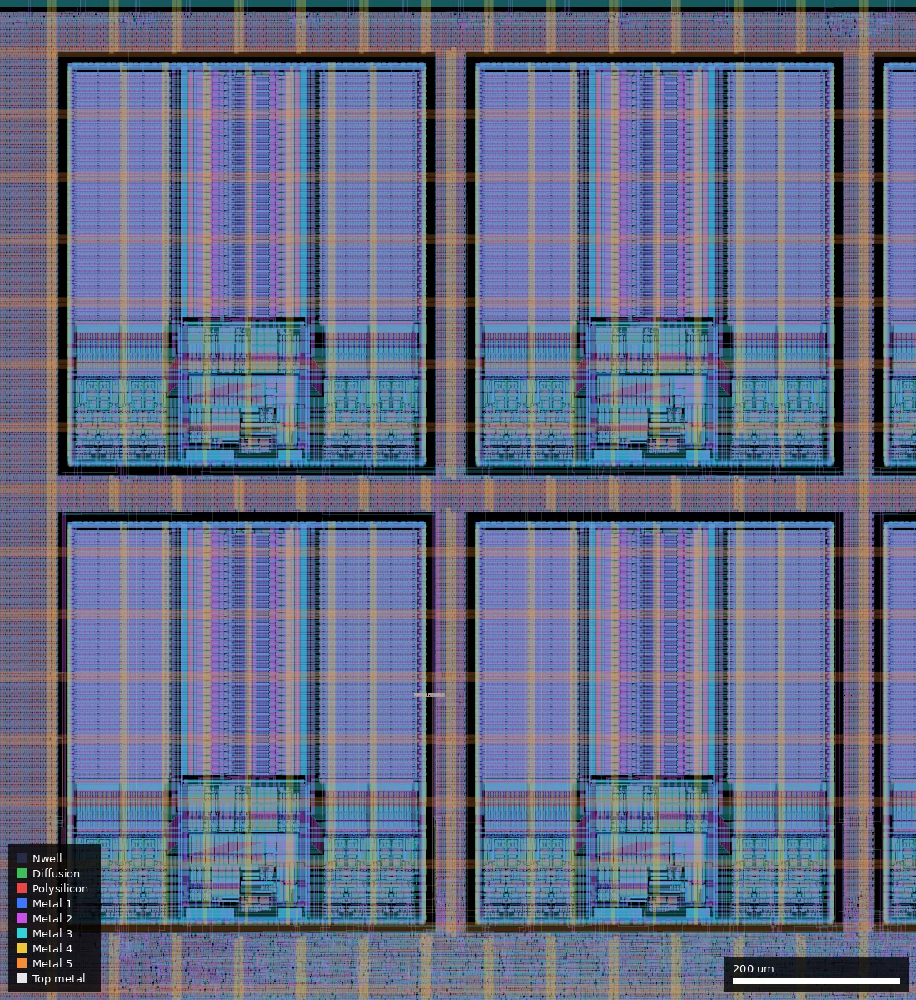
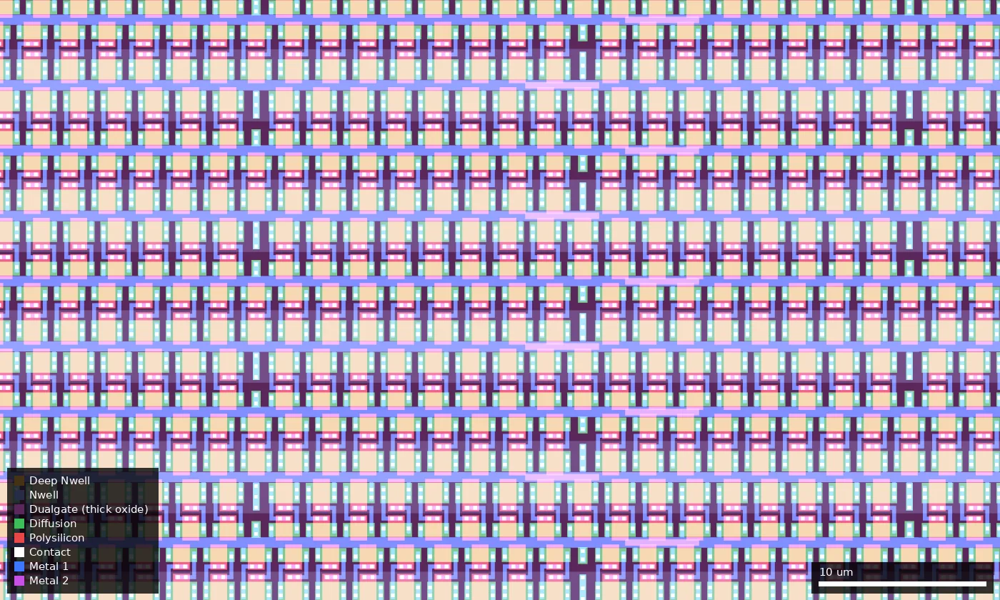

# PSOC: Simplest possible PicoSoC implementation using wafer.space flow (ws-run2)

| | |
|---|---|
| Repository | https://github.com/burnettlab/picosoc-on-waferspace @ a5283bc (main, last commit 2026-07-13); platform lists d-burnett/picosoc-on-waferspace |
| Slot | 1x0p5 |
| Top cell | chip_top |
| Licence in repo | Apache-2.0 |
| Taped-out layout | `PSOC_chip_top_6_6`, 3932 x 2531 um, 1 placement on the G802 reticle (at x 12.036 mm, y 15.606 mm) |
| README | THIN (98 words, original) |

## What the repo actually contains
PicoRV32 SoC on the wafer.space template: `ip/picorv32.v` (RV32IC, barrel shifter, counters, IRQ; no MUL/DIV), `src/spimemio.v` (QSPI flash), `src/simpleuart.v`, `src/simple_sram.v`, template-derived `chip_core.sv` (a leftover template counter XORed onto data pads remains; a `chip_core.sv~` backup is committed). README credits the template, JBFSF/SensorSoC, YosysHQ/picorv32 and lawrie/pico_ram_soc. Stated pinout: power, ground, clock, reset, serial tx/rx, QSPI (6 pins). Wishbone, I2C open-drain IO, bandgap, regulators and a radio are plans only; nothing is in the repo.
- Flow: LibreLane, **5 V** (gf180mcu_fd_sc_mcu7t5v0, gf180mcu_fd_io), PDK commit 140b0494, 25 MHz.
- **Eight gf180mcu_fd_ip_sram__sram512x8m8wm1 (5 V) macros**, 4 KiB as 1024 x 32 (`macros_5v.yaml`, `simple_sram.v`).
- A complete run is checked in (`final/`, 534 MB: GDS 99 MB, SDF/SPEF for 9 corners, `metrics.json`, netlists) plus `chip_top.gds.zip`.
- `final/metrics.json`: 42,204 stdcells (1.18 mm^2), 13 macros (1.80 mm^2), die 9.95 mm^2, util 59.5 %. KLayout and Magic DRC, antenna, density, XOR and all LVS counts 0; IR drop worst 0.127 mV. **Setup timing fails: overall WS -6.26 ns, nom_ss_125C_4v50 -4.31 ns (TNS -205 ns); TT +14.4 ns, FF +21.2 ns.** Hold is positive. Not mentioned in the README.
- Simulation: template `cocotb/chip_top_tb.py` only; no firmware test. No bring-up data.

## Taped-out layout

| Measured in `layout/PSOC.oas` | |
|---|---|
| Die | 3932 x 2531 um (9.95 mm2), reticle cell `PSOC_chip_top_6_6`, 1 placement on the G802 reticle |
| Pads / IO cells | 46 `gf180mcu_fd_io__bi_24t` bidir, 5 `in_c` + 1 `in_s` inputs (`clk_PAD` is the `in_s`), 4 `asig_5p0` analog, 8 stock `gf180mcu_fd_io__dvdd` + 8 `dvss` (not the `ws_io` power pads used in run 1), 4 corners. South: `clk_PAD` (x 482 um), `rst_n_PAD` (612), `bidir_PAD[0..17]`; east: `bidir_PAD[18..25]` (y 772..1759); north: `bidir_PAD[45..26]` (x 482..3450); west: `input_PAD[3..0]` (y 772..1195) and `analog_PAD[3..0]` (1336..1759). This is the same 1x0p5 pad ring as ws-run1/TQVC |
| Standard cells | all `gf180mcu_fd_sc_mcu7t5v0`: 104,773 placements, 18,372 logic cells and 86,401 fill, tap, end-cap and decap cells |
| Main logic cell types | 3,895 `dlyb_1`, 2,274 `nand2_1`, 1,871 `dffq_1`, 1,851 `oai21_1`, 1,108 `dlyc_1`, 817 `buf_4`, 814 `nor2_1`, 533 `clkinv_1`, 531 `mux4_1`. No latches |
| SRAM | 8 x `gf180mcu_fd_ip_sram__sram512x8m8wm1`, each 431.86 x 484.88 um, in a 4 x 2 array filling (1530, 990) to (3431.86, 2024.88): lower row at y 990, upper row at y 1540; columns at x 1530, 2020, 2510, 3000 |
| Transistor flavours | 5 V/6 V thick oxide only. In a 400 x 400 um core sample (700..1100, 1000..1400) all 35,670 merged Poly2 shapes (60,570 um2) lie inside Dualgate (55/0) |
| Not present | no DNWELL, MIM, high-resistance poly, BJT or custom analog cells: none of those layers exists in the file. `RES_MK`, `DIODE_MK`, `MOS_CAP_MK`, `ESD_MK` markers belong to IO cells and SRAM macros (not traced shape by shape) |
| Wafer.space blocks | `ws_ip__logo` (143.25 um, at (26, 2361.75)), `ws_ip__qrcode_id` (142.8 um at (26, 26)), `ws_ip__shuttle_id` and `ws_ip__project_id` (195.5 x 59.5 um, at (26, 175.6) and (175.6, 26)), `ws_ip__marker` (245 um square at (3651, 2250), a diagonal-bar corner marker), seal ring and fill |

The core is a flat sea of cells (hierarchy flattened by the flow), so PicoRV32, the SPI flash controller (`spimemio`) and the UART cannot be told apart in the layout; the only identifiable blocks are the SRAMs. The placed logic is a blob at roughly x 1000..3150, y 450..960 um, directly below the SRAM array; the left part of the core (x < 1000) is filler. About 5,100 of the 18,372 logic cells (28 %) are delay cells (`dlyb_1`, `dlyc_1`, `dlya_1`), i.e. hold fixing; they are a large share compared with the 801 `dlyb_1` in the TinyQV dies.

### Does it match the repository?

Yes. The repo's `chip_top.gds.zip` (added in 72fe374, present at the designs.csv commit a5283bc; the checked-in `final/gds/chip_top.gds` was not compared separately) unpacks to a GDS with top cell `chip_top`, 3932 x 2531 um, and the same 264 distinct child cell types with identical placement counts to the taped-out cell once `$n` suffixes are stripped (287,611 top-level placements in both), including all 8 SRAM macros. XOR of the taped-out layout against that GDS (flattened, merged) is zero on Contact, Via1-Via4, Pad, Nwell, Pplus, Nplus, Dualgate and V5_XTOR and non-zero only on COMP (0.39 mm2), Poly2 and the metals, which is wafer.space's regenerated dummy fill. One discrepancy with the summary above: `final/metrics.json` reports 42,204 stdcells, the layout has 18,372 logic cells and 104,773 placements including fill/tap, so the metrics count is a different category (probably logic plus tap cells; not resolved). The 13 macros in the metrics are the 8 SRAMs plus the 5 wafer.space blocks (logo, QR id, shuttle id, project id, marker). I did not run DRC or LVS, so the zero-violation claims from `final/metrics.json` are as reported by the flow, not rechecked.

## Authors and affiliations
| Person | Role | Affiliation | Source |
|---|---|---|---|
| d-burnett | sole committer (3 commits), owner of GitHub org burnettlab | not stated | `git shortlog`, `gh api` (no name/company) |

## Value for GF180MCU characterisation and PDK development
### Verdict: Low
Synthesised digital on stock 5 V cells plus eight foundry 5 V SRAMs; a functional/yield data point and a worked 5 V SRAM integration. The layout confirms this: no analog, MIM, DNWELL or custom cells, only thick-oxide devices, 8 SRAM macros and 18,372 logic cells.
### Test structures and measurable circuits
Nothing built for characterisation (confirmed from the layout). The eight identical SRAM macros (4 x 2 array) give eight copies for statistics on the foundry macro. About 5,100 delay cells (`dlyb_1` 3,895, `dlyc_1` 1,108) are spread through the logic. The SoC run at a known clock gives a max-frequency vs conditions point; signoff SDF/SPEF are in `final/` to compare (SS setup is short by 4.3 ns at 25 MHz).
### Candidate PDK additions
Nothing found; no PDK problems documented.
### What would be needed to use it
Packaged test with QSPI flash holding firmware (reset vector 0x00100000) and UART; no firmware or test plan in repo.
## Notes and caveats
Platform description and README differ in scope; nothing analog is present (checked in the layout); the committed `chip_core.sv` still XORs a free-running template counter into the low bidir outputs (`count ^ mem_rdata`), so many pads will toggle in operation (from source; not traced in the layout); repo owner (burnettlab) differs from the platform owner (d-burnett).
