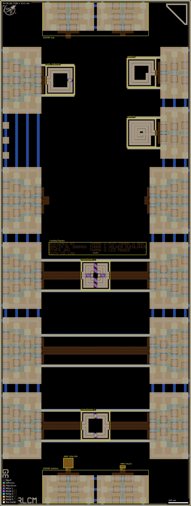
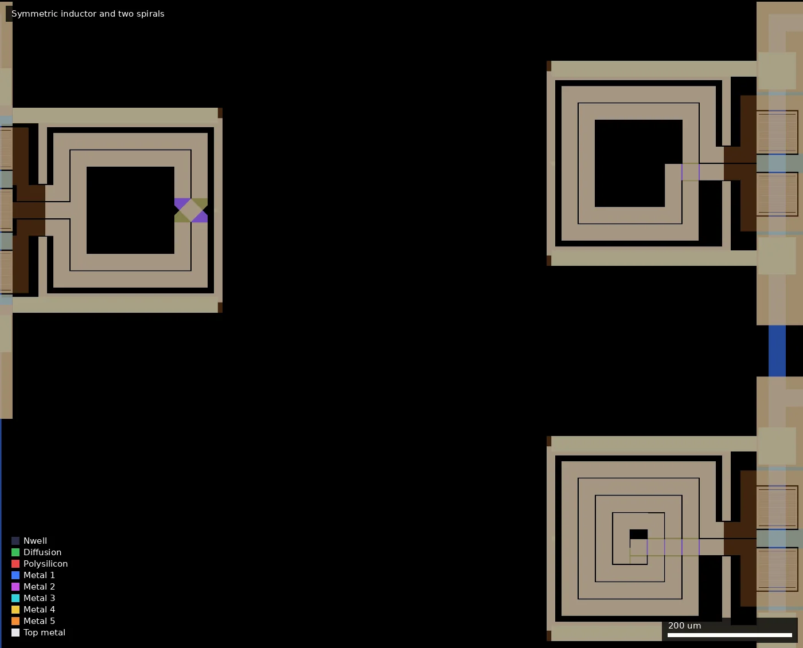
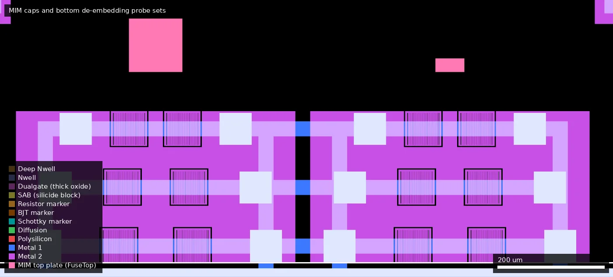
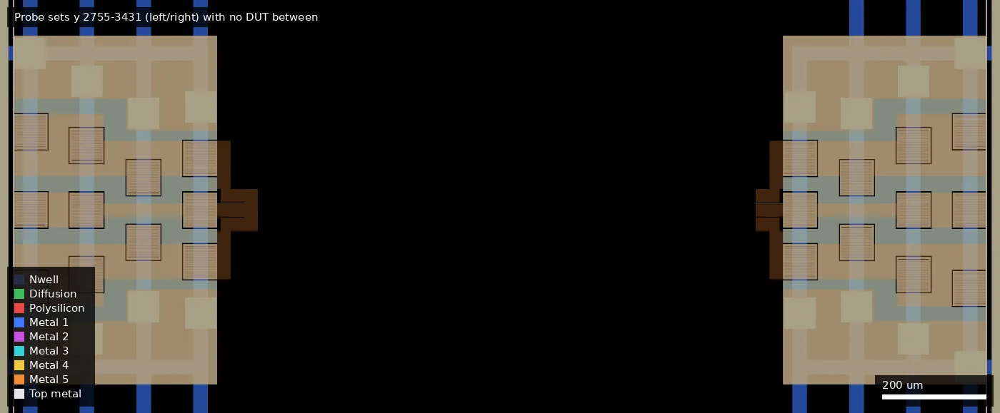

# RLCM: RLCM: Test Passives For GF180MCUD (ws-run2)

| | |
|---|---|
| Repository | https://github.com/EngGhaith/RLCM-Test-Passives-For-GF180MCUD @ d1bc20b (`main`, last commit 2026-07-15) |
| Slot | 0p5x1 |
| Top cell | RLCMV4_filled |
| Licence in repo | None (audit: MISSING) |
| README | Missing |
| Taped-out layout | RLCM_RLCMV4_filled_14_2, 1936 x 5122 um, 1 placement on the G802 reticle (28.004 mm, 5.242 mm) |

## What the repo actually contains

Layout only. Seven files:

- `RLCMV4_filled.zip`: one file, `RLCMV4_filled.gds` (190 MB, with dummy fill), the taped-out
  die, 1936 x 5122 um.
- `seperate_GDSs/Ind2_D250_N2_W26_TO.gds` and `..._CLEAN.gds`: a 2-port spiral inductor (top
  cell `SpiralInductor`).
- `seperate_GDSs/Ind3_D250_N2_W26_TO.gds` and `..._CLEAN.gds`: a 3-port symmetric inductor (top
  cell `SymmetricInductor`).
- `seperate_GDSs/0p5x1p0_frame.gds`: the unmodified wafer.space 0.5x1 template frame (with IO
  cells and two SRAM macros).
- `seperate_GDSs/bare_frame.gds`: the frame actually used: 72 custom `Bondpad_5LM` pads plus
  the wafer.space ID/logo cells, no IO cells.

There are no schematics, netlists, generator scripts, simulation decks, S-parameter files,
DRC/LVS reports or documentation. Commit messages are upload attempts ("try", "TRY 4") plus
"Initial Inductors", "Cleaned DRC", "Added bare padframe".

The die is a purely passive, probe-pad RF test structure set. It contains no transistors, no
`gf180mcu_fd_io` cells, no ESD and no supply pads. Contents of top cell `RLCMV4_filled`, from
the GDS hierarchy and KLayout PCell records:

| Instance | Location (um) | Description |
|---|---|---|
| `SpiralInductor_2P_282x282` | (1434, 4385) | 2-port spiral inductor, 282 x 282 um outline, inside ground ring `GRM` (298 x 298 um, Metal1-Metal5 stack) |
| `SpiralInductor_2P_282x282$1` | (1434, 3777) | Second 2-port spiral, same outline, different winding (17 Metal5 shapes against 8; parameters not recorded) |
| `SymmetricInductor_3P_282x282` | (611, 4309) | 3-port symmetric inductor with centre tap, ground ring `GRM_SYM` |
| `SymmetricTransformer` | (968, 813) | Symmetric transformer using Metal1-Metal5, 6 port markers, ground ring `GRM_TR` |
| `SymmetricTransformer$2` | (968, 2333) | Second transformer drawn on Metal5 with Metal1/Metal2 only underneath |
| `cap_mim` | (642, 385) | PDK MIM capacitor PCell, option MIM-B, 100 x 100 um (10 000 um2, about 20 pF at 2 fF/um2), between Metal4 and Metal5 |
| `cap_mim$1` | (1217, 385) | MIM-B, 54 x 25 um (1350 um2, about 2.7 pF) |
| `Probes_2P` x2 | right edge | 2-port probe pad sets (8 pads in two staggered columns) feeding the two spirals |
| `Probes_2P_DEEMD` x4 | top and bottom edges | 2-port de-embedding pad sets (two at the bottom next to the MIM caps, two at the top); which is open, short or thru is not labelled |
| `Probes_3P` x9 | left and right edges | 3-port probe pad sets (9 or 10 pads each) for the symmetric inductor and the transformers |
| `Bondpad_5LM` x72 | perimeter | Custom Metal2-Metal5 pad with Pad opening (37/0), 68 x 65 um, pitch 152 um on the long edges and 138 um on the short edges |
| `via_sub` x108 | around DUTs | 62 x 62 um Pplus substrate tie cells |
| `Credits`, `Thanks` | centre | Metal5 text |
| fill | whole die | `COMP_FILL`, `POLY2_FILL`, `METAL1..5_FILL`; `SLOT_2P` cells put slot datatypes (x/3) under the probe pads |

Layers 201/0 to 207/0 on the inductor and transformer cells are user port markers (ports 1-3
and 5-7), which is how the EM flows named below locate ports. Inductor geometry from the file
names: D = 250 um, N = 2 turns, W = 26 um ("TO" = tape-out).

## Taped-out layout

Source: `layout/RLCM.oas` (the reticle file), measured with KLayout; the bench list
(`wafer.space-bench/data/designs.csv`) gives the taped-out commit as `d1bc20b4f854`, the same
commit as the repository head cited above.

| Item | Measured |
|---|---|
| Die | 1936 x 5122 um (slot 0p5x1), seal ring plus wafer.space fill |
| Pads | 72 custom `Bondpad_5LM` (68 x 65 um, Metal2 to Metal5 with Pad opening), no IO cells, no ESD, no supply pads |
| Standard cells / SRAM | none (layout.json lists no standard cells, no SRAM macros, no IO cells) |
| Active devices | none. COMP and Poly2 shapes exist only in the fill cells; there are no Dualgate, V5_XTOR, resistor-marker or diode layers |
| Passive DUTs | 2 spiral inductors, 1 centre-tapped symmetric inductor, 2 symmetric transformers, 2 MIM-B capacitors (FuseTop 75/0 is the MIM top plate, CAP_MK 117/5 marks both) |
| Probe sets | 9 x `Probes_3P` (447 x 676 um), 2 x `Probes_2P` (338 x 524 um), 4 x `Probes_2P_DEEMD` (524 x 338 um), each with a `SLOT_2P` slot-layer block |
| Other | 108 `via_sub` Pplus substrate ties (62 x 62 um), ground-ring bars (`via_dev$72`, `$44`), wafer.space logo, QR/shuttle/project ID cells, "RLCM" artwork bottom-left |
| Text on die | Metal5 text "DESIGNED BY / GHAITH AL SABAGH / NTHFS JKU / MWTH CD LAB" and "THANK U MIM THANK U SHO / THANK U VOLKER MUEHLHAUS / THANK U LEO MOSER", cells `Credits` (496..876, 2543..2670) and `Thanks` (910..1482, 2576..2670) |

### Does it match the repository?

Yes. The `RLCMV4_filled.gds` in the repo zip (extracted and compared) has the same die box
(1936 x 5122 um), the same 1010 cells and identical top-level instance counts by base name
(72 `Bondpad_5LM`, 108 `via_sub`, 9 `Probes_3P`, 4 `Probes_2P_DEEMD`, 2 `Probes_2P`, 2 each of
inductor, transformer and `cap_mim`, one symmetric inductor, fill). The OAS only adds the
wafer.space reticle wrapper cell name. The repo's `0p5x1p0_frame.gds` (with IO cells and SRAM) is
not what was taped out; `bare_frame.gds` is. Not compared shape by shape.

Layout of the die (overview, `style full`): top to bottom on the left, a probe set for the
symmetric inductor (y 3971-4647), the stub site, transformer 2 row, the DUT-less middle row and
transformer 1 row; on the right the two spirals (y 3628-4534) then the same four rows;
de-embedding pad sets along the top and bottom edges.

### Test structure locations

| Structure | Cell | Position of cell (um) | Size (um) | Detail (layout) | Probe set next to it |
|---|---|---|---|---|---|
| 2-port spiral A | `SpiralInductor_2P_282x282` | 1285,4236 | 298 x 298 incl. ground ring | about 2 turns, Metal5 with underpass | `Probes_2P` 1572,4123 (right edge) |
| 2-port spiral B | `SpiralInductor_2P_282x282$1` | 1285,3628 | 298 x 298 | about 4 turns, same outline, tighter pitch | `Probes_2P$3` 1572,3515 |
| 3-port symmetric inductor | `SymmetricInductor_3P_282x282` | 462,4160 (rotated) | 298 x 298 | centre-tap crossover (Metal2 and lower metal) visible at the right-hand side | `Probes_3P` 26,3971 (left edge) |
| Transformer 1 | `SymmetricTransformer` | 819,664 | 298 x 298 | multi-layer windings, six ports | `Probes_3P$2` 26,475 and `Probes_3P$2$1$1` 1463,475, joined by long Metal5 feed bars |
| Transformer 2 | `SymmetricTransformer$2` | 819,2184 | 298 x 298 | Metal5-dominant | `Probes_3P$2$1$2` at 26,1995 and `Probes_3P$2$2$1` at 1463,1995 |
| Empty middle site | none | between 475..1911 | 1884 x 676 | pads and feed/ground bars, no inductor or transformer between them: by geometry the open (or thru) reference for the transformer feeds | `Probes_3P` pairs at y 1235 |
| Stub site | none | y 2755-3431 | 1884 x 676 | pads with ~30 um stubs facing each other across a ~950 um gap, not joined | `Probes_3P` pairs |
| MIM-B 100 x 100 um | `cap_mim` | 641,384 | 101 x 101 | top plate on FuseTop, Metal4/Metal5 plates, stubbed to the bottom DEEMD sets | `Probes_2P_DEEMD$1$1`, `$2` (y 26-364) |
| MIM-B 54 x 25 um | `cap_mim$1` | 1216,384 | 55 x 26 | same | same |
| De-embedding sets | `Probes_2P_DEEMD` x4 | top 982,4758 and 430,4758; bottom 430,26 and 982,26 | 524 x 338 | whether each is open, short or thru is not marked; the two bottom ones carry the MIM caps | direct |

Which pads reach which DUT was judged from placement and metal bars only; no net extraction was
done (the merged Metal5 is one ground net across the die, so naive connectivity is not
informative).

Close-up, x 400-1700, y 3600-4650: the 3-port symmetric inductor, spiral A and spiral B with
the probe-pad edge on the right.

Close-up, x 400-1550, y 0-520: MIM top plates (pink, 100 x 100 um at x 641, 54 x 25 um at x 1216)
and the bottom `Probes_2P_DEEMD` pad sets.

Close-up, x 0-1936, y 2700-3500: the stub site, with short opposing stubs and no DUT.

Not on the die: no resistor test structure, no transistor, no standard cell. The 300 or so
top-level labels (`DVDD`, `DVSS`, `VDD`, `VSS`, `ASIG5V`, `bidir_PAD[n]`, `PAD`, `Y`, `OE`, ...)
are Metal2 to Metal5 label-layer leftovers of the template frame and name nothing real.

## Authors and affiliations

| Person / organisation | Role | Affiliation | Source |
|---|---|---|---|
| Ghaith Al Sabagh (GitHub `EngGhaith`) | Sole author (11 commits) | On-chip Metal5 text reads "Designed By / Ghaith AL SABAGH / NTHFS JKU / MWTH CD LAB": Johannes Kepler University Linz, RF institute and a Christian Doppler laboratory (expansion of the abbreviations inferred). GitHub profile states nothing. | `git shortlog`; KLayout TEXT PCell parameters in the GDS; `gh api users/EngGhaith` |
| Volker Muehlhaus | Thanked on chip; author of the openEMS and Palace GDS-to-EM flows the stack files target | not stated here | TEXT PCell "THANK U VOLKER MUEHLHAUS"; `EM-Flow/README.md` in the author's other repo |
| Leo Moser | Thanked on chip | not stated | TEXT PCell "THANK U LEO MOSER" |

A third thanks line reads "THANK U MIM THANK U SHO" (meaning not known).

## Value for GF180MCU characterisation and PDK development

### Verdict: High

Purpose-built RF passive test structures with on-wafer probe pads and de-embedding dummies:
inductors, transformers and MIM capacitors on the 11 kA top-metal option. Measured
S-parameters would calibrate the back-end stack (metal and dielectric thicknesses,
conductivities, substrate resistivity) that every EM simulation of GF180MCU depends on, and
nothing comparable exists in the open PDK. The value depends on the author publishing the
simulation side, which is not in this repo.

### Test structures and measurable circuits

| Structure | Parameter exercised | Access | Repo path | Simulation available |
|---|---|---|---|---|
| 2-port spiral inductor (two variants) | Inductance, Q and self-resonance: Metal5 (11 kA top metal) sheet resistance and thickness, height above substrate, substrate conductivity, via-stack resistance of the underpass | `Probes_2P` pad sets on the right edge | `seperate_GDSs/Ind2_D250_N2_W26_TO*.gds`; in `RLCMV4_filled.gds` | None in repo |
| 3-port symmetric inductor | Differential L and Q, centre-tap behaviour, winding asymmetry | `Probes_3P` pad set | `seperate_GDSs/Ind3_D250_N2_W26_TO*.gds` | None in repo |
| Symmetric transformer, all-metal version | Coupling coefficient, mutual inductance (the "M" of the name), inter-winding capacitance through the Metal1-Metal5 stack | `Probes_3P` pad sets (two per transformer) | only inside `RLCMV4_filled.gds` | None in repo |
| Symmetric transformer, top-metal version | Same on Metal5 with thin lower-metal crossings: separates top-metal from lower-metal loss | `Probes_3P` pad sets | only inside `RLCMV4_filled.gds` | None in repo |
| `cap_mim` 100 x 100 um MIM-B | MIM capacitance density (nominal 2 fF/um2), series resistance of plates and top-via array (17 161 vias), self-resonance | `Probes_2P_DEEMD`-type pad sets at the bottom edge (bottom-edge sets confirmed by placement; no net trace) | inside `RLCMV4_filled.gds`; PDK PCell `cap_mim`, `mim_option='MIM-B'`, `metal_level='M5'` | PDK SPICE model `cap_mim_2f0fF`; no EM result |
| `cap_mim` 54 x 25 um MIM-B | Same at 1350 um2: area versus perimeter scaling | as above | as above | as above |
| De-embedding structures (`Probes_2P_DEEMD` x4) | Pad and feed-line parasitics (open/short/thru); also Metal5 line resistance and pad capacitance to substrate | direct | inside `RLCMV4_filled.gds` | None |
| `Bondpad_5LM` pads | Pad capacitance of a Metal2-Metal5 pad without ESD | direct | `seperate_GDSs/bare_frame.gds` | None |

No resistor test structure was found: there is no Poly2 outside the fill cell, no resistor
marker layer, and no cell with a resistor name. The "R" in the project name may refer to
series resistance extracted from the inductors and feed lines (inferred).

Devices and domain: PDK `cap_mim` (MIM-B) and `via_dev` PCells only; everything else is drawn
metal. No voltage domain applies.

Simulation data to compare against: none is published. The author's related work is in a
different repository, `EngGhaith/The-Silent-Owl-GF180MCU-WB-LNA` (Apache-2.0, a Chipathon 2026
LNA), directory `EM-Flow/`:

- `OPENEMS-GF180MCUD-1P5M-TM11KA-MIMB.xml`, `...-MIMB-POLY.xml`, `...-MIMB-HRPOLY.xml` and
  `PALACE-GF180MCUD-1P5M-TM11KA-MIMB.xml`: layer-stack definitions for Volker Muehlhaus's
  `openems_ihp_sg13g2` / `gds2openEMS` and `gds2palace_ihp_sg13g2` flows (the author has forks of
  the latter two), first committed 2026-06-08 and revised to 2026-06-24.
- The openEMS stack models Metal1-Metal4 as 0.55 um conductors at 2.02e7 S/m, top metal as
  1.19 um at 2.10e7 S/m, one merged SiO2 dielectric (eps_r 4.0, 8.52 um), a 0.3 um nitride
  passivation, a 191 um substrate at 2 S/m, and the MIM as an equivalent 0.31 um dielectric
  with eps_r 70 to give 2.0 fF/um2. MIM vias must be moved to layer 1041 before simulation.
- That directory holds stack files and a README only: no simulation models or S-parameters of
  the RLCM structures. The same repo also has `analog_pad_sp_paramerters/` (extracted
  S-parameter model of `gf180mcu_fd_io__asig_5p0`).

So the chip exists to validate those stack files, but the reference simulations have to be
rerun from the GDS files in this repo.

### Candidate PDK additions

- **EM simulation stack for GF180MCU-D (1P5M, 11 kA top metal, MIM-B)** for openEMS and AWS
  Palace, in `EngGhaith/The-Silent-Owl-GF180MCU-WB-LNA/EM-Flow/`. Once checked against this
  silicon it is a direct candidate for shipping with the PDK (the equivalent of
  `libs.tech/openems` in the IHP open PDK).
- **Inductor and transformer layouts** with ground rings and port markers: starting points
  for PDK inductor PCells, which GF180MCU lacks. The generator that produced them is not in
  the repo.
- **`Bondpad_5LM`** bare pad and **`bare_frame.gds`**: an ESD-free, IO-cell-free frame for the
  0.5x1 slot, useful for any RF or device-characterisation project.
- **`Probes_2P` / `Probes_3P` / `Probes_2P_DEEMD`** probe-pad cells with slotting, as a reusable
  on-wafer RF probing kit.
- No PDK bugs or DRC waivers are recorded; a commit says "Cleaned DRC" without detail.

### What would be needed to use it

- Bare-die, on-wafer RF probing: a probe station, vector network analyser and GSG/GSGSG (or
  multi-port) probes matched to the pad pitch, with a calibration substrate. Wire bonding
  would defeat the purpose.
- From the author: which probe set belongs to which structure, the intended probe type and
  pitch, which de-embedding dummy is which, the intended frequency range, and the inductor
  and transformer design parameters (only D, N, W of one spiral are known, from file names).
- The reference EM simulations (openEMS/Palace models and S-parameters) of each structure,
  or the scripts to regenerate them from the GDS with the stack files above.
- Foundry-side data for comparison: the actual metal option of the run (the stack files
  assume 11 kA top metal and MIM-B) and substrate resistivity.

## Notes and caveats

- Everything above is reconstructed from the GDS and the taped-out OAS (cell names, placements, layer usage and KLayout
  PCell parameter records); there is no text documentation of any kind in the repo.
- Probe-set-to-DUT assignments are from placement and feed-bar geometry, not traced nets; the open/short/thru role of each de-embedding set is still unlabelled and would need the author or a net trace to settle.
- The top level still carries several hundred template IO pin labels (`PAD`, `A`, `Y`, `OE`,
  `DVDD`, `bidir_PAD[n]`, ...) although no IO cells are present; they are leftovers and name
  nothing real.
- The submitted layout is an OASIS file, so its hash cannot be compared with the GDS in the
  zip (sha256 `5bf5343a...`).
- The platform description says the chip verifies "the automated openEMS flow"; that flow and
  its GF180 stack files live in a different repository and belong mainly to a third party
  (Volker Muehlhaus), with the GF180 stack definitions contributed by this author.
- The directory name `seperate_GDSs` is spelled that way in the repo.
