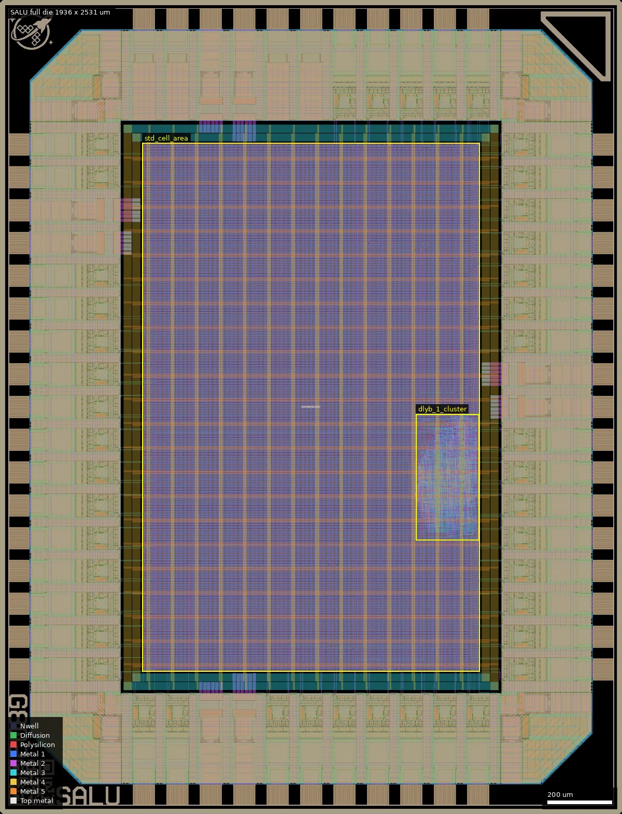
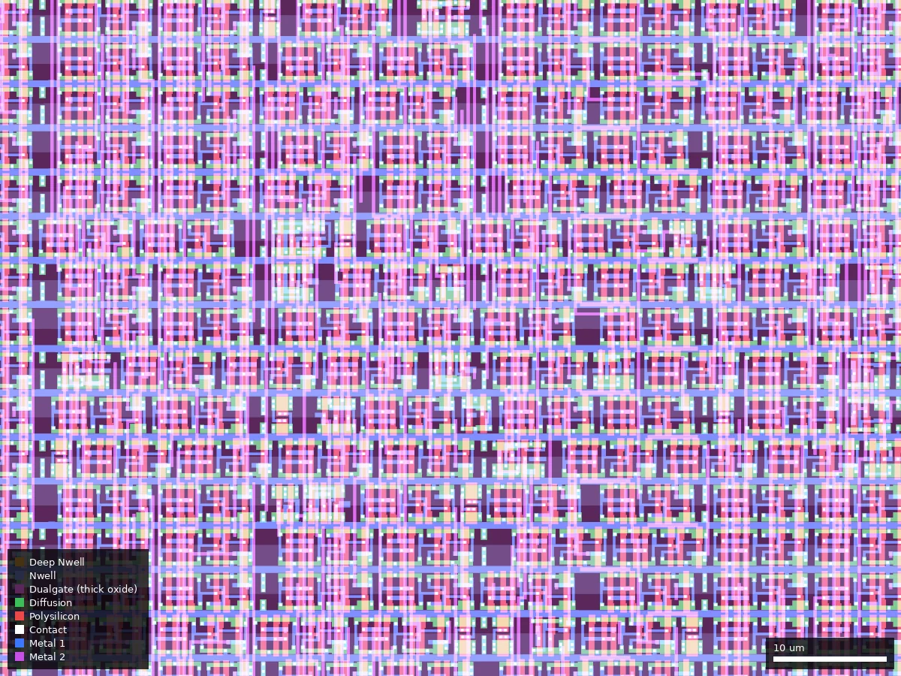

# SALU: Simple ALU (ws-run2)

| | |
|---|---|
| Repository | https://github.com/StackDoubleFlow/alu_silicon @ 15ae8bf (main, last commit 2026-07-14) |
| Slot | 0p5x0p5 |
| Top cell | chip_top |
| Licence in repo | MIT (LICENSE added in 0aba293) |
| README | TEMPLATE (identical to the wafer-space template README) |
| Taped-out layout | SALU_chip_top_13_6, 1936 x 2531 um, 1 placement on the G802 reticle |

## What the repo actually contains
Template (2026-07-04 state) plus one design commit. `chisel/src/main/scala/ALU.scala` (Chisel via mill) generates `src/chisel/ALU.sv`: 8-bit ALU, registered output, ops add/sub/sll/srl/sra/or/and/xor. `chip_core.sv`: `bidir_in[7:0]` src1, `[15:8]` src2, `[18:16]` control, `bidir_out[26:19]` result; reset `~rst_n`. Flow: LibreLane 5 V default (gf180mcu_fd_sc_mcu7t5v0, gf180mcu_fd_io), PDK commit d658698, 25 MHz; SRAM macro entries removed; no SRAM or analog. `cocotb/chip_top_tb.py` (278 lines) tests the ops. No signoff reports in tree. Release v1.0 has `design.gds.gz` (9.7 MB), compared with the taped-out layout below.

## Taped-out layout

| Measured | Value |
|---|---|
| Die | 1936 x 2531 um (0p5x0p5 slot), one placement |
| Pad ring | 60 pads: 38 `bidir` (`gf180mcu_fd_io__bi_24t`), 5 `in_c` + 1 `in_s` input cells (clk, rst_n and four inputs), 4 `asig_5p0` analog cells, 4 DVDD + 4 DVSS, 4 corners; pad labels `bidir_PAD[n]`, `input_PAD[n]`, `analog_PAD[n]`, `clk_PAD`, `rst_n_PAD` on Metal5 |
| Standard cells | `gf180mcu_fd_sc_mcu7t5v0` only; 1,608 logic cells, of which 1,324 are `dlyb_1` delay cells (plus one `dlya_1`), leaving about 283 real logic cells: 8 `dffq_1` flip-flops (the registered result), about 30 each of `oai21_1` and `nand3_1`, 22 `nor2_1`, 22 `aoi21_1`, 21 `nand2_1`, 23 xor/xnor; 36,011 fill, tap and endcap placements, 270 tie cells |
| Macros | none: no SRAM, no hard macros, no custom cells |
| Oxide, passives | Dualgate and V5_XTOR appear only inside the stock 5 V cells and IO cells; no MIM, high-resistance poly, DNWELL, eFuse or BJT |
| Custom or analog content | none; the 4 analog pad cells are placed but unused |

### Does it match the repository?
Yes. I unpacked the v1.0 release `design.gds.gz` and compared top-cell instance counts (after stripping `$n` suffixes) with the taped-out layout: all 109 distinct child cell names have identical counts, both have 1039 cells and the same 1936 x 2531 um bounding box. The 19 inputs (`bidir_in[18:0]`), 8-bit result on `bidir_out[26:19]` and the other bidirectional pads configured as outputs driven low, as in `src/chip_core.sv`, were checked in the RTL only (I did not extract pad connectivity from the layout). The 8-bit width is confirmed by the 8 flip-flops.

*Whole die, 1936 x 2531 um. The std-cell area (443,442 to 1493,2086) is almost all fill and tie; the mottled patch at about 1295,850 to 1492,1243 is where the 1,324 `dlyb_1` delay cells and the ALU logic sit.*

*Close-up, 80 x 60 um at 1380,900: densely packed delay and logic cells in the cluster, between rows of fill capacitor cells.*

What is notable: the 1,324 delay cells are 82 percent of the logic. They are most likely hold-fixing buffers on the input paths (inferred from the cell type; I did not trace which nets they sit on). If so, the input-to-register paths are lengthened by delay chains, a pad-to-register delay that could be measured; nothing in the repository documents the delay inserted.

## Authors and affiliations
| Person | Role | Affiliation | Source |
|---|---|---|---|
| StackDoubleFlow | ALU design (3 commits) | not stated (profile: Illinois, USA) | `git shortlog`, `gh api` |
| Leo Moser et al. | template | wafer.space template | git log, AUTHORS.md |

## Value for GF180MCU characterisation and PDK development
### Verdict: Low
Tiny synthesised ALU on stock 5 V cells (about 283 logic cells and 8 flip-flops, plus 1,324 hold-fix delay cells); the layout confirms nothing custom or analog. Yield data point only.
### Test structures and measurable circuits
Nothing built for characterisation (confirmed from the layout). Pad-to-pad delay of the registered ALU is measurable, and the 1,324 `dlyb_1` delay cells give a long delay path to compare with simulation, but no SDF/timing results are checked in.
### Candidate PDK additions
Nothing found.
### What would be needed to use it
Packaged test driving 19 input pads and reading 8 outputs at 25 MHz; no test plan.
## Notes and caveats
README is unmodified template; the platform text matches the sources. The release v1.0 GDS matches the taped-out layout cell for cell (checked).
