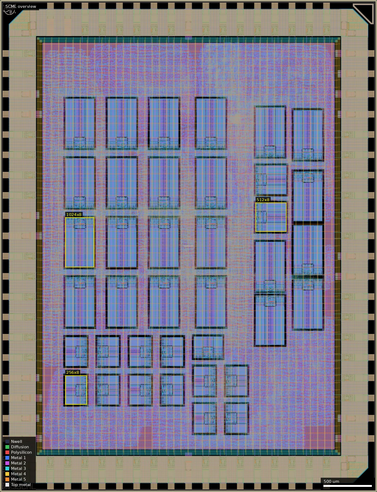
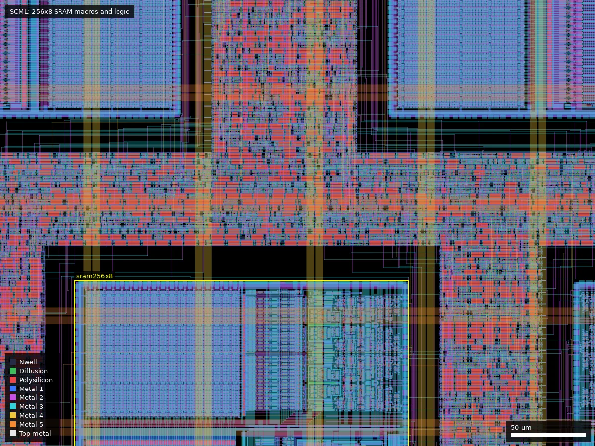

# SCML: ML-Audio SC (ws-run2)

| | |
|---|---|
| Repository | https://github.com/kjconway5/ML-Audio @ 94e7733 (main, last commit 2026-08-07) |
| Slot | 1x1 |
| Top cell | chip_top |
| Licence in repo | Apache-2.0 |
| README | OK (1630 words, about 1330 own) |
| Taped-out layout | SCML_chip_top_6_2, 3932 x 5122 um, 1 placement on the G802 reticle (at 12.036, 5.242 mm) |

## What the repo actually contains
A keyword-spotting pipeline: 1.003 MHz PDM, 5-stage CIC, 33-tap compensation FIR, 256-point STFFT (modified R2FFT), log-mel filterbank (PULP arithmetic IP), spectral VAD, int8 depthwise-separable CNN with a shared MAC array, requant, boot/flash loader over UART, trained in `src/ml/Pipeline` (PyTorch; models and hex weights in `src/ml/models`; Speech Commands wavs checked in). Flow: LibreLane + slang, **3.3 V** (gf180mcu_as_sc_mcu7t3v3 SCL, gf180mcu_fd_io pads, per the layout and config.yaml), 16 MHz (period 62.5 ns), PL density 42 %, corners tt_3v30 and ff_n40C_3v60 (ss_125C_3v00 only for SRAM libs). **38 SRAM macros** in `macros_3v3.yaml` (gf180mcu_ocd_ip_sram: 13 x 256x8, 2 x 512x8, 23 x 1024x8, about 28 KB); SRAM repo cloned by `make clone-pdk` from RTimothyEdwards/gf180mcu_ocd_ip_sram, plus `install-3v3-scl-hotfix`. 31 DFT/debug bidir pads (bidir[39:9]) and pad assignments for UART, KWS done/class, VAD drop and test-mode pins. Extensive cocotb tests (`cocotb/chip_core_tb.py`, module tests, GL+SDF wrapper `cocotb/sim/chip_top_sdf_wrapper.sv`). No `final/` or signoff reports in the repo; the 213 MB `chip_top.gds` is a release asset (`final-gds`). The commit log mentions clean LVS/manufacturability, "some slew violations remaining on 3.0v corner" and hold fixes.

## Taped-out layout
| Item | Measured |
|---|---|
| Die | 3932 x 5122 um |
| Pads | 74: 40 `gf180mcu_fd_io__bi_24t`, 13 `in_c` + 1 `in_s`, 2 `asig_5p0`, 8 `dvdd` + 10 `dvss` (the repo's 6 DVDD + 2 VDD and 8 DVSS + 2 VSS pads are all built from dvdd/dvss cells; no separate vdd/vss cells). Note: the pad library is **`gf180mcu_fd_io`**, not `ocd_io`. |
| Standard cells | `gf180mcu_as_sc_mcu7t3v3` only: 111,492 logic cells (plus 303,499 fill/tap); buff_2 18,716, dfxtp_2 15,869, mux2_2 13,745, clkbuff_8 9,619, xnor2_2 7,922, and2_2 7,731, maj3_2 3,702, nand2_2 3,492, inv_2 3,304, xor2_2 3,267, mux4_2 2,669 |
| SRAM macros | 38 `gf180mcu_ocd_ip_sram`: 23 x `sram1024x8m8wm1` (301.3 x 515.8 um), 13 x `sram256x8m8wm1` (301.3 x 224.9 um), 2 x `sram512x8m8wm1` (301.3 x 321.9 um); 27,904 bytes in total |
| Oxide / devices in the core | no Dualgate, V5_XTOR, SAB, resistor, MIM or Pad shapes inside the core (420..3510 x 420..4700 um), so the logic and SRAM are 3.3 V thin-oxide only. Dualgate (49,682 shapes) lies in the `fd_io` pad cells. Only 122 DIODE_MK shapes in the core. |
| Custom / analog | none: no hand-drawn cells; the two `asig_5p0` pads are stock cells (not traced to any circuit) |

### Does it match the repository?
Yes. The commit in designs.csv (94e7733) is the repo HEAD. The release asset `final-gds` (`chip_top.gds`, 213,579,098 bytes, sha256 635403b4...) and the taped-out OASIS have the same die box (3932 x 5122 um), the same 331 distinct top-level instance cell names (after stripping `$n` suffixes), and identical top-level placement counts for all of them except the router via array `VIA_via4_5_10000_10000_4_4_1240_1240` (25,484 in the release GDS, 18,696 in the taped-out OASIS; I did not find why, it is a plain Via4/Via5 stack cell). Pad counts agree with `slot_defines.svh` for 1x1 (12 + 2 inputs, 40 bidir, 2 analog, 18 power pads) and the SRAM counts agree with `macros_3v3.yaml` (13 x 256x8, 2 x 512x8, 23 x 1024x8). The summary's earlier claim of `ocd_io` pads was wrong: the layout and `librelane/config.yaml` use `gf180mcu_fd_io`.

*Overview, whole die: 23 large 1024x8 macros (two grids of columns at x 680-1860 and 2050-3360, y 1720-4096), 13 small 256x8 macros (y 615-1620, x 680-2580) and 2 x 512x8 at (2666-2988, 2710-3401) um sit in a sea of std-cell logic; the 38 macros are the dark rectangles.*

*Close-up (1300-1700, 1500-1800 um): a 256x8 macro (marked, lower left, origin (1350,1310) um) and its neighbours with the flop/MAC logic that fills the gaps between them.*

Block identification: the netlist is flat (no logic sub-cells were kept), so I cannot outline the PDM front end, CIC, FIR, STFFT, mel filterbank, VAD or CNN from the layout. The flop count (15,869 dfxtp_2), 3,702 `maj3_2` and 7,922 `xnor2_2` are consistent with the adder/multiplier-heavy DSP and MAC datapath in the repo, and there is no analog front end: PDM is read as a digital input on a 3.3 V `in_c`/`bi_24t` pad, and nothing in the core is non-digital.

## Authors and affiliations
| Person | Role | Affiliation | Source |
|---|---|---|---|
| Aydan Olaez | physical flow, timing, LVS | ucsc.edu email (hint only) | git |
| Jose Peralta, Diego Nocera, Michael Aguero | RTL, verification, docs | ucsc.edu emails (hint only) | git |
| Kye Conway (kjconway5) | repo owner | UC Santa Cruz (GitHub bio: studying Computer Engineering) | `gh api` |
| course | README cites "UCSC ECE 153/250 Digital Signal Processing" (H. Ye, 2026) in FIR/STFFT READMEs; no course for the project itself is stated | | src/rtl/FIR/README.md, src/rtl/STFFT/README.md |

## Value for GF180MCU characterisation and PDK development
### Verdict: Low
Large synthesised digital design with 38 SRAM macros of three sizes on the 3.3 V library; useful as an SRAM/SCL integration case and yield point, but no test structures.
### Test structures and measurable circuits
Nothing dedicated. The 31 debug pads expose internal state, and the design uses three SRAM sizes at 3.3 V; no simulation result in the repo (beyond functional sim logs in `src/ml/models/*/sim-core-results.txt`) is a timing reference.
### Candidate PDK additions
Documented PDK problems: `cocotb/sim/gf180mcu_as_sc_mcu7t3v3_missing_cells.v` says the shipped Verilog model lacks ao211_2, aoi211_2, oai211_2, xor2_2; `install-3v3-scl-hotfix` copies libs from AvalonSemiconductors/gf180mcu_as_sc_mcu7t3v3 over the PDK; commit message "fixed incorrect timing corners for 1024 srams"; GL-sim stubs, slew/max-cap violations at IO pads and SRAM inputs; `scripts/gen_specify_blocks.py` and `sdf_icarus_fixer.py` for SDF sim.
### What would be needed to use it
Packaged test with a UART boot of weights and PDM microphone or WAV playback; no bring-up plan in the repo.
## Notes and caveats
No signoff data in the repo. The release GDS was compared with the taped-out layout (see "Does it match the repository?"); DRC/LVS status itself was not re-run. Submodule list (`.gitmodules`) is empty at HEAD.
