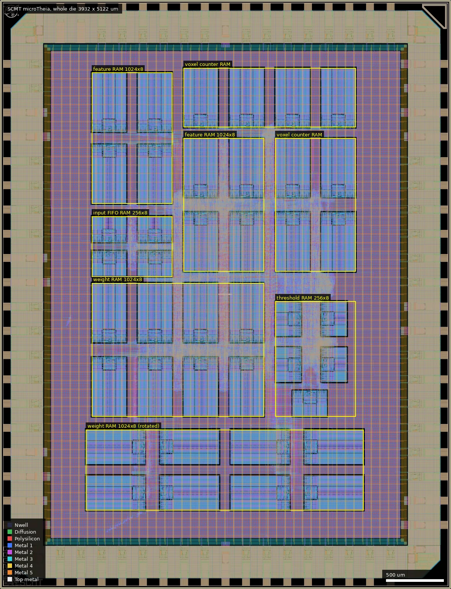
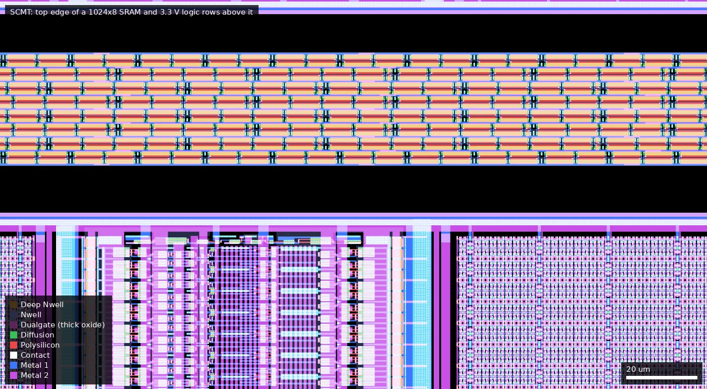
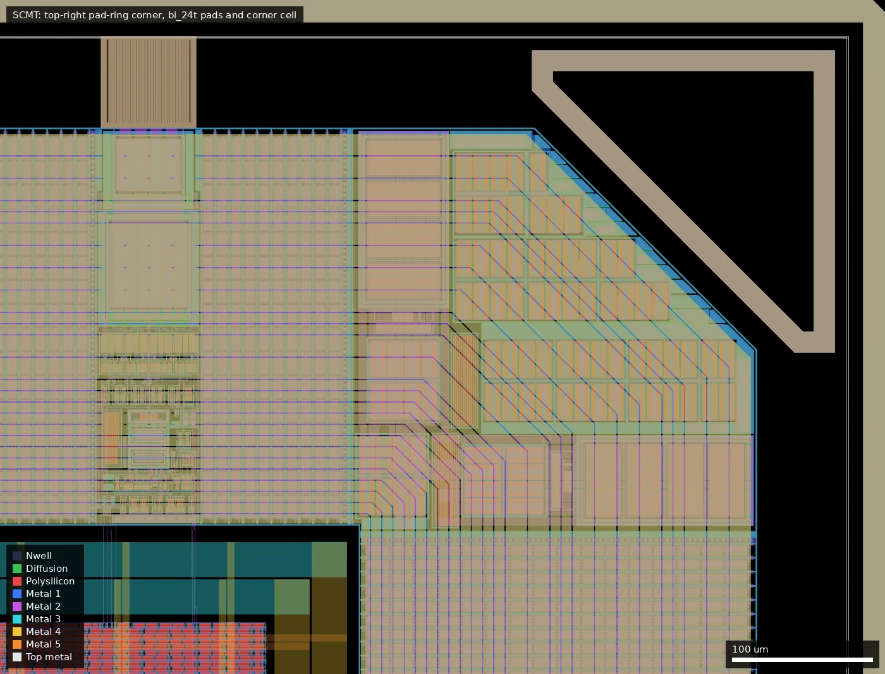

# SCMT: microTheia (ws-run2)

| | |
|---|---|
| Repository | https://github.com/dhgaddy/microTheia @ ef69ed4 (main, last commit 2026-07-30); README clone path is dolphin-530/microTheia |
| Slot | 1x1 |
| Top cell | chip_top |
| Licence in repo | Apache-2.0 |
| README | OK (1086 words) |
| Taped-out layout | SCMT_chip_top_2_2, 3932 x 5122 um, 1 placement on the G802 reticle |

## What the repo actually contains
Event-based vision SoC: SPI slave (`third_party/verilog_spi`, submodule jasonwaseq/verilog_spi @ d2698c0), EVT2 decoder, input FIFO, voxel binning (320x320 to 16x16 grid, 16 time bins, double-buffered feature RAM), MAC engine for four programmable class weights, argmax/threshold classifier, boot FSM, selectable debug mux. Flow: LibreLane, **3.3 V** (as_sc_mcu7t3v3, ocd_io), 64 MHz (period 15.625 ns), PL density 41 %, PDK commit f6eeac7. Macros: gf180mcu_ocd_ip_sram 1024x8 (32 instances listed), 256x8 (9), none of 512x8. git LFS: 55 files (EVT2 test streams, `weights/*.mem`), none missing. `docs/` has architecture, RTL reference, simulation, limitations. README embeds a timing-closure screenshot ("positive setup and hold slack in all tested corners"; max-cap and max-slew violations explained as pad/clock-buffer limits against the 0.2 pF global limit), "Full pass LVS and DRC". Gate-level sim passes four gesture classes (about 7 h per run). No `final/` or signoff files in the repo; GDS only as release assets (v1.0 2026-07-04, v1.1 2026-07-15).

## Taped-out layout
| Item | Measured from the layout |
|---|---|
| Die | 3932 x 5122 um (20.1 mm2), 1 placement at (4.052, 5.242) mm on G802 |
| IO ring | 40 `gf180mcu_fd_io__bi_24t`, 13 `in_c` + 1 `in_s`, 2 `asig_5p0` (analog pads `analog_PAD[0..1]`, not traced into the core), 8 `dvdd`, 10 `dvss`, 4 corner cells; pad labels `clk_PAD`, `rst_n_PAD`, `input_PAD[n]`, `bidir_PAD[0..39]` |
| Standard cells | `gf180mcu_as_sc_mcu7t3v3` only: 47,523 logic cells (layout.json) plus 269,002 fill/tap cells. 28,172 are `buff_2`, 2,445 `dfxtp_2`, 2,276 `dlybuff_2`, 1,588 `clkbuff_8` |
| SRAM | 32 x `gf180mcu_ocd_ip_sram__sram1024x8m8wm1` (301 x 516 um) and 9 x `sram256x8m8wm1` (301 x 225 um): 34.25 KiB, about 5.6 mm2 (28 % of the die) |
| Voltage | 3.3 V logic and SRAM. Dualgate (55/0) appears only inside the IO-library cells (clamps, pad drivers); no Dualgate in standard cells or SRAMs. No V5_XTOR (112/1) |
| Passives, special devices | No MIM, no DNWELL or high-res poly layers; only the IO-cell ESD devices, library `diode_2` antenna cells and MOS-cap fill |
| Custom/analog content | none; macros are the PDK SRAM, wafer.space ID/logo/marker cells |

### Does it match the repository?
The designs.csv commit ef69ed4 is the repo HEAD ("Update die image"), which is after the v1.1 tag (c7e20e0, 2026-07-14); the submitted GDS corresponds to v1.1. I compared the taped-out OASIS with the v1.0 and v1.1 release `chip_top.gds` and with `librelane/macros/macros_3v3.yaml` at ef69ed4.
- All 41 SRAM instances sit at the exact lower-left positions and rotations listed in `macros_3v3.yaml` (16 weight RAM, 8 feature RAM, 8 voxel counter RAM at 1024x8; 5 threshold RAM and 4 input-FIFO RAM at 256x8). The macro placement is identical in v1.0 and v1.1.
- IO cell counts are identical in v1.0, v1.1 and the reticle OASIS. Top-level logic cell count (my count, taps and fill excluded): v1.0 47,983, v1.1 48,251, taped-out OASIS 48,251. So the die is v1.1, not v1.0.
- One unexplained difference: the number of top-level `via4_5` power-grid instances is 26,904 in both release GDS files but 18,696 in the reticle file, probably wafer.space re-wrapping the power grid or fill; I did not investigate.
- The 3.3 V claim, the library and the SRAM counts in the summary above are confirmed. The 256x8 macros are present (9).

*Whole die (0,0 to 3932,5122 um). SRAM macros occupy most of the core; the outlined groups follow the instance names in `macros_3v3.yaml`. Standard-cell logic (47.5 k cells) sits in the channels between them.*

*Detail at (880,2610) to (1080,2720) um: 8 rows of 3.3 V standard cells in the narrow channel between the top of a 1024x8 weight SRAM (bottom of the picture) and the bottom of an input-FIFO 256x8 SRAM above; no thick oxide is present.*

*Pad-ring corner at (3300,4640) to (3932,5122) um: a `bi_24t` pad cell, the `cor` corner cell and the wafer.space marker; the thick-oxide IO devices live in these cells.*

## Authors and affiliations
| Person | Role | Affiliation | Source |
|---|---|---|---|
| Marco Frank, Jason Waseq, Marc Romero, Liam Ditscheiner | RTL/flow | not stated | AUTHORS.md, git |
| Dalton Gaddy (dhgaddy) | repo owner | UC Santa Cruz (GitHub bio "CE B.S. @UCSC"; ucsc.edu email also hint) | `gh api`, git |
| course | not stated | | |

## Value for GF180MCU characterisation and PDK development
### Verdict: Low
Synthesised digital with 41 SRAM macros (28 % of the die) at 3.3 V; no test structures, confirmed by the layout (no MIM, DNWELL, V5_XTOR or custom cells). The 64 MHz target and the many SRAMs make it a decent timing-closure data point.
### Test structures and measurable circuits
Nothing dedicated; debug mux (`docs/debug_mux_pinout.txt`, `docs/pin_chart.csv`) exposes 32 internal bits per page. No simulation reports checked in to compare with.
### Candidate PDK additions
`sim/gf180mcu_as_sc_mcu7t3v3_missing_cells.v` (stubs for cells missing in the shipped Verilog model). Authors document that the SRAM Verilog timing models are not consistently present in the open PDK, so SDF back-annotation silently falls back to zero delay (`make sim-sdf`).
### What would be needed to use it
Packaged test with an SPI master (Prophesee/EVT2 camera or MCU), weights loaded after every power cycle (BOOT_REQ sequence).
## Notes and caveats
Two release GDS versions; HEAD is after v1.1 and the taped-out layout is v1.1 (compared by SRAM placement and cell counts). The repo has no layout files besides the releases.
