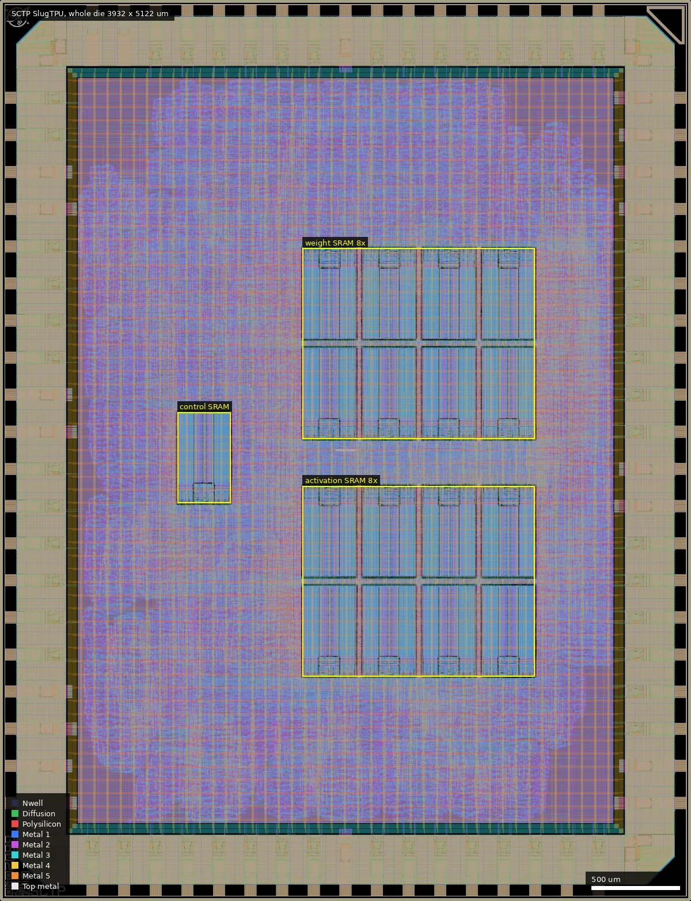
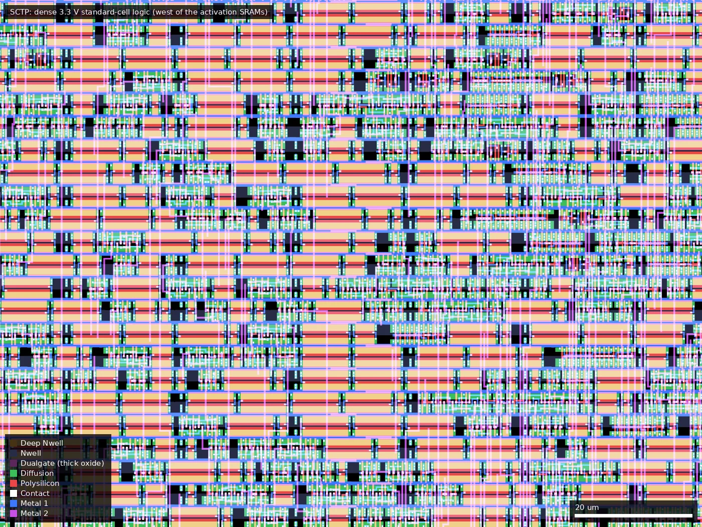
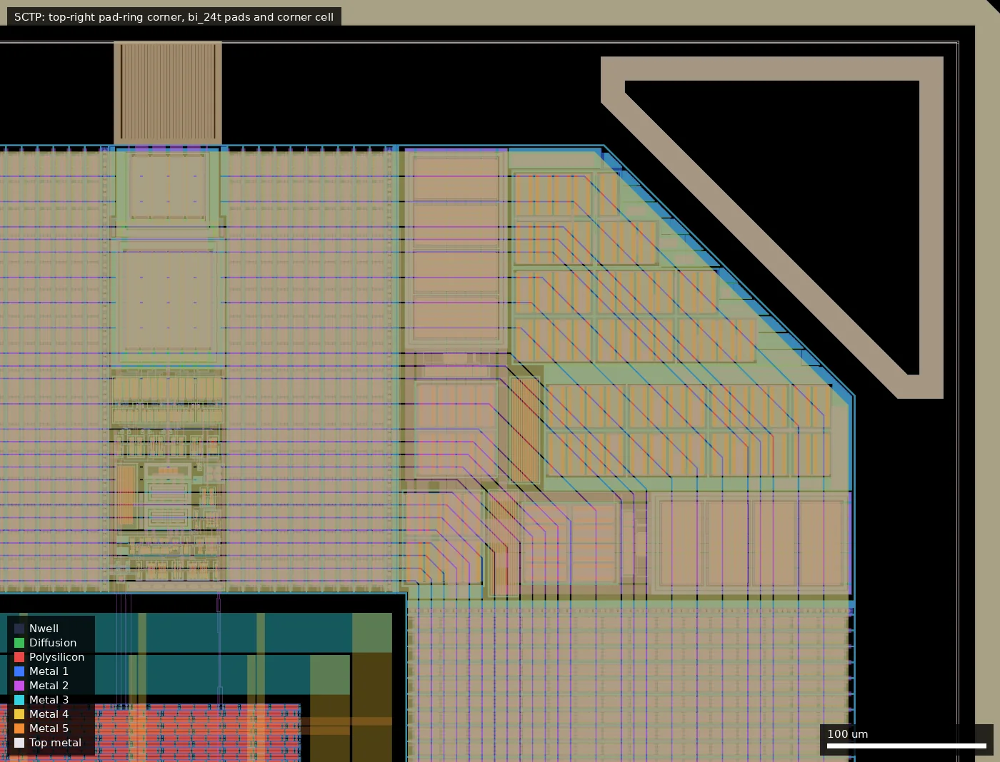

# SCTP: SlugTPU (ws-run2)

| | |
|---|---|
| Repository | https://github.com/SlugTPU/gf180mcu-slugtpu @ e906c15 (main, last commit 2026-07-13) |
| Slot | 1x1 |
| Top cell | chip_top |
| Licence in repo | Apache-2.0 |
| README | OK (1061 own words on top of the template) |
| Taped-out layout | SCTP_chip_top_0_2, 3932 x 5122 um, 1 placement on the G802 reticle |

## What the repo actually contains
Quantised-inference TPU: 8x8 INT8 systolic array (`src/sysray`, double-buffered weights, 32-bit accumulators), scalar post-processing pipeline (bias, ReLU, zero-point, fixed-point scale and saturate), CISC-style ISA (Dram2Sram, Sram2Dram, Matmul, ...), control unit, wishbone interconnect (`src/dram`), SDR SDRAM controller for a Micron MT48LC16M16A2 (32 MiB, off-chip), SPI-to-wishbone host bridge ("spibone"), debug mux, `TPU_ACTIVE` on bidir pad 38. Flow: LibreLane + slang, **3.3 V** (as_sc_mcu7t3v3, ocd_io), PDK commit 140b0494, CLOCK_PERIOD 17 ns at HEAD (an `mxu` sub-flow uses 25 MHz). **17 gf180mcu_ocd_ip_sram__sram1024x8m8wm1 macros** in `macros_3v3.yaml` (README still describes 256x8 macros and 2 KiB + 2 KiB). Many cocotb unit tests and assembled-program tests; the Micron SDRAM model is not in the repo for copyright reasons. A KiCad breakout board (`kicad/`) with a TSOP54 SDRAM and an ESP32-C3-MINI-1 footprint. No `final/` or signoff files; no releases.

The two submodules in `.gitmodules` (`ip/gf180mcu_ocd_ip_sram`, `ip/gf180mcu_as_sc_mcu7t3v3`) have no gitlink in HEAD. They were added 2026-03-14 and 2026-05-06 and removed from the tree 2026-06-08 ("remove old manual submodule import of 3v3 libraries"); the `.gitmodules` file was left behind. Branches 3v3-everything, integration, lint_fix, spi_rework still carry gitlinks (ocd_ip_sram @ 2c2a601, as_sc_mcu7t3v3 @ 9444996). At HEAD the libraries come from the PDK that `make clone-pdk` installs via ciel (`ciel enable 140b0494...`, `--include-libraries all`): `macros_3v3.yaml` uses `pdk_dir::libs.ref/gf180mcu_ocd_ip_sram/...` and the SCL config uses `libs.ref/gf180mcu_as_sc_mcu7t3v3`. The clone-status errors for those submodules are expected and harmless.

## Taped-out layout
| Item | Measured from the layout |
|---|---|
| Die | 3932 x 5122 um (20.1 mm2), 1 placement at (0.060, 5.242) mm on G802 |
| IO ring | 40 `gf180mcu_fd_io__bi_24t`, 13 `in_c` + 1 `in_s`, 2 `asig_5p0` (`analog_PAD[0..1]`, not traced into the core), 8 `dvdd`, 10 `dvss`, 4 corners; labels `clk_PAD`, `rst_n_PAD`, `input_PAD[n]`, `bidir_PAD[0..39]` |
| Standard cells | `gf180mcu_as_sc_mcu7t3v3` only: 124,628 logic cells plus 443,248 fill/tap cells. Largest groups: 19.7 k `xnor2`, 15.9 k `dlybuff` (hold buffers), 12.6 k `and2`, 10.2 k `dfxtp` flops, 9.3 k `maj3`, 6.6 k `xor2`; 856 antenna `diode` cells |
| SRAM | 17 x `gf180mcu_ocd_ip_sram__sram1024x8m8wm1` (301 x 516 um), 17 KiB, about 2.6 mm2 (13 % of the die) |
| Voltage | 3.3 V logic and SRAM. Dualgate (55/0) only inside the IO-library cells; none in standard cells or SRAMs. No V5_XTOR |
| Passives, special devices | No MIM, DNWELL or high-res poly; only IO-cell ESD devices, library antenna diodes and MOS-cap fill |
| Custom/analog content | none |

### Does it match the repository?
The repository has no GDS and there are no releases, so the comparison is with `librelane/macros/macros_3v3.yaml` at e906c15. The reticle layout has exactly 17 SRAM1024x8 instances at the 17 lower-left positions and orientations listed there: one control SRAM at (1010,2262), 8 weight SRAMs (4 at y=2628 N, 4 at y=3194 S, x=1723/2063/2403/2743) and 8 activation SRAMs (y=1277 N and y=1843 S, same x). That agrees with the config (17 macros, 3.3 V, as_sc_mcu7t3v3, ocd_io pad ring) and corrects the README, which still talks about 256x8 SRAMs; none are on the die. Whether the standard-cell netlist is that of e906c15 cannot be checked without a netlist or GDS; the logic count (124.6 k cells) is consistent with an 8x8 INT8 array plus scalar pipeline, SDRAM controller and SPI bridge but is not a proof.

The systolic array is not separately visible: the flow produced a flat placement with no hierarchy or net names in the reticle file. Arithmetic cells (xnor2/xor2/maj3/and2, about 35 k of them) are spread over the whole logic area, concentrated west of the weight/activation SRAM block and around it, so the 8x8 MAC grid cannot be located as a block. The 10.3 k flops include the weight double-buffers and 32-bit accumulators of the 64 PEs (about 64 x ~80 is 5 k) plus control and SPI/SDRAM state; this split is an estimate, not measured.

*Whole die (0,0 to 3932,5122 um). The 16 weight and activation SRAMs form a 4 x 4 block at (1723..3044, 1277..3710) um; the control instruction SRAM is at (1010..1311, 2262..2778); standard cells fill the rest of the core.*

*Detail at (1000,1000) to (1120,1090) um, west of the activation SRAMs: 3.3 V standard cells in rows, many `xnor2`/`maj3`/`dlybuff` cells; no thick oxide.*

*Pad-ring corner at (3300,4640) to (3932,5122) um: `bi_24t` pad cell, `cor` corner cell and the wafer.space marker; the thick-oxide IO devices live in these cells.*

## Authors and affiliations
| Person | Role | Affiliation | Source |
|---|---|---|---|
| yanghuaxuan (Huaxuan Yang) | most commits (about 300) | not stated | git |
| Shreyas Gupta, Adi-0 (Aditya Kumar), Angelina Nguyen | design | Angelina Nguyen has ucsc.edu email (hint) | git |
| course | **UC Santa Cruz CSE 127A/B Capstone Course (2026)** | | README |
| Leo Moser | template | wafer.space | AUTHORS.md |

## Value for GF180MCU characterisation and PDK development
### Verdict: Low
Synthesised digital with 17 SRAM macros and 124.6 k logic cells, all 3.3 V; functional/yield and timing data point only. The layout shows no test structures, MIM, DNWELL or custom cells.
### Test structures and measurable circuits
Nothing dedicated; debug mux (`src/debug_mux.sv`) and `TPU_ACTIVE`. No sim results in repo.
### Candidate PDK additions
Nothing found; no PDK problems documented.
### What would be needed to use it
Packaged test with the custom PCB and an SDRAM, SPI host, assembled test programs (`cocotb/general_test`).
## Notes and caveats
Stale `.gitmodules`; README out of date on SRAM size (layout confirms 17 x 1024x8); no hardening results, GDS or netlist in the tree, so the standard-cell netlist could not be compared; the systolic array cannot be located in the flat layout.
