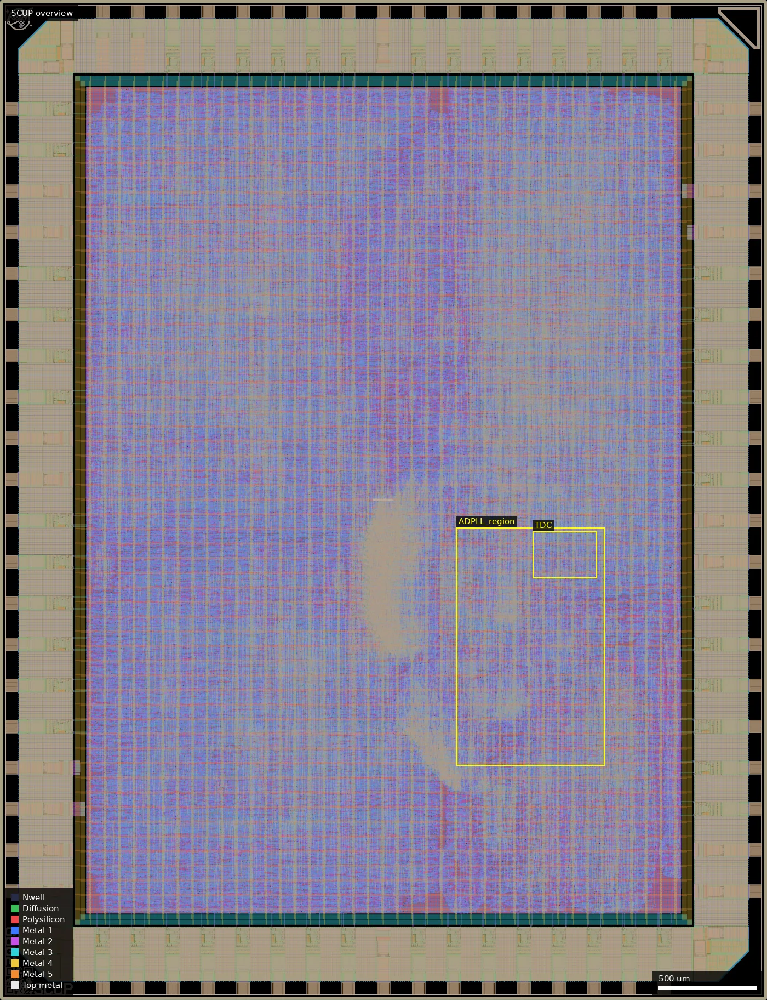
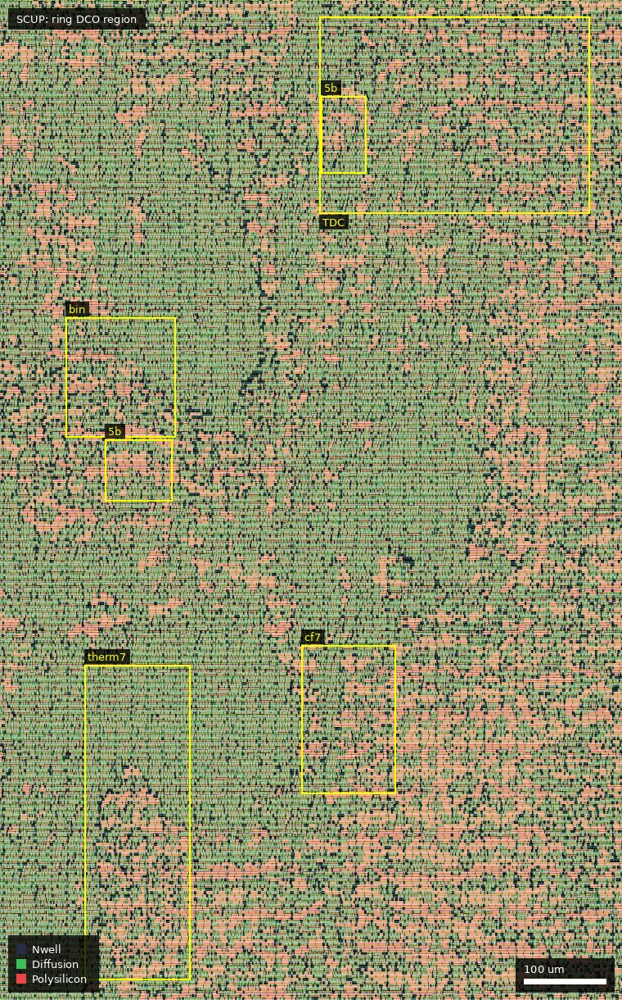

# SCUP: GF180MCU Peripherals (ws-run2)

| | |
|---|---|
| Repository | https://github.com/sifferman/gf180mcu-peripherals @ bee7cb6 on `main` (last commit 2026-06-20); the real design is on `dev` / `peripherals-mvp` @ 74c6a42 (2026-07-14) |
| Slot | 1x1 |
| Top cell | chip_top |
| Licence in repo | GPL-3.0 (LICENSE; "inherit GPLv3 from WangXuan95/FPGA-SDcard-Reader" commit) |
| README | TEMPLATE on main (777 words, identical to the template); a real README exists on dev |
| Taped-out layout | SCUP_chip_top_4_2, 3932 x 5122 um, 1 placement on the G802 reticle (at 8.044, 5.242 mm) |

## What the repo actually contains
**The cloned `main` is the bare wafer.space template** (two commits, only `chip_core.sv` with a counter and `sram512x8` instances, no peripherals or PLLs). The real project is on `origin/dev` and `origin/peripherals-mvp` (both 74c6a42). I read these with `git show origin/dev:...`; all statements below come from dev.

Chip: SCUP, "Santa Cruz Usable Peripherals", a 3.3 V test chip and reusable IP library, 1x1, 74-pad ring (about 7 input pads retyped to bidir: NUM_INPUT 12 to 5, NUM_BIDIR 40 to 47), 50 MHz clock (RMII needs it). A host PC reads/writes memory over UDP through a hardware UDP-to-AXI-lite bridge (`ethernet-host/dma.py`), no soft CPU.
- RMII Ethernet MAC + UDP stack (LAN8720A PHY, REF_CLK-in mode): Alex Forencich verilog-ethernet (fork sifferman/alexforencich_ethernet, branch waferspace-2026.06.30) with `src/eth/*` glue.
- SDRAM controller: ultraembedded core_sdram_axi4 (`sdram_wrap.sv`) for a Winbond W9825G6KH x16.
- SD card: WangXuan95 FPGA-SDcard-Reader, modified (`src/sdcard/`, split CMD IO), file-to-LED, time-shared on the pads by a mode strap; this is why the design is GPLv3.
- AXI4-lite interconnect, scratch RAM, CSR bus.
- ADPLL array (`src/adpll/adpll_array.sv`, `adpll_config.sv`, `adpll_array_csr.sv`) from the submodule sifferman/adpll @ 5c78a74 (ssh URL in `.gitmodules`, **not initialised in the clone**; available as `/backups/github/github.com/sifferman/adpll.git`).
- Flow: LibreLane + slang (`--max-constexpr-steps 1000000000`), 3.3 V (gf180mcu_as_sc_mcu7t3v3, ocd_io), no SRAM macros in the final design, topological Netgen LVS, custom orthogonal KLayout metal filler (`librelane/klayout_fill/`). SDC with per-interface datasheet I/O delays and generated clocks for the forwarded RMII ref_clk and SDRAM clock.
- Results documented in STATUS.md/questions.md: DRC (Magic + KLayout), LVS ("match uniquely", 274,538 devices), antenna clean; setup clean at all corners; RTL sim and VCS gate-level sim pass for Ethernet, SDRAM and PLL CSR. Hold on SDRAM output I/O and RMII RX margins were discussed and closed by SDC modelling. `signoff/` holds one metrics file and the "waferspace-resubmit" note (precheck PASSED 2026-07-14, sha256 d60b956c...; GDS not in git).

### The PLLs
- **Type: all-digital, standard-cell, ring-oscillator DCO ADPLLs** (not analog). The control loop is plain RTL.
- **DCO:** NAND2 enable gate + chains built from `gf180mcu_as_sc_mcu7t3v3` inv_2, nand2_2, mux2_2 (and dlybuff_2 in the TDC), `keep`/`dont_touch`, behind a `Target` parameter in `rtl/tech_cells/`. Four ring styles: binary-weighted delay select, thermometer, muxtap (ring length via a mux tree), coarse/fine. 5- or 7-bit tune.
- **Loops:** frequency-locked (edge counter, F_DCO = mul/div x 50 MHz) with bang-bang, proportional-integral or gear-shift filters; and phase-locked (flash TDC `adpll_tdc_flash` made of dlybuff_2 delay line + phase detector, with proportional-integral filter).
- **Array in the submitted design:** NumPll = 10 curated configurations (index: filter x DCO x tune bits: 0 bb x binary x7, 1 pi x thermometer x7, 2 gear x muxtap x5, 3 bb x muxtap x5, 4 pi x muxtap x5, 5 bb x thermometer x5, 6 gear x coarsefine x7, 7 phase pi x thermometer x7, 8 phase pi x muxtap x5, 9 phase pi x binary x7). Earlier plans for 48/36/24/16/12 PLLs failed placement or routing (congestion); the DCOs are routing-heavy.
- **Sources:** the sifferman/adpll repo (BSD-3, E. Sifferman, "grounded" in Staszewski and Balsara 2006, Razavi, Kratyuk 2007, Hanumolu 2007, Da Dalt 2005). Nothing taken from other designs.
- **How outputs are observed:** control and readout via the Ethernet CSR (0x2000_0000): enable, mul, div, per-PLL lock flag and tune code. A CSR-selected observation mux for the DCO clock + lock exists in RTL but **is not routed to a pad** (chip_core comment: asig_5p0 pads cannot carry routed digital signals, LVS issue); so there is no direct frequency measurement. Frequency at lock follows from mul/div x 50 MHz and the tune code gives the code-vs-frequency point.
- **What was simulated:** behavioural RTL sims on stock Icarus with a behavioural DCO; ngspice + Icarus gate-level mixed-signal cosim (extracted ring from the hardened `ring_dco` macro via Magic, ngspice >= 42), 16 configs x process corners in the adpll repo's CI; `docs/figures/dco_freq_vs_code.png`, `dco_pvt_envelope.png`, `corner_{ff,ss,typical}.dat`, `dco_curves/tt_{binary,muxtap,thermometer}.dat`. Example typical-corner data: binary code 0 338 MHz, 8 239, 16 184, 24 150, then 32 385 (non-monotonic), 127 222 MHz. Long-ring multi-wavefront behaviour is noted (STATUS.md). In gate-level sim the ADPLLs are kept disabled (enabling the structural ring exploded the event queue); lock in the full chip is verified only by the cosim, and the chip-level ngspice cosim is of single ADPLLs, not the full chip.

## Taped-out layout
| Item | Measured |
|---|---|
| Die | 3932 x 5122 um, flat netlist (no sub-blocks below the top cell except pads and std cells) |
| Pads | 74: 47 `gf180mcu_ocd_io__bi_24t`, 6 `in_c` + 1 `in_s` (clk_PAD, rst_n_PAD, input_PAD[0..4]), 2 `asig_5p0` (analog_PAD[0] at (706, 5064), analog_PAD[1] at (526, 5064)), 6 `dvdd` + 2 `vdd` + 8 `dvss` + 2 `vss` |
| Standard cells | `gf180mcu_as_sc_mcu7t3v3` only: 239,123 logic cells (plus 684,932 fill/tap); largest groups buff_2 54,291, dlybuff_2 34,397, mux2_2 32,531, dfxtp_2 31,637, clkbuff_12 9,667, inv_2 4,325 |
| SRAM macros | none (the scratch RAM is flop based: about 31 k dfxtp_2 with mux2_2 read trees spread uniformly over the die) |
| Oxide / devices in the core | none of Dualgate, V5_XTOR, SAB, RES_MK, MIM or Pad appears inside the core (420..3510 x 420..4700 um): the core is 3.3 V thin-oxide logic only. Dualgate/V5_XTOR exist only in the 5 V-capable `ocd_io` pad cells. About 12 k `diode_2` antenna diodes sit in the ADPLL region alone (DIODE_MK 401 k shapes die wide). |
| Custom cells | none; no hand-drawn analog. Only the wafer.space marker/logo/QR/ID cells and the ocd_io ring |
| ADPLLs | at least 7 ring DCOs recovered by connectivity extraction, all in x 2340..2830, y 1200..2300 um (table below) |

### Does it match the repository?
Partly, and only against the `dev` branch. The commit in designs.csv (bee7cb6, `main`) is the bare template (counter and `sram512x8` instances), so the die cannot be that: it has no SRAM macros, 239 k logic cells and ADPLL rings. Against `origin/dev` (74c6a42) the pad count and types agree (NUM_INPUT 5 + clk + rst = 7 input pads, 47 bidir, 2 analog, 18 power pads), the library (mcu7t3v3, ocd_io) agrees, there are no SRAM macros as dev says, and the extracted DCO rings have the structure of `ring_dco_*` (below). No GDS is in git (the 360 MB `chip_top.gds` is git-ignored; dev's `signoff/waferspace-resubmit/README.md` records only its sha256 d60b956c... and says it is the pre-fill stage of RUN_2026-07-08_13-52-47 refilled with the custom filler), so cell lists could not be compared with a repository GDS. Extracted-layout statements below are connectivity-based (Metal1-Metal4 and vias, pin labels as pin positions); devices were not extracted.

*Overview, whole die: the ADPLL field is the lighter blob at about (2340-3100, 1200-2420) um in the lower middle; the rest is std-cell logic and flop RAM under the power grid.*

### ADPLL rings found in the layout
Each ring is a strongly connected component of the extracted cell graph containing one `nand2_2` (enable gate), `inv_2` chains and `mux2_2` cells, matching the RTL (`ring_dco_*`, `keep_hierarchy`).

| Ring (extracted) | Cells | Box (um) | Reading |
|---|---|---|---|
| A | 254 inv_2, 127 mux2_2, 1 nand2_2 | (2443,1225)-(2572,1609) | thermometer 7-bit (2^7-1 = 127 units, 2 inverters each) |
| B | 254 inv_2, 22 mux2_2, 1 nand2_2 | (2708,1452)-(2823,1633) | coarse/fine 7-bit (15 coarse units of 8 pairs + 7 fine units = 254 inv, 22 mux) |
| C | 126 inv_2, 7 mux2_2, 1 nand2_2, 1 buff_2 | (2420,1887)-(2554,2033) | binary-weighted style (7 muxes); the loop closes with 126, not 254, inverters, so I cannot say which segment is missing |
| D, E, F, G | 62 inv_2, 31 mux2_2, 1 nand2_2 (D also 1 buff_2) | D (2468,1809)-(2550,1884); E (2349,2064)-(2415,2131); F (2368,2138)-(2426,2221); G (2732,2209)-(2787,2303) | 5-bit: muxtap (62 inv + 31-mux tree) and 5-bit thermometer (62 inv + 31 mux) have identical cell counts, so the style of each cannot be told from counts |

The RTL list has ten (two binary-7, two thermometer-7, one coarse/fine-7, four muxtap-5, one thermometer-5); I found seven within the region searched (x 1700-3350, y 1100-2800), so three were not isolated (other thermometer-7 and binary-7, one 5-bit, or rings spanning my search boxes). The ring cells are ordinary placed library cells in the same rows as unrelated logic (placement density map and region render), not a dedicated, symmetric or shielded block. The DCO cluster has no varactors, cap banks or tristate cells: tuning is purely by `mux2_2` bypass or tap selection, as in RTL.

*Ring DCO region (2340-3100, 1200-2420 um): boxes mark rings A (therm7), B (cf7), C (binary style), two of the 5-bit rings and the dlybuff_2 delay-line area (TDC) at (2730,2160)-(3060,2400); rendered at 760 px so it stays under 600 kB.*

The `dlybuff_2` delay line of the flash TDCs is visible as a concentration of about 196 `dlybuff_2` in (2730,2160)-(3060,2400); the TDC lines were not traced individually.

Pad exposure: the ring clock outputs are not on a pad. `chip_core.sv` carries an `obs_dco_clk`/`obs_lock` mux that is only put into an unused-signal sink list and the author's comment says the asig_5p0 pads cannot take a routed digital signal; the two `asig_5p0` pad cells are present at the top edge, but I did not trace what their nets reach. Only the CSR at 0x2000_0000 over Ethernet gives lock/tune readout.

## Authors and affiliations
| Person | Role | Affiliation | Source |
|---|---|---|---|
| Ethan Sifferman | sole committer, all design | UC Santa Cruz (GitHub: "Lecturer turned PhD student at UC Santa Cruz", company UC Santa Cruz) | `gh api users/sifferman` |
| Leo Moser | template author | not stated here | AUTHORS.md |
| Third-party: Alex Forencich, ultraembedded, WangXuan95 | vendored IP | | submodule URLs |
Course/lab: none stated in this repo.

## Value for GF180MCU characterisation and PDK development
### Verdict: High
It carries 10 distinct standard-cell ring DCOs and phase-locked/frequency-locked loops with SPICE-vs-RTL models, readable over Ethernet, plus a full set of timing and signoff data. The weakness is that the DCO clock is not on a pad. Valid only for the dev-branch design.
### Test structures and measurable circuits
| Structure | What it exercises | Access | Where (dev branch / adpll repo) |
|---|---|---|---|
| 10 ring DCOs (inv_2, nand2_2, mux2_2 chains, 4 styles, 5/7-bit tune), 3.3 V | std-cell delay vs code, PVT; model check against the extracted-SPICE curves | Ethernet CSR at 0x2000_0000 (enable, mul, div, lock, tune); no pad for DCO clock | `src/adpll/*`, `third_party/adpll/rtl/dco/*` |
| 3 flash TDCs (dlybuff_2 delay lines) | dlybuff_2 delay and linearity (via phase-lock tune/phase codes) | CSR | `third_party/adpll/rtl/tdc/adpll_tdc_flash.sv` |
| Pad-timing: RMII/SDRAM/SD I/O at 50 MHz on ocd_io pads | pad (`bi_24t`, `in_c/in_s`) delay, drive, slew | pads | `librelane/chip_top.sdc` |
Simulation results to compare silicon to: SPICE curves in `docs/figures/*.dat`, `dco_curves/*.dat` and cosim logs (adpll repo); STA at 9 corners; GL sim.
### Candidate PDK additions
- Ring DCO and TDC cell wrappers as a retarget seam (`tech_cells`).
- The M2.4 density rule (Metal2 coverage > 30 %): stock filler reached only 29.54 %, which forced a custom KLayout filler (`librelane/klayout_fill/fill_{all,comp,metal,poly2}.rb`, 2.5 um M2 squares at 1.0 um spacing, orthogonal lattice). Candidate for the template/precheck.
- Template power-pad fix (fd_io 3-pin) prepared on a branch `fix-fd-io-power-pad-pins` of the author's template fork (not upstreamed per STATUS.md).
- yosys-slang `--max-constexpr-steps` accumulation bug; netgen topological LVS setup for LVS-ignore cells.
- asig_5p0 analog pads cannot take routed digital signals without an LVS failure (documented in chip_core comments).
### What would be needed to use it
A packaged PCB with the LAN8720A PHY (REF_CLK-in), a 50 MHz oscillator, the SDRAM (W9825G6KH), and a host sending UDP via `ethernet-host/dma.py`; the custom PCB must drive the retyped bidir pads as I/O (`docs/hardware-notes.md`). To measure DCO frequency directly one would need DCO clock access, which the design lacks (per RTL; not traced in the layout; use lock-frequency and tune code over CSR, or probe die internals).
## Notes and caveats
- **The platform repo link lands on a template-only `main`.** Make sure the dev branch is used. The precheck-passing GDS hash (d60b956c...) is recorded on dev, not on main.
- dev README table says "10x mux-chain ring DCO"; the tree supports 4 DCO styles x 3 filters.
- RMII RX at 50 MHz was reported marginal in STA at SS (-1.0 ns TT, -5.9 ns SS in an earlier run; later SDC modelling was said to close it); the final timing numbers on the submitted layout are not in the repo (one metrics.csv from RUN_2026-06-21).
- The taped-out layout agrees with the dev branch description (pads, library, no SRAM, ring DCO structure) but there is no repository GDS to diff; the final timing numbers of the submitted layout are not available. Seven of the ten rings were isolated in the layout; the other three and the pad connections of `analog_PAD[0..1]` were not traced.
- Ring DCOs sit in ordinary std-cell rows beside unrelated logic with no isolation, so their frequency will carry local supply and routing effects that the extracted-ring SPICE did not model.
- Course/institution for the SC** group: SCTP states the CSE 127A/B Capstone at UCSC; SCML cites UCSC ECE 153/250 lectures; SCUP's author is at UCSC (GitHub profile); SCMT has only a GitHub bio. So UC Santa Cruz is supported for SCTP, SCML, SCUP, and by hint (bio, emails) for SCMT.
