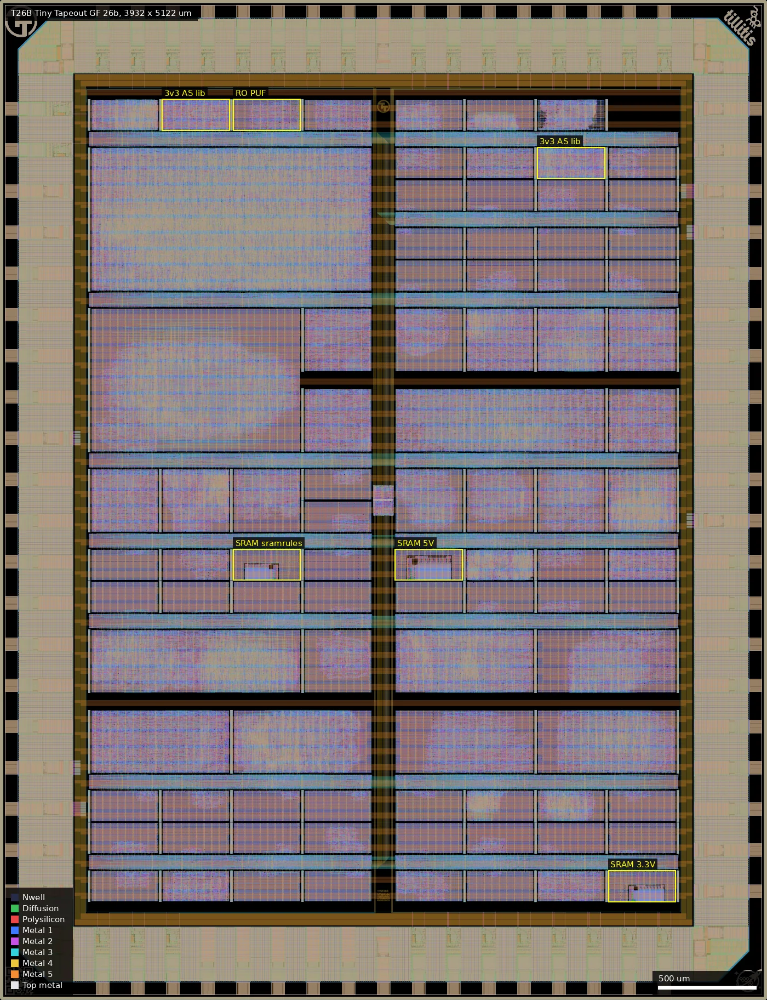
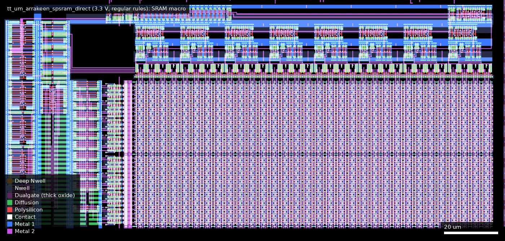
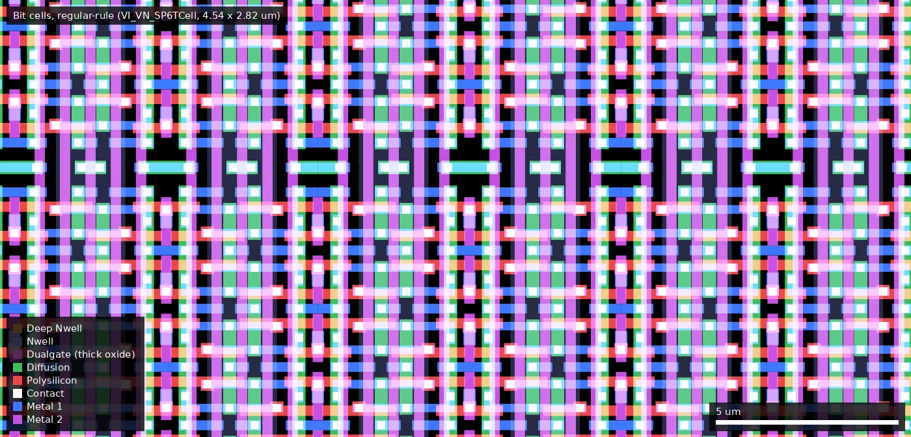
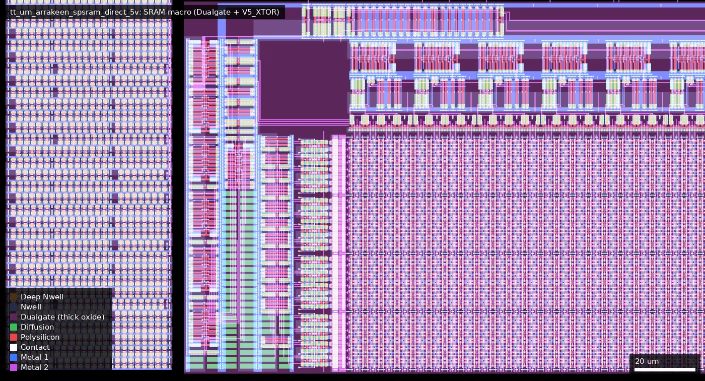

# T26B: Tiny Tapeout GF 26b (ws-run2)

| | |
|---|---|
| Repository | https://github.com/TinyTapeout/tinytapeout-gf-26b @ 8c92b24 (main, last commit authored 2026-07-15, committed 2026-09-16; tag `tapeout-ws2607` = b7b04a0, 2026-06-22) |
| Slot | 1x1 (die 3932 x 5122 um per `tt-multiplexer/cfg/gf180mcuD.yaml`) |
| Top cell | tt_gf_wrapper |
| Licence in repo | Apache-2.0 (`LICENSE`; each `projects/*/LICENSE` is the submitter's own) |
| README | Thin (74 words, points at tinytapeout.com and the multiplexer docs) |
| Taped-out layout | T26B_tt_gf_wrapper_2_4, 3932 x 5122 um, 1 placement on the G802 reticle |

## What the repo actually contains

The second Tiny Tapeout shuttle on wafer.space run 2: 90 user macros (88 user
designs plus `tt_um_chip_rom` and `tt_um_factory_test`) occupying 159 of the
160 tile slots of an 8 x 20 grid behind the Tiny Tapeout multiplexer. Like
T26A it is an assembly repo: user RTL and schematics are not here.

- `projects/<macro>/`: hardened deliverables per design: `<macro>.oas`,
  `<macro>.lef`, `<macro>.v` (gate-level netlist, or a blackbox stub for the
  custom-GDS SRAMs), `info.yaml`, `docs/info.md`, `commit_id.json` (source repo,
  commit, Actions run), `pdk.json`, and for LibreLane builds
  `stats/metrics.csv` and `stats/synthesis-stats.txt`.
- `projects/danger_level.yaml`: the only content that differs from the taped
  out commit. Added after tapeout (commit 8c92b24, Sylvain Munaut, "Update
  danger level for 3v3 SCL projects"), it marks the two Detronyx tiles as
  `level: high`, reason "Uses a broken version of the 3v3 SCL that has a short
  in buf_8".
- `tt-multiplexer/` @ b6bed69, `tt/` @ d4626aa, `gf180mcu/` @ cae6f09,
  `librelane/` @ e2f0b0e: the same submodule commits as T26A.
- `verilog/dv/mux/`, `verilog/rtl/tt_um_factory_test.v`, `docs/` renders:
  same as T26A.

Release `tapeout-ws2607` ("Wafer Space 2607 (G802) Tapeout"):
`tt_gf_wrapper.oas`, `foundry_submission.zip` (GDS, OAS, gate-level netlists,
`shuttle_index.json`, README index, generated from b7b04a0), `macros.zip`,
`GDS.zip`, `gl_test_vcd.zip`, and the wafer.space precheck log, outputs and
`runs.tar`.

### Shuttle infrastructure

Identical to T26A (same `tt-multiplexer`, PDK and tool commits; `diff -r` of
the two `tt-multiplexer` trees and of the as-built `cfg/gf180mcuD.yaml` shows
no difference):

| Item | What is used |
|---|---|
| Standard cells | `gf180mcu_fd_sc_mcu7t5v0` at a 3.3 V core (`VDD_PIN_VOLTAGE: 3.3`; corners tt_025C_3v30, ss_125C_3v00, ff_n40C_3v60) |
| IO cells | `gf180mcu_ocd_io`: 16x `bi_24t`, 10x `in_c`, 3x `in_s`, 29x `asig_5p0`, 4x `dvdd`, 6x `dvss`, 2x `vdd`, 4x `vss`, 4x `cor` (counted in `tt_gf_wrapper.nl.v`) |
| Pads | 74: 3 mux control, `clk`, `rst_n`, `ui[7:0]`, `uo[7:0]`, `uio[7:0]`, 22 analog, 5 reserved, supplies (`ol2/tt_top/tt_gf_wrapper.v`) |
| Mux | `tt_ctrl` x1 + `tt_mux` x15; address = `mux_id*32 + blk_id` |
| Power gating | One `tt_pg_3v3_hp_{1,2,4}` header switch per user macro (65/23/2 instances); no analog-supply gate. The placed switch macros have no Dualgate or V5_XTOR shapes: 3.3 V thin-oxide devices (measured) |
| Analog pin routing | None: `analog: []`; the 22 `asig_5p0` pads are bonded but not connected into the core; the four custom tiles all declare `analog_pins: 0` |
| ID/logo | `gf180mcu_ws_ip__id`, `gf180mcu_ws_ip__logo`, `tt_logo_*` |

86 of 90 macros were hardened with LibreLane (79x 3.0.3, 6x 3.0.0, one 2.4.2)
against open_pdks 5443591 (one against 0fe599b); three are `custom_gds`
submissions; chip_rom is built at assembly time.

### User projects (all 90, by mux address)

"Cell instances" counts every `gf180mcu_*` instance in the gate-level netlist,
including fill, tap and endcap cells.

| Addr | Macro (tiles) | Title | Author (as declared) | Function | Source repo | Std cells | Note |
|---|---|---|---|---|---|---|---|
| 0 | `tt_um_chip_rom` (1x1) | Chip ROM | Uri Shaked | ROM with information about the chip | TinyTapeout/tt-chip-rom | - | infrastructure; no layout in repo |
| 1 | `tt_um_factory_test` (1x1) | Tiny Tapeout Factory Test | Tiny Tapeout | Factory test module | TinyTapeout/ttgf26a-factory-test | 1356 | infrastructure IO loopback/counter |
| 3 | `tt_um_arrakeen_spsram_direct_sramrules` (1x1) | TT-Arrakeen-SPSRAM-direct-sramrules | Staf Verhaegen | Single port SRAM with pins connected directly to TT tile pins. | FibraServiTT/TTGF26b_Arrakeen_SPSRAM_direct_sramrules | - | **CUSTOM SRAM** 128x8, 3.3 V, SRAM-rule bit cell |
| 5 | `tt_um_fhw_appel_spiPWMio` (1x1) | spiPWMio | Sönke Appel | A PWM input and PWM generator are configurable via input pins, readable via output pins, and accessible via SPI for read and write operations. | FHW-Appel/TTgf26a-spiPWMio | 2583 |  |
| 7 | `tt_um_ecc_scalar_mult` (1x1) | ECC Scalar Multiplication | Dhanush Kulkarni | Compact 8-bit ECC Scalar Multiplication Engine demonstrating scalar-point arithmetic for Tiny Tapeout. | CambridgeinstitutetechnologyBLR-Dhanush/ECC_Scalar_Multiplication | 1339 |  |
| 32 | `tt_um_alu` (1x1) | 8-bit Interactive ALU | Matanel Kadosh | An 8-bit Arithmetic Logic Unit with internal registers and multiplexed output for result/carry. | matanelk96/ASIC-ALU-MK | 1749 |  |
| 33 | `tt_um_60hz_load` (1x2) | 60 Hz Grid-Forming ASIC with Dump-Load Control | Eric Pearson | a CORDIC-locked grid-forming reference + linear dump-load controller ASIC for driving micro-inverters | ericpearson1313/tt_grid_tie_load | 6787 |  |
| 34 | `tt_um_santhosh_spike_codec_gf` (1x2) | Neuromorphic Spike Codec (GF180) | Prof. Santhosh Sivasubramani, IIT Delhi | GF180mcuD digital neuromorphic spike codec: three encoders (rate via 8-bit Fibonacci LFSR, latency/time-to-first-spike, delta with programmable thr... | SanthoshSivasubramani/tt_um_santhosh_spike_codec_gf_pub | 5801 |  |
| 36 | `tt_um_layla_spike_detector` (1x2) | Neural Spike Detector | Layla Adeli | Adaptive neural spike detector with IIR bandpass filter (300-3000 Hz), Nonlinear Energy Operator (NEO), and EWMA adaptive threshold. Digital backen... | laylaadeli7/tt_neural_spike_detection | 6294 |  |
| 38 | `tt_um_emiliopeju_lightscan` (1x2) | Lightscan | Emilio Perez Juarez | BISS-C Position acquisition system for a scan with pulsed output. | EmilioPeJu/ttgf-lightscan | 6735 |  |
| 39 | `tt_um_egurapha_chacha20` (3x4) | ChaCha20 | Raphael Eguchi | RFC 8439 ChaCha20 stream-cipher core with a UART or parallel host interface | egurapha/ttgf-chacha20 | 37442 |  |
| 65 | `tt_um_arrakeen_spsram_direct_5v` (1x1) | TT-Arrakeen-SPSRAM-direct-5V | Staf Verhaegen | Single port SRAM with pins connected directly to TT tile pins. | FibraServiTT/TTGF26b_Arrakeen_SPSRAM_direct_5V | - | **CUSTOM SRAM** 128x8, 5 V devices |
| 67 | `tt_um_LukeSilva_cartrip` (1x1) | Car Trip | Luke Silva | Let's go on a car trip (vga demo) | LukeSilva/tt-gf-car-trip | 3307 | contains art macro `tt_gf_cartrip_lg_nameplate` |
| 69 | `tt_um_Alanduan21_triad01_top` (1x1) | triad01 | Duan Yihe | A clocked failsafe arbitration block for autonomous drone control paths. Evaluates RC and FC health signals through temporal filtering and ternary ... | Alanduan21/ttgf-triad01 | 1920 |  |
| 71 | `tt_um_lif_snn` (1x1) | 4-Neuron LIF Spiking Neural Network | Ilim Stankulov | A simple 4-neuron spiking neural network implementing the LIF model | ilim-stankulov/lif-spiking-neural-network | 2977 |  |
| 96 | `tt_um_santhosh_aer_router_gf` (1x2) | Asynchronous-AER Spike Router (4-phase REQ/ACK, 16-entry routing table, GF180) | Prof. Santhosh Sivasubramani, IIT Delhi | GF180mcuD synchronous implementation of a 4-input / 4-output AER (address-event-representation) spike router. Time-multiplexed AER input and output... | SanthoshSivasubramani/tt_um_santhosh_aer_router_gf_pub | 5201 |  |
| 98 | `tt_um_santhosh_cim_bist_gf` (1x2) | CIM Controller with BIST and Fault Map (GF180) | Prof. Santhosh Sivasubramani, IIT Delhi | GF180mcuD digital compute-in-memory peripheral: 8x8 1-bit cell array with built-in self-test (march/checkerboard/diagonal patterns), 64-bit sticky ... | santhoshs93/tt_um_santhosh_cim_bist_gf_pub | 5433 |  |
| 100 | `tt_um_santhosh_neuro_puf_gf` (1x2) | Neuromorphic PUF (distinct-tap LFSR arbiter + memristor XOR, GF180) | Prof. Santhosh Sivasubramani, IIT Delhi | GF180mcuD digital Physical Unclonable Function: 8 distinct-tap maximal-length 10-bit LFSRs act as synthesizable virtual ring-oscillators, a 6-bit c... | santhoshs93/tt_um_santhosh_neuro_puf_gf_pub | 5984 | "virtual ring oscillators" are LFSRs; no real RO |
| 101 | `tt_um_reflex_s4` (3x2) | AER Reflex Chip - MCP2515 CAN gateway | khu-haeun | Robot-arm reflex core: relays joint commands to CAN via an MCP2515, blocks the stream on a danger trigger and injects a reflex pose. Tuning values ... | khu-haeun/aer_reflex | 20645 |  |
| 102 | `tt_um_waferspace_vga_screensaver` (1x2) | Wafer.space Logo VGA Screensaver | Uri Shaked | Wafer.space Logo bouncing around the screen (640x480, TinyVGA Pmod) | TinyTapeout/tt-waferspace-vga-screensaver | 6529 |  |
| 103 | `tt_um_d5smith_mfa` (1x2) | Music for ASICs | d5smith | Autonomous generative ambient music chip using LFSR composition, scale quantization, and DDS synthesis | d5smith/tt_um_d5smith_mfa | 6746 |  |
| 128 | `tt_um_uart_soc` (1x1) | UART_SOC | Siri Jagadeesh | Verifies firmware signature using a secure hash comparison module | sirijagadeesh4-hub/SIRI_UART_SOC | 1354 |  |
| 129 | `tt_um_cwru_cpu` (1x2) | CWRU CHIPS Simple Counter with 7-segment Display | Andrew Chen, John Paul Magbitang | Simple counter demo on a RISC-V CPU with 7-segment display output | john-paul-sm/ASICWRU_SimpleCounter | 4866 |  |
| 130 | `tt_um_raksha` (1x1) | Raksha | Sinchana | Secure Packet Authentication Engine for V2X Communication | shanthkumars165-commits/secure_packet_authentication | 1288 |  |
| 132 | `tt_um_wnn` (1x1) | 8-bit WNN Pattern Recognizer | Your Name | 8-bit Weightless Neural Network for pattern recognition using pattern matching. | cambridgeinstitutetechnology-blr-venkat/cit_project-2 | 1291 |  |
| 134 | `tt_um_likitha_trng` (1x1) | Secure TRNG Entropy Generator | Likitha | Hardware entropy mixing circuit generating randomized outputs using XOR feedback paths | Cambridgeinstituteoftechnology-likitha/likii | 1282 | combinational XOR mixer, no entropy source |
| 135 | `tt_um_2048_vga_game` (3x2) | 2048 sliding tile puzzle game (VGA) | Uri Shaked | Slide numbered tiles on a grid to combine them to create a tile with the number 2048. | urish/tt-2048-game | 18375 |  |
| 192 | `tt_um_ecdsa_verify` (1x1) | ECDSA Verification | Lyra | Simplified ECDSA digital signature verification module using Verilog | santoshism2006-pixel/vtox | 1285 |  |
| 194 | `tt_um_ecc_processor` (1x1) | ECC Processor | Dhanush Kulkarni | Compact 8-bit ECC Processor demonstrating scalar-point arithmetic for TinyTapeout. | CambridgeinstitutetechnologyBLR-Dhanush/_ECC_Processor | 1564 |  |
| 195 | `tt_um_jct_lea` (2x2) | LEA-128 | awayzer JCT | iterative approach implementation of the LEA128 block cipher | awayzer/ttgf-jct-LEA128 | 13614 |  |
| 196 | `tt_um_fast_auth` (1x1) | Fast Authentication Accelerator | Nagaraj | A hardware IP block that performs low-latency ECDSA verification for V2X communication. Authenticates digital signatures in under 1 ms, meeting IEE... | CambridgeinstitutetechnolgyBLR-Harshini/v2x_accelator | 1659 |  |
| 198 | `tt_um_karthik_trng` (1x1) | TRNG using Ring Oscillator | Karthik | True Random Number Generator using ring oscillator | cambridgeinstituetechnologyBLR-karthikp/trng_ | 1309 | docs claim a ring oscillator; none in netlist (~25 logic cells) |
| 199 | `tt_um_coffeepot` (2x2) | 100Mpbs 3 port Ethernet switch | Julia Desmazes | Unmanaged cut-though 3 port 100Mbps ethernet switch | Essenceia/ethernet_switch | 9092 |  |
| 288 | `tt_um_teapot` (1x2) | 100Mbps Ethernet Accelerator Wrapper | Julia Desmazes | Network connected accelerator wrapper, connected to custom bfloat16 multiplier. | Essenceia/Teapot | 6484 |  |
| 295 | `tt_um_mealycpp_ascon_sdmc_uart` (4x4) | ASCON Integrated Crypto Processor | Dr. Mohamed El-Hadedy | AEAD-only SDMC ASCON cryptographic processor with UART command/control, using the CISC-style AEAD core. HASH, XOF, CXOF, and chain modes are intent... | mealycpp/tt-ascon-full | 58050 |  |
| 352 | `tt_um_connerdaehler_boop` (1x2) | Procedural ASIC | Conner Daehler | animated procedural graphics using XOR and arithmetic patterns | wiredlab/daehler-procedural_graphics_core | 4956 |  |
| 353 | `tt_um_JCT_PoC` (1x1) | ttgf jct PoC | awayzer JCT | Naive and very simple implementation of a stream cipher | awayzer/ttgf-jct-PoC | 1396 |  |
| 354 | `tt_um_PaulineKreis_PWM_Analyser` (1x2) | PWM-Analyser | Pauline Kreis, Muhammad Saim Bilal | Analyses PWM signal and delivers duty Cycle and frequency measurements on a 7-segment display | PaulineKreis/TTGF26b_PWM-Analyser | 6060 |  |
| 355 | `tt_um_jte_cordic` (1x1) | CORDIC sin/cos generator | Jacques Te | Computes the sine and cosine of an 8-bit input angle using an iterative 8-stage CORDIC algorithm in Q2.6 fixed-point. | JacquesBTe/tt_um_jte_cordic | 1963 |  |
| 356 | `tt_um_Arctic0` (1x2) | Arctic0 16-bit CPU | Einosuke Okazaki | 16-bit multi-cycle CPU: SPI flash instructions, SPI SRAM data, UART TX/RX, GPIO and register dump | PenguinEino/Arctic0 | 6052 |  |
| 357 | `tt_um_aidenkoch4` (1x1) | Three Channel RGB PWM Controller | Aiden Koch | Red Green Blue compatable Pulse Width Modulator to control effective voltages at an LED to control the color output. User defiend clock divider inc... | aidenkoch4/ece430-tt-GF26A | 1544 |  |
| 358 | `tt_um_ljhahne_pong` (1x2) | Pong | Lukas Hahne | Simple implementation of Pong | ljhahne/ttgf-pong | 6859 |  |
| 359 | `tt_um_pschuetz_tremolo` (1x1) | Tremolo guitar pedal ASIC | Preston Schuetz | This is a PWM controller for a tremolo guitar pedal | Pschuetz112/tt-guitar-pedal-tremolo_final | 1839 |  |
| 385 | `tt_um_PWM` (1x1) | PWM Generator | Omar, Nitin | A PWM generator with configurable period and duty cycle via 8-bit input pins | Omar90551/TTGF-PWM | 1456 |  |
| 386 | `tt_um_elemental_harmony` (2x2) | Elemental Harmony Game | Aakarshitha Suresh | Elemental Harmony is a silicon-based 4 * 4 strategy game, like Tic-Tac-Toe, where players compete against a logic engine to score points by matchin... | Aakarshitha/Elemental_Harmony_GF26b | 14346 |  |
| 387 | `tt_um_KimLuu02_WashingMachine_FSM` (1x1) | WashingMachine_FSM | Charithma Perera, Kim Luu | Washing Machine Control | KimLuu02/TTGF26b_WashingMachine-FSM | 1458 |  |
| 389 | `tt_um_Kieckenwama_Traffic_LIGHT_FSM` (1x1) | Traffic Light FSM | Eric Kiecksee | Simple traffic light FSM for intersection with main road, side road and pedestrian phases | Kieckenwama/TTGF26b_Traffic_Ligth_FSM | 1845 |  |
| 390 | `tt_um_smerity_mandelbrot` (2x2) | Smerity-Mandelbrot | Stephen Merity | An interactive fixed-point Mandelbrot iterator with a sequential (bit-serial) multiplier. Tested on iCEBreaker FPGA V1.1a. | Smerity/tt_um_smerity_mandelbrot | 16299 |  |
| 391 | `tt_um_jsabree11_fibonacci_checker` (1x1) | fibbonaci_tt | Jake Sabree | Checks if a user input number is in the fibbonaci sequence | wiredlab/sabree-fibonacci_tt | 1500 |  |
| 449 | `tt_um_wokwi_466666882406199297` (1x1) | Simple Sprinkler | Noah Perez | I designed a Binary to Hexidecimal Decoder using a seven-segment LED display that takes inputs A - D and outputs a hexidecimal value between 1 - F. | noahzperez29/Noah_Binary_Hex_Decoder | 1540 | Wokwi |
| 450 | `tt_um_pattern_gen` (2x2) | Programmable Waveform and PWM Generator | silicon_nomad | UART-programmable waveform and PWM generator. Send samples over UART, stored in 256-byte RAM, played back as 8-bit parallel DAC output or 8 indepen... | silicon-nomad/tt-programmble-tiny-pattern-gen | 10303 |  |
| 451 | `tt_um_rebeccargb_universal_decoder` (1x1) | Universal Binary to Segment Decoder | Rebecca G. Bettencourt | Decodes various binary codes to various segmented displays. | RebeccaRGB/ttgf-ubcd | 1902 |  |
| 453 | `tt_um_rebeccargb_hardware_utf8` (1x1) | Hardware UTF Encoder/Decoder | Rebecca G. Bettencourt | Converts Unicode code points between UTF-8, UTF-16, and UTF-32. | RebeccaRGB/ttgf-hardware-utf8 | 3118 |  |
| 454 | `tt_um_santhosh_snn_wta_gf` (2x2) | Spiking Neural Network WTA Inference Engine (GF180) | Prof. Santhosh Sivasubramani, IIT Delhi | GF180mcuD digital spiking neural network inference engine: 4 LIF neurons with programmable 4x4 signed synaptic weight matrix, per-neuron bias, prog... | ragansanthosh/tt_um_santhosh_snn_wta_gf_pub | 12292 |  |
| 455 | `tt_um_spi_master` (1x1) | SPI Master Slave Communication | Nevin Philip | 8-bit Full Duplex SPI Communication using Master and Slave | nev-1910/SPI | 1467 |  |
| 480 | `tt_um_pwm_cit` (1x1) | Configurable 8-bit PWM Generator | Vinuta | Generates a variable duty cycle PWM signal using an 8-bit input. | Cambridge-CIT-ASIC-Tapeouts/PWM | 1336 |  |
| 481 | `tt_um_push` (1x1) | Secure V2X Mini Demonstrator | Pushkar Kulkarni | 8-bit LFSR based data masking for secure V2X communication | push-777/Sanpush_ALU | 1302 |  |
| 482 | `tt_um_rameshwar_door_lock` (1x1) | Digital Door Lock | Rameshwar | Digital door lock system using password verification. | Rameshwar-12/Door_lock_system | 1275 |  |
| 483 | `tt_um_santosh_aes_sbox` (1x1) | AES S-Box Accelerator | Santosh | Design and Physical Implementation of AES S-Box Accelerator using SKY130 OpenLane Flow | cambridgeinstitutetechnologyblr-santosh/sanpush_aes | 1360 |  |
| 484 | `tt_um_sandy_venky` (1x1) | 8-bit LFSR Circuit | Satya Roop Bankuru | Sequential PRNG block using Verilog. | CambridgeinstitutetechnologyBLR-satya/lfsrvenkys | 1280 |  |
| 485 | `tt_um_hardware_anomaly_detection` (1x1) | Hardware Anomaly Detection | Vinayak | ML-based V2X hardware anomaly detection engine. | vinayakalk25/Hardware_abnormal_detection | 2072 |  |
| 486 | `tt_um_v2x_warning` (1x1) | V2X Collision Warning | PM Likhith Kumar | Simple V2X collision warning system using Verilog | Cambridge-CIT-ASIC-Tapeouts/V2X_Collision_Warning_system | 1471 |  |
| 487 | `tt_um_multi_protocol` (1x1) | Multi-Protocol Communication Controller | Chirantan J Tilavalli | Supports UART, SPI and I2C transmission modes using a compact single-module design. | CambridgeinstituteoftechnologyBLR-chiru/Communication-protocol | 1413 |  |
| 512 | `tt_um_spi_slave` (1x1) | SPI Slave with 8-Register File | Usha | An industry-grade SPI slave peripheral with an internal 8-byte register file | Ushaop-op/ttgf-spi | 2001 |  |
| 513 | `tt_um_ex_drosen766` (1x1) | Project | DHR | Description of project | DRosen766/ttgf-26b | 1399 |  |
| 514 | `tt_um_4b_accumulator_cpu` (1x1) | 4 bit Accumulator CPU | Darshan | A minimal 4-bit accumulator-driven CPU where each instruction from ROM operates on the accumulator via an ALU (ADD, SUB, AND, OR), with the accumul... | Cambridge-CIT-ASIC-Tapeouts/ttgf-4b-accumulator-cpu | 1393 |  |
| 515 | `tt_um_spi_config_reg` (1x1) | Simple SPI configuration for analog designs | Alan G | Simple 8-bit unidirectional SPI register for external configuration of future analog/mixed-signal designs | agurlask/ttgf26b-spi-config-reg | 1372 | digital SPI register intended for future analog designs |
| 516 | `tt_um_cambridge_nlfsr` (1x1) | Programmable Chaotic NLFSR | Aishu | A 16-bit NLFSR with two switchable non-linear feedback functions for cryptographic chaos. | CambridgeinstitutetechnologyBLR-Aishu/CIT_Programmable-NLFSR | 1332 |  |
| 517 | `tt_um_BastiBudde_i2c_slave_sensor` (1x1) | I2C Slave Template with Emulated Sensor | Sebastian Budde, Janina Speckmann | I2C slave (tested up to FM+) with eight writable registers and eight read-only registers fed by an internal LFSR that emulates a sensor - a reusabl... | BastiBudde/TTSky26b_I2C-Slave-Sensor | 3153 |  |
| 518 | `tt_um_pqc_ntt_butterfly` (1x1) | PQC NTT Butterfly Core | Aishwarya Gadela & Bojji Reddy Rishika | Hardware-accelerated Cooley-Tukey NTT Butterfly processing block for PQC Kyber | bojjireddyrishika12-web/butterfly | 1659 |  |
| 519 | `tt_um_Vincent2405_adder_tree` (1x1) | BSD Convolution Adder Tree | Vincent Mertens | Multiplierless shift-add tree for image convolution | Vincent2405/BSD-Convolution-Adder-Tree-TinyTapeout | 1885 |  |
| 545 | `tt_um_franretfie_top` (1x1) | Quadrature sine generator | Framcesco Osti | A Quadrature Sine Direct Digital Synthetizer with PCM outputs | fran-retfie/GF26b-qsdss | 3040 |  |
| 547 | `tt_um_ro_puf` (1x1) | Tiny RIng Oscillator PUF | Manuel Roales | A Ring Oscillators PUF wit programmable characteristics | mRoales/Programmable_Ring_Oscillator_PUF | 2803 | **4 configurable ring-oscillator banks** (verified in netlist) |
| 549 | `tt_um_detronyx_uart_trace_exerciser` (1x1) | Detronyx UART Trace Exerciser | Detronyx contributors | UART-controlled pattern generator and streaming trace/event analyzer | Zhekar1998/tt_um_detronyx_uart_trace_exerciser | 3224 | **`gf180mcu_as_sc_mcu7t3v3` cells**; danger=high (buff_8 short) |
| 551 | `tt_um_brisq` (1x1) | BRISQ | Poiku | BRISQ: Binary Reduced Inverse SQrt | pratyaygopal/BRISQ | 3054 |  |
| 576 | `tt_um_geeta_doddamani_lfsr` (1x1) | 4-bit Maximum-Length LFSR | Geeta Doddamani | A 4-bit maximum-length LFSR with seed 0x1 and feedback polynomial x4+x+1. Generates pseudo-random sequence of period 15. | Geeta-doddamani/ttgf-lfsr | 1283 |  |
| 577 | `tt_um_spi_cpu_top` (1x1) | SPI-CPU | MS College of Engineering | A 4-bit CPU using the SPI Flash RAM from the QSPI PMOD to load programs. | cyrilprasannarajp/tt_MS_Engg_Clg_SPI | 2695 |  |
| 578 | `tt_um_ecc_accelerator` (1x1) | ECC Scalar Accelerator | PM LIKHITH KUMAR AND PRAJWAL T | Simplified ECC accelerator using Verilog HDL for ASIC implementation | pmlikhithkumar55-ship-it/CIT_AMG | 1781 |  |
| 579 | `tt_um_i2c_master` (1x1) | I2C Master Controller | Akshaya Institute of Technology | Simple I2C Master Controller that transmits one byte to a fixed slave address (0x50). Generates START and STOP conditions and provides BUSY, DONE, ... | abhilash0419/tt_Akshaya_Ins_of_Tech_I2C | 1331 |  |
| 580 | `tt_um_configurable_pwm` (1x1) | Configurable PWM Generator | Shivaranjani GR, Ganesh Ragava, Sidharth Kamalakkannan | A PWM generator featuring run-time variable period, duty cycle, and output polarity controls with built-in safety clamps. | ShivaranjaniGR/ePWM_Tapeout | 1385 |  |
| 581 | `tt_um_aswarby_mac` (1x1) | Aswarby INT8 MAC | Mark Shilton | Byte-serial weight-stationary signed INT8 multiply-accumulate engine | markd666/tt-aswarby-mac | 3206 |  |
| 582 | `tt_um_comp8` (1x1) | 8-bit Comparator | Nagaraj | Compares two 8-bit inputs and indicates equal, greater than, or less than. | Cambridge-CIT-ASIC-Tapeouts/VLSI-project | 1345 |  |
| 583 | `tt_um_arrakeen_spsram_direct` (1x1) | TT-Arrakeen-SPSRAM-direct | Staf Verhaegen | Single port SRAM with pins connected directly to TT tile pins. | FibraServiTT/TTGF26b_Arrakeen_SPSRAM_direct | - | **CUSTOM SRAM** 128x8, 3.3 V devices, regular rules |
| 608 | `tt_um_elvtide01_7SegmentDice` (1x1) | 7SegmentDice | Jannis Rohleder, Aishwarya Kanade | 6-sided electronic dice with 7-Segment Display output | elvtide01/7SegmentDice | 2291 |  |
| 609 | `tt_um_cherny_xor_8bi` (1x1) | XORing given bits | Jan Cerny | Oputpus is a XOR of ui_in and previously configured address | cherny1001/ttgf-26b | 2599 |  |
| 610 | `tt_um_antimatter15_pdm_vad` (1x1) | PDM Voice Activity Detector | Kevin | A one-tile spectral PDM voice activity score. | antimatter15/ttgf26-vad | 3511 |  |
| 611 | `tt_um_polytrig_core` (1x1) | PolyTrig Digital Waveform Synthesis Core | Saeed Seyedfaraji | Compact ASIC-oriented digital waveform synthesis engine supporting LUT-based trigonometric reconstruction, waveform generation, and NCO-style signa... | SaeedSeyedfaraji/tt_um_polytrig_core_gf | 1853 |  |
| 612 | `tt_um_detronyx_arith_lab` (1x1) | Detronyx Arithmetic Lab Tile | Detronyx contributors | Register-loaded add/multiply/divide arithmetic lab for TinyTapeout GF | Zhekar1998/tt_um_arith_lab | 3212 | **`gf180mcu_as_sc_mcu7t3v3` cells**; danger=high (buff_8 short) |
| 613 | `tt_um_urish_simon` (1x1) | Simon Says memory game | Uri Shaked | Repeat the sequence of colors and sounds to win the game | urish/tt-simon-game | 2659 | **13-stage RO** clock source, output on uo[7] |
| 614 | `tt_um_hasheddan_nni` (1x1) | Nearest Neighbor Interpolation | Dan Mangum | Nearest neighbor interpolation demosaicing for RGGB Bayer CFAs over UART | hasheddan/nni | 2371 |  |

### What differs between 26a and 26b

| | T26A | T26B |
|---|---|---|
| User macros / tiles used | 95 / 160 | 90 / 159 |
| Submission close (`config.yaml` `end_date`) | 2026-06-22 | 2026-06-24 |
| Infrastructure, PDK, IO, power gates, pad map | same commits | same commits |
| Tile mix | 72x 1x1, 17x 1x2, 2x 2x2, 1x 3x2, 1x 4x2, 2x 4x4 | 65x 1x1, 15x 1x2, 6x 2x2, 2x 3x2, 1x 3x4, 1x 4x4 |
| Source languages | 36 Wokwi (workshop), 50 Verilog, 5 SV, 2 VHDL, 1 Amaranth, 1 analog | 1 Wokwi, 82 Verilog, 4 SV, 3 full custom |
| Non-stock content | Analog VCO+R-2R DAC (9T cells, `ppolyf_u_1k`, `nfet_03v3`); 4 ring-oscillator tiles; 1 tile with stock SRAM macros; microlane-flow tile | 3 custom Arrakeen SRAM tiles; 2 tiles on `gf180mcu_as_sc_mcu7t3v3`; 1 ring-oscillator PUF |
| Shared designs | `tt_um_chip_rom`, `tt_um_factory_test`, `tt_um_fhw_appel_spiPWMio`, `tt_um_rebeccargb_hardware_utf8`, `tt_um_rebeccargb_universal_decoder`, `tt_um_waferspace_vga_screensaver` at identical source commits; `tt_um_urish_simon` at different commits (26a 1ad919a, 26b 3a0a46f) | |
| Post-tapeout repo change | none | `danger_level.yaml` entry for the two 3v3-library tiles |
| Precheck Magic DRC warnings | 4316 | 42336 |
| Extra branches | 13 project names staged but not taped out | every staged project name is on main |

### Verification results present

- wafer.space precheck (2026-07-04): KLayout DRC "SUCCESS (0 violations)",
  KLayout antenna clear; **Magic DRC 42336 errors as a non-gating warning.**
  `12-magic-drc/reports/drc.magic.rpt` in `runs.tar` is dominated by `CO.3`
  (poly overlap of contact), `S.CO.3_LV` ("MV P/N-diffusion overlap of contact
  in 3.3V SRAM"), `CO.7 - 2*CO.6`, `CO.4`, `PP.8a`, `NP.8a`. The rule names
  point at the custom SRAM tiles and the 3v3 cell library (inferred; not
  attributed by coordinates).
- `gl_test_vcd.zip`: gate-level mux test results.
- No silicon bring-up data.

## Taped-out layout

| Measured fact | Value |
|---|---|
| Die | 3932 x 5122 um, reticle cell `T26B_tt_gf_wrapper_2_4`, one placement at (4.052, 10.424) mm on G802 |
| Top-cell children | 90 `tt_um_*` tiles (88 user designs + `tt_um_chip_rom` + `tt_um_factory_test`), 15 `tt_mux`, 1 `tt_ctrl`, 90 power gates (65 `tt_pg_3v3_hp_1`, 23 `_2`, 2 `_4`), 4 IO corner cells, 4 `tt_logo_*` cells, `gf180mcu_ws_ip__id` and `__logo` |
| Pads | 74 (`gf180mcu_ocd_io`): 29 `asig_5p0`, 16 `bi_24t`, 10 `in_c`, 3 `in_s`, 4 `dvdd`, 6 `dvss`, 2 `vdd`, 4 `vss`; same as T26A |
| Standard cells | `gf180mcu_fd_sc_mcu7t5v0`: 153 556 logic + 325 037 fill placements; `gf180mcu_as_sc_mcu7t3v3` (third-party 3.3 V library): 2405 logic + 4031 fill placements, in two tiles |
| SRAM macros | no `gf180mcu_fd_ip_sram` macros; three custom 128x8 6T SRAMs (below) |
| Other custom | none besides the SRAM tiles; no analog tile, no `tt_asw_5v0`, no 5 V power gate |
| MIM / high-res poly / DNWELL | None: no MIM, DNWELL or Resistor (62/0) shapes on the die |

### Does it match the repository?

Yes. `releases/tapeout-ws2607/tt_gf_wrapper.oas` (built from tag
`tapeout-ws2607` = b7b04a0; repo HEAD 8c92b24 differs only by
`projects/danger_level.yaml`) has the same die box, identical instance counts
for every distinct top-cell child (after stripping `$n` suffixes) and
identical placement origins as the reticle slot, no difference in either
direction. The numbers agree with the infrastructure table (74 pads, 15 mux,
65/23/2 power gates, 90 tiles = the 90 macros). Each of the three Arrakeen
SRAM tiles was XORed layer by layer (23 layers each) against its
`projects/<tile>/<tile>.oas`: 0.000 um2 difference on every layer. Other
tiles were checked at instance level only.

*Whole die. Yellow boxes: the three SRAM tiles (3.3 V regular rules at 3118.6, 501.8 um; SRAM-rules at 1195.0, 2148.2 um; 5 V at 2025.0, 2148.2 um), the two tiles on the 3.3 V AS cell library (2754.1, 4206.2 um and 830.5, 4453.1 um) and the ring-oscillator PUF (1195.0, 4453.1 um). Each box is one 346.64 x 160.72 um tile.*

### The custom SRAM tiles

*`tt_um_arrakeen_spsram_direct`: the SRAM macro `SP6TSRAM128x8` (182.4 x 83.5 um at 3223.5-3405.9, 504.8-588.2 um). The bit-cell array is the lower right block; row decoder and word-line drivers are left, column muxes and sense/precharge above the array, clock generator top left. The black area has no Dualgate: thin oxide throughout.*

*Bit-cell array of the regular-rule macro (about 3330-3355, 525-537 um): `VI_VN_SP6TCell`, 4.54 x 2.82 um, two cells per column visible mirrored. Poly red, diffusion green, Metal1 blue, Metal2 magenta.*

*`tt_um_arrakeen_spsram_direct_5v` (2025-2260, 2148-2275 um): the larger 5 V macro `SP6TSRAM128x8` (226.1 x 123.9 um at 2086.3-2312.4, 2150.6-2274.5 um); purple tint is Dualgate, which covers the whole macro. The filler cells left of the macro are the standard-cell fill around it.*

| Tile (addr) | Macro and bit cell | Array | Devices (measured) |
|---|---|---|---|
| `tt_um_arrakeen_spsram_direct` (583), tile at (3118.64, 501.76) | `VI_SP6TSRAM128x8` 182.36 x 83.47 um; `VI_VN_SP6TCell` 4.54 x 2.82 um (12.8 um2) | 1024 cells (128 words x 8 bits) in one `ColumnBlock`, plus row periphery, clock generator and WL driver column | 7382 gate rectangles in the macro, none in Dualgate or V5_XTOR: 3.3 V thin oxide. Bit cell: 4 n + 2 p gate rectangles of 0.28 x 0.36 um |
| `tt_um_arrakeen_spsram_direct_sramrules` (3), tile at (1195.04, 2148.16) | `W0_SP6TSRAM128x8` 170.84 x 83.44 um; `W0_F3_SP6TCell` 4.18 x 2.68 um (11.2 um2) | 1024 cells, same architecture | 3.3 V thin oxide, same 7382 gate rectangles; bit-cell gates 0.28 x 0.28 um; the only tile with SramCore (108/5) markers: 6744 um2 over the array, 11.2 um2 per cell |
| `tt_um_arrakeen_spsram_direct_5v` (65), tile at (2024.96, 2148.16) | `YC_SP6TSRAM128x8` 226.10 x 123.92 um; `YC_L2_SP6TCell` 5.7 x 3.8 um (21.7 um2) | 1024 cells | 100 % of gate area inside Dualgate and V5_XTOR (5 V/6 V devices). Bit-cell gates 0.36 x 0.5 to 0.6 um; periphery gates 0.5 to 0.6 um minimum side |

The 3.3 V macros contain no Dualgate or V5_XTOR; the few such shapes in those
tiles come from the `mcu7t5v0` fill and buffer cells around the macro, as the
caveats below said. The 5 V bit cell has gate rectangles with a shorter side
of 0.36 um, below the 0.5 to 0.6 um of its periphery, and the 5 V tile has no
SramCore marker (only the SRAM-rules tile does). That asymmetry is measured; I
did not run a DRC deck, so whether those cells violate 5 V rules is not
established. Gate dimensions are bounding boxes of merged Poly2-over-COMP
rectangles, not extracted W/L.

### Tiles on the 3.3 V AS library and the PUF

- `tt_um_detronyx_arith_lab` at (2754.08, 4206.16) and
  `tt_um_detronyx_uart_trace_exerciser` at (830.48, 4453.12): cells from
  `gf180mcu_as_sc_mcu7t3v3` (together 2405 logic placements; 10 and 16
  `buff_8` instances respectively). The cell gates are thin oxide (checked on
  `buff_8`: 22 gate rectangles, 0.28 x 1.0 um n and 0.28 x 1.38 um p, no
  Dualgate). The documented `buff_8` short is **not** a Metal1/Metal2 short:
  in the placed `buff_8` the VDD, VSS, A and Y labels are on four separate
  Metal1/Via1/Metal2 nets. Where the short is (poly, diffusion or well
  connection) is not settled; extraction of the cell netlist would settle it.
- `tt_um_ro_puf` at (1195.04, 4453.12): ordinary `mcu7t5v0` cells; no custom
  geometry.

### Infrastructure compared with T0P3 and TTPG

`tt_pg_3v3_hp_1/2/4` are the same macros as in T26A, TTPG and T0P3 (same
outlines, no Dualgate or V5_XTOR in the placed `hp_1`; gate counts identical
to T26A's: 191 p-type gate rectangles in `hp_1`), one per tile (90 here, T26A
95, TTPG 52, T0P3 32). T26B has no `tt_pg_5v0_2`, `tt_asw_5v0` or
`tt_ckt_ana` (T0P3 has them); its 29 `asig_5p0` pad cells are not connected to
any tile, as in T26A (geometry check as in T26A; no extraction).

## Authors and affiliations

| Person / organisation | Role | Affiliation | Source |
|---|---|---|---|
| Tiny Tapeout (org `TinyTapeout`) | Shuttle organiser, repo owner | Tiny Tapeout | `gh api orgs/TinyTapeout` |
| Uri Shaked (`urish`) | 286 commits; release author; chip ROM, Simon, 2048, screensaver | "working on Wokwi and Tiny Tapeout" | git shortlog, GitHub bio |
| TinyTapeoutBot | 259 automated import commits | - | git shortlog |
| Sylvain Munaut (`smunaut`) | Multiplexer and GF180 port; danger-level commit | not stated | copyright headers, git log |
| htfab, Kristaps Jurkans | tooling | not stated | git shortlog |
| Staf Verhaegen | Three Arrakeen SRAM tiles | Chips4Makers (given as the Discord handle); repos under org `FibraServiTT` ("TT by FibraServi") | `info.yaml`, `gh api users/FibraServiTT` |
| "Detronyx contributors" (`Zhekar1998`) | Two tiles on the 3.3 V AS cell library | not stated | `info.yaml`, `commit_id.json` |
| Manuel Roales (`mRoales`) | Ring-oscillator PUF | not stated | `info.yaml` |
| Prof. Santhosh Sivasubramani | 5 neuromorphic digital tiles (repos under `SanthoshSivasubramani`, `santhoshs93`, `ragansanthosh`) | IIT Delhi | `info.yaml` author field |
| About 20 single-tile authors with repos named `CambridgeinstitutetechnologyBLR-*` or under org `Cambridge-CIT-ASIC-Tapeouts` | ECC, V2X, PWM, LFSR, TRNG student tiles | Cambridge Institute of Technology, Bangalore (inferred from repo and org names only) | `commit_id.json`, `gh api orgs/Cambridge-CIT-ASIC-Tapeouts` |
| MS College of Engineering; Akshaya Institute of Technology | SPI-CPU; I2C master | as named | `info.yaml` author field |
| Andrew Chen, John Paul Magbitang | CWRU CHIPS counter CPU | Case Western Reserve University (inferred from project title) | `info.yaml` |
| Dr. Mohamed El-Hadedy (`mealycpp`) | ASCON processor (4x4) | not stated | `info.yaml` |
| Julia Desmazes (`Essenceia`) | Ethernet switch, accelerator wrapper | not stated | `info.yaml` |

Other authors are as listed in the project table, with no affiliation stated.

## Value for GF180MCU characterisation and PDK development

### Verdict: High

Three purpose-built full-custom 128x8 6T SRAM tiles from one generator in three
process variants (3.3 V regular rules, 3.3 V SRAM-rule bit cell, 5 V), each
with address/data/clock wired straight to the tile pins, plus two tiles built
on the third-party `gf180mcu_as_sc_mcu7t3v3` 3.3 V cell library (with a known
shorted cell) and a ring-oscillator PUF. The rest is ordinary 7T logic.

### Test structures and measurable circuits

All in the 3.3 V core domain behind per-tile power switches; access is through
the mux and the shared `ui/uo/uio` pads only.

| Structure | What it exercises | Access | Where |
|---|---|---|---|
| `tt_um_arrakeen_spsram_direct` (addr 583): `SP6TSRAM128x8`, cell prefix `VN_`, 181.32 x 83.46 um, column mux 4, cell names such as `SP6TPrecharge_56L100W`, `WLDriver_N56L120WP56L240W` (layout: gate rectangles 0.28 um on the short side) | 6T bit cell built from 3.3 V devices under regular logic design rules: function, read/write margin vs VDD, access time (clock 66 MHz declared) | `a[6:0]`=`ui[6:0]`, `we`=`ui[7]`, `d`=`uio[7:0]`, `q`=`uo[7:0]`, `clk` | `projects/tt_um_arrakeen_spsram_direct/` (OAS, LEF, stub `.v`, docs); GDS hierarchy read from `macros.zip` |
| `tt_um_arrakeen_spsram_direct_sramrules` (addr 3): same architecture, prefix `F3_`, 169.80 x 83.42 um, uses the SRAM core marker layer (108/5) | Same bit cell drawn with the foundry SRAM design rules: yield and margin comparison against the regular-rule version | same pinout | `projects/tt_um_arrakeen_spsram_direct_sramrules/` |
| `tt_um_arrakeen_spsram_direct_5v` (addr 65): prefix `L2_`, 224.72 x 122.72 um, 5 V devices (`*_5v0` cells, `Precharge_100L100W`, `WLDriver_N120L200WP120L400W`, measured: periphery gates 0.5-0.6 um, bit cell 0.36 um short side; all gates inside Dualgate and V5_XTOR) | 5 V-device 6T SRAM run at the shuttle's 3.3 V core (docs: "5V version ... also compatible with 3.3V") | same pinout | `projects/tt_um_arrakeen_spsram_direct_5v/` |
| `tt_um_detronyx_arith_lab` (addr 612) and `tt_um_detronyx_uart_trace_exerciser` (addr 549): about 1600 and 1200 non-filler cells respectively from `gf180mcu_as_sc_mcu7t3v3` (`dfsrtp_2`, `dfxtp_2`, `maj3_2`, `ao*`, `clkbuff_*`, and 10 / 16 instances of the shorted `buff_8`) | First use in anger of the 3.3 V thin-oxide 7T library; supply-short behaviour of the broken `buff_8`; if the tile survives, 3v3-library timing | Register interface on `ui/uio`, result on `uo` (arith lab); UART (trace exerciser). Marked danger "high": powering the tile is expected to short the gated rail | `projects/tt_um_detronyx_*/` (netlist, `stats/metrics.csv`), `projects/danger_level.yaml` |
| `tt_um_ro_puf` (addr 547): four ring-oscillator banks, netlist loops of 126, 126, 117 and 61 nets, almost entirely `clkinv_1`/`clkinv_2` with NAND/AOI selection muxes | `clkinv_1` delay, die-to-die and within-die frequency variation | Challenge on `ui[6:0]`, enable `ui[7]`, counts streamed on `uo` | `projects/tt_um_ro_puf/` |
| `tt_um_urish_simon` (addr 613): 13-stage `clkinv_1` RO divided by 2048 | `clkinv_1` stage delay | `clk_sel=1`, divided clock on `uo[7]` | `projects/tt_um_urish_simon/` |
| `tt_um_factory_test` (addr 1) | Pad function and drive | mirrors and counter | `verilog/rtl/tt_um_factory_test.v` |

Simulation references: none for the SRAMs or the PUF in this repo (the SRAM
docs give only dimensions and protocol). The Simon RO docs quote "~101 MHz in
GF180 SPICE at 3.3 V". LibreLane tiles have three-corner STA in
`stats/metrics.csv`; for the Detronyx tiles this is STA against the AS library
liberty files.

Not measurable despite their names: `tt_um_karthik_trng` (docs describe a ring
oscillator; the netlist has about 25 logic cells and no combinational loop, so
it was optimised away), `tt_um_likitha_trng` (combinational XOR of the inputs),
`tt_um_santhosh_neuro_puf_gf` (LFSRs described as "virtual ring oscillators").

### Candidate PDK additions

- Arrakeen single-port SRAM generator output for GF180 in three variants. If
  silicon works, this is a candidate open SRAM compiler alongside
  `gf180mcu_fd_ip_sram`; the sramrules-vs-regular pair is direct evidence on
  whether the SRAM rule set can be used safely.
- `gf180mcu_as_sc_mcu7t3v3` library: documented defects are the `buff_8` short
  (`projects/danger_level.yaml`) and `CO.6a` contact/Metal1 end-of-line hits
  inside `gf180mcu_as_sc_mcu7t3v3__aoi211_2` reported by the KLayout deck
  (`projects/tt_um_detronyx_arith_lab/docs/info.md`, which says the checker was
  made non-gating for that reason).
- Magic DRC deck: 42336 errors on a layout that passes the KLayout deck,
  including SRAM-specific rules (`S.CO.3_LV`). Either the Magic deck does not
  honour the SRAM marker as the KLayout deck does, or the KLayout deck is
  missing checks; worth triaging.
- Same infrastructure items as T26A: `gf180mcu_ocd_io` pad ring in production,
  `tt_pg_3v3_hp_*` power switches, LVS/antenna work-arounds in
  `tt-multiplexer`.

### What would be needed to use it

- Packaged parts on a Tiny Tapeout demo board or equivalent; no bare-die work.
- SRAMs: a pattern generator / MCU driving 7 address, 8 data, WE and clock and
  reading 8 outputs; supply sweep (retention and write/read margin shmoo) and
  clock-frequency sweep. March-test scripts are not in the repo.
- Detronyx tiles: current-limited supply and a decision to enable them at all;
  the power switch may or may not limit the short current (not characterised).
- RO PUF: frequency counter or logic analyser; many dice for statistics.
- Missing: SRAM schematics/SPICE and the generator sources (upstream in
  `FibraServiTT/TTGF26b_Arrakeen_SPSRAM_direct*`, pinned in `commit_id.json`),
  expected timing numbers, the AS library version actually used, a test plan.

## Notes and caveats

- 129 remote branches; all except `main` are bot staging branches
  `projects/<macro>-<run id>` holding earlier submissions of projects that are
  on main. No branch has different infrastructure or extra designs.
- Checkout HEAD (8c92b24) is one commit past the taped-out commit (b7b04a0);
  the only change is `projects/danger_level.yaml`.
- The three SRAM `.v` files are empty blackbox stubs ("Auto-generated by
  LibreLane"); the descriptions above come from GDS cell names, layers and
  `docs/info.md`. Gate sizes in the Taped-out layout section are measured from
  the placed layout (rectangle sides), not extracted W/L.
- The "3.3 V" SRAM tiles still contain a few Dualgate/V5_XTOR shapes; these
  come from the `gf180mcu_fd_sc_mcu7t5v0` filler/buffer cells around the macro.
- `tt_um_wokwi_466666882406199297` is titled "Simple Sprinkler" but described
  as a binary-to-hex decoder; `tt_um_wnn` has author "Your Name";
  `tt_um_ex_drosen766` has template title/description; `tt_um_santosh_aes_sbox`
  describes a SKY130 OpenLane flow although it was hardened for gf180mcuD.
- `tt_um_BastiBudde_i2c_slave_sensor` source repo is named `TTSky26b_...`.
- My netlist loop check does not recognise AS-library flip-flops, so loop
  results for the two Detronyx tiles were discarded.
- Power-gate device type is measured (thin oxide). Magic DRC attribution to tiles is still unsettled (report text only; matching error coordinates to tiles would settle it). The `buff_8` short is not a Metal1/Metal2 short in the placed cell; its location is unsettled.
- User-project analysis is from hardened netlists, GDS cell names and
  `docs/info.md`; the 88 upstream source repos were not cloned.
