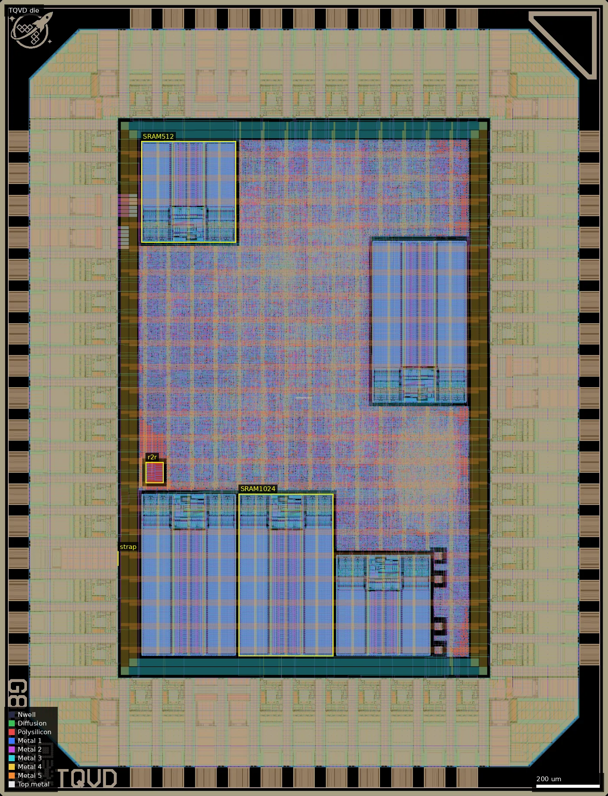
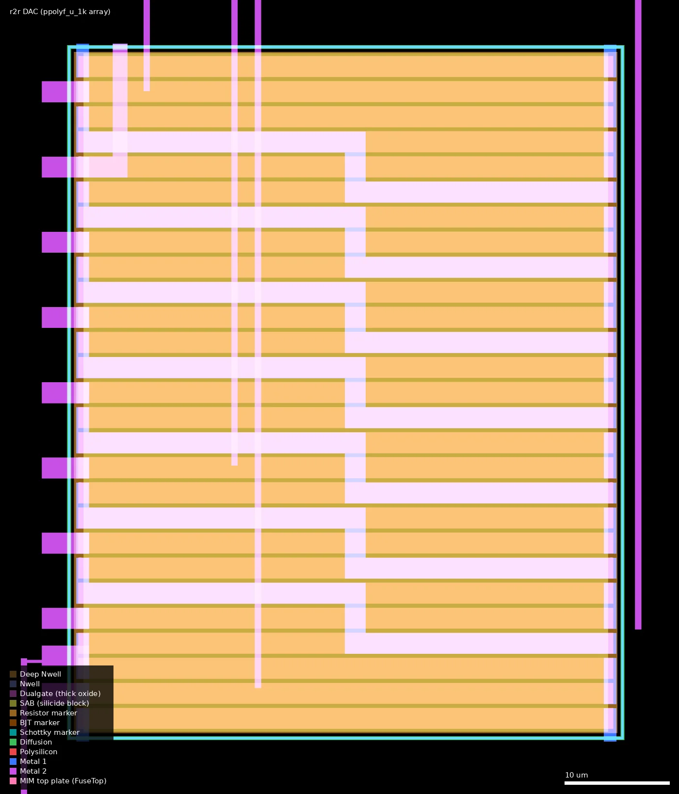
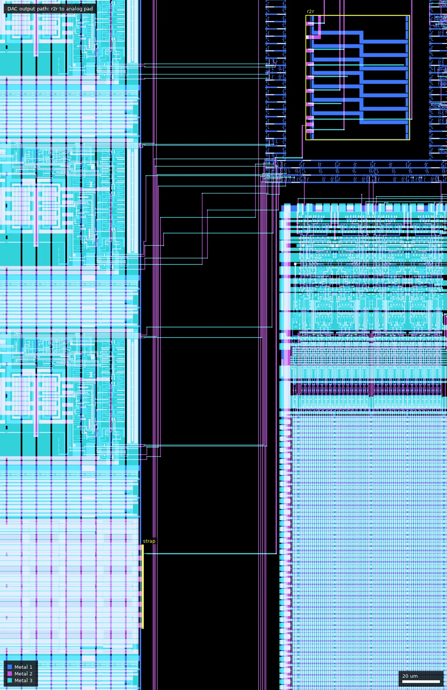

# TQVD: TinyQV - RISC-V SoC with HDMI output (ws-run2)

| | |
|---|---|
| Repository | https://github.com/MichaelBell/ws02-tinyQV @ 1ac951f (main, last commit 2026-07-14); submodule src/tinyQV = MichaelBell/tinyQV @ 5d4c1d4 (2026-07-06); tags v1.0-v1.4; branches main, dac, template |
| Slot | 0.5 x 0.5 (quarter), `0p5x0p5` |
| Top cell | `chip_top` |
| Taped-out layout | `TQVD_chip_top_14_8`, 1936 x 2531 um, 1 placement on the G802 reticle |
| Licence in repo | `LICENSE` = Apache-2.0 (file present; audit: PRESENT, claim unknown) |
| README | OK: 1693 words, about 932 project-specific on top of the template README |

## What the repo actually contains
Second-generation TinyQV SoC (RV32EC core, QSPI flash and PSRAM, Tiny Tapeout competition peripherals) for run 2 on the new 3.3 V stack, replacing the run-1 5 V libraries (see ws-run1 TQVA/B/C, repo ws01-tinyQV). Changes confirmed in the sources:
- 3.3 V standard cells.
- 3.3 V SRAM macros.
- Split core/IO supply pads.
- Much more RAM.
- An 80-column VGA/DVI text console.
- One 8-bit R-2R DAC on an analog pad.

Run-1 peripherals removed to make room: PRISM, VGA tester, AffineX, CORDIC, DWARF.

**Flow and libraries** (`Makefile`, `librelane/config.yaml`, `librelane/macros/macros_3v3.yaml`):
- PDK: gf180mcuD via ciel, `PDK_COMMIT f6eeac7d...`. Release v1.4 "SCL fixes" only bumps this from `d658698b...`, so the library fixes came from the PDK side. Flow: LibreLane Chip flow with `--scl gf180mcu_as_sc_mcu7t3v3 --pad gf180mcu_ocd_io`, SRAM `gf180mcu_ocd_ip_sram`.
- Standard cells: `gf180mcu_as_sc_mcu7t3v3` (7-track, 3.3 V; author of the "as" library not identified in the repo). The Makefile marks `gf180mcu_osu_sc_gp9t3v3` and `gp12t3v3` as "(broken)". v1.4 synthesis gives 17,795 cells, for example 2985 dfxtp_2, 534 dlxtp_2, 2019 and2_2 and 141 dlybuff_2 (hold fix).
- Corners: nom/min/max RC at tt_025C_3v30, ff_n40C_3v60 and ss_125C_3v00. The resizer skips ss "due to tight HDMI timing".
- Clocks: `CLOCK_PERIOD: 38` (26.3 MHz; README says 25.2 MHz) on clk_PAD. `fast_clk` on clk5x_PAD is 0.2 x that (7.6 ns; README says 126 MHz). The CPU clock is muxed (`as_sc mux2_2` in chip_core.sv) between clk and a divide-by-5 of clk5x in HDMI mode (`input[2]` low).
- Pads (`gf180mcu_ocd_io`): separate dvdd/dvss (I/O ring, 3+3 on this slot) and vdd/vss (core, 1+1) cells. `chip_top` ports are VDD, VSS, DVDD, DVSS. Signal pads: in_s (clk), in_c, bi_24t x38, 5 inputs, dedicated clk5x and prog_clk pads, one asig_5p0 analog pad. The I/O supply voltage is not stated in the repo.
- SRAM: five 3.3 V macros.
  - 3 x `sram1024x8m8wm1`: text RAM `i_text.i_sram0/1` and font `i_font.i_sram`.
  - 2 x `sram512x8m8wm1`: CPU scratch `i_scratch.i_sram` and `i_text.i_sram2`.
  - Liberty views: tt 3.30, ff 3.60, ss 3.00 V.
  - Scratch `CEN` goes through a dlybuff_2 ("Delay the CEN to fix long hold", internal_ram.v).
- Custom macros in `ip/`:
  - `ddr_driver` x4 (TMDS D0/D1/D2/CK lanes), built from as_sc cells (dlybuff_2, inv_2, dlxfn_2, dfxtp_2, mux2_4), with GDS/LEF and its own liberty at three corners.
  - `r2r`: DAC ladder, GDS/LEF/blackbox only.
  - `analog_connect`: a Magic-script-generated Metal2/Via2/Metal3 strap, 44.32 x 1 um, with .mag/.tcl.
  - wafer.space id, marker and logo blocks.
- Video (`src/video`): text mode, font, and the smoldvi DVI serialiser (TMDS encoder, gearbox, serialiser). Output is on `bidir[36:29]` as 4 differential pairs. The commit adding HDMI is titled "Implement HDMI (untested)"; there is no hardware evidence in the repo.
- DAC (`src/project.v`, `PERI_DAC=4'hD`): an 8-bit register, optionally streamed from the PWL synth. It is buffered by 8 x `as_sc buff_4` into `r2r` (66.8 x 55.85 um, pins b0-b7, out, VGND). The repo GDS holds one resistor PCell (`ppolyf_u_1k_7HW445`) with 27 strips of 2 x 50 um (see Taped-out layout); the strip count is not documented in the repo. It reaches the pad through `analog_connect`. Routing uses NDRs: dac_out 1.5/0.5 um (HEAD "Wider DAC out"; v1.3 "Increase DAC trace width") and dac_buffered 0.6/0.4 um. VGND is tied to VSS via `PDN_MACRO_CONNECTIONS`. There is no schematic, SPICE or simulation of the DAC, and the README does not document it.
- Verification: cocotb RTL and gate-level (`chip_top_tb.py` 7 tests, `test.py` 12 tests, DVI and VGA decoders).

**Releases:**
- v1.0 (2026-07-02), v1.1, v1.2, v1.3, v1.4 (07-14, "SCL fixes").
- v1.0, v1.1, v1.3 and v1.4 carry full LibreLane log zips of about 0.5 GB each.
- HEAD (19:41) is newer than v1.4 (19:27) and differs from the tag only in `config.yaml` (NDR_1p5 for dac_out).
- Which of these was submitted is not stated. The platform lists an OASIS file, sha256 `f4ab93b2...e0df`, which I did not compare with the release GDS.

**Signoff status from the v1.4 logs** (RUN_2026-07-14_14-36-25):
- LVS, antenna and DRC pass. Magic DRC count is 0, though `ERROR_ON_MAGIC_DRC` is False.
- Hold is clean (worst +0.231 ns, min_ss_125C_3v00).
- Setup is met at all tt and ff corners (worst +0.72 ns, max_tt_3v30).
- Setup is **violated at all three ss_125C_3v00 corners**: worst -3.34 ns, TNS -53 ns, 74 endpoints in total, none reg-to-reg.
- Max-slew violations: 50. Max-cap violations: up to 210 (138 at nominal tt).

## Taped-out layout
| Fact | Measured from the taped-out layout |
|---|---|
| Die | 1936 x 2531 um, one placement at (28.004, 20.788) mm |
| Pads / IO cells | `gf180mcu_ocd_io`: 38 bi_24t, 6 in_c, 3 in_s, 1 asig_5p0 (analog), 3 dvdd + 3 dvss, 1 vdd + 1 vss, 4 corner cells; Metal5 labels `analog_ASIG`, `clk_PAD`, `input_PAD[n]`, `bidir_PAD[n]`, `DVSS` |
| Standard cells | `gf180mcu_as_sc_mcu7t3v3` (mcu7t3v3): 23,689 logic placements, 40,036 fill/tap placements; top types dlybuff_2 3549, dfxtp_2 2993, mux2_2 2395, buff_2 2238, and2_2 2019 |
| SRAM | 3 x `sram1024x8m8wm1` (301.3 x 515.8 um), 2 x `sram512x8m8wm1` (301.3 x 321.9 um) |
| Custom blocks | `ddr_driver` x4 (32.55 x 33.67 um), `r2r` x1 (66.8 x 55.88 um at (464,995)), `analog_connect` x1 (44.3 x 1 um at (376,733)); wafer.space logo, QR, shuttle and project id, marker |
| Thick oxide | Dualgate (55/0) is not present in the logic area, in `r2r`, `ddr_driver` or `analog_connect` (checked with `layout_query layers`); the 39,236 Dualgate shapes on the die are elsewhere (IO cells and SRAM macros, not itemised). The logic area is 3.3 V thin oxide only |
| Resistors | one resistor PCell, `ppolyf_u_1k_7HW445` (27 poly strips) inside `r2r`; no MIM, no BJT cells |

### Does it match the repository?
Yes. The repo has no chip-level GDS at commit 1ac951f, so I compared with the v1.4 release `chip_top.gds.gz` (whose sources differ from HEAD only in `config.yaml`). Die size is identical (1936 x 2531 um) and the top cell has the same 168 distinct child cell names; all counts are identical (the 4 ddr_driver, 5 SRAM, 50 IO cells, r2r, analog_connect) except two router via-array cells: `VIA_via4_5_10000_18000_2_4` 724 (OASIS) vs 726 (v1.4) and `..._4_4` 2172 vs 2178. That is routing-level only, and consistent with HEAD's changed DAC-output routing rule rather than a different design, but I did not run a full XOR so which tag or commit was submitted is still not proven. The repo's `ip/r2r/gds/r2r.gds` is geometrically identical to the `r2r` cell on the die (equal area on every layer), the cell list shows 3.3 V libraries and SRAMs as in the sources, and the die carries the `analog_ASIG` pad.

Overview (whole die, 1936 x 2531 um): the SRAMs are the large blue blocks, r2r sits at (464-520, 995-1062) um and the analog strap at the left edge at y = 733-778 um.

The `r2r` cell (rotated 90 degrees on the die, box 464-520 x 995-1062 um): 27 parallel poly strips (orange, with the resistor marker) joined by Metal1 straps, with the nine Metal2 pins on the left.

Routing close-up of (300-540, 700-1070) um: the `out` pin of r2r runs on Metal3 (cyan) down to the `analog_connect` strap (yellow, 376 um, 733-778 um) at the left, where the analog IO cell sits.

### R-2R DAC (measured)
| Item | Value |
|---|---|
| Cell and position | `r2r` at (464.0, 995.0)-(519.9, 1061.8) um, rotated 90 degrees; contains one PCell `ppolyf_u_1k_7HW445` |
| Resistor type | p+ poly, unsalicided (SAB layer over the whole array), with the Resistor marker 62/0 and RES_MK 110/5; the "1k" in the cell name means the PDK's 1 kOhm/sq flavour (sheet value taken from the name, not measured). No diffusion resistors, no Dualgate or V5_XTOR: 3.3 V-only |
| Unit | 27 identical strips, each 2.0 um wide x 50.0 um long (25 squares, about 25 kOhm each at 1 kOhm/sq), pitch 2.4 um, 0.4 um spacing; no per-strip dummies other than the end strips |
| Matching layout | straight, parallel, same orientation, one block with a continuous P+ guard ring and a ring contact, serpentine Metal1 jumpers between neighbours; strips at both ends (x = 1.2 and 63.6 um in the cell) have their ends on separate nets and look like edge dummies |
| Ladder size | 8 bits (pins b0..b7), `out`, `VGND`: 9 Metal2 pins. Consistent with 25 active unit strips: 8 legs of 2 unit strips (2R), 7 series units, 1 terminating 2R, plus 2 edge dummies = 27. I did not extract the netlist (my quick connectivity trace was not reliable), so which strip is which is not settled |
| Output | `out` is on Metal2/Metal3 and reaches the `analog_connect` strap at (376.5, 755) um, which sits on the `gf180mcu_ocd_io__asig_5p0` pad (`analog_ASIG`, left edge, y about 755 um). Confirmed by flood-filling Metal1 to Metal3 via the vias in the region: that net also touches the strap |
| Drive | b0..b7 are the 8 `buff_4` outputs from the register (mcu7t3v3, 3.3 V logic); `VGND` is tied to VSS in the PDN |

If the strips are 1 kOhm/sq the unit R is about 25 kOhm and the DAC output impedance about 25 kOhm (R); the load, probe and pad leakage matter. T0P3 (ws-run2/T0P3) found a PolyWave R-2R inside Dualgate; this one is a plain straight-strip poly array, outside thick oxide and 3.3 V only, so the two together compare layout style and voltage domain.

## Authors and affiliations
| Person | Role | Affiliation | Source |
|---|---|---|---|
| Mike Bell (MichaelBell) | TinyQV, port, HDMI text mode, DAC (128 commits) | not stated | AUTHORS.md, git shortlog, gh api |
| Leo Moser | wafer.space template, flow, padring, CI (104 commits) | not stated | AUTHORS.md, git shortlog |
| Luke Wren (Wren6991) | DVI serialiser (smoldvi) | not stated | AUTHORS.md |
| Han, Matt Venn, Rebecca G. Bettencourt, Renaldas Zioma, Toivo Henningsson | TinyQV peripherals | not stated | AUTHORS.md |
| "tnt" | credited for the analog-pad connection method (commit 3263656) | not stated | git log |
| Tim 'mithro' Ansell, TrevorPeyton | one template commit each | not stated | git shortlog |

## Value for GF180MCU characterisation and PDK development
### Verdict: Medium
Not a test chip, but an early real design on three new pieces of the 3.3 V stack: the as_sc 7t3v3 library (about 17.8k cells at 25 MHz), five ocd 3.3 V SRAMs and the ocd split-voltage pads. It also has an 8-bit R-2R DAC on an analog pad, a 126 MHz DDR serialiser on ordinary bi_24t pads, and full STA at tt/ss/ff to compare with silicon.

### Test structures and measurable circuits
| Structure | What it exercises | Access | Where |
|---|---|---|---|
| 8-bit R-2R DAC (`r2r` at (464,995) um, 27 strips of ppolyf_u_1k 2 x 50 um) | poly resistor matching and value, DNL/INL, asig_5p0 pad path, M2/M3 strap resistance; 3.3 V only, no Dualgate | write PERI_DAC register from the CPU (or PWL synth); measure the single analog pad with a high-impedance probe (unbuffered) | ip/r2r, ip/analog_connect, src/project.v, config DRT_ASSIGN_NDR |
| as_sc 7t3v3 cell timing, SoC fmax | new 3.3 V library delay vs liberty (3.30/3.00/3.60 V) | CLK pad, supply sweep, flash-boot firmware, UART on bidir[25..28] | config; v1.4 logs 12-staprepnr, 54-stapostpnr |
| Slow-corner setup violations | whether ss_125C_3v00 libs are pessimistic | hot, 3.0 V run; find failing frequency | v1.4 54-openroad-stapostpnr/summary.rpt |
| ddr_driver + TMDS on bi_24t | IO drive/slew at 252 Mbit/s per lane; hand-built macro with own liberty | bidir[29..36]; needs external 126 MHz CLK5x and input[2] low | ip/ddr_driver, src/video/smoldvi*.v |
| 3.3 V SRAMs (512x8, 1024x8) | function, access time, hold (CEN delay fix) | scratch via CPU; text and font RAM via console and video | internal_ram.v, text_ram.v, font.v |
| Split-voltage pads | IO vs core supply independence | board DVDD vs VDD pins | chip_top.sv, slot_0p5x0p5.yaml |

Simulation results to compare with silicon: yes for timing. The v1.0, v1.1, v1.3 and v1.4 log zips have per-corner STA, SDF, power and RCX. Nothing for the DAC.

### Candidate PDK additions
- The repo is a worked example of the full 3.3 V stack: config, `macros_3v3.yaml`, `pdn_3v3_sram.tcl`.
- ddr_driver is a custom DDR serialiser macro with liberty at 3 corners.
- r2r and analog_connect (Magic-built) are a DAC macro and an analog pad strap; the connection method was "suggested by tnt".
- Documented problems:
  - The osu libraries are marked "(broken)".
  - The `template` branch has a "Padring DRC issue repro" commit (2026-06-23) swapping an analog pad for a bidir on ocd pads, with no description of the problem.
  - v1.4 "SCL fixes" only bumps the PDK commit.
  - Inherited workarounds: ERROR_ON_MAGIC_DRC False, a long MAGIC_GDS_FLATGLOB (DUALGATE devices drawn into high-level SRAM cells), Metal2_ignore_active filler, PL_ROUTABILITY_DRIVEN False.

### What would be needed to use it
A packaged or bonded die on a board with separate VDD and DVDD supplies, 25.2 MHz and 126 MHz clocks, QSPI flash and PSRAM, a UART, a DMM or scope for the DAC, and a probe or HDMI sink good for 250 Mbit/s or more. It also needs test firmware sweeping DAC codes and exercising the SRAMs, which is not in the repo. No bring-up notes, test plan or measured data are present.

## Notes and caveats
- The submitted tag or commit is not stated; the die matches v1.4 except for 8 router via-array cells (HEAD differs from v1.4 only in a DAC routing rule). I read the v1.4 logs and the HEAD sources.
- The README does not describe the DAC, the analog pad or the ocd supply split, and gives 25.2 MHz while the SDC constrains 38 ns.
- HDMI is described as untested in commit 7541b2d.
- The `.gitmodules` URL is SSH; the clone was seeded from a mirror.
- The `dac` branch is pre-squash history from 2026-06-22. `template` is the upstream template plus the padring repro. Neither was submitted.
- DAC strip count, unit size and output pad are now measured; the exact ladder connectivity (which strip is which leg) and the true sheet resistance are not, and the digital Dualgate use inside IO and SRAM cells was not examined further.
