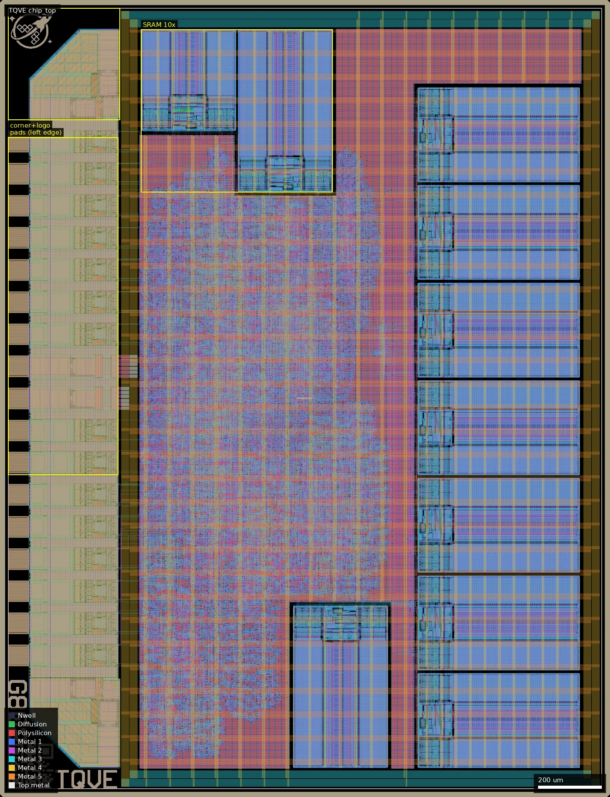
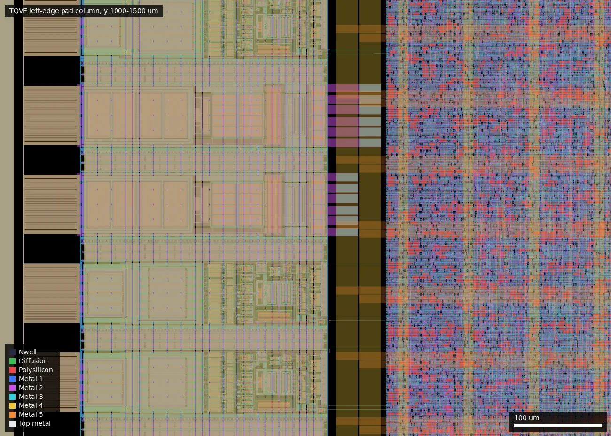
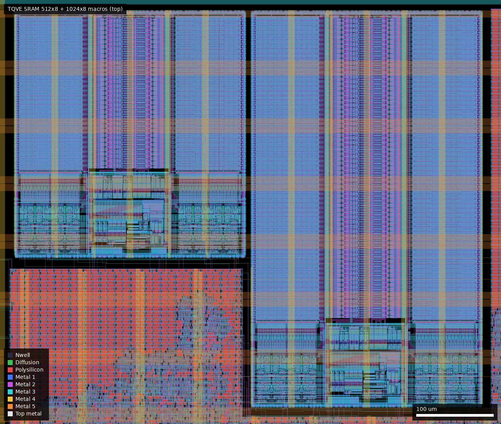
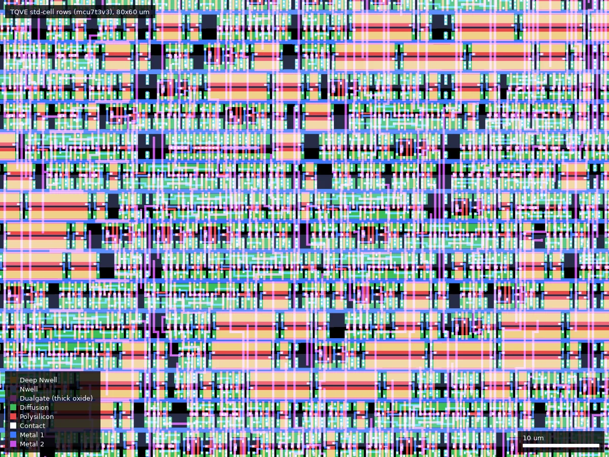

# TQVE: TinyQV - RISC-V SoC with experimental pad setup (ws-run2)

| | |
|---|---|
| Repository | none listed on platform.wafer.space (no public lead found in the layout) |
| Slot | 0p5x0p5 |
| Top cell | chip_top |
| Licence in repo | n/a |
| README | n/a |
| Taped-out layout | TQVE_chip_top_14_7, 1936 x 2531 um, 1 placement on the G802 reticle |

## What the repo actually contains

No repository was listed for this project, so nothing was cloned and there is nothing to audit. The platform description is: "This version of TinyQV uses the new 3v3 standard cell library, 3v3 SRAM macros and a single line of pads to allow more area with fewer pins.  The extra space is used for 9.5kB of scratch RAM.  It also has a USB CDC peripheral which should allow serial comms without an external UART.". The layout (`ws-run2`, `TQVE/chip_top.oas`, SHA256 `67b553d085bad20db1898fc5458e8875a7f82d59a7b519e3bcb8e71c247302e5`) is the only evidence beyond that text and it is the basis of this summary.

## Taped-out layout

| Item | Measured |
|---|---|
| Die | 1936 x 2531 um (same size as TQVD) |
| Standard cells | `gf180mcu_as_sc_mcu7t3v3` (3.3 V, 7-track), 24,213 logic cells (+ 70,319 fill/tap placements); mostly `_2` drive strength |
| Sequential cells | about 3,580 flops: `dfxtp_2` 2,959, `dfsrtp_2` 615, `dfxtn_2` 4; no latch cells in the logic, about 3,919 `dlybuff_2` (16 % of logic cells; hold-fixing delay buffers, inferred) |
| SRAM macros | 10 `gf180mcu_ocd_ip_sram` macros: 9 x `sram1024x8m8wm1` (301.3 x 515.8 um) + 1 x `sram512x8m8wm1` (301.3 x 321.9 um) = 9.5 kB, matching the platform text; the bit-cell sub-cells are named `3v1024x8m81` / `3v512x8m81` (3.3 V version of the ocd macro) |
| IO cells | 17 pad cells, all stock `gf180mcu_fd_io` (foundry IO library): 13 `bi_24t`, 1 `in_c`, 1 `in_s`, 1 `dvdd`, 1 `dvss`, plus 2 `cor` corners and fill cells; 25 shapes on Pad layer |
| Pads (Metal5 labels) | `bidir_PAD[0..12]`, `rst_n_PAD` (in_c), `clk_PAD` (in_s), `VDD`, `VSS` |
| Thick oxide (Dualgate 55/0) | only in the IO cells (about 46 % of the pad strip area); none in the sampled core and SRAM areas; no V5_XTOR (112/1) anywhere in the die |
| Passives / other | no MIM, no DNWELL, no BJT markers; `RES_MK` 282 shapes (150 of them in the pad strip) and `DIODE_MK`/`MOS_CAP_MK` come from the IO cells and SRAM macros. No analog or custom structures |
| Artwork / IDs | wafer.space logo, QR-code ID, project-ID and shuttle-ID cells; the cell `gf180mcu_ws_ip__logo` rocket logo at top-left. No other text or repository URL found (labels are pad names only) |

### What is "experimental" about the pad setup

Seen in the layout: all 17 pad cells sit in one column along the left edge (x 26-376, pitch 102 um from y 449.5 to 2081.5), with corner cells at the left end only. The other three edges have no IO cells; the core power ring and seal ring still run round the die, so the core extends to the right, top and bottom edges. TQVD, with the same die size, has pads on all four edges (about 57 pad cells, `ocd_io` cells). TQVE also has just one `dvdd` and one `dvss` pad for the entire 24 k-cell core and ten SRAMs (extracted connectivity not traced; this is from cell counts), so power delivery and IR drop are a possible issue, and it uses `fd_io` rather than `ocd_io` cells.

### Does it match the repository?

There is no repository to compare with. Against the platform text the layout agrees: 3.3 V `mcu7t3v3`-family library, 3.3 V SRAM macros, 9.5 kB of RAM (9 x 1 kB + 0.5 kB), and a single line of pads. A USB CDC peripheral cannot be identified from cell names (the logic is flat and unnamed); it would use two of the 13 bidirectional pads (inferred). Compared with the already-checked TQVD (`MichaelBell/ws02-tinyQV`, 23,689 logic cells, 5 SRAMs), the logic size is nearly the same (24,213) and the extra area is SRAM, consistent with this being a TinyQV variant (inferred from description and size; the layout carries no author text).

Whole die: pad column on the left edge (box, y 1023-2095 um) with the corner and logo at top-left, the two RAM macros at the top (448-1056, 1921-2437 um), the 7 more 1024x8 macros in a column at the right, and the core logic in the middle left.

Left-edge pad column, x 0-700 um, y 1000-1500 um: bondpads at far left, IO cells (thick oxide, ESD) and the core power ring to their right.

Top of the die (430-1080, 1900-2450 um): the 512x8 macro (left) and one 1024x8 macro (right), with periphery at the bottom of each macro.

Standard-cell rows at 600-680 x 1000-1060 um: plain 3.3 V logic, no Dualgate.

## Authors and affiliations

Not stated. No names on the die. The platform text and the TinyQV/ocd cells suggest the TinyQV author Michael Bell (inferred, not from the layout).

## Value for GF180MCU characterisation and PDK development

### Verdict: Low

A plain digital design on stock cells and standard IO. It would only matter as a large 3.3 V `mcu7t3v3` library sample (24 k cells, about 3.6 k flops, 16 % delay buffers) and as an RAM-heavy 3.3 V ocd SRAM sample (ten macros, same macro family as OCD3). No analog, passives or test structures. The single pad column with one VDD/VSS pair is interesting only as a power-delivery experiment (functional yield and supply droop on a 15-signal part).

Candidate PDK additions: none; the 3.3 V SRAM macros and `mcu7t3v3` library are already the candidates seen in OCD3 and TQVD.

## Notes and caveats

- Not checked: whether the design works, what the logic is, how many pads reach which core nets. Source is unpublished or in an unlisted repository; the TQVD repo's branches and releases do not mention this variant.
- Dualgate/V5_XTOR were checked by layer statistics over sampled boxes (pad strip, core 450-1000 x 500-1800, SRAM 1000-1900 x 200-700), not a full-die boolean.
