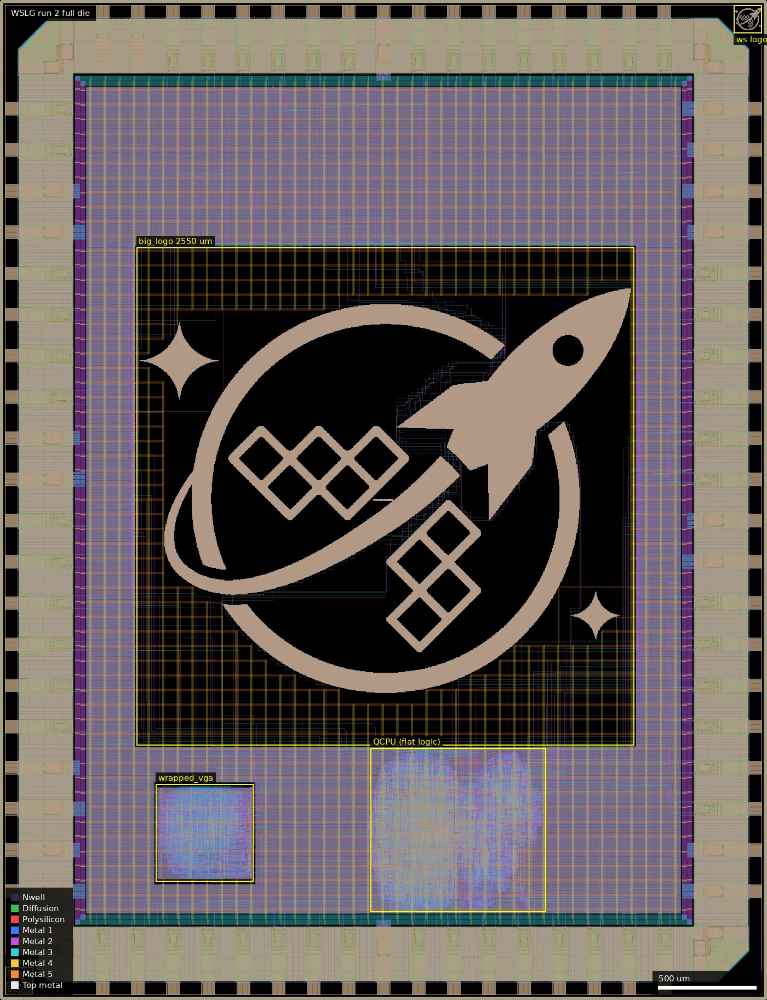

# WSLG: Wafer.Space Logo (ws-run2)

| | |
|---|---|
| Repository | https://github.com/89Mods/ws-logo-die @ 02d2ff4 (main, last commit 2025-12-11 "Initial build") |
| Slot | 1x1 |
| Top cell | chip_top |
| Licence in repo | Apache-2.0 (LICENSE) |
| Taped-out layout | WSLG_chip_top_10_2, 3932 x 5122 um, 1 placement on the G802 reticle |
| README | TEMPLATE (100% the wafer-space project template README, 0 own words) |

## What the repo actually contains

A die whose purpose is a huge wafer.space logo. `big_logo/big_logo.gds` (48 MB) is generated by `big_logo/Makefile` from `wafer_space_logo.png` with the ip logo script (pixel size 3.4 um, foreground layers 34/0 36/0 42/0 46/0 30/0 81/0, boundary 0/0 152/5; layers read as Metal1-4, Poly2 and Metal5, inferred). It is placed at [700,1305] in `librelane/config.yaml`. Besides the logo, the functional content is:

- `src/qcpu.v` (698 lines), `multiplier.v` (2934), `spi.v`, `uart.v`, `wrapped_qcpu.v`: a small CPU with GPIO ports, UART, SPI, SPI-ROM boot and 128x8 RAM as flops, built flat in `chip_top`; selected when `input_in[7]` is high.
- `vga_screensaver/`: TinyTapeout tt-waferspace-vga-screensaver (submodule ef9a2f0) in the `wrapped_vga` macro, 500x500 um, shown when `input_in[7]` is low via 8 VGA bits on the upper bidir pads.
- Standard 5 V cells `gf180mcu_fd_sc_mcu7t5v0` and `gf180mcu_fd_io`, plus the Avalon submodule `gf180mcu_as_ex_mcu7t5v0` at 6b7ac1f (Tholin commits "Dynamic DFF cell", "Fix DRC errors", Dec 10-11 2025). The top macro uses static `dfxtp_2` and excludes `dy_*`; the VGA macro excludes stock `dff*` and static `df*`, so it is built from the dynamic `dy_dfxtp_2`.
- Analog pads are the stock `gf180mcu_fd_io__asig_5p0`; no custom analog.

Not present: final GDS, reports, silicon data; `cocotb/chip_top_tb.py` is the template bench.

## Taped-out layout

| Item | Measured |
|---|---|
| Die | WSLG_chip_top_10_2, 3932 x 5122 um (1x1 slot), 1 placement on the G802 reticle |
| Pads | 74 pad cells on the ring: 40 `gf180mcu_fd_io__bi_24t`, 13 `in_c` + 1 `in_s` (12 inputs + clk + rst_n), 2 `asig_5p0` analog, 8 `gf180mcu_ws_io__dvdd`, 10 `dvss`; 4 corner cells |
| Standard cells | `gf180mcu_fd_sc_mcu7t5v0` (5 V, 7-track) plus Avalon `gf180mcu_as_ex_mcu7t5v0`; 14290 logic cells (layout.json), about 145500 fill/tap/decap cells |
| Flops | 1600 static `dfxtp_2` (QCPU, top level) and 92 dynamic `dy_dfxtp_2` (all in `wrapped_vga`) |
| SRAM | none (the 128x8 CPU RAM is flops) |
| Artwork | `big_logo`, 2550 x 2550 um at (700,1305): 125815 squares of 3.4 x 3.4 um, identical on Poly2 and Metal1-Metal5, 22.4 % of the cell area (1.454 mm2 merged) |
| Oxide | Dualgate 55/0 (240500 shapes) and V5_XTOR 112/1 (159810) everywhere on standard cells and IO cells: all active devices are 5/6 V thick-oxide; no thin-oxide-only logic |
| MIM / high-res poly / DNWELL | none: no MIM or DNWELL layer shapes; RES_MK (1068 shapes) and DIODE_MK markers occur only inside library and pad cells, not in user-drawn devices (marker origin not examined cell by cell) |
| Metal top | no MetalTop (53/0) and no Via5; stack stops at Metal5 |
| Other | Metal1-5 slot cells (`Metal*_Slot`, 2 x 10 um, 3909 per layer) in a 2420 x 2045 um array at (796,1585); `gf180mcu_ws_ip__logo` 143 x 143 um at (3763,4953) and `gf180mcu_ws_ip__id` 143 x 143 um at (26,26) (chip-ID block, 214 rectangles per metal layer, Metal1-5 only) |

### Does it match the repository?

The repository has no final chip GDS (only `big_logo/big_logo.gds` and the IP cells), so the comparison is against sources and config. Agrees: top-level blocks (`big_logo` at the configured [700,1305], one `wrapped_vga` 500 x 500 um, flat QCPU logic), cell libraries (stock 5 V `mcu7t5v0` plus `gf180mcu_as_ex_mcu7t5v0`), pad counts (`slot_defines.svh` for 1x1: 12 inputs + 40 bidir + 2 analog + 8 DVDD + 10 DVSS), and the dynamic-flop split: all 92 `dy_dfxtp_2` are inside `wrapped_vga` and there are none in the top level, which uses only static `dfxtp_2`.

The artwork was checked shape by shape against `big_logo.gds` at the repository commit: same 2550 x 2550 um boundary, same 125815 pixels on Poly2 and Metal1, Metal4 (XOR zero); Metal2 has 8 fewer pixels in the taped-out cell, Metal3 3 fewer and Metal5 7 fewer (merged area lower by 92, 35 and 81 um2). The cause was not determined (the flow's placement or PDN may have clipped them); it does not change the picture. The summary's earlier "inferred" layer reading is settled: the six layers are Poly2 (30/0) and Metal1-5 (34/36/42/46/81), and the layout confirms it.

The overview shows the pad ring around a power-gridded core; the logo is the only artwork on the die proper (the beige film is Metal5, on top of the stack) at (700,1305)-(3250,3855) um, with the VGA macro at (800,605)-(1300,1105) um and the flat QCPU logic at about (1900,450)-(2800,1290) um (boxed by eye from the image).

### Artwork and digital logic

Artwork: a bitmap (1 bit per 3.4 um pixel) of the wafer.space logo drawn as stacked squares on Poly2 and Metal1-Metal5 with no contacts, vias, COMP or implant under it. Geometry shows no contacts or vias inside the logo cell, so the six layers are separate stacked patterns (connectivity was not extracted). Digital logic: a QCPU (flat, 1600 static flops, 128x8 RAM as flops, multiplier, SPI, UART) and the VGA screensaver macro (11597 placements including fill; 92 dynamic flops). No custom analog or test structures, SRAM, MIM, DNWELL or eFuse.

## Authors and affiliations

| Person | Role | Affiliation | Source |
|---|---|---|---|
| Leo Moser | template (74 commits) | not stated | git log, AUTHORS.md |
| Tholin (89Mods) | "Initial build", the cell library | Avalon Semiconductors (Germany) | GitHub profile, ex-cell submodule history |
| Tim Ansell, TrevorPeyton | template commits | not stated | git log |

## Value for GF180MCU characterisation and PDK development

### Verdict: Medium

The logo is a very large poly + Metal1-5 pattern (22 % of a 2550 x 2550 um cell; a density/DRC corner case, no measurement), but the VGA macro is the first use of the dynamic `dy_dfxtp_2` cell as the only flop type (92 instances on the die), so VGA correctness versus minimum clock is a dynamic-DFF retention test. The layout confirms the verdict.

### Test structures and measurable circuits

| Structure | Exercises | Access | Where |
|---|---|---|---|
| `wrapped_vga`, 92 `dy_dfxtp_2` (16.5 x 4.8 um each) | dynamic DFF minimum clock / retention | VGA outputs, HSYNC/VSYNC on the 8 upper bidir pads when `input_in[7]` low | cell `wrapped_vga`, (800,605)-(1300,1105) um |
| QCPU in top level, 1600 static Avalon `dfxtp_2` | max clock vs liberty | GPIO/UART pins when `input_in[7]` high | flat in `chip_top`, about (1900,450)-(2800,1290) um |
| Big logo, 125815 pixels on Poly2 + Metal1-5 | metal/poly density, DRC (Metal2 fill treated specially) | visual only | cell `big_logo`, (700,1305)-(3250,3855) um |

### Candidate PDK additions

Dynamic DFF cell `dy_dfxtp_2` (lef/lib/gds/verilog) in the ex library, 5 V. Config notes: KLAYOUT_FILLER_OPTIONS Metal2_ignore_active; OpenROAD halo workaround (issue 8868).

### What would be needed to use it

Packaged part, 5 V, a pixel-clock source whose frequency can be lowered, a VGA monitor or logic analyser. No test plan.

## Notes and caveats

- **Run 1 comparison.** The run 1 submission of this project (same repository and commit) is the same layout: an XOR of 22 layers (COMP, Poly2, Contact, Metal1-5, Via1-4, Pad, Dualgate, V5_XTOR, Nwell, LVPWELL, Pplus, Nplus, PR_bndry, MOS_CAP_MK, metal labels) found zero differing area, child counts and logic cell counts match exactly (14290 logic cells, 92 `dy_dfxtp_2`, 1600 `dfxtp_2`), and the chip-ID block is geometrically identical too (214 rectangles per metal layer, no XOR). Only cell-name suffixes (`$n`) differ. The run 2 file is therefore a re-submission of the same silicon design in a different file format (OASIS rather than GDS), not a new build.
- The repo has no final GDS, so layout-versus-repo agreement rests on sources, config and the logo GDS (see above).
- The die is all 5 V thick-oxide logic (Dualgate + V5_XTOR); there is no 3.3 V-only transistor, MIM, high-res poly or DNWELL to characterise.
- The extraction of connectivity (does a pad reach the VGA macro) was not run; pad-to-block assignment follows the RTL, not an extracted netlist.
- Dummy fill, seal ring and ID marks were added by wafer.space; they are not counted above.
